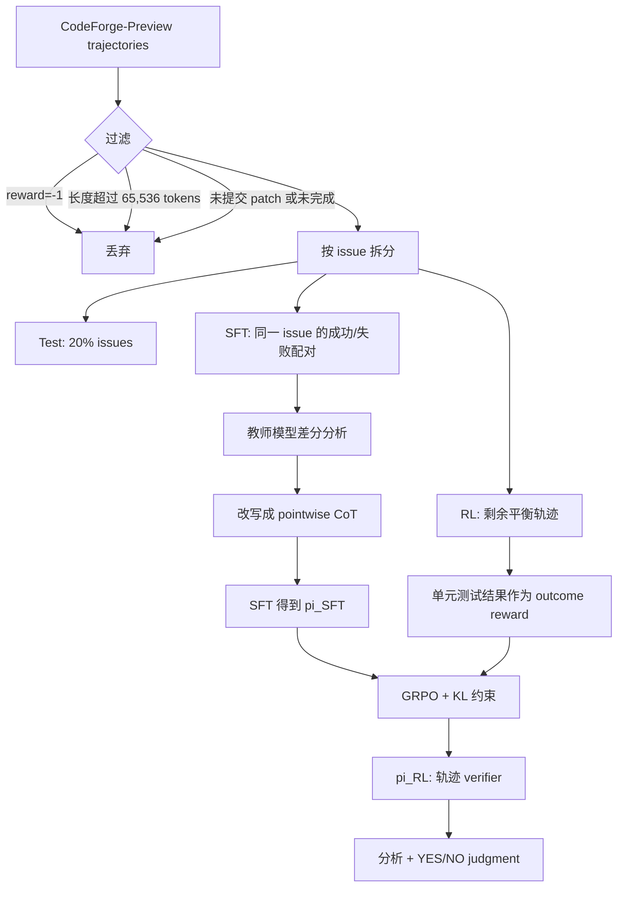

# SWE-Critix：给 Coding Agent 轨迹训练一个会解释的通用 verifier

## 元信息

- 原文：SWE-Critix: Post-Training Generalist Verifiers for Assessing Coding-Agent Trajectories
- 链接：https://arxiv.org/abs/2610.13356
- 版本：arXiv:2610.13356v1，2026-10-09 提交；arXiv cs.AI recent 在 2026-10-12 当前周列表中收录。
- 作者：Jiajun Hu, Chun Yong Chong
- 代码与模型：
  - GitHub：https://github.com/SWE-Critix/SWE-Critix
  - Hugging Face：https://huggingface.co/SWE-Critix
- 本文定位：大模型 Agent 与大模型后训练交叉。它不训练一个写代码的 agent，而是训练一个判断 coding-agent 轨迹是否真正解决任务的 verifier。

## TL;DR

- **问题**：coding agent 的任务越来越像真实软件工程，轨迹会包含仓库阅读、文件修改、命令执行、测试反馈和多轮修复；很多场景没有一个现成 oracle 能告诉我们“这个 agent 到底做成了吗”。
- **方法**：SWE-Critix 把 verifier 也当成一个可后训练的 LLM。输入是 issue 描述和完整执行轨迹，输出先给自然语言分析，再给 `<judgment>YES/NO</judgment>`。
- **训练路线**：先用教师模型对同一 issue 的成功轨迹和失败轨迹做差分分析，生成 CoT 监督；再用 SFT 让 Qwen3-30B-A3B 学会“总结轨迹、识别错误、做因果判断”；最后用 GRPO 与单元测试结果构造的 outcome reward 做 RL。
- **数据规模**：底座来自 CodeForge-Preview，原始 258K test-verified 轨迹，覆盖 51K issues 和 1,655 repositories；过滤掉超过 64K tokens 或没有提交 patch 的轨迹后，SFT 只用 10,390 条带 CoT 样本，RL 使用其余 91.3% 训练数据。
- **关键结果**：在 43,445 条 held-out test 轨迹上，Qwen3-30B-A3B 准确率 57%，SFT 后 66%，RL 后 78%；RL 模型的正类 F1 为 0.84，负类 F1 为 0.66。
- **最重要的局限**：这仍是 preliminary evaluation。负类 recall 只有 64%，R2E-Gym 子集显著低于 SWE-Rebench 和 SWE-Smith；训练和评测都强依赖 test-result ground truth，尚未证明能在没有测试 oracle 的真实任务中直接替代人工审查。
- **研究意义**：它把“agent 评测”从 benchmark 分数推进到轨迹级监督问题：未来 coding-agent RL、审计、回放调试和失败恢复，都可能需要这种能读完整过程、给出解释、还能被继续训练的 verifier。

## 1. 研究问题：为什么 final patch 不够看？

### 1.1 Coding agent 的可验证性正在变成瓶颈

作者的出发点不是“再做一个 SWE-Bench 分数”，而是指出一个更基础的监督缺口：

- coding agent 已经不只是生成一段函数。
- 它会阅读仓库、检索上下文、编辑多个文件、执行测试、解释报错、继续修复。
- 一条轨迹可能跨越几十到几百轮交互，LoLBench 这类任务的轨迹甚至能达到 53 到 532 turns，并且平均包含百万级 tokens。

这意味着 verifier 面临的对象不再是一个最终答案，而是一个“过程对象”：

| 观察对象 | 能回答的问题 | 看不到的风险 |
|---|---|---|
| 最终 patch | 代码是否像一个可提交解 | 中间是否误读需求、删测试、绕过失败、污染环境 |
| 测试结果 | 当前测试是否通过 | 测试是否覆盖真实要求、失败原因是否可解释 |
| 完整轨迹 | agent 如何形成判断、何处出错、是否恢复 | 成本高，长上下文难读，需要专门 verifier |

SWE-Critix 的 claim 是：**真实 coding-agent verifier 应该同时看 outcome 和 process，而且不能只给一个 scalar reward。**

### 1.2 论文的二维 taxonomy

论文先给出一个 verifier taxonomy，把已有工作放到两个轴上：

- **验证目标**
  - Outcome：只看最终结果或 patch。
  - Process：看完整执行过程。
- **构造方式**
  - Training-free：直接用通用 LLM、规则、rubric 或测试生成。
  - Training-based scalar：训练一个给分模型或 critic。
  - Training-based generalist：训练一个能读轨迹、解释判断、输出结构化结论的模型。

| 构造方式 | Outcome verifier | Process verifier |
|---|---|---|
| Training-free | Agentless、LLM-as-a-Verifier、Trae、Agentic Rubrics | SWE-PRM、Wink、TrajDebug、SWE-Prime、ProcCtrlBench、RETRACE、LivePlan、AgentLens |
| Training-based scalar | SWE-Gym、R2E-Gym、DeepSWE、SWE-RM、Dockerless、SWE-TRACE | OpenHands Critic、Critic Rubrics 等 |
| Training-based generalist | Agentic Rubrics、ExecCritic、SWE-Review | SWE-Critix 所在位置 |

这个表的意义不只是分类。它说明作者要填的空白是：

1. verifier 不是只判最终 patch。
2. verifier 不是只给 reward。
3. verifier 要能把成功或失败的因果链写出来。
4. verifier 需要通过 SFT 与 RL 继续后训练，而不是靠 prompt 临场发挥。

## 2. 方法主张：用“差分 CoT + SFT + RL”训练轨迹 verifier


### 2.1 输入与输出

SWE-Critix 的 verifier 输入是：

- issue 或 requirement 描述；
- agent 解决该任务的完整 trajectory；
- trajectory 内含工具调用、仓库反馈、代码改动、测试输出和最终提交行为。

输出是两部分：

1. 自然语言分析：
   - 轨迹摘要；
   - 错误类型识别；
   - 成功或失败的因果解释。
2. 结构化判断：
   - `<judgment>YES</judgment>`
   - `<judgment>NO</judgment>`

用公式化方式写，就是：

```text
输入 x = (issue_specification, trajectory)
模型 y ~ pi_theta(. | x)
输出 y = (analysis, judgment)
judgment in {YES, NO}
```

作者真正关心的不是让模型“会说理由”，而是让理由服务于判断：

- 如果 trajectory 失败，分析应该指出失败机制。
- 如果 trajectory 成功，分析应该指出哪些动作和证据支撑成功。
- 如果模型只复述过程却不能区分成功失败，它不是 verifier，只是 summarizer。

### 2.2 差分 CoT 标注

SWE-Critix 没有让教师模型逐条孤立评价轨迹，而是先找同一个 issue 下的一条成功轨迹和一条失败轨迹，让教师模型做 pairwise differential analysis。

这个选择有三个动机：

- 同一 issue 固定了需求和仓库背景，减少“任务不同导致轨迹不同”的噪声。
- 成功和失败并排出现，教师更容易指出关键差异。
- 差分分析可以产生更像诊断报告的 CoT，而不是泛泛的“看起来完成了”。

教师输出包含：

| CoT 片段 | 作用 |
|---|---|
| issue specification | 压缩任务目标，避免 verifier 忘记原始需求 |
| trajectory summary | 说明 agent 做了什么 |
| mistake categories | 标注常见或新增错误类型 |
| differential reasoning | 对比成功和失败轨迹的分叉点 |
| taxonomic analysis | 将行为映射到错误分类 |
| causal analysis | 解释为什么成功或失败 |

但最终 verifier 的使用场景是 pointwise judgment，也就是一次只看一条轨迹。为避免 CoT 里残留“另一条轨迹”的比较语言，作者又用教师模型把这些片段改写成单条轨迹可用的版本。

### 2.3 SFT：先教会模型怎么读轨迹

SFT 阶段使用的是 Qwen3-30B-A3B-Thinking-2507 作为底座，保留 Qwen 的 thinking template。

损失函数是标准自回归交叉熵：

```math
L_SFT(theta) =
- E_{(x,y) ~ D_SFT} [
  sum_{t=1}^{|y|} log pi_theta(y_t | x, y_{<t})
]
```

变量解释：

| 符号 | 含义 |
|---|---|
| `x` | issue 与 trajectory 组成的 prompt |
| `y` | CoT 分析加最终 judgment |
| `D_SFT` | 带教师 CoT 的 SFT 数据 |
| `theta` | verifier 模型参数 |

SFT 在论文里承担的是“冷启动”角色：

- 它让模型学会输出格式。
- 它让模型先学轨迹摘要和错误分类。
- 它缓解 base model 倾向于把轨迹判为成功的偏置。

### 2.4 RL：再用测试结果训练判别能力

RL 阶段不再需要教师 CoT，而是使用单元测试结果作为 outcome reward。

目标函数写成：

```math
max_pi_theta E_{x ~ D_RL, y ~ pi_theta(.|x)} [r(x,y)]
- beta * KL(pi_theta || pi_SFT)
```

奖励函数很简单：

```math
r(x,y) =
  +1, if y_ans = YES and trajectory passes tests
  +1, if y_ans = NO  and trajectory fails tests
  -1, otherwise
```

这个设计的含义很直接：

- 单元测试不是最终要替代的 verifier，而是训练阶段可用的自动监督。
- verifier 要学习的是“从轨迹证据推断测试成败”，不是运行测试本身。
- KL 项限制 RL 不要偏离 SFT 后的解释型行为。

作者使用 GRPO，group size 为 8，从 `pi_SFT` 初始化训练出 `pi_RL`。

## 3. 数据：CodeForge-Preview 如何被改造成 verifier 训练集？

### 3.1 原始数据规模

SWE-Critix 使用 CodeForge-Preview，这个数据集包含：

| 指标 | 数值 |
|---|---:|
| 总轨迹数 | 258K |
| 通过轨迹 | 155K |
| 失败轨迹 | 103K |
| issues | 51K |
| repositories | 1,655 |
| agent scaffold | OpenHands |
| 生成模型 | Qwen3-Coder-480B |
| 下游来源 | R2E-Gym、SWE-Rebench、SWE-Smith |

GitHub README 给出更细的 token 长度特征：

| 来源 | Issues | Repos | Trajs | Passed Trajs | Median Len | Average Len | P99 Len |
|---|---:|---:|---:|---:|---:|---:|---:|
| R2E-Gym | 4,216 | 9 | 32,964 | 20,904 | 39,599 | 42,149 | 83,549 |
| SWE-Rebench | 9,764 | 1,577 | 77,169 | 44,739 | 41,996 | 45,236 | 99,391 |
| SWE-Smith | 37,221 | 124 | 148,001 | 89,501 | 36,008 | 39,313 | 88,101 |
| Total | 51,201 | 1,655 | 258,134 | 155,144 | 38,052 | 41,398 | 91,150 |

这些长度解释了为什么普通 LLM-as-judge 很难稳定工作：输入不是几段 diff，而是长轨迹、长上下文和稀疏失败信号。

### 3.2 过滤规则

作者进一步丢弃三类轨迹：

1. `reward == -1`：CodeForge-Preview 中这个值意义不清。
2. 轨迹长度超过 65,536 tokens：超出训练可控长度。
3. incomplete trajectory：agent 自己没有认为任务完成，作者用 Qwen3.5-27B 判断最终 assistant message 是否表示完成。

论文正文说过滤掉约 16% 数据。过滤后再拆成三部分：

| 集合 | 构造方式 | 目的 |
|---|---|---|
| Test | 随机选择 20% issues，使用这些 issues 的所有轨迹 | held-out 评估 |
| SFT | 在剩余 issues 中，若同时有成功和失败轨迹，各抽一条 | 用差分 CoT 教会解释与判断格式 |
| RL | 剩余轨迹中先保留所有失败轨迹，再 round-robin 抽成功轨迹平衡类别 | 用测试结果做 outcome reward |

SFT 集包含 10,390 条轨迹，只占训练集 8.7%。这说明作者并不试图给所有轨迹生成昂贵 CoT，而是用少量高质量教师分析初始化，再把大量无 CoT 数据留给 RL。

## 4. 训练配置：这不是轻量实验


### 4.1 SFT 配置

| 项目 | 设置 |
|---|---|
| 基座 | Qwen3-30B-A3B-Thinking-2507 |
| 框架 | MindSpeed-LLM |
| 硬件 | 16 nodes，每节点 8 张 Ascend 910B1/B2 64GB，总计 128 张 NPU |
| 训练轮数 | 3 epochs |
| 迭代数 | 975 iterations |
| 用时 | 约 15 小时 |
| checkpoint | `pi_SFT`，Hugging Face 已公开 |

README 中还给出分布式参数：

- TP = 2
- PP = 2
- EP = 16
- ETP = 1
- CP = 16
- Global Batch Size = 32
- Sequence Length = 71,680
- Save Interval = 325

这里有一个值得注意的工程点：SFT 不是短上下文训练。它显式把 sequence length 拉到 71,680，以容纳 coding-agent 轨迹。

### 4.2 RL 配置

| 项目 | 设置 |
|---|---|
| 初始 checkpoint | `pi_SFT` |
| 框架 | VeRL |
| rollout backend | vLLM |
| training backend | Megatron |
| 算法 | GRPO |
| group size | 8 |
| 硬件 | 8 Atlas A3 nodes，每节点 16 张 Ascend 910C 64GB，总计 128 张 NPU |
| 迭代数 | 3,396 iterations |
| 用时 | 约 533 小时 |
| checkpoint | `pi_RL`，Hugging Face 已公开 |

README 还特别提示：实验使用的 VeRL image 内 vLLM 0.18.0 尚不支持 Router Replay。这会导致 MoE rollout 与 training 之间的专家路由不能保证完全复现。

这条 note 很关键，因为它提醒读者：

- RL 曲线和最终结果不是“无条件可复现”的纯算法结论。
- MoE 模型训练存在系统栈细节。
- 如果换成支持 Router Replay 的后续版本，结果可能有差异。

## 5. 实验结果：SFT 解决偏置，RL 提升判别

### 5.1 总体结果

论文只做 preliminary evaluation，聚焦二分类能力：轨迹是否成功。

| 模型 | Accuracy | Precision+ | Recall+ | F1+ | Precision- | Recall- | F1- |
|---|---:|---:|---:|---:|---:|---:|---:|
| Qwen3-30B-A3B | 0.57 | 0.66 | 0.85 | 0.75 | 0.75 | 0.00 | 0.01 |
| SWE-Critix SFT | 0.66 | 0.78 | 0.67 | 0.72 | 0.49 | 0.62 | 0.55 |
| SWE-Critix RL | 0.78 | 0.82 | 0.85 | 0.84 | 0.69 | 0.64 | 0.66 |

这张表里最值得读的是负类指标：

- base Qwen3 的负类 recall 接近 0，说明它几乎不会把轨迹判为失败。
- SFT 把负类 recall 拉到 0.62，说明教师 CoT 和格式训练显著缓解“默认成功”偏置。
- RL 继续把 accuracy 拉到 0.78，同时保持正类 recall 0.85，并把负类 precision 提到 0.69。

换句话说：

```text
Base model:
  容易说 YES，像是乐观审稿人。

SFT:
  学会按格式读轨迹，开始承认失败存在。

RL:
  在不显著牺牲成功轨迹识别的情况下，进一步提升总体判别。
```

### 5.2 分数据集结果

| 子集 | Base Acc | SFT Acc | RL Acc | 观察 |
|---|---:|---:|---:|---|
| R2E-Gym | 0.60 | 0.52 | 0.62 | 最弱，SFT 还低于 base |
| SWE-Rebench | 0.56 | 0.71 | 0.78 | SFT 和 RL 都明显有效 |
| SWE-Smith | 0.56 | 0.66 | 0.82 | RL 提升最大 |
| All | 0.57 | 0.66 | 0.78 | 总体呈阶梯式提升 |

R2E-Gym 是一个反例。它提醒我们：

- SFT 并不是普遍单调提升。
- 数据来源和任务分布会影响 verifier 能否学到稳定失败模式。
- 作者推测 R2E-Gym 数据量较小，可能导致迁移更差。

### 5.3 结果能证明什么，不能证明什么？

| 结论 | 证据 | 边界 |
|---|---|---|
| 训练 verifier 有用 | All accuracy 57% 到 66% 到 78% | 只评估二分类，不评估分析质量 |
| SFT 能修正输出格式和正类偏置 | base 9.6% 输出格式不合规，负类 recall 近 0；SFT 后格式严格遵循 prompt | 没有单独 ablation CoT 内容与格式模板 |
| RL 提升判别能力 | RL 总体 accuracy 78%，正类 recall 回到 85% | reward 来自单元测试，无法覆盖无测试 oracle 场景 |
| 失败轨迹仍更难 | RL 负类 recall 64% | 失败模式多样，错误信号可能很隐蔽 |

## 6. 伪代码：SWE-Critix 的训练流程



```text
Input:
  CodeForge-Preview trajectories
  Unit-test outcomes pass/fail
  Base model Qwen3-30B-A3B-Thinking-2507
  Teacher model for pairwise differential analysis

State:
  D_raw = all test-verified trajectories
  D_filtered = []
  D_sft = []
  D_rl = []
  D_test = []

Procedure:
  for trajectory in D_raw:
    if reward == -1:
      skip
    if token_length > 65536:
      skip
    if no submitted patch or incomplete final message:
      skip
    add trajectory to D_filtered

  sample 20 percent issues into D_test

  for each remaining issue:
    if issue has both pass and fail trajectories:
      select one pass and one fail trajectory
      teacher compares the pair
      teacher writes summary, mistake taxonomy, differential reasoning, causal analysis
      rewrite pairwise CoT into pointwise CoT
      add both trajectories to D_sft

  add remaining failed trajectories to D_rl
  round-robin sample passed trajectories until D_rl is balanced

  pi_sft = SFT(base_model, D_sft)

  for each RL step:
    sample prompt x from D_rl
    generate y with pi_theta
    extract y_ans from <judgment> tag
    reward = +1 if y_ans matches unit-test outcome else -1
    update pi_theta with GRPO and KL(pi_theta || pi_sft)

Output:
  pi_rl = SWE-Critix verifier
```

失败边界也要写进伪代码：

- 如果 trajectory 缺少可解释的最终提交，训练它判断成败意义不大。
- 如果测试本身不可靠，reward 就会把 verifier 训练到错误监督上。
- 如果轨迹太长而被截断，模型可能学到的是上下文缺失后的伪判断。

## 7. Figure 与 Table 逐项证据解读

### 7.1 Figure 1：为什么流程图是本文核心证据？

Figure 1 把数据拆分、CoT 标注、SFT、RL 和应用串成一张图。它支撑的 claim 是：

- SWE-Critix 不是单阶段 fine-tune。
- CoT annotation 只用于 SFT 的小数据冷启动。
- RL 利用大量没有 CoT 的轨迹继续提升判断。
- 最终应用中，模型不再需要 pairwise 轨迹，而是 pointwise 读单条轨迹。

但 Figure 1 不能证明：

- CoT 的每个字段都必要。
- 差分标注优于逐条标注。
- 输出的自然语言分析真的忠实于轨迹。

这些仍需要 ablation 或人工质量评测。

### 7.2 Figure 2：训练曲线证明了什么？

训练动态图显示：

- SFT 阶段 LM loss 下降，说明模型能拟合教师 CoT 格式。
- RL 阶段 reward 上升，说明模型越来越会匹配单元测试标签。

但它不等价于：

- verifier 的解释质量上升。
- verifier 能发现无测试覆盖的语义 bug。
- verifier 可泛化到人类真实需求验收。

### 7.3 Table 1：结果表最尖锐的地方

Table 1 的关键不只是 78% accuracy，而是 base model 的失败轨迹识别几乎崩掉：

- All negative recall：0.00。
- All negative F1：0.01。
- 作者还观察到 9.6% base 输出格式不合规。

这说明通用 reasoning model 即便强，也不天然适合做长轨迹 verifier。它可能读到了很多“agent 做了很多事”的表面证据，却缺少把失败信号压过成功叙事的训练。

## 8. 相关工作位置：它与 reward model、PRM、LLM-as-judge 的差别

### 8.1 与 scalar reward model 的差别

普通 reward model 或 critic 往往输出一个分数：

```text
trajectory -> reward
```

SWE-Critix 要输出：

```text
trajectory -> analysis -> YES/NO
```

这个差别在 agent 场景很重要：

- 分数能用于优化，但很难审计。
- 自然语言分析能帮助定位失败，但可能幻觉。
- SWE-Critix 的价值在于尝试把两者合在一起：既能被 RL 后训练，又能给出解释。

### 8.2 与 training-free LLM judge 的差别

LLM-as-judge 的优势是便宜、灵活、无需训练；弱点是：

- 长轨迹输入成本高。
- 输出格式和判断标准不稳定。
- 面对失败轨迹容易被 agent 的自信叙述影响。

SWE-Critix 的思路是把 judge 专门化：

- 用真实 coding-agent 轨迹训练；
- 用差分 CoT 教它读过程；
- 用测试标签提供可规模化 reward。

### 8.3 与 PRM 的差别

Process Reward Model 通常给 step-level reward 或过程分数。SWE-Critix 的过程性不是逐步打分，而是读完整轨迹后做整体解释。

| 模型类型 | 监督粒度 | 输出 |
|---|---|---|
| PRM | step-level 或局部过程 | 分数或局部反馈 |
| Outcome RM | 最终结果 | scalar reward |
| SWE-Critix | 完整 trajectory | CoT-style analysis + YES/NO |

这也带来一个 trade-off：

- SWE-Critix 更适合审计和最终判断。
- 它不一定适合实时中断 agent 或逐步引导 agent 修正。

## 9. 开源与可复现性

本轮核验到的公开材料包括：

| 材料 | 状态 |
|---|---|
| arXiv abstract / PDF / TeX source | 可访问 |
| GitHub repository | 2026-10-12 更新，含 README、prompt_templates、scripts |
| HF SFT checkpoint | `SWE-Critix-Qwen3-30B-A3B-SFT-Epoch3` |
| HF RL checkpoint | `SWE-Critix-Qwen3-30B-A3B-RL-Step-3396` |
| HF SFT dataset | `alpaca_style_sft_dataset`，10K 到 100K 规模标签 |
| HF RL dataset | `rl_dataset`，100K 到 1M 规模标签 |
| 训练脚本 | SFT 与 RL 脚本均在 GitHub |

仍需谨慎的地方：

- 数据集 license 是 mixed-upstream-licenses，复用时要检查各来源限制。
- 训练高度绑定 Ascend / MindSpeed / VeRL / vLLM / Megatron 栈。
- README 明确说 vLLM 版本不支持 Router Replay，MoE rollout 与 training 存在可复现性风险。
- 论文没有给出人工评审验证 CoT 解释质量的结果。

## 10. 核心判断与证据边界

### 10.1 我认为最强的结论

**SWE-Critix 最有价值的贡献不是 78% accuracy，而是把 coding-agent trajectory verification 形式化成一个后训练问题。**

它把三件事连起来：

1. 真实 agent 轨迹足够长，通用 judge 不稳定。
2. 测试结果能作为训练监督，但不能直接替代解释。
3. 差分 CoT 可以作为小规模冷启动，让模型学会读过程和说理由。

这个方向对后训练很有启发：

- agent 的 RL 需要 verifier。
- verifier 自己也需要 post-training。
- verifier 的训练数据来自 agent 轨迹，而不是普通 instruction following 数据。

### 10.2 最强的反证风险

这篇论文仍有几个没解决的问题：

| 风险 | 为什么重要 |
|---|---|
| 负类 recall 64% | 如果失败轨迹漏判，verifier 用于安全或发布门禁时仍会放过大量坏轨迹 |
| 测试 oracle 依赖 | 真正缺 oracle 的任务，恰恰是作者开头说最需要 verifier 的场景 |
| CoT 忠实性未评估 | 模型可能给出看似合理但不对应真实失败原因的解释 |
| 缺少强闭源/开源 judge 对比 | 未来需要和 GPT-6 Astra、GLM-5、DeepSeek-V4.1 等前沿模型比较 |
| 缺少 downstream 应用 | 还不知道 verifier 能否帮助 agent 修复失败轨迹或作为 RL reward model |

### 10.3 失败模式细读：为什么“失败轨迹”更难？

论文里最值得警惕的数字不是总体准确率，而是负类 recall。`pi_RL` 在所有测试样本上的负类 recall 是 0.64，意味着如果把失败轨迹看成需要拦下的风险样本，仍有约三分之一会被判成成功。

这不是一个小瑕疵，原因有三层：

| 层次 | 具体机制 | 对 verifier 的影响 |
|---|---|---|
| 轨迹叙事层 | agent 常常会写出自信的完成总结，即使 patch 没有解决问题 | verifier 容易被“完成感”误导 |
| 失败信号层 | 失败可能藏在某个测试日志、边界条件、缺失文件或未覆盖路径里 | 长上下文中负证据稀疏 |
| 数据分布层 | 成功轨迹和失败轨迹可能共享大量相同前缀与相似修复动作 | 二分类边界不等于表面行为差异 |

因此，SFT 能把模型从“几乎全判成功”拉回到会识别失败，是一个重要进步；但 RL 后负类 recall 仍有限，说明 outcome reward 只能告诉模型“这条错了”，未必能告诉模型“错在哪里”。如果未来要把 SWE-Critix 用作安全门禁，下一步更需要的是失败定位监督：

- 哪一次编辑引入了问题？
- 哪个测试输出被误读？
- 哪个需求约束被忽略？
- agent 是否用看似合理的最终话术掩盖了未完成事实？

### 10.4 R2E-Gym 反例：一个小表就能拆掉过度乐观

R2E-Gym 子集上，SFT accuracy 从 base 的 0.60 降到 0.52，RL 才回到 0.62。这个反例非常有价值，因为它提醒我们不要把“后训练阶段”理解成自动增益。

可能解释包括：

1. **样本体量较小**：R2E-Gym 原始 issues 和 repos 明显少于 SWE-Rebench 与 SWE-Smith，失败模式覆盖不足。
2. **任务生成机制不同**：程序化环境和 hybrid verifier 可能带来更集中但更特殊的失败形态。
3. **SFT CoT 偏移**：如果教师差分分析主要学习到其他来源的错误类型，迁移到 R2E-Gym 时可能把某些正常行为误判成失败。
4. **类别边界变化**：R2E-Gym 中测试通过与真实完成之间的关系，可能不同于另外两个来源。

这一节能说明作者的结果并非“所有数据集上都漂亮”。更稳妥的读法是：

- SWE-Critix 证明了训练型 verifier 的方向有效。
- 它尚未证明一个单一 verifier 能平滑覆盖所有 coding-agent benchmark。
- 对真实部署来说，来源混合、任务类型、失败分类和测试 oracle 质量都应进入 verifier 训练报告。

### 10.5 测试 oracle 的双重身份

单元测试在这篇论文里有双重身份：

| 身份 | 好处 | 风险 |
|---|---|---|
| 训练标签 | 成本低、可规模化、能支持 RL | 测试不完备会把错误监督写进模型 |
| 评估基准 | 可自动计算 accuracy、precision、recall、F1 | 只能衡量是否匹配测试结果，不等于真实需求验收 |

这会产生一个微妙问题：SWE-Critix 训练的是“预测测试成败的轨迹读者”，还是“理解任务完成性的 verifier”？两者在数据集里高度相关，但在真实软件工程中不完全一致。

例如：

- patch 通过现有测试，但遗漏需求边界，测试标签会给成功。
- patch 未通过一个脆弱测试，但语义上接近正确，测试标签会给失败。
- agent 删除或弱化测试，若环境没有捕捉到，标签可能被污染。
- 任务需要产品判断或人工验收，单元测试只能覆盖一部分事实。

所以本文结论的最合理边界是：在 test-verified trajectory 数据上，SWE-Critix 学会了比通用底座更好地从轨迹预测测试标签；它还没有证明自己能独立替代真实工程审查。

### 10.6 解释质量还需要单独验证

SWE-Critix 输出自然语言分析，这是它区别于 scalar reward model 的关键。但论文的 preliminary evaluation 主要报告二分类指标，没有系统评估解释是否忠实。

解释质量至少需要四类检查：

| 检查项 | 应问的问题 |
|---|---|
| Grounding | 解释中的证据是否真的出现在轨迹里？ |
| Causality | 模型指出的失败原因是否足以导致测试失败？ |
| Completeness | 是否漏掉关键错误步骤或关键成功步骤？ |
| Actionability | 人类或 agent 能否据此修复问题？ |

没有这些检查时，CoT 分析更像一个有用界面，而不是已验证的可靠解释。它仍可能出现“判断对了，理由错了”或“判断错了，理由听起来很合理”的情况。

### 10.7 对下一代 verifier 的具体建议

如果沿着 SWE-Critix 继续做，我会优先补四个实验：

1. **CoT ablation**：去掉 summary、taxonomy、causal analysis 中的某一部分，看哪一类分析真正贡献判别。
2. **Reward ablation**：比较只用 outcome reward、加入过程错误定位 reward、加入解释一致性 reward 的差异。
3. **Cross-harness generalization**：训练时排除某个 harness 或任务来源，测试时只在被排除来源上评估。
4. **Human audit set**：抽样让资深工程师标注失败原因，评估 verifier 的解释是否可用。

这些实验比继续堆总体 accuracy 更关键，因为 agent verifier 的最终价值不是在离线表格里多几个点，而是在真实 agent 工作流中降低错误放行率、提高失败恢复效率，并给人类审查者一个可信的证据入口。

### 10.8 研究者视角的后续问题

我会把后续问题分成四组：

| 问题 | 具体追问 |
|---|---|
| 数据 | 如果引入 Open-SWE-Traces、不同 harness 和不同底座 agent，verifier 是否仍有效？ |
| 训练 | 去掉 SFT 直接 RL 是否可行？CoT 字段是否都必要？ |
| 奖励 | outcome reward 之外，能否加入过程 reward 或错误定位 reward？ |
| 应用 | verifier 能否在 agent 执行中途拦截坏方向，而不是事后判卷？ |

## 11. 对 Agent 安全与后训练的有限延伸

SWE-Critix 不是一篇安全论文，但它对 Agent 安全有直接启发：

- 很多安全失败不是最终回答违规，而是在轨迹中发生。
- 轨迹 verifier 可以审查 agent 是否删除测试、绕过检查、泄露凭据、执行不必要危险命令。
- 如果 verifier 只看 outcome，就会错过过程中的控制失败。

对后训练而言，它也提出一个更一般的范式：

```text
agent traces -> differential diagnosis -> SFT cold start -> outcome-supervised RL -> auditable verifier
```

这个范式可以迁移到：

- terminal agent 的长程任务验收；
- computer-use agent 的操作安全审查；
- research agent 的实验轨迹评估；
- post-training 数据筛选与 reward modeling。

但迁移时必须保留边界：

- coding task 有测试结果，其他领域未必有。
- 轨迹越涉及真实用户和敏感环境，CoT 标注越需要隐私与安全过滤。
- verifier 一旦参与训练 agent，也会变成可被优化、可被欺骗的目标。

## 12. 结论

SWE-Critix 交出的不是一个最终形态 verifier，而是一条清楚的研究路线：

1. 用真实 coding-agent 轨迹定义监督对象。
2. 用成功/失败轨迹对构造差分解释。
3. 用少量 CoT SFT 建立可解释判断格式。
4. 用大量测试标签轨迹做 RL，提升二分类判别。
5. 用公开模型、数据和脚本让社区继续复现和扩展。

它最值得带走的一句话是：

> coding agent 越像真实工程师，评估就越不能只看最终 diff；我们需要能读完整工作过程、能解释、也能被训练的 verifier。

如果后续工作能补上 CoT 忠实性评估、失败模式定位、人类验收对齐、无测试 oracle 场景和在线干预能力，SWE-Critix 这类模型可能会从“判卷器”变成 agent 后训练与安全部署里的基础组件。
