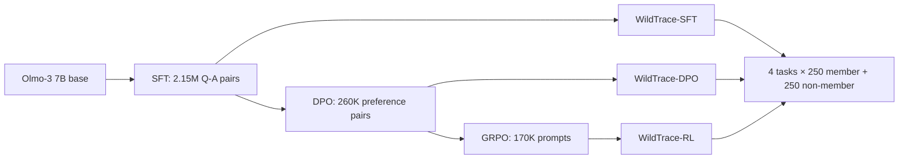

# WildTrace：大规模后训练里，“训练数据检测”为什么接近猜硬币？

> 原文：[arXiv:2610.16152](https://arxiv.org/abs/2610.16152)｜作者：Hengxiang Zhang、Junxian Liu、Hongxin Wei｜首次提交：2026-10-12 04:21 UTC｜分类：大模型后训练 / AI 安全

## TL;DR

- **它研究什么**：给定一个后训练后的语言模型和一条文本，能否判断该文本是否曾出现在该阶段的训练集中；这关系到 benchmark 污染审计、版权与数据治理。
- **它怎样做**：用开放的 Olmo-3-1025-7B 从头运行 `SFT → DPO → GRPO`，形成三个可审计的 oracle 模型；每个阶段在数学、代码、指令跟随、问答四类任务中各保留 250 个成员和 250 个同分布非成员。
- **规模与证据**：训练总量超过 250 万样本（SFT 215 万、DPO 26 万、RL 17 万），RL 使用 32 张 A100；比较困惑度、Min-K%、Min-K%++、Min-kNN、Self-Critique 等输入/输出检测器，并以 AUC、TPR@5% FPR 衡量。
- **核心数字**：最好的 Min-K%++ 在全部 12 个“阶段 × 任务”格子上的平均 AUC 只有 **0.529**；SFT-QA 能到 0.618，但同一方法到 DPO-QA 是 0.544、RL-QA 是 0.470。训练规模升至 10 万样本时，TPR@5% FPR 已低于 0.1。
- **最重要的反例**：如果把非成员换成另一领域，分数可虚高 **+21.2%**；甚至两个集合都不是成员时，QA 对 Coding 也能得到 0.908 AUC。检测器可能主要在认“领域”，不是认“是否训练过”。
- **边界**：这是一个 7B、开放数据谱系上的受控测试床，不等同于证明闭源模型不可审计；检测阶段还假设可得完整样本信息，而部署中同分布校准集和真实 base model 往往不可得。

## 研究问题：把“能测到”与“真测到”分开

训练数据检测属于 membership inference：对样本 `x`，模型 `M` 产生分数 `S(x; M)`，再用阈值判断其是否为成员。

$$
h(x;\mathcal{M})=\begin{cases}
1,&S(x;\mathcal{M})<\lambda\\
0,&S(x;\mathcal{M})\ge\lambda
\end{cases}
$$

其中 `h=1` 代表成员，`λ` 是决策阈值。难点不只是设计 `S`，而是评测集能否避免把时间戳、体裁、领域或数据源差异伪装成会员信号。

传统两条路线各有短板：

| 路线 | 得到成员标签的办法 | 主要问题 |
| --- | --- | --- |
| 事后构造 | cutoff 前文档当成员、之后文档当非成员 | 时间、格式与领域漂移可能直接泄露标签 |
| 小规模受控训练 | 自己训练并保留训练日志 | 数据小、重复 epoch 多，记忆信号被放大 |
| WildTrace | 大规模受控后训练，保留同源 holdout | 成员身份可验证，也更接近现代后训练配方 |

论文的主张因而不是“所有成员推断都无效”，而是：**在可复现、同分布、规模较大的后训练下，既有高分很可能不能外推到真实审计。**

## 论证路线：claim → mechanism → evidence → boundary

| Claim | 机制 | 证据 | 仍不能证明什么 |
| --- | --- | --- | --- |
| 旧评测会混入捷径 | 成员/非成员必须同源且标签可核验 | 9 个无模型盲基线在三阶段均约 0.52–0.53 AUC | 盲基线失败不代表没有所有未测量的偏差 |
| 规模改变可检测性 | 将训练集从 1 万扩至 20 万，其他设置固定 | AUC 向 0.5 回落，10 万时低 FPR 下 TPR < 0.1 | 没有画出所有模型尺寸和数据域的缩放律 |
| 后训练阶段也改变信号 | 同一 base 连续执行 SFT、DPO、GRPO | Min-K%++ 在 SFT-QA 0.618，DPO/RL-QA 降为 0.544/0.470 | 机制解释仍是训练目标差异的合理假设，不是因果消融 |
| 部署阈值是假设负担 | 比较 ID、OOD、无验证集校准 | ID 校准平均准确率 0.72；无需验证的最佳无监督平均仅 0.64 | 小规模阈值实验不等于 WildTrace 主大规模 setting 的最终部署性能 |

## WildTrace 如何构造：把标签真相嵌进后训练链

### 三阶段 oracle

起点是开放的 `Olmo-3-1025-7B`；每一步用前一步 checkpoint 继续训练，因而每个阶段都对应一个明确的“曾见过哪些数据”的模型。



三个训练阶段的关键配置如下；这不是“某个原始 web 文档是否进过预训练”的追溯，而是有完整训练记录的阶段性检测。

| 阶段 | 训练规模 | 训练强度 | 模型与关键设置 |
| --- | ---: | --- | --- |
| SFT | 2.15M | 2 epoch | 32K context，LR `8×10⁻⁵`，8 GPU |
| DPO | 260K | 1 epoch | `β=5`，16K context，LR `1×10⁻⁶`，8 GPU |
| GRPO | 170K | 450 step | group=8、temperature=1、8K context、32 GPU |

RL 有一个很细但重要的标签约束：成员只从训练时采样回答得到 **non-zero advantage** 的 prompts 中选择。它避免把从未真正进入有效强化信号的 prompt 误写为“成员”，但也意味着 RL 结论针对这种有奖励更新痕迹的样本选择。

### 同分布留出，为什么比“cutoff 前后”更严格？

每个任务先从原数据挑 250 条，在训练开始前排除，作为非成员；再从实际训练部分抽 250 条成员。于是每个阶段是 `4 × (250+250)=2,000` 个评测例。

这使检测器不能轻易依赖“新闻发布时间”“代码格式更像 GitHub”“问答长度不同”等非会员线索。Figure 1 的九个盲测组合——BoW、TF-IDF、Word2Vec 分别接逻辑回归、随机森林、神经网络——在 SFT/DPO/RL 的平均 AUC 为 0.53/0.53/0.52，支持这一设计确实压低了纯文本捷径。

## 被测的究竟是什么检测信号？

论文将方法分为两类：

1. **输入型**：直接看给定 token 序列的概率，如 Perplexity、Entropy、Zlib、Lowercase、Neighbor、Min-K%、Min-K%++。
2. **输出型**：只给问题，让模型生成回答后再评分，如 generated perplexity/entropy/Min-K%、Min-kNN、Self-Critique。

Min-K%++ 是主表最强者。它不直接平均所有 token，而先以当前位置词表分布标准化，再平均最低 `k%` token：

$$
\operatorname{Min\!\!\text{-}K\%++}(x)=\frac{1}{E}\sum_{x_i\in K\%}
\frac{\log p_\theta(x_i\mid x_{<i})-\mu_{x_{<i}}}{\sigma_{x_{<i}}},\qquad k=20.
$$

- `E`：进入最低 20% 的 token 数；
- `μ, σ`：当前位置完整预测分布的 log-prob 均值和标准差；
- 直觉：成员也许在模型本来最没把握的 token 上仍显得“不寻常地熟悉”。

参考模型法再做差：`S_ref(x)=S(x;M)-S(x;M_ref)`。这可消去一部分文本天然易预测性，但它假设审计者有合适的 reference；作者随后显示，reference family 的选择本身会左右效果，实际闭源部署不一定知道原始 base model。

## 实验设置与主结果

所有主结果以三种推理随机种子平均；输入型在完整样本上算分，输出型最多生成 2,048 token。指标包括：

- **AUC**：阈值无关的成员/非成员排序能力，0.5 是随机；
- **TPR@5%FPR**：只容许 5% 误报时，能抓到多少真成员，较接近审计“不要乱指控”的条件。

| 方法类别 | 最有代表性的结果 | 解读 |
| --- | --- | --- |
| 输入型 Min-K%++ | 全局平均 **0.529** | 整体仅略高于随机 |
| SFT-QA | 0.618 | response imitation 留下的信号相对更强 |
| DPO-QA / RL-QA | 0.544 / 0.470 | 偏好相对比较和在线 rollout 不留下同样的 token 似然痕迹 |
| 输出型 Min-kNN | 全局平均 0.509 | 多次生成的结构近邻并未解决大规模问题 |
| Self-Critique | 全局平均 0.504 | 面向 RL 策略塌缩的熵信号也接近随机 |

Figure 2 的训练规模实验是全文最有行动性的负结果：固定训练配置、把 Dolci-Instruct-SFT 从 10K 扩到 200K，Min-K%++ 的 AUC 与 TPR@5%FPR 都持续下降；到 100K 时低误报检出率已经低于 0.1。这不能推出“更多数据必然保护成员”，但说明小数据、重复训练得出的检测器强度，不能作为真实后训练审计能力的代用品。

## 评测协议本身如何制造高分？

### 域漂移：0.908 不等于找到了成员

作者用 code 成员配不同领域非成员。只要测试对照换域，AUC 相对 in-domain 可抬高最多 21.2%。更尖锐的检查是把两边都换成非成员：QA 与 Coding 之间仍可得 **0.908**。

这条证据改变了分数的含义：当 member / non-member 的语料来源不同，模型概率不仅编码“是否见过”，也编码体裁、难度和领域。一个漂亮的 ROC 可能是在区分数据集，而不是在审计训练日志。

### 阈值：离线最好值不等于现场可用

在 10K 小规模 SFT 的 Code 任务上，ID validation（Code）下多法平均准确率为 **0.72**，而无需验证集的 GMM、GMM-log1p、BlindMI 最好平均约 **0.64**；用 IF/QA/Math 这种 OOD validation 校准会下降。该表应谨慎阅读：它说明校准数据的价值，也暴露了许多“二分类准确率”结果暗含已拥有同分布、带标签验证集这一现实中稀缺的资源。

```text
Input: target M, sample x, optional labeled validation V
State: score S(x; M), threshold λ
1. 选择输入型或生成型检测器，计算 S
2. 若 V 与待审计数据同分布，选择使 validation accuracy 最大的 λ
3. 否则使用无监督阈值估计，但记录其更低且不稳定的准确性
4. 输出 member / non-member / inconclusive
Failure boundary: V 若 OOD，或 M_ref 不匹配，阈值和分数都可能在测数据域而非会员资格。
```

## Figure / Table 证据逐项解读

| 证据 | 支撑什么 | 不应过度解读为 |
| --- | --- | --- |
| Figure 1：盲基线约随机 | 评测集未被简单词面分类器轻易分开 | 所有潜在混杂都已被排除 |
| Table 1：最优均值 0.529 | 现有方法在该大规模 testbed 效果很弱 | 任何未来或白盒检测都必然失败 |
| Figure 2：随数据规模衰减 | 小规模高分外推风险大 | 已得到普适的幂律或因果机理 |
| Figure 3：非成员对非成员 0.908 | 域漂移可伪造成员信号 | 所有真实数据污染检测都是假象 |
| Table 2：ID 校准平均 0.72 | 阈值需要与目标分布对齐 | 可在未知真实训练语料上轻易获得 ID 验证集 |

## 相关工作位置与复现性

WildTrace 接在预训练数据检测的 Perplexity / Min-K% 系列之后，也测试了针对 RL 的 Self-Critique 和 Min-kNN；与单一 SFT 或单一 RL 的专门方法不同，它将三个后训练阶段置于同一条可追溯链中。

它的可复现价值来自三个层面：开放模型谱系、可验证训练成员标签、阶段配对 evaluation set。缺口也清晰：论文没有在闭源大型模型、不同模型尺寸、不同版权语料及非文本模态上复验；reference-based 检测的实际用处还受 reference 可得性约束。因而最稳妥的结论是：**这是对当前评测协议和方法可迁移性的强警告，不是对一切训练数据取证的终局判决。**

## 研究者视角：接下来该问什么？

- 把“成员检测”分解为两个任务：先测样本与对照是否同分布，再测会员；否则 AUC 无法解释为取证能力。
- 后训练审计需要报告完整运行条件：训练规模、epoch、阶段、样本可见字段、reference 家族、阈值来源与低 FPR 曲线，而不是只报一个最佳 AUC。
- 对 AI 安全与版权治理而言，负结果意味着仅靠黑盒 token 概率不足以形成高置信责任认定；更值得探索的是训练日志证明、数据 provenance、可验证训练记录与隐私保护审计的组合。
- 对后训练研究而言，SFT、DPO、GRPO 不是可互换的“微调”：它们写入参数的监督信号不同。未来方法若声称通用，应至少跨这三阶段、跨规模和跨域评测，并把 `inconclusive` 当作一等输出，而非强制二分类。

## 进一步拆解：三种后训练目标留下的痕迹为什么不同？

论文把阶段差异归于优化目标，而不只把它当作表格现象。这个解释值得逐层展开。

### SFT：直接把答案 token 推高

SFT 对题目 `q` 和标准回答 `y=(y_1,...,y_N)` 最小化负对数似然：

$$
\mathcal{L}_{\mathrm{SFT}}(\theta)=-\mathbb{E}_{(q,y)\sim\mathcal{D}}
\sum_{t=1}^{N}\log \pi_\theta(y_t\mid y_{<t},q).
$$

这意味着若某条回答反复或直接进入目标函数，模型对其具体 token 序列可能会产生较低困惑度，因而 `Min-K%++` 一类打分有机会工作。主表中 SFT 的 Code、IF、QA 都是该方法较高的格子；但 Math 仍只有 0.510，说明“目标 token 训练”不是会员信号的保证，数据多样性、题目重复度和回答约束度仍会左右结果。

### DPO：学习的是相对偏好，而非逐字背诵

DPO 看到三元组 `(q,y⁺,y⁻)`，推动优选答案相对参考策略更可能：

$$
\mathcal{L}_{\mathrm{DPO}}=-\mathbb{E}\left[\log\sigma\left(
\beta\log\frac{\pi_\theta(y^+\mid q)}{\pi_{ref}(y^+\mid q)}-
\beta\log\frac{\pi_\theta(y^-\mid q)}{\pi_{ref}(y^-\mid q)}\right)\right].
$$

- `π_ref` 把优化约束为相对原策略的变化；
- `β=5` 控制偏好推进的强度；
- 检测器若只阅读 `q,y⁺`，未必能重建原训练时“与哪一个 `y⁻` 对比”的关键信息。

所以 DPO 的低分并不奇怪：训练证据被编码为**排序关系**，而许多 membership 分数仍将文本当作独立字符串处理。WildTrace 没有证明相对比较一定更隐私，但准确指出了一个方法—任务失配：为 token likelihood 设计的审计器，未必能感知 preference learning 的统计痕迹。

### GRPO：训练对象还会随采样轨迹变化

GRPO 对每个问题采样一个组的回答，用组内相对奖励形成 advantage：

$$
\hat A_i=\frac{r_i-\operatorname{mean}(r_1,\ldots,r_G)}
{\operatorname{std}(r_1,\ldots,r_G)}.
$$

论文的设置是 group size 8、450 个训练步，并带 KL 正则。这里 prompt 不是一个固定 target response 的索引；其影响要经过 rollout、奖励、相对优势及策略更新。作者追踪 non-zero advantage 的 prompts 以界定成员，但检测时，输入型方法在 RL 上只能给 `q` 计分，输出型方法又要面对生成随机性。于是 RL 的难度不只是“样本更多”，也是会员标签与可观察文本之间的路径更间接。

> 这一部分是论文的机制性解释，而非完成的因果证明。真正要分离“目标函数”与“数据量、训练时长、样本过滤”的效应，需要让三阶段在可比数据和预算下做专门消融。

## 方法库存：为什么这些 baseline 仍值得保留？

低分并不让 baseline 失去价值；恰恰因为它们覆盖了几类不同可观察假设，失败模式才能定位。

| 检测家族 | 所依赖的假设 | WildTrace 中暴露的脆弱处 |
| --- | --- | --- |
| Perplexity / Entropy | 成员令模型更自信 | 大数据与少 epoch 稀释单样本的置信度差 |
| Zlib / Lowercase | 把模型分数与文本可压缩性/表面变体校正 | 仍可能把文体与领域当作会员差异 |
| Neighbor | 局部扰动前后的概率差能显露记忆 | 扰动稳定性并不等于训练使用痕迹 |
| Min-K% / ++ | 最不符合预测的 token 最有辨别力 | DPO/RL 中它看不到关键偏好与 rollout 信号 |
| Min-kNN | 多次生成会围绕训练轨迹收敛 | 平均 0.509，生成近邻没有可靠地成为证据 |
| Self-Critique | 初答和自批的熵序列反映 RL policy collapse | 其 RL 平均仍接近随机，熵相似不等于样本成员 |

这张表的启示是：新方法不应只在“模型是否自信”维度微调。更可能的方向是引入阶段特定的可验证 side information，或将检测拆成“样本是否影响了优化”和“该影响能否被文本接口观察”两个层次。

## 实验细节对结论强度的影响

### 完整样本信息是一个乐观前提

论文明确假设检测者可访问每条样本的完整信息。对于 SFT，它在完整 `(q,y)` 上计算输入分数；DPO 使用 `(q,y⁺)`；RL 使用问题 `q`。输出型则从相应 prompt 生成回答再计分。

这保证了不同方法得到最充分的文本输入，因而主结论不应被误读为“信息不够才失败”。但现实审计可能只拿到截断样本、清洗后的语料片段、争议作品的一部分，或根本不知道目标模型的具体 post-training stage。若这些限制加入，性能很可能进一步下降；这是从论文设定作出的推论，作者并未在主实验中量化该跌幅。

### AUC 与低误报检出率回答的是不同问题

若一个方法 AUC 略高于 0.5，仍可能在极低 FPR 区域完全不可用。版权争议、污染通报或模型训练合规审计通常承受不起大量误报，因此 `TPR@5%FPR` 比“最佳 accuracy”更贴近风险约束。Figure 2 中 100K 后 TPR@5%FPR 小于 0.1，恰恰提醒读者：即使 ROC 曲线某处看上去有分离，严格阈值下仍可能抓不到多少真正成员。

### 三次种子平均不是不确定性的终点

主表以三种推理随机种子平均，附录另给重复实验标准差；阈值校准表以十个随机 validation 切分报告均值与标准差。这是比单次运行更负责任的做法，但 benchmark 每格只有 500 条（250/250），而且任务和模型都集中在一个开源生态。未来报告最好同时给：置信区间、每任务原始 ROC、按样本长度/难度的切片，以及留出整个数据源后的跨源测试。

## 失败案例不是旁枝：它重新规定了“证据”

很多检测论文将失败解释成某个算法还不够聪明；WildTrace 提供了三个更结构性的失败型反例：

1. **盲分类器近似随机**：这是 benchmark 的正面校验。它表明简单 lexical shortcut 没有明显胜利，却不自动赋予所有模型型检测器真实因果含义。
2. **扩大训练集后衰减**：这是方法迁移失败。小规模、五 epoch 的 10K setting 能放大会员信号，因而适合研究协议影响，但不能代替 215 万 SFT 样本的真实背景。
3. **两个非成员也能高 AUC**：这是解释失败。若评分器把 QA 与代码分开，它的高分甚至可在零会员差异的构造中出现，因此分数本身不构成训练使用的证据链。

要把这一点落实到实践，可以把 audit 报告改成一个最低证据清单：

- 成员与非成员是否来自同一源、同一时间、同一任务分布？
- 是否有 blind baseline；其分数是否显著低于目标检测器？
- 阈值来自哪里，是否独立于待裁决样本，是否真正 ID？
- reference model 与目标模型的 base / tokenizer / pretraining family 是否可证实匹配？
- 在固定 5% 或 1% FPR 下，TPR 是否仍具有实际价值？

没有这些信息时，把某条文本的高 score 说成“确实被用于训练”是不恰当的；较好的表述应是“在给定协议和对照下存在模型可区分信号”，再明确该信号还可能由哪些混杂造成。

## 局限与可复现性清单

论文自己的局限可进一步操作化为复现任务，而不只是结尾免责声明。

| 缺口 | 为什么重要 | 下一步可检验的问题 |
| --- | --- | --- |
| 单一 7B 开放模型线 | 参数规模与 tokenizer 会改变 memorization 表观 | 同配方在更小/更大、不同架构上曲线是否一致？ |
| 单一数据谱系 | Dolci 的质量控制与任务比例未必代表商业语料 | 跨来源 holdout 后盲基线和 AUC 是否仍稳定？ |
| 有完整训练可见性 | 真实争议往往没有这些日志 | 只知文本片段时，性能和校准如何退化？ |
| 主要是黑盒 token 分数 | 白盒梯度、训练 trace、签名方法未被比较 | 多证据融合能否在低 FPR 下改善而不过拟合？ |
| 受控成员定义 | 现实中存在去重、清洗、混合与再采样 | 应如何定义“影响训练”而非字面出现？ |

WildTrace 最有价值的地方，正是把这些限制暴露为可测的实验变量。它没有提供最终的追责工具，却为评估“谁声称自己有追责工具”提供了更难绕开的基准。

## 可以复用的评测协议，而不是可直接复用的结论

如果后续团队要使用这篇论文，最应该复用的是它的**对照设计**：训练开始前固定 holdout；按后训练阶段分别记录数据进入路径；让成员与非成员来自同一任务和同一数据源；并在目标模型之外先运行不访问模型的盲基线。这样，即使新的检测器得到更高 AUC，也能回答“高分是否只是数据集分隔”的基本问题。

一个最小复现实验可以按以下顺序进行：

1. 选一个数据血缘可公开的 base model，划出不可训练的 holdout；
2. 为 SFT、preference 和 RL prompt 分别维护成员账本，不能把三者混成一个标签；
3. 在每一阶段同时报告同域、跨域和 non-member-vs-non-member 三类对照；
4. 报告 AUC、1%/5% FPR 下的 TPR、以及 ID/OOD/no-validation 阈值三种结果；
5. 当 reference 不可证实时，把 reference-based 分数标记为敏感性分析，而非主结论。

这一协议对 AI 安全尤其重要：数据泄漏、benchmark 污染和版权主张都可能需要模型行为证据，但行为证据的说服力取决于反事实对照是否严谨。WildTrace 的负结果迫使研究者把“检测成功”从一个排行榜指标，变成带有数据谱系、错误率预算与可解释边界的完整论证。

最后，一个合理的审计结论应把证据等级分开：训练日志或加密 provenance 是直接证据；同分布 benchmark 上稳定的低 FPR 分离是间接支持；仅在跨域对照、未知阈值或不匹配 reference 上出现的高 AUC 则只是待解释的现象。把这三层混为一谈，既会夸大模型检测的能力，也会让真正可复核的数据治理工具失去可信度。
