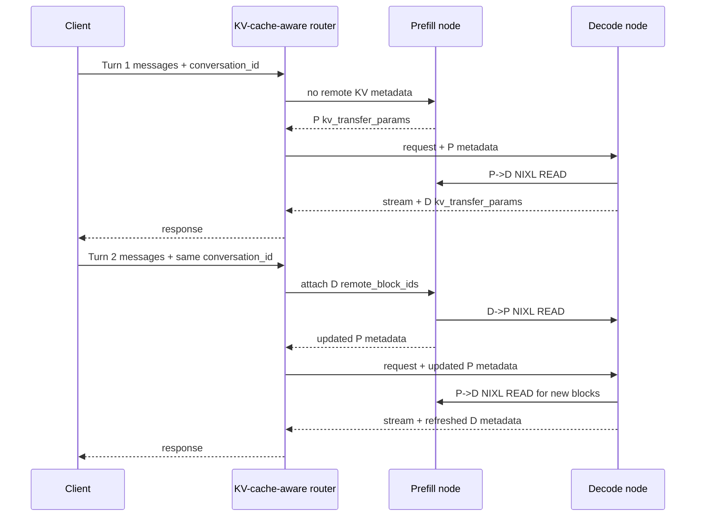

# vLLM 双向 KV Transfer：多轮 Agent 推理的延迟瓶颈不只在模型本身

### 元信息与 TL;DR

- **原文**：[Improve TTFT for Multi-Turn Agentic Workloads with Bi-Directional KV Transfer in vLLM](https://vllm-project.github.io/2026/10/12/bidirectional-kvxfer-multiturn-agentic-workload.html)
- **发布时间**：2026-10-12
- **作者/来源**：Sunita Nadampalli (AWS)，vLLM Blog
- **配套文档**：[NIXL connector usage](https://github.com/vllm-project/vllm/blob/main/docs/features/nixl_connector_usage.md)
- **主题归类**：大模型 Agent 基础设施、多轮推理服务、KV cache、prefill/decode disaggregation、TTFT 优化。

**TL;DR：**

1. 这篇 vLLM 工程报告关心的是多轮 Agent 会话里的一个具体瓶颈：每一轮都把系统提示、用户消息、工具结果和模型回复重新送回服务端，prefill 节点可能反复计算已经出现过的上下文。
2. 常规 P/D disaggregation 只支持 `Prefill -> Decode` 单向 KV 读取；decode 节点生成完回复后持有包含提示和回复 token 的 KV，但下一轮 prefill 节点通常拿不到这部分状态。
3. vLLM 的新机制把这条路补成双向：decode 节点在生成结束后保留 eligible KV blocks，并把 `kv_transfer_params` 随流式响应尾块交给 router；下一轮 prefill 节点用 `conversation_id` 找回这些 block metadata，通过 NIXL 做 `Decode -> Prefill` RDMA read。
4. 实验在 1P1D 部署上进行：两台 `p5en.48xlarge` GPU 节点分别跑 prefill 与 decode，EFA 互联；模型包括 Qwen3-32B 与 `zai-org/GLM-5-FP8`。
5. 关键数字很直接：Qwen3-32B 在 24k 输入长度处，TTFT 从 778 ms 降到 460 ms，约 1.6x；GLM-5-FP8 在 20k 输入长度处，TTFT 从 2,334 ms 降到 702 ms，最高约 3.3x。
6. 机制不是“传输免费”，而是“传输成本小于重算成本”：Qwen3-32B 的 KV transfer 约 30-130 ms，GLM-5-FP8 约 29-110 ms，但省掉的 prefill compute 更大。
7. 边界同样重要：它需要 stateful KV-cache-aware router、稳定 `conversation_id`、decode 端 KV TTL、合适的 `kv_recompute_threshold`，且 reasoning trace 被客户端裁剪时可能破坏 prefix 对齐。
8. 对 Agent 研究者来说，这篇文章的意义不是一个单点性能技巧，而是提醒我们：长程 Agent 的可用性由模型、工具、上下文协议、缓存生命周期和网络拓扑共同决定。

### 问题意识：为什么多轮 Agent 会把 prefill 变成重复劳动？

多轮 Agent 和普通聊天最大的差别，不只是消息更多，而是上下文结构更“重”：

- 系统提示可能包含权限、工具协议、输出格式、合规要求；
- 用户任务会在每轮追加新的目标修正；
- 工具调用会返回网页、代码 diff、日志、SQL 结果、测试输出；
- 模型自己的回复也会成为下一轮上下文的一部分；
- 长程 coding agent 还可能在 10 到数十轮之间不断压入诊断、计划和验证记录。

在常见 OpenAI-compatible chat payload 里，客户端通常每一轮重发完整历史。于是服务端面对的是一个不断增长的 prompt：

```text
Turn t prompt = system + user_1 + assistant_1 + tool_1 + ... + user_t
```

如果服务端无法复用上轮已经算过的 KV，prefill 代价会随着历史长度增长而上升。

可以把每轮 TTFT 简化为：

```text
TTFT_t ~= Queue_t + Prefill(history_t) + Decode_first_token_t
```

当 `history_t` 从 2k 增到 20k/24k token，瓶颈不一定在第一个输出 token，而常常在“先把长上下文读完”。

这就是 vLLM 文章的切入点：

- **不是**重新训练模型；
- **不是**缩短上下文；
- **不是**只靠本地 prefix cache；
- **而是**让 P/D disaggregation 里的 decode 节点把自己已经持有的历史 KV，在下一轮反向借给 prefill 节点。

### 作者论证路线：从单向 P->D 到双向 D->P

原文的论证很工程化，可以拆成四步：

| 论证环节 | 作者要解决的问题 | 核心机制 | 证据形式 |
|---|---|---|---|
| 识别重复计算 | 多轮会话中 prefill 节点反复处理旧历史 | 分析 P/D disaggregation 的单向 KV 流 | 架构图与流程解释 |
| 增加反向读取 | decode 端已有上轮生成 KV，但 prefill 端拿不到 | `bidirectional_kv_xfer` + NIXL READ | router metadata 流程 |
| 控制何时复用 | 短 prefix 远程读取可能比重算更慢 | `kv_recompute_threshold` 默认 64 token | 配置项与阈值解释 |
| 用基准验证 | 长上下文多轮场景是否真的降 TTFT | Qwen3-32B、GLM-5-FP8，1P1D EFA | TTFT 曲线与 prefill breakdown |

这条路线的强处在于：

- 它不把 KV cache 当成抽象黑盒，而是区分 **谁计算、谁持有、谁读取、谁释放**；
- 它不只报告 TTFT，还拆出 prefill duration 与 KV transfer component；
- 它把可复现条件写得很细，包括硬件、EFA、NIXL、vLLM/NIXL 版本、proxy 和 benchmark 参数。

边界也因此更清楚：

- 这个结果不是任意部署自动获得；
- 不是所有多轮场景都能吃满收益；
- 如果本地 prefix cache 命中稳定，收益会和“prefill cache miss/eviction”情形不同；
- 如果 router 不能正确维护跨轮 metadata，双向路径不会被触发。

### 机制拆解：KV 张量不经过 router，metadata 经过 router

原文第一张图最重要，因为它把数据面和控制面分开了：


图里红色新增路径包含六个动作：

1. decode 节点生成完成后，不立即释放 completed prompt + response KV；
2. decode 节点在流式响应的 terminal chunk 里返回 metadata；
3. router 用 `conversation_id` 缓存 metadata；
4. 下一轮 prefill 节点先做本地 prefix-cache lookup，再检查 remote reusable blocks；
5. 当可复用 token 数达到 `kv_recompute_threshold`，prefill 节点排队异步 receive；
6. prefill 节点通过新的 `D -> P` NIXL READ 读取 decode 端保留的 KV，只计算剩余 suffix。

这里有一个容易误解的点：

- router **不搬运 KV 张量**；
- router 只存 block location、engine ID、host/port、过期信息等 metadata；
- 真正的 KV 数据通过 NIXL/libfabric/RDMA 在 prefill 与 decode 节点之间 peer-to-peer 移动。

用 Mermaid 表达就是：



这解释了为什么这项能力不是一个简单开关：

| 组件 | 需要承担的新职责 | 失败时的后果 |
|---|---|---|
| Client | 每轮发送稳定 `conversation_id` | router 无法关联会话，全部变 cache miss |
| Router | 缓存并转发 `kv_transfer_params` | prefill 不知道该去哪里拉 KV |
| Decode node | 保留 completed KV 到 TTL | 下一轮到达时 block 已释放，只能重算 |
| Prefill node | 判断 remote reuse 与 recompute | 小 prefix 也远程读取会得不偿失 |
| NIXL/libfabric | 执行 P->D 与 D->P READ | 网络或注册配置错误会抵消收益 |

### 两个控制旋钮：TTL 与 recompute threshold

这篇文章里最值得抠的不是“打开双向传输”，而是两个控制旋钮：

| 参数 | 默认值 | 作用 | 研究意义 |
|---|---:|---|---|
| `decoder_kv_blocks_ttl` | 480 秒 | decode 端保留 KV blocks 的时间 | 把“会话间隔”转化为显存占用与命中率权衡 |
| `kv_recompute_threshold` | 64 token | 低于阈值时 prefill 直接重算 | 把“网络传输成本 vs 本地计算成本”显式化 |

可以用一个简化判定式理解：

```text
若 reusable_tokens >= kv_recompute_threshold
    cost_remote = lookup + RDMA_read + alignment_check
    cost_local  = recompute(reusable_tokens)
    选择 remote reuse，当 cost_remote < cost_local
否则
    选择 local recompute，避免小块读取开销
```

这个阈值不是固定真理，而是依赖四类变量：

- 模型大小：更大的模型通常每 token prefill compute 更贵；
- KV 大小：层数、head、hidden size、精度会改变传输量；
- 网络与拓扑：EFA/libfabric、PCIe locality、NUMA 映射影响 RDMA 成本；
- 业务节奏：用户或 agent 下一轮是否在 TTL 内到达。

所以 GLM-5-FP8 比 Qwen3-32B 获得更大收益，并不奇怪：

- 原文指出 GLM-5-FP8 的 per-token recompute time 更高；
- 当重算更贵时，即使 D->P transfer 不是零成本，也更容易“划算”；
- 这说明双向 KV transfer 的收益会随模型计算成本、上下文长度和 cache miss 概率放大。

### 证据一：Qwen3-32B 的收益是“平掉斜率”

Qwen3-32B 的 TTFT 曲线清楚展示了问题：


原文给出的关键数字：

| 输入长度 | 双向 KV 关闭 | 双向 KV 开启 | 现象 |
|---:|---:|---:|---|
| 2k | 158 ms | 122 ms | 开启后略低 |
| 24k | 778 ms | 460 ms | 最长 prompt 约 1.6x 降低 |

这不是把 TTFT 变成常数，而是把斜率压低：

- OFF 路径随着上下文增长明显抬升；
- ON 路径仍会上升，因为仍有新 token、调度和传输成本；
- 但旧上下文的大块 prefill compute 被远程 KV 复用替代。

prefill breakdown 解释了为什么：


原文报告：

- Qwen3-32B 的 KV transfer 约 30-130 ms；
- total prefill duration 开启后约 128-414 ms；
- recompute-only 路径约 153-744 ms。

也就是说，新增的橙色 transfer 成本是真实存在的，但它换掉了更大的蓝色重算成本。

### 证据二：GLM-5-FP8 的收益更像“避免灾难性重算”

GLM-5-FP8 的曲线更陡，也更能说明机制适用边界：


原文给出的关键数字：

| 输入长度 | 双向 KV 关闭 | 双向 KV 开启 | 现象 |
|---:|---:|---:|---|
| 2k | 500 ms | 358 ms | 短 prompt 已有收益 |
| 20k | 2,334 ms | 702 ms | 最长 prompt 最高约 3.3x 降低 |

prefill breakdown 更夸张：


原文报告：

- KV transfer 约 29-110 ms；
- 开启后的 total prefill duration 约 316-541 ms；
- recompute-only 路径约 500-2,331 ms。

这组数字说明：

- 对较大或较慢的模型，长上下文重算可能成为主导成本；
- 双向 KV transfer 的固定/近固定传输开销，在长 prompt 上被摊薄；
- 多轮 Agent 的“越聊越慢”并不是纯粹用户体验问题，而是服务端计算路径问题。

### 复现条件：这不是“pip install 后自然发生”的优化

原文的复现环境写得很细，值得保留下来：

| 维度 | 配置 |
|---|---|
| 拓扑 | 1 个 prefill 节点 + 1 个 decode 节点 + 1 个 proxy/benchmark 节点 |
| GPU 节点 | `p5en.48xlarge`，每台 8 张 NVIDIA H200 |
| 互联 | AWS EFA，16 个接口，每实例总计 3.2 Tb/s |
| OS/驱动 | Ubuntu 24.04.4，NVIDIA driver 580.126.16，CUDA 13.0 |
| EFA 软件 | EFA installer 1.50.0，libfabric 2.6.0amzn1.0 |
| vLLM/NIXL | 文中安装 `vllm==0.29.0`、`nixl==1.4.1`，并应用 PR #40186 |
| 模型 | Qwen3-32B、`zai-org/GLM-5-FP8` |
| 关键压测设置 | prefill 节点使用 `--no-enable-prefix-caching` 模拟 cache-evicted 情况 |

这个环境表的意义是：

- 结果不是“任何 GPU 云主机上都 3.3x”；
- EFA、RDMA、PCIe locality 和 NIXL rail selection 都会影响真实收益；
- 关闭 prefill prefix cache 是为了模拟本地 cache miss 或 router 选到不同 prefill 节点的情形。

如果生产部署中：

- prefill 本地 prefix cache 命中率很高；
- 会话间隔超过 decode TTL；
- router 不能保持 `conversation_id`；
- 模型较小、重算很快；
- 网络延迟或 KV 注册成本偏高；

那么收益可能显著小于原文数字。

### 配置路径：最小可理解版本

文档页给出双向配置的核心形式：

```json
{
  "kv_connector": "NixlConnector",
  "kv_role": "kv_producer",
  "kv_connector_extra_config": {
    "bidirectional_kv_xfer": true,
    "kv_recompute_threshold": 64,
    "decoder_kv_blocks_ttl": 480
  }
}
```

decode 端对应使用 `kv_role: kv_consumer`，也需要开启 `bidirectional_kv_xfer`。

但这个 JSON 只是服务器侧条件，真正触发跨轮复用还需要：

1. proxy 在 turn 1 的 response stream 尾块里拿到 decode metadata；
2. proxy 用 `conversation_id` 缓存 metadata；
3. turn 2 请求继续携带同一个 `conversation_id`；
4. benchmark 或客户端显式发送 `--send-conversation-id` 等等价字段；
5. prefill 侧发现 remote reusable tokens 超过阈值。

原文 troubleshooting 里最典型的失败是：

| 现象 | 可能原因 | 结果 |
|---|---|---|
| proxy 总是 `cache MISS` | 没有发送 `conversation_id` | 双向路径根本没跑 |
| proxy 总是 `cache MISS` | PR #40186 没应用，stream 不返回 metadata | decode block 信息丢失 |
| proxy 总是 `cache MISS` | decode 端还保持 `BIDIR=false` | decode 不返回 `kv_transfer_params` |
| `Declining expired remote read` | decode TTL 过短 | block 到下一轮时已过期 |

这些失败案例比成功命令更有价值，因为它们说明：

- Agent serving 的缓存优化不是单节点优化；
- 它横跨 API payload、streaming protocol、router state、server config、GPU memory lifecycle 和网络传输；
- 任何一环不对，性能曲线就会退回 recompute 路径。

### Figure/Table 证据怎么读？

原文四张性能图可以合并成一个判断：

| 图表 | 支持的结论 | 不能证明什么 |
|---|---|---|
| Qwen3-32B TTFT 曲线 | 双向 KV transfer 压低长 prompt 的 TTFT 增长斜率 | 不能证明所有 Qwen3 部署都有 1.6x |
| Qwen3-32B prefill breakdown | transfer 成本小于省掉的 compute | 不能证明 transfer 成本可忽略 |
| GLM-5-FP8 TTFT 曲线 | 更高 recompute 成本下收益更大 | 不能证明所有 FP8/MoE 模型都同等受益 |
| GLM-5-FP8 prefill breakdown | 20k prompt 下 recompute-only prefill 接近 2.3s | 不能覆盖真实生产混合流量与排队尾延迟 |

文章真正扎实的地方，是同时给出两种视角：

- **用户视角指标**：TTFT；
- **系统视角拆解**：prefill compute + KV transfer。

如果只看 TTFT，读者可能以为这是一个黑盒加速；拆开后可以看到：

```text
Saving ~= Recompute(old_context) - Remote_KV_Read(old_context)
```

当 `old_context` 足够长、模型足够重、网络足够快时，saving 为正且扩大。

当 `old_context` 很短、模型很轻、网络不稳定或 block 过期时，saving 可能缩小甚至消失。

### 和 Agent 系统的关系：缓存协议会改变 Agent 架构

把这篇文章放到 Agent 领域看，它触及了一个更大的趋势：

- 早期 Agent 研究主要问“模型会不会规划、会不会用工具”；
- 近期 Agent 工程开始问“长程状态、工具结果、记忆和审计日志怎么服务化”；
- vLLM 这篇文章则继续往下问：“当这些状态变成长上下文后，GPU 服务路径如何不被重复 prefill 拖垮？”

这会反过来影响 Agent 架构设计：

| Agent 设计选择 | 对双向 KV reuse 的影响 |
|---|---|
| 每轮保留完整历史 | 更容易复用 prefix，但上下文更长 |
| 对历史做摘要/压缩 | 降低长度，但可能破坏与 decode KV 的 prefix 对齐 |
| 裁剪 reasoning trace | 可能导致 D 端 KV 与下一轮 prompt token 序列不一致 |
| 稳定 session/conversation ID | 是跨轮 metadata 关联的必要条件 |
| 多 prefill 节点轮询 | 增加本地 cache miss 概率，也提高远程 reuse 价值 |
| 长时间等待用户输入 | decode TTL 可能过期，需要调整保留策略 |

尤其要注意 reasoning trace 的边界。

文档页明确警告：如果 reasoning 模型输出 `<think>...</think>`，decode 的 KV blocks 覆盖完整 token 序列；但客户端下一轮发送历史时把 thinking traces 删除，prefill 看到的 prompt 就不是 decode 序列的 prefix。此时拉回的 KV 对应错误 token 位置，可能产生错误结果。

这说明：

- 上下文压缩不是纯文本层策略；
- 它会影响底层 KV cache 的语义一致性；
- Agent runtime 必须知道“给模型看的 token 序列”和“给用户展示的 transcript”可能不是同一个对象。

### 局限与失败边界

这篇文章的证据强，但边界也很具体：

1. **实验是 1P1D 与指定硬件拓扑**
   - 结果来自 EC2 P5en + EFA；
   - 多 P、多 D、跨 AZ、异构 GPU、共享集群拥塞都可能改变结果；
   - 原文说 feature 可在其他配置运行，但性能依赖硬件、模型、workload、网络。

2. **基准模拟了 prefill cache miss**
   - prefill 节点关闭 prefix caching；
   - 这对应 cache evicted 或 router 选到不同 prefill 节点；
   - 如果真实部署里本地 prefix cache 命中稳定，收益需要重新测。

3. **router 是 stateful 组件**
   - 它必须保存 conversation metadata；
   - 这带来状态一致性、扩缩容、故障恢复、隐私边界和观测问题；
   - 原文示例 proxy 适合复现，不等于生产路由器的完整设计。

4. **decode KV TTL 会占显存**
   - TTL 越长，命中机会越高；
   - 但保留 blocks 会挤占 decode 端 KV cache；
   - 高并发场景需要在 reuse、eviction、OOM 风险之间做策略。

5. **token 序列必须一致**
   - 客户端裁剪、摘要、隐藏 thinking trace、工具结果标准化都可能改变 token prefix；
   - 一旦 prefix 对齐假设破坏，cache reuse 不只是“效果差”，而可能“结果错”。

### 研究者视角：这篇文章改变了哪些问题的问法？

我认为这篇文章值得 Daily Report 收录，原因不只是“vLLM 又做了一个优化”，而是它把长程 Agent 的服务瓶颈说得足够具体。

过去我们容易把 Agent 延迟归因于：

- 模型太慢；
- 工具太慢；
- 上下文太长；
- 网络太慢。

这篇文章给出更精确的分解：

```text
长程 Agent 延迟 =
  调度排队
+ 旧上下文 prefill 重算
+ 新 token prefill
+ KV 传输/注册
+ decode 首 token
+ 工具调用外部延迟
```

其中“旧上下文 prefill 重算”是可以通过跨轮 KV 生命周期管理削减的。

后续值得追问的问题包括：

1. **Agent 记忆系统是否应该暴露 cache-aligned transcript？**
   - 如果用户可见历史、模型内部历史、KV 可复用历史三者不同步，runtime 需要新的抽象。

2. **router 是否应成为 Agent safety 边界？**
   - router 保存 conversation metadata；
   - 它不保存 KV 张量，但能决定哪段历史被复用；
   - 这可能影响审计、隔离、租户边界和 prompt-injection 追踪。

3. **能否把 TTL 从固定时间改成策略化 lease？**
   - 原文提到 decode TTL 不通过 heartbeat 更新；
   - 对生产 Agent 来说，按活跃度、优先级、成本或用户 SLA 调整 TTL 会更自然。

4. **压缩上下文和 KV reuse 如何协同？**
   - 摘要降低 token 数；
   - KV reuse 降低旧 token 重算；
   - 二者都要处理“语义等价”和“token prefix 一致”之间的张力。

5. **评测是否应纳入 agent serving 指标？**
   - Agent benchmark 不能只报成功率和 token 数；
   - 多轮 TTFT、cache hit/miss、prefill duration、KV transfer bytes 也应成为部署级指标。

### 结论

vLLM 的双向 KV transfer 把一个多轮 Agent 的基础设施问题讲清楚了：

- 多轮上下文增长会导致 prefill 重算；
- 常规 P/D disaggregation 的 KV 流向是单向的；
- decode 端已经持有的历史 KV，可以在下一轮通过 router metadata 与 NIXL READ 反向复用；
- 在作者的 1P1D EFA 实验中，Qwen3-32B 最长 prompt 约 1.6x 降 TTFT，GLM-5-FP8 最高约 3.3x；
- 但收益依赖硬件拓扑、会话间隔、router 状态、prefix 对齐和阈值配置。

更大的启发是：

> 长程 Agent 的能力不是只由模型决定。它还由上下文协议、缓存生命周期、路由器状态、工具返回形态和服务端拓扑共同决定。

对未来 Agent 系统来说，“会不会想”和“会不会做”之外，还要问一个更工程但同样关键的问题：

> 已经想过、已经看过、已经生成过的上下文，系统是否还在一遍遍付费重算？
