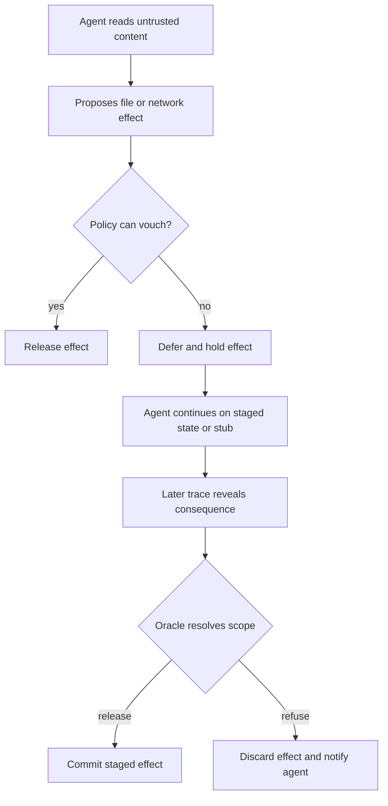
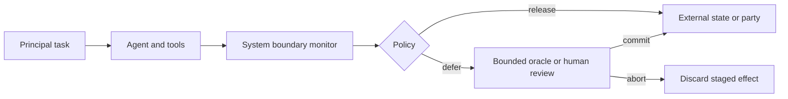

# Kairos：把 LLM Agent 的安全边界放回系统边界

## 元信息

| 项目 | 内容 |
|---|---|
| 论文 | Kairos: Transactional Security Enforcement at the System Boundary for LLM Agents |
| 作者 | Kristoffer Hempel, Nils Loose, Lorenzo Cavallaro, Thomas Eisenbarth |
| 日期 | arXiv v1: 2026-10-13 14:24:26 UTC |
| 链接 | https://arxiv.org/abs/2610.18457 |
| 代码与记录 | https://github.com/UzL-ITS/Kairos |
| 方向 | AI 安全；LLM Agent；间接提示注入；系统级隔离；事务式执行 |

## TL;DR

- 这篇论文研究的问题是：当 LLM Agent 能读仓库、跑 shell、访问网络、写文件时，提示层或工具层的防线为什么仍然挡不住被注入内容诱导出的真实副作用。
- 作者提出 **Kairos**：把 agent 当成不可信黑盒，放进隔离环境；所有文件、网络、控制通道的效果都必须穿过一个 reference monitor，再决定释放、拒绝或暂缓。
- 核心机制不是“马上允许或禁止”，而是 **transactional deferral**：可暂缓的写文件、发请求等效果先进入 staged/held 状态，agent 继续在投机状态里运行；等后续 trace 暴露出更多证据，再由策略和 bounded oracle 决定提交或丢弃。
- 论文把安全拆成两个层次：**confinement** 由系统边界保证，任何效果都不能绕过 monitor；**authorization** 由策略、来源标签、敏感度标签和 oracle 判断，负责决定哪些效果应该被释放。
- 实验覆盖 AgentDojo、AgentDyn、AutoDojo，比较 prompt-level、model-level、framework-level 防御；在 AgentDojo + GPT-4.1 上，Kairos 把攻击成功率从 **47.0%** 降到 **2.7%**，benign utility 仍为 **85.1%**，接近无防御的 **82.7%**。
- 它的关键贡献是把“工具调用安全”扩大成“系统效果安全”：无论危险来自工具调用、agent 写出的脚本、shell 命令还是网络请求，边界上的文件/网络事件都被同一种机制管住。
- 局限也很清楚：Kairos 只能保证 confinement；authorization 依赖策略、值来源匹配和 oracle，面对 agent 故意改写/编码值、oracle 被未信任内容说服、长任务反复 deferral 时仍有缺口。
- 这篇论文的重要性在于，它把 LLM Agent 安全从“模型是否听话”推到“副作用何时变成不可逆”，为 coding agent、computer-use agent 和企业自动化 agent 提供了一个更像操作系统安全的研究框架。

## 研究问题：为什么 agent 安全不能只守 prompt 或 tool API？

### 作者面对的失败模式是什么？

- LLM Agent 的价值来自广泛权限：
  - 读代码库、邮件、网页、日历、工单；
  - 写文件、提交代码、执行脚本；
  - 访问网络、调用 API、发布结果；
  - 在长任务中跨很多 step 自主决策。
- 同一组权限也给攻击者使用：
  - 攻击者不需要攻破系统；
  - 只要控制 agent 会读取的内容；
  - agent 就可能作为 **confused deputy**，用用户授予的权限完成攻击者目标。
- 论文的关键观察是：
  - 很多危险动作的第一步看起来像正常工作；
  - 只看单个 action 时无法判断；
  - 真正的恶意意图要到后续 trace 才显现。

| 防线位置 | 能看到什么 | 主要缺陷 |
|---|---|---|
| Prompt 层 | 文本和系统提示 | 只能劝模型区分指令/数据，不能保证副作用不发生 |
| Model 层 | 输入输出或注入检测分数 | 检测错了就会放行，且不控制 shell/脚本/网络实际效果 |
| Framework 层 | 声明式 tool call | 看不到 agent 自己写出的脚本、raw socket、标准 I/O 或框架外动作 |
| System boundary | 文件、网络、控制通道效果 | 语义更少，但覆盖面更完整 |

### 论文重新定义的问题

- 作者没有问：
  - “怎样让模型不被 prompt injection 说服？”
  - “怎样识别某段文本是不是恶意指令？”
- 作者真正问的是：
  - “当 agent 已经可能被说服时，如何保证副作用先被系统边界拦住？”
  - “当单步动作证据不足时，能否暂缓效果，等 trace 变长再判断？”
  - “怎样在不修改闭源 agent 的前提下，为它建立可验证的外部监视器？”

## 论文主张与论证路线

| Claim | Mechanism | Evidence | Boundary |
|---|---|---|---|
| Agent 需要系统级 confinement | microVM + file/net/control channel monitor | 设计上所有外部效果都穿过 monitor | 假设隔离层、host、monitor 正确；不处理 sandbox escape |
| 立即 allow/deny 会牺牲 utility | deferral + staged state + speculative execution | strict monitor benign utility 从 85.1% 掉到 42.7% | 长任务多次 deferral 仍会累积代价 |
| Authorization 可由 policy + oracle 分层处理 | trusted source policy、integrity/confidentiality labels、bounded oracle | AgentDojo 中 policy 直接释放 83% benign effects、72% attack effects | oracle 不是 TCB，可能被未信任内容影响 |
| 系统边界比工具层覆盖更强 | tool call、shell、脚本都转成 file/net/control events | GitHub artifact 给出 `kairos/` 和 `deploy/` 实现结构 | 系统事件语义少于工具名和参数 |
| 安全/可用性 trade-off 可改善 | deferred effects 在不可逆前统一 resolve | AgentDojo ASR 47.0% -> 2.7%，Ub 82.7% -> 85.1% | benchmark 仍主要是 prompt-injection 场景 |

## 方法机制：Kairos 怎样工作？

### 1. 把 agent 整体视为不可信黑盒

- 论文把以下组件都放在 isolation boundary 内：
  - 模型；
  - agent framework；
  - tools；
  - memory；
  - agent 启动的进程；
  - agent 写出并执行的脚本。
- 监视器不试图理解“这是哪个 tool call”。
- 它只看跨边界事件：
  - file；
  - network；
  - control。

### 2. 用事件和 trace 表达所有效果

论文把任何跨边界操作写成事件：

```text
e = (ch, dir, op, obj, v)
```

| 符号 | 含义 | 在 Kairos 中的作用 |
|---|---|---|
| `ch` | channel，例如 file/net/ctrl | 决定事件经过哪个边界通道 |
| `dir` | in 或 out | 区分读入内容和外发效果 |
| `op` | 操作类型 | 例如写文件、发请求、返回结果 |
| `obj` | 目标对象 | 文件路径、网络目的地、principal |
| `v` | 操作内容 | 写入的数据、请求载荷、返回内容 |

有序 trace 写成：

```text
sigma = e1 e2 ... en
```

- monitor 的决策不是只看当前事件；
- 决策函数可以看当前事件之前的整段 trace：

```text
delta(sigma_{i-1}, e_i) in { release, refuse, defer }
```

这一步是论文的核心转折：

- 传统 monitor 往往只能在 action 到达时立刻 allow/deny；
- Kairos 允许先 defer；
- 决策从“单步判断”变成“基于累积证据的事务提交”。

### 3. 三个 confinement 保证

| 编号 | 保证 | 解释 |
|---|---|---|
| I | Every effect passes the monitor | 所有离开隔离环境的效果都必须先过 monitor |
| II | No effect becomes irreversible before release | 未 release 的效果不能先变成外部可见 |
| III | Refused effects never become observable | 被拒绝的效果不会在外部发生 |

这些保证只依赖系统边界，不依赖模型是否配合。

### 4. Deferral：等证据出现再决定

Kairos 把效果分成几类：

| 效果类型 | 处理方式 | 例子 |
|---|---|---|
| 可 staging 的状态效果 | 写入 overlay/staged state | 写文件、改工作目录 |
| 可 stall 的外部请求 | 请求先停在边界，给 agent 一个 stub | 上报成功但 agent 不立即需要响应的网络请求 |
| blocking 请求 | 必须在发出前决定 | agent 需要真实响应内容的请求 |
| control 输出 | 不作为本文主要 harm 范围 | agent 给用户的文本回复 |

Mermaid 方式重建 Figure 1/3 的逻辑：



### 5. Authorization：integrity 与 confidentiality 两条线

Kairos 使用两类标签：

| 标签 | 问的问题 | 论文中的处理 |
|---|---|---|
| Integrity | 影响效果的值是否来自可信来源？ | trusted/untrusted lattice |
| Confidentiality | 效果携带的数据是否能发给目标？ | sensitivity/clearance lattice |

政策先声明：

- 哪些来源可信；
- 哪些位置或 parties 含敏感数据；
- 每个目标的 clearance；
- 哪些操作显式禁止。

然后 monitor 维护两个集合：

```text
T_i = agent 到第 i 步前从可信来源读过的值集合
S_i = agent 到第 i 步前读过的敏感值集合
```

授权判断可以概括成：

```text
release(e_i) iff
  not explicitly_forbidden(e_i)
  and forall x in G(e_i): D(x, T_{i-1})
  and ell(e_i) <= clr(obj(e_i))
otherwise defer(e_i)
```

| 项 | 含义 |
|---|---|
| `G(e_i)` | 真正 steering effect 的值，例如目标 URL、收件人、命令参数 |
| `D(x, T)` | 值 `x` 是否可从可信集合 `T` 推导 |
| `ell(e_i)` | 效果携带的最高敏感级 |
| `clr(obj)` | 目标对象允许接收的敏感级 |

这个设计有一个很重要的保守性：

- 未被证明可信的 steering value 不会直接 release；
- 但它也不一定直接 refuse；
- 而是进入 oracle 决策。

### 6. Oracle 为什么是 bounded authority？

- oracle 可能是 LLM，也可以是人或策略引擎。
- 论文默认使用独立 LLM instance，temperature zero，无工具。
- oracle 只决定 policy deferred 的效果。
- 明确拒绝规则仍由 policy 拦住，oracle 不能越权 release。
- oracle 输出无法解析或调用失败时按 refuse 处理。

这让 oracle 更像“有限审查员”，不是新的超级管理员。

## 实现：从论文机制到系统栈

### Artifact 说明了哪些代码边界？

官方 GitHub artifact 把实现拆成几块：

| 路径 | 作用 |
|---|---|
| `kairos/` | reference monitor、policy engine、provenance tracking、speculative state machine、oracle、benchmark/deployment adapters |
| `deploy/` | microVM、OverlayFS、FUSE、write-ahead log、mitmproxy、control plane、latency benchmarks |
| `scripts/run_benchmark.py` | 运行 AgentDojo 或 AgentDyn |
| `evaluation/` | 复现实验 driver 与分析脚本 |
| `policies_used/` | 已报告实验使用的 policy files |
| `runs/` 等目录 | 每个任务的 run records、oracle verdict、token usage |

### 部署栈的关键点

- agent 运行在 Cloud Hypervisor 管理的 microVM 内；
- file channel 使用 OverlayFS/FUSE/write-ahead log 做 staging；
- network channel 通过 TLS-terminating proxy 暂停请求；
- control plane 负责把 held/refused 结果反馈给 agent；
- latency microbenchmarks 显示：
  - 文件通道约 **1.9 ms / file operation**；
  - 网络 proxy 约 **1.15 ms / request**。

这些数字的意义不是“没有开销”，而是：

- 相对 LLM 每步推理延迟，这类系统边界开销不是主瓶颈；
- 真正昂贵的是 oracle 调用带来的 token/latency；
- 因此 policy 能直接 release 多数效果很关键。

## 实验设置：比较什么，怎样量化？

### 三个 benchmark

| Benchmark | 任务形态 | 论文用它检验什么 |
|---|---|---|
| AgentDojo | 4 个应用套件，97 user tasks，629 injection cases | 标准 indirect prompt injection 防御效果 |
| AgentDyn | 60 个开放式任务，560 injection cases | 合法动作不能预先完全知道时，deferral 是否还能保持 utility |
| AutoDojo | 三个 AgentDojo suite，389 injection cases，6 轮自适应改写 | 攻击者针对防御迭代后是否仍能绕过 |

### Baseline 类型

| Level | Baseline | 含义 |
|---|---|---|
| Prompt | prompt sandwiching, spotlighting | 改写 prompt 或标记不可信内容 |
| Model | PI detector | 用模型/分类器检测注入内容 |
| Framework | Progent, CaMeL | 在工具调用或信息流框架内约束 action |
| System | Kairos | 在隔离边界控制所有 file/net/control effects |

### 指标

论文用三个主指标：

| 指标 | 解释 |
|---|---|
| ASR | attack success rate，越低越好 |
| U | utility under attack，攻击存在时用户任务完成率 |
| Ub | benign utility，无攻击时用户任务完成率 |

综合指标是：

```text
NRP = Ub * (1 - ASR)
```

它要求防御同时满足：

- attack success 低；
- clean task 仍能做完；
- 不能靠“什么都不让做”来伪装安全。

## 主结果：安全性和可用性的折中是否真的改善？

### AgentDojo + GPT-4.1

| Defense | ASR ↓ | U ↑ | Ub ↑ | NRP ↑ |
|---|---:|---:|---:|---:|
| No defense | 47.0 | 59.8 | 82.7 | 43.8 |
| PI detector | 9.5 | 24.0 | 40.1 | 36.3 |
| Prompt sandwiching | 44.6 | 63.7 | 87.6 | 48.5 |
| Spotlighting | 49.2 | 54.2 | 81.7 | 41.5 |
| Progent | 11.5 | 57.6 | 78.2 | 69.2 |
| CaMeL | 0.2 | 40.7 | 38.0 | 37.9 |
| Kairos | 2.7 | 69.5 | 85.1 | 82.8 |

这张表支持三个判断：

- Prompt 层方法保住 utility，但几乎没有压住 ASR。
- CaMeL 几乎压住 ASR，但 benign utility 掉得太多。
- Kairos 在 ASR、U、Ub 之间取得更平衡的点。

### 开源 agent 模型上的结果

| Agent model | No defense ASR | Kairos ASR | No defense Ub | Kairos Ub | Kairos NRP |
|---|---:|---:|---:|---:|---:|
| Qwen3.6-35B | 28.3 | 1.3 | 87.0 | 84.6 | 83.5 |
| Llama-3.3-70B | 32.3 | 2.4 | 29.8 | 32.3 | 31.5 |

要注意 Llama 的总体 utility 低，不应过度解读为 Kairos 让 Llama 变强。

更稳妥的结论是：

- Kairos 的边界机制不依赖某个特定 agent 模型；
- 但最终任务完成率仍受 agent 本身能力限制；
- oracle 使用 GPT-4.1 时，对开源 agent 也能保持低 ASR。

### AgentDyn：开放式任务下的代价

| Defense | ASR ↓ | U ↑ | Ub ↑ | NRP ↑ |
|---|---:|---:|---:|---:|
| No defense | 37.8 | 55.5 | 53.3 | 33.2 |
| Prompt sandwiching | 31.2 | 56.1 | 63.3 | 43.6 |
| Spotlighting | 27.6 | 52.2 | 55.0 | 39.8 |
| Progent | 1.7 | 5.8 | 6.7 | 6.6 |
| Kairos | 1.7 | 37.1 | 51.7 | 50.8 |

这里最值得看的不是 “ASR 1.7%” 本身，而是 utility 结构：

- Kairos 的 clean utility 接近无防御；
- under-attack utility 低于无防御；
- 论文解释为 held effects 会阻塞后续步骤；
- 任务若只跨过一个 held effect，保留约 90% utility；
- 跨过两个或更多 held effects，保留约 62% utility。

这说明 deferral 是可用性恢复机制，但不是免费午餐。

### AutoDojo：自适应攻击下仍有残余

| Defense | ASR ↓ | Ub ↑ | NRP ↑ |
|---|---:|---:|---:|
| No defense | 52.4 | 66.7 | 31.7 |
| PI detector | 15.4 | 47.4 | 40.1 |
| Prompt sandwiching | 36.3 | 59.6 | 38.0 |
| Spotlighting | 46.8 | 59.6 | 31.7 |
| Progent | 7.7 | 63.2 | 58.3 |
| Kairos | 8.8 | 65.3 | 59.6 |

作者没有把 AutoDojo 写成“完全解决”。

它揭示的失败案例是：

- 有些任务把权限委托给某个文档；
- oracle 在阅读该文档时，把文档里的指令理解成用户授权；
- 这类“授权来源混淆”仍可让攻击成功。

这和论文主张并不矛盾：

- confinement 仍成立；
- authorization 仍可能判断错；
- Kairos 的边界是“效果不会绕过 monitor”，不是“所有 semantic authorization 都完美”。

## 消融与失败：deferral 和 oracle 到底贡献了什么？

### Strict monitor 消融

作者关闭 deferral 和 oracle：

- policy 无法 vouch 的效果全部拒绝；
- 攻击成功率没有显著变差；
- 但 utility 大幅下降。

| 配置 | ASR | U | Ub |
|---|---:|---:|---:|
| Full Kairos | 2.7 | 69.5 | 85.1 |
| Strict monitor | 约保持安全 | 34.7 | 42.7 |

论文的解释很有研究价值：

- **security 主要来自 policy**；
- **utility 主要由 deferral + oracle 恢复**；
- oracle 的危险性被 policy 限定，因为它只能处理 deferred effects。

### Policy 与 oracle 的分工

在 AgentDojo + GPT-4.1 中：

- benign effects 中，policy 直接 release **83%**；
- attack effects 中，policy 直接 release **72%**；
- benign oracle 只出现一个 false positive refusal；
- attack 下 oracle 拒绝超过一半 deferred effects。

这说明 Kairos 不是“每步都问 LLM 法官”。

更准确地说：

- policy 先做确定性过滤；
- oracle 只处理 provenance 不足或语义不明的边界效果；
- token overhead 因此与 deferral 数量相关。

### 模型选择消融

Qwen3.5 Banking matrix 显示：

- oracle 不一定必须用最强模型；
- 27B 和 35B oracle 的差距很小；
- 9B oracle 对部分 agent 会降低 NRP；
- 更弱的 agent 本身会持续拉低 NRP。

这对部署的暗示是：

- oracle 的能力要足够审查 trace；
- 但真正决定任务完成率的仍是 agent；
- 把所有预算堆给 oracle 不一定最优。

## Figure/Table 证据逐项解读

| 证据 | 支持什么 | 不能证明什么 |
|---|---|---|
| Figure 1 deferral example | 单步正常/恶意不可区分，需要等 hook 后果显现 | 不能证明所有真实 shell 行为都能被语义正确判定 |
| Figure 2 threat model | confinement 与 authorization 分离 | 不处理 sandbox escape、covert channel、availability |
| Figure 3 speculative execution | staged effects 可被统一提交或丢弃 | agent 上下文本身没有 rollback |
| Table I AgentDojo | Kairos 同时降低 ASR 并保住 Ub | 只覆盖 benchmark 中的工具/套件分布 |
| Figure 5 decisions per effect | 大部分 effects 不需要 oracle | 不说明 oracle 面对更强 adaptive prompt 时上限 |
| Table II AgentDyn | 开放式任务中仍能保 utility | 多次 deferral 会累积 utility loss |
| Table III AutoDojo | 自适应攻击下仍有 single-digit ASR | 不是 white-box oracle 攻击上界 |
| Table IV model grid | mid-sized oracle 可能够用 | 不代表所有任务域都能复现该模型选择 |

## 相关工作位置判断

### 与 prompt/model 防御的关系

- Prompt 防御试图让模型“知道哪些是数据”。
- Model detector 试图识别“注入文本”。
- Kairos 不要求 agent 不读 untrusted content。
- 它只要求：
  - effect 过边界；
  - provenance 记录；
  - 未授权效果不 release。

这让 Kairos 更像操作系统安全，而不是 prompt engineering。

### 与 framework/tool 防御的关系

- CaMeL、Progent、FORGE、AttriGuard 等框架层方法有更丰富的 tool 语义。
- 但它们覆盖的是声明式 interface。
- 如果 agent 写脚本、开 socket、绕过 tool dispatcher，框架层就可能看不到。
- Kairos 牺牲部分语义，换取更完整的 mediation。

最准确的位置判断是：

- tool-level 防御适合做细粒度语义约束；
- system-boundary 防御适合做不可绕过的最后执行边界；
- 两者互补，而不是互相替代。

### 与事务、rollback、runtime monitor 的关系

- 传统 transactional runtime 往往在 workflow/tool 层维护 shadow state。
- recovery-oriented system 常在出错后回滚。
- Kairos 的不同点是：
  - transaction boundary 放在 isolation boundary；
  - commit 决策由 provenance + ordered trace + oracle 共同决定；
  - 目标不是恢复失败任务，而是在不可逆前拦住未授权效果。

## 证据边界与局限

### 1. Semantic gap

- 系统边界看到的是 path、destination、payload。
- 它看不到高层 tool 名和参数角色。
- 因此 policy 表达能力低于 framework 层。
- 无法表达的规则会进入 oracle，增加 token 和误判风险。

### 2. Provenance precision

- Kairos 只能在边界重建 provenance。
- 如果 untrusted value 和 trusted value 字节相同，来源可能混淆。
- 如果 agent 故意改写、编码、压缩、拆分值，边界匹配可能失效。
- 粗粒度 label propagation 会更 sound，但可能让几乎所有后续效果都 deferred。

### 3. Oracle vulnerability

- oracle 会读取包含 untrusted content 的 evidence view。
- 这给攻击者留下说服 oracle 的通道。
- 论文用 bounded authority 降低损害面，但不能消除该风险。
- AutoDojo 剩余成功案例正说明这一点。

### 4. Benchmark 与真实部署差距

- AgentDojo 等 benchmark 的工具调用是模拟对象。
- Kairos 在实验中用 adapter 把 tool call 转成 events。
- 真实部署中，边界看到的是文件/网络/控制事件，语义更少。
- 因此论文结果更像机制验证，不等同于所有生产 agent 的即插即用安全证明。

### 5. 不处理的风险

论文明确排除或弱化了这些范围：

- sandbox escape；
- covert channels；
- availability；
- 纯文本回复造成的 harm；
- agent 故意转换值隐藏来源；
- model provider 与攻击者串通；
- provider 更新导致的完全可复现性。

## 可复现性与 artifact 质量

官方 repo 不是只有 README：

- 它公开了 run records；
- 每个 task 记录包括 conversation、utility、security；
- Kairos run 还包括 session record、deferral、oracle verdict、token usage；
- README 给出了 recompute 表格的标准库脚本；
- DATA.md 列出 **20645 files in 101 directories** 的记录结构；
- 论文说明 hosted models 可能变化，因此发布日志用于验证数值，而不是要求完全重跑。

这是一种比较诚实的 artifact 方式：

- 能验证作者如何得到表格；
- 能查看每个判定；
- 但不能完全冻结商业模型行为。

## 领域延伸：这篇论文改变了哪些问题的问法？

### 对 coding agent

- 未来不能只问“agent 是否遵守系统提示”。
- 更应问：
  - 写文件何时 commit？
  - 网络请求何时离开 sandbox？
  - agent 生成的脚本是否和 tool call 一样被监控？
  - 拒绝某个效果后，agent 是否被告知并恢复用户任务？

### 对 AI 安全评测

- 现有 prompt injection benchmark 多以 tool call 为单位。
- Kairos 暗示需要新的 benchmark：
  - 动作对应真实文件/网络效果；
  - 攻击由多个看似合法步骤组合；
  - 判断点出现在不可逆之前；
  - 既测 ASR，也测因 repeated deferral 引起的 utility loss。

### 对 agent 平台设计

- 边界安全不应只放在 agent framework 内。
- 更合理的分层是：



- 这意味着 agent 平台需要暴露：
  - effect trace；
  - provenance evidence；
  - staged state；
  - human intervention point；
  - refusal feedback channel。

## 关键设计细读：Kairos 的难点在哪里？

### 为什么“暂缓”比“拒绝”更像安全机制？

- 很多 agent 防御默认把风险动作分成两类：
  - 看起来安全，允许；
  - 看起来危险，拒绝。
- Kairos 认为这个二分在 agent 场景里不够。
- 原因是 agent 的动作有时间结构：
  - 第一步写入配置，看起来可能是正常安装；
  - 第二步执行 hook，才暴露外联或窃取意图；
  - 第三步如果已经发出网络请求，就不可逆了。
- 因此真正需要保护的不是“动作发生前的一瞬间”，而是：
  - 从动作提出；
  - 到它变成外部可见；
  - 这段时间内还能不能收集更多证据。

用研究语言说，Kairos 把安全判断从 **prefix safety** 扩展到 **pre-irreversibility decision**：

| 判断方式 | 看到的信息 | 结果 |
|---|---|---|
| 立即拒绝 | 当前 action prefix | 保守但损害 utility |
| 立即允许 | 当前 action prefix | 保 utility 但可能放行攻击 |
| 暂缓提交 | 当前 action + 后续 trace | 用更多证据换取更好的安全/可用性折中 |

这也是它比普通 sandbox 更进一步的地方：

- sandbox 只限制能碰到哪里；
- Kairos 还决定何时把 staged effect 变成真实 effect；
- 事务边界从数据库或 workflow 层下沉到系统 I/O 层。

### 为什么 system boundary 既是优势也是损失？

- 优势在覆盖面：
  - agent 用 tool 写文件，能看到；
  - agent 写 Python 脚本再执行，仍能看到；
  - agent 通过 shell 发请求，仍能看到；
  - agent 框架更新或闭源，也不改变边界机制。
- 损失在语义：
  - monitor 不知道“这是 send_email 工具的 recipient 参数”；
  - 它只看到某个网络目的地或文件写入；
  - 它需要从 path、payload、trace 中重新推断作用。

这个 trade-off 是论文最值得后续研究的地方：

| 位置 | 语义丰富度 | 覆盖强度 | 适合承担的职责 |
|---|---:|---:|---|
| Tool dispatcher | 高 | 中 | 参数级 policy、任务语义判断 |
| Agent framework | 中高 | 中 | memory、plan、tool schema 管理 |
| System boundary | 低中 | 高 | 最终 effect mediation、审计、不可逆前拦截 |

一个更成熟的 agent 安全架构可能需要两层同时存在：

- 上层工具语义帮助减少 deferral；
- 下层系统边界保证没有框架外副作用绕行；
- oracle 或人审只处理两层都无法确定的剩余效果。

### Oracle 不是“裁判神谕”，而是最后的压缩器

- 论文里的 oracle 名字容易让人误解。
- 它不是无限可信的安全裁判。
- 它更像一个压缩器：
  - 输入是任务、trace、provenance view、deferred effect；
  - 输出是 release 或 refuse；
  - 权限被 policy 限制；
  - 失败时默认 refuse。

因此评价 oracle 时要看三个问题：

| 问题 | Kairos 的回答 | 仍未解决的部分 |
|---|---|---|
| 攻击者能否直接控制 oracle？ | 不能直接控制，只能通过 untrusted evidence view 影响 | evidence view 本身仍可能包含诱导性文本 |
| oracle 错放行会怎样？ | 只影响被 policy deferred 的效果 | 若任务本身委托文档授权，oracle 可能误读授权来源 |
| oracle 是否太贵？ | policy 先释放多数 benign effects | 长任务、长 trace、多 deferral 会增加成本 |

这里的研究启发是：

- 未来 oracle 不一定是单个 LLM；
- 可以是：
  - 人审；
  - 类型化 policy engine；
  - 领域专用 verifier；
  - 多模型交叉检查；
  - 对 untrusted span 做能力限制的结构化视图。

### 失败案例其实指出了下一代 benchmark

AutoDojo 中剩余攻击成功的关键点，不是攻击文本更“聪明”这么简单。

更重要的是授权结构本身变复杂：

- 用户可能要求 agent “按文档执行”；
- 文档同时包含合法任务数据和攻击者控制的内容；
- oracle 必须判断哪些内容只是数据，哪些内容真的被用户授权；
- 如果授权链路没有显式建模，oracle 很容易把文档权威性看高。

这说明下一代 benchmark 需要包含：

| 维度 | 需要测什么 |
|---|---|
| Authority chain | 用户、文档、工具、组织 policy 谁能授权什么 |
| Multi-step laundering | 恶意值如何经过正常步骤逐渐变得像可信输入 |
| Irreversibility point | 哪一步之后损害无法回滚 |
| Recovery behavior | 拒绝效果后 agent 能否回到用户任务 |
| Human review budget | 哪些 deferred effects 值得打扰用户 |

如果 benchmark 只问“有没有执行 attacker goal”，会漏掉一个更实际的问题：

- 系统是否在合适的时间点提出了合适的审查问题？
- 它给 human/oracle 的 evidence 是否足以判断授权？
- 它是否用最小干扰保住了用户任务？

### 对高权限 agent 的直接启示

- 对 coding agent：
  - commit、push、package publish、secret access 都应有 pre-effect boundary；
  - agent 写出的脚本不能因为“不是 tool call”就脱离审计。
- 对 browser/computer-use agent：
  - 点击、表单提交、文件下载、付款、邮件发送都应区分 staged 与 irreversible；
  - UI action 需要映射到可审查的 effect。
- 对企业 agent：
  - policy 不应只写在 prompt；
  - 应落在文件、网络、数据库、消息系统和身份边界；
  - 审计日志要记录 release/refuse/defer 的理由，而不只是最终输出。
- 对个人 agent：
  - 记忆、日历、邮件、shell 之间的授权不能混为一谈；
  - “用户认识这个联系人”不等于“允许发出这封邮件”；
  - “用户让 agent 阅读文档”不等于“文档可以下达后续命令”。

这些启示都来自同一个中心原则：

```text
Agent 可以推理和尝试，但副作用必须在不可逆之前被独立边界确认。
```

## 结论

- Kairos 的最强结论不是“LLM oracle 能判断所有攻击”。
- 它真正证明的是：
  - 当 agent 是黑盒且可能被完全诱导时；
  - 系统边界仍可以先保证所有效果被 mediation；
  - deferral 允许 monitor 等到更多 trace 出现；
  - policy 提供主要安全性；
  - oracle/human review 主要恢复 utility。
- 它把 agent 安全从“如何让模型别犯错”推进到“如何让模型犯错时，副作用仍不越过不可逆边界”。
- 这条线对未来高权限 agent 比单纯 prompt 防御更重要，也更接近真实系统会采用的安全结构。

