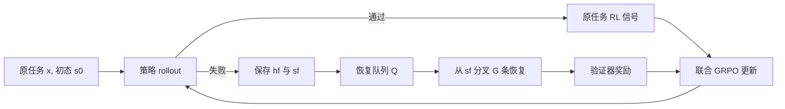

# ReTerm：把“失败后的恢复”变成终端 Agent 的训练对象

> 论文：**ReTerm: Recovery Training for Self-Improving Terminal Agents**  
> 分类：大模型 Agent / 后训练  
> 原文：[arXiv:2610.18484](https://arxiv.org/abs/2610.18484)（v1，2026-10-13）｜代码：[twothsnd/ReTerm](https://github.com/twothsnd/ReTerm)  
> 基座：Qwen3.5-9B｜核心评测：Terminal-Bench 2.0、OpenThoughts-TBLite、SWE-bench Verified

## TL;DR

- **它解决什么？** 终端 Agent 的长程执行并非只会“没做完”：一次错误命令、错误诊断或错误验证会留下文件、进程、配置与错误假设。后续动作是在一个已被自己污染的状态中继续，普通只从初始状态采样的训练很少教模型如何接手。
- **怎么做？** ReTerm 先收集基座模型的真实失败轨迹与 VM 快照，让更强教师从失败状态继续修复；通过验证器、格式、约束遵循、效率四道筛选，得到约 10K 条恢复轨迹用于 SFT。随后 ReTerm-GRPO 从当前策略的新失败状态分叉多条恢复 rollout，把原任务与恢复任务共同做 group-relative RL。
- **证据是什么？** 基于 Qwen3.5-9B，论文报告 Terminal-Bench 2.0 `34.8% Pass@1`，相对基座 `20.2%` 提升 **14.6 个百分点**；OpenThoughts-TBLite 为 `60.6%`，SWE-bench Verified 为 `58.4%`。跨 Terminus-2、mini-SWE-agent、OpenHands 三个外部 harness 仍分别有 `+10.1/+6.7/+12.4pt`。
- **核心判断。** 增益不仅来自“更多 RL”：消融中普通 GRPO 为 `28.0%`，ReTerm-GRPO 为 `34.8%`。论文将这个差额归因于显式优化“从失败遗留状态继续完成任务”的行为。
- **局限。** 这些是作者报告的单模型、单训练管线结果；恢复率图中，除工具使用错误外，ReTerm-GRPO 在其余四类错误上仍不超过 `32%`。成功验证器不等于完备正确性，教师数据、LLM judge 与环境快照成本也使复现门槛很高。

## 研究问题：为什么“从头再来”不是充分的 Agent 训练分布？

### 失败不是一个二元标签，而是一份状态负债

终端任务的状态由工作区、依赖、服务、临时文件、版本控制、工具输出和对话历史共同构成。一次失败后的状态 `s_f` 既可能包含可保留的中间成果，也可能包含使后续动作偏航的残留。把任务仅表示为初始状态 `s_0` 上的成功率，会漏掉一个实际部署中反复出现的问题：**Agent 要在不知道隐藏测试细节的条件下，判断哪些遗留物可信、该修、该隔离还是该推倒。**

| 常规训练隐含假设 | 真实终端执行中的反例 | ReTerm 的重写 |
|---|---|---|
| rollout 从干净环境开始 | 失败尝试已经修改环境 | 以 `(x,h_f,s_f)` 作为恢复任务 |
| 失败只提供 0 奖励 | 失败轨迹包含可诊断的因果线索 | 保存历史与快照，继续执行 |
| 通过任务即可 | 反复无效命令也可能偶然通过 | 增加合规与效率过滤 |
| 固定数据足够覆盖错误 | 策略变化会改变错误分布 | 用在线队列持续加入新失败 |

### 论文的论证路线

| Claim | Mechanism | Evidence | Boundary |
|---|---|---|---|
| 真实失败更适合教恢复 | 从基座自然失败快照续接，而非人工注错 | ReTerm-10K 与 SFT 增益 | 没有直接的同预算“自然失败 vs 人工注错”因果实验 |
| 恢复可随策略共同演化 | ReTerm-GRPO 从当前策略失败分叉 | 普通 GRPO `28.0` vs ReTerm-GRPO `34.8` | 仅报告一个主要基座与环境族 |
| 能力不只是 harness 提示格式 | 固定 Terminal-Bench 任务换四种 harness | 三个外部 harness 仍正向 | 不能推出所有工具协议都同样迁移 |
| 改善确实涉及恢复 | 按五类错误测恢复率 | 图中所有类别高于基座与 GRPO | 错误分类有 LLM judge，且总体恢复仍低 |

## 方法：先把失败保存下来，再学习如何接手

### ReTerm-10K：三阶段恢复数据管线

1. **失败状态收集**：在来自 TMax-15K 的可执行任务上为基座采样多次尝试；每次在 VM 容器中执行，记录推理、命令、观察与完整交互史 `h_f`。在运行验证器前暂停并保存 VM 快照，失败样本才进入下一步。
2. **教师恢复**：恢复该快照，由 DeepSeek-V4-Pro 在只知道“前一尝试失败”、但不知道隐藏测试反馈的情况下续做。它必须读历史、审计遗留状态、重建原任务契约、诊断失败并完成修复。
3. **四级过滤**：保留验证器通过的样本；剔除格式/工具调用畸形样本；剔除显式违反任务限制的样本；再剔除无意义重复动作循环。前两项为确定性规则；后两项先规则初筛，再用 DeepSeek-V4.1-Flash 做上下文判断。

论文最终得到约 **10K** 条样本。其九个领域占比为 `8.4–14.2%`；`4–8k` 输出 token 的恢复最多（`37.1%`），`69.6%` 位于 `2–8k`；`9–16` assistant turns 最多（`38.0%`），`87.8%` 在 32 turns 内结束。这些统计不是性能证明，却说明恢复轨迹不是一次短小纠错，而是有相当长的状态检查与验证过程。

### SFT：只学习教师接管后的 token

给定任务指令 `x`、学生失败历史 `h_f`、恢复提示 `r` 与教师续写轨迹 `y`，论文的监督目标为：

$$
\mathcal{L}_{\mathrm{SFT}}=-\mathbb{E}_{(x,h_f,r,y)}\left[\sum_{t\in\mathcal{A}(y)}\log\pi_\theta(y_t\mid x,h_f,r,y_{<t})\right].
$$

- `\mathcal{A}(y)` 只包含教师生成的恢复 token；原失败历史和提示被 mask，避免把“已经失败的动作”当作目标模仿。
- 这使模型学习的对象不是“解题全轨迹”，而是条件化策略 `\pi_\theta(\text{repair}\mid x,h_f,r,s_f)`。
- 作者生成数据时给教师结构化 workflow，但 SFT 时移除详细 workflow，只保留最小恢复提示；这是为了降低模型对长提示词的依赖。该点合理，但论文没有提供“保留/移除 workflow”的消融，因此不能量化其贡献。

### ReTerm-GRPO：让失败样本跟着策略移动

从原始任务池 `\mathcal{T}=\{(x,s_0)\}` 出发，对每个任务采样 `G` 条原始 rollout：

$$
\tau_i^O\sim\pi_{\theta_{old}}(\cdot\mid x,s_0),\qquad R_i^O=V_x(s_i^O).
$$

只要一个 group 内存在失败，就抽取一条失败轨迹的历史与末态，形成恢复任务 `(x,h_f,s_f)`；从该状态再采样 `G` 条恢复 rollout：

$$
\tau_i^R\sim\pi_{\theta_{old}}(\cdot\mid x,h_f,r,s_f),\qquad R_i^R=V_x(s_i^R).
$$

其中 `V_x` 是任务验证器。原任务组和恢复任务组各自在 group 内标准化奖励、得到相对 advantage，随后共同优化。关键工程装置是容量为 `K` 的**恢复任务队列**：新失败从队首优先取样，过老任务溢出时淘汰。它试图同时解决两个问题：一个 batch 失败太少，无法稳定训练；保留过久的失败又会与新策略失配。

```text
Input: task pool T, policy πθ, verifier V, recovery queue Q(capacity K)
State: original groups O; recovery groups R
repeat
  sample (x, s0) from T; roll out G attempts from s0
  score each attempt with V; optimize original group O
  if a failed attempt exists:
      preserve (hf, sf); prepend (x, hf, sf) to Q
  sample recent recovery tasks from Q
  for each task: roll out G continuations from sf; score with V
  optimize recovery group R and joint objective O + R
  discard oldest tasks if |Q| > K
until budget exhausted
Output: policy that solves and recovers
```

失败边界也很明确：如果验证器无法分辨“补丁恰好过测试”和真正满足任务，`R_i` 会把错误学习信号放大；队列只能降低、不能消除策略分布漂移。

## 实验：性能、迁移与恢复是否一致指向同一件事？

### 主结果

| 模型 | OpenThoughts-TBLite | Terminal-Bench 2.0 | SWE-bench Verified |
|---|---:|---:|---:|
| Qwen3.5-9B 基座 | 44.2 | 20.2 | 45.2 |
| TMax-9B | 57.2 | 27.2 | 53.5 |
| ReTerm-9B | **60.6** | **34.8** | **58.4** |
| 相对基座变化 | +16.4 | +14.6 | +13.2 |

数字表明作者的训练并未只在一个 terminal benchmark 上得分：SWE-bench Verified 也有提升，且文中称其超过同为 9B 的 Socratic-SWE。不过，这仍不是与所有公开系统公平的成本对照；表中闭源大模型与超大开源模型使用不同容量、工具与运行预算，不能从横排分数直接推导算法优越性。

### Harness 迁移：把提示格式变化当作干扰因素

在固定 Terminal-Bench 2.0 任务上，作者比较 ReAct 训练 harness、Terminus-2、mini-SWE-agent 与 OpenHands：

| Harness | 基座 | ReTerm-9B | 增益 |
|---|---:|---:|---:|
| 训练 ReAct | 20.2 | 34.8 | +14.6 |
| Terminus-2 | 22.5 | 32.6 | +10.1 |
| mini-SWE-agent | 19.1 | 25.8 | +6.7 |
| OpenHands | 15.7 | 28.1 | +12.4 |

这张表比主表更有解释力：若提升只是训练 harness 的格式记忆，外部 harness 应显著塌缩；实际仍为正。不过最低增益是 `+6.7`，也说明交互协议仍会影响最终表现，不能把恢复能力视为完全 harness 无关。

### 消融：把“恢复导向 RL”的额外贡献隔离出来

| 阶段 | Terminal-Bench 2.0 Pass@1 | 相对上一阶段 |
|---|---:|---:|
| Base | 20.2 | — |
| Recovery SFT | 25.8 | +5.6 |
| 标准 GRPO | 28.0 | +2.2 |
| ReTerm-GRPO | **34.8** | **+6.8** |

最应审慎解读的是最后一行：它支持“在作者该训练预算和实现下，恢复分支帮助很多”，却未独立控制额外恢复 rollout、队列采样频次与 token 预算。更严格的反事实应让普通 GRPO 享受等量环境交互、等长上下文与等验证调用，再比较目标函数本身。

## Figure / Table 证据解读：哪些结果支撑机制，哪些仍只是迹象？

### Figure 1 与数据统计：训练对象确实是“接管”，不是普通轨迹重放

恢复管线图的证据作用在于保留 `h_f` 和 VM 快照；没有 `s_f`，教师看到的只是一段失败日志，无法验证补丁是否在真实遗留文件与进程上工作。数据图显示样本分布和长度，但它**不能**证明数据多样性足够覆盖罕见灾难性失败，也不说明教师是否引入风格偏差。

### Figure 2 与恢复率图：机制对五类错误有更直接的观测

作者定义规划、工具使用、实现、验证、资源管理五类错误，并以 DeepSeek-V4.1-Flash 判断恢复结局、再人工核验。ReTerm-GRPO 在五类上均高于基座与普通 GRPO，是“改善不只来自最终 Pass@1”的补强证据。但图的反面同样重要：除工具使用错误外，其余类别恢复率仍 **≤32%**。这说明系统尚不能稳定修复更抽象的计划、实现与验证偏差。

### Figure 3 训练曲线：联合目标没有明显互相破坏，但不等于稳定性已证明

原任务组和恢复任务组的平均奖励都在早期上升并随后趋稳，恢复组上升更大。它支持“恢复训练未立即牺牲原任务奖励”；但单次曲线没有 seed 方差、没有长期持续学习压力测试，也不能排除奖励黑客或评测泄漏。



## 相关工作中的位置：与“造错再修”和一般 RL 的差别

- 与普通可验证 RL 相比，ReTerm 不改变“验证器给奖励”的根基，改变的是训练状态分布：将策略自己的失败显式转成第二类任务。
- 与 TermiGen 一类通过手工/合成错误来构造修复样本的思路相比，作者强调自然失败与当前策略更贴近；但这是一条动机与间接消融，而不是本文已经彻底实证的分布匹配结论。
- 与仅在对话上下文中“反思重试”的 Agent 方法相比，VM 快照把恢复扩展到文件系统与进程等外部状态。代价是环境快照、重放和验证器必须高度可靠，适用范围自然更窄。

## 可复现性与证据边界

- **已公开的可审查物**：arXiv 源码给出数据管线、目标、表格、提示词和错误类别定义；官方仓库已公开。本文未将论文图直接本地化，因为当前深读所需的关键数字、流程与边界可由文本、表格和伪代码精确承载。
- **复现要核对的变量**：TMax-15K 任务切分、VM snapshot 行为、教师模型版本与采样参数、四级筛选的阈值/提示、队列容量 `K`、每组 rollout 数 `G`、奖励归一化和测试 harness 版本。
- **评测边界**：Terminal-Bench 与 SWE-bench 的验证器测的是特定任务契约；论文没有证明恢复策略面对安全敏感命令、不可逆副作用或真实生产权限时仍可安全运行。
- **数据治理边界**：教师从失败环境继续工作本身可能接触模型生成的污染文本与文件。论文把它们当任务状态，而不是不可信内容源；若迁移到联网或多租户环境，恢复前还需额外的 provenance、权限与隔离层。

## 领域延伸：从“会解题”到“会收拾自己留下的局面”

ReTerm 最有价值的概念贡献，是把 Agent 的可靠性拆成两种能力：首次规划质量和**状态债务清偿能力**。后者不应只以一次最终成功判定；未来基准可记录“破坏量、可恢复性、独立验证次数、恢复后残留”这样的过程指标。

进一步的问题也更尖锐：

- 如果恢复队列主要保留最近失败，它会不会遗忘早期但高风险的罕见故障？可以研究按严重性与新颖性加权的 replay，而非纯 FIFO。
- 若验证器存在漏洞，恢复训练会不会更擅长找到漏洞而非修好任务？需要独立、隐藏且多视角的验证，而非复用同一个奖励接口。
- 对有权限的 computer-use Agent，“保留、修复、隔离、丢弃”必须受策略约束；性能导向恢复不可替代安全边界与人工升级路径。

因此，这篇论文的可信结论不是“终端 Agent 已经可靠自愈”，而是：在作者的可验证终端设置里，把自然失败状态作为一等训练对象，能带来可观且跨 harness 的提升；但最难修的错误仍大多没有被修复，安全部署还需要超出 Pass@1 的状态治理。

## 逐项拆开：恢复流程的每一步究竟避免了什么失败？

### 先审计继承状态，而不是立刻继续敲命令

论文附录中的恢复 workflow 把第一步称为 inherited-state audit。它要求检查任务产物、中间输出、临时文件、配置改变、服务或进程状态，并把相关状态归为可信、部分可信、损坏或有害。这个看似朴素的步骤在论证里十分关键：如果模型把上一轮自己生成的测试、日志或半成品当作事实，就可能把一个错误假设继续固化。

- **保留**：与原任务契约一致、且已经被独立检查的中间产物。
- **局部修复**：方向正确但不完整的实现，例如缺少边界条件或遗漏验证。
- **隔离**：来源不明、可能误导后续判断的生成文件、缓存和自测结果。
- **丢弃**：由错误高层假设产生的整套方案；此时继续打补丁通常只会增加状态债务。

这也揭示 ReTerm 与“再试一次”的差异：重试把失败当成噪声，恢复则把失败视为带 provenance 的状态转换。论文训练中的 VM snapshot 是这个区分能够落地的前提；若只有文本历史，模型无法知道文件系统是否已被改写、服务是否仍在运行、或某个配置是否改变。

### 重建任务契约：把验证从继承的自测中剥离出来

附录要求恢复模型重新回答四个问题：最终状态是什么、交付物是什么、哪些约束必须成立、什么才算语义上的成功。随后它要构造一个**独立测试**，而不是直接复用由当前实现产生的测试或预期结果。该约束意在打断一个常见循环：模型先根据错误理解写代码，再写一个刚好确认该理解的测试，最后把“测试绿了”错当任务完成。

| 恢复时观察到的信号 | 不应得出的结论 | 更合适的处理 |
|---|---|---|
| 命令返回 0 | 用户需求已满足 | 对照原任务与最终产物再验证 |
| 局部单测通过 | 集成路径正确 | 运行独立、端到端或反例测试 |
| 文件存在 | 内容语义正确 | 检查格式、边界和约束 |
| 先前计划很长 | 方向正确 | 明确列出关键假设与反例 |

这部分不是新增 benchmark 指标，而是数据生成与筛选里隐含的行为规范。因此它应被理解为方法的设计意图，而非作者已经用对照实验量化的能力来源。

### 为什么要从同一失败状态分叉 `G` 次？

在普通 online RL 中，同一个初始任务的多条 rollout 用于估计相对好坏；ReTerm 把相同结构放到 `s_f` 上。这样，组内 reward 差异比较的是“谁更会从同一个残局恢复”，而不是比较不同任务或不同损坏程度。

- 当所有恢复 rollout 都失败，group-relative 信号很弱；这正是当前能力边界，而不是可凭空放大的正样本。
- 当部分成功、部分失败，优势项会鼓励能识别状态、改变策略并完成验证的续做轨迹。
- 当所有都成功，组内区分同样有限；论文没有详细报告这种比例，因而无法判断信号密度与采样效率。

恢复队列的“新任务前插、旧任务过期”逻辑是一种经验上的非平稳分布处理。它比无限保存历史失败更贴近当前策略，却可能牺牲罕见的、长期没再出现但很严重的失败。论文未报告不同 `K`、不同时间衰减或优先级 replay 的消融，这是值得补做的实验。

## 指标阅读：Pass@1 的含义与不该额外加上的含义

`Pass@1` 只表示在一次规定采样/运行协议下，任务验证器接收该尝试的比例。对 ReTerm 而言，它是合理的一阶指标，因为训练奖励本身来自验证器；但它不提供以下信息：

1. **恢复成本**：额外恢复 turns、token、VM 恢复和验证调用是否抵消了成功率增益？
2. **不可逆副作用**：一次失败前是否已经删改、泄露或消耗了不能靠后续成功弥补的资源？本文环境主要是可重置基准，无法回答。
3. **校准程度**：模型能否在无望恢复时停止并升级，而不是制造更多状态变化？
4. **鲁棒正确性**：隐藏测试通过是否覆盖了任务的全部语义、性能和安全约束？

因此，把 `34.8%` 解读为“每三个终端任务有一个可靠完成”仍太强。它是某一评测协议下的首尝试通过率；而论文自己的错误分析也表明，遇到复杂失败后大多数样本未能恢复。

### 训练与评测明细清单

| 维度 | 论文给出的信息 | 读者应追问的缺口 |
|---|---|---|
| 基座 | Qwen3.5-9B | 是否有其他规模、架构的重复结果？ |
| 冷启动数据 | ReTerm-10K，约 10K 过滤后轨迹 | 原始候选数量、保留率、领域间质量差异？ |
| 教师 | DeepSeek-V4-Pro | 采样温度、上下文截断、教师成本与污染风险？ |
| 过滤 | verifier / format / compliance / efficiency | 每一层删除比例与误杀率？ |
| 在线 RL | 原任务与恢复任务共同 GRPO | `G`、`K`、权重和总环境交互预算？ |
| 主评测 | 三个 agent/coding benchmark | 是否使用完全隔离的训练任务、容器与 harness 版本？ |
| 错误分析 | 五类错误、LLM judge 后人工核验 | 标注样本量、标注一致性与人工复核协议？ |

这张清单并不否定报告结果；它划出了从“论文中已显示的效果”走向“可独立复现、可部署结论”所需的补充证据。

## 如果复现：最小实验不应只复现最终分数

更可检验的复现计划应至少拆成四个相互独立的问题：

1. **状态可恢复性**：保存并恢复环境后，`s_f` 是否与失败时的可见文件、进程和工具状态一致？如果 snapshot 本身不可重放，训练对象就发生了变化。
2. **数据质量**：随机抽取通过四级筛选的轨迹，检查是否真的诊断、修复、独立验证，而非通过偶然条件或测试漏洞过关。
3. **目标函数贡献**：在相同 token、相同 verifier 调用、相同失败状态数下，比较标准 GRPO、仅多 rollout 的 GRPO、恢复队列但不分支、完整 ReTerm-GRPO。
4. **部署式评测**：把恢复能力和副作用一起计分。例如记录恢复前后的不必要文件修改、失败重试次数、超时、独立测试覆盖、以及主动请求人工帮助的准确性。

如果上述第一、二项无法成立，后续高分只能说明某个特定环境中存在有效捷径；如果第三项没有成立，就难以把增益归因给恢复目标；如果第四项没有成立，也还不能把 benchmark 改善外推到有真实权限的终端 Agent。

从这个意义上说，ReTerm 不是终点，而是一种更严格的训练问题表述：系统必须学会辨认自己造成的局面，并在证据不足时保持克制。未来工作应把这种克制、隔离与求助也纳入可验证的恢复目标。
