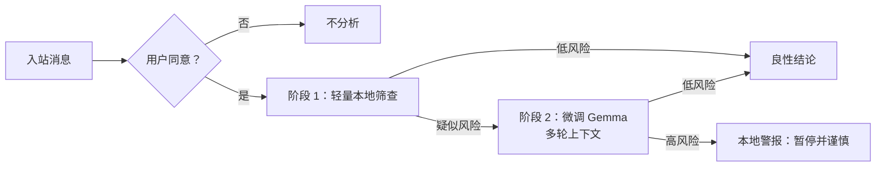

# 在端侧把“可疑”升级为“可解释的风险”：Google DeepMind 与新加坡的 Gemma 反诈骗微调细读

> **原文**：[Google DeepMind and Singapore Government collaborate to build fine-tuned AI model for scam detection](https://deepmind.google/blog/on-device-ai-scam-detection-mddi/)  
> **发布日期**：2026-10-14；**类别**：大模型后训练 / AI 安全；**类型**：官方技术博客  
> **本文边界**：本文逐段解读该公告已经公开的架构、数据治理和部署承诺。它不是论文；原文没有披露模型版本、参数量、训练超参、测试集规模、误报漏报、端侧延迟、电池开销或产品上线日期。以下所有“应当验证”的项目都不是已被公告证明的效果。

## TL;DR

- Google DeepMind 与新加坡 GovTech 将轻量级 Gemma 针对本地诈骗对话做了微调，目标不是在云端阅读通信，而是在用户同意后、设备本地识别**操纵性对话模式**，在资金或凭证暴露之前提示用户暂停。
- 关键工程选择是两阶段级联：低功耗分类器先筛入站消息，只有疑似风险的片段才交给微调 Gemma 做多轮上下文判断。这把昂贵的语言理解集中在少数难例上，试图同时降低算力、续航和隐私成本。
- 作者公开了训练治理而非训练配方：微调在 GovTech 管理的 GCP sovereign sandbox 内进行；训练数据是从诈骗报告和情报馈送导出的匿名化数据，明确排除私密或可识别公民数据；测试包括合成对话与本地语料。
- 这份公告提供的是一种**部署论证**：本地语境不足使通用模型易错、云端扫描伤害隐私、单一大模型耗电，因此采用本地微调 + 轻量过滤 + 上下文复核 + 同意授权。它并没有给出足以比较模型好坏的 benchmark。
- 文章给出的宏观动机是：诈骗占新加坡报案犯罪过半，2019 年以来损失超过 S$4 billion；复杂社会工程造成的损失可达全部损失的 80%。这些数说明问题严重，却**不能**证明该模型降低了任何损失。
- 最大安全难点不只是“识别率”：第一阶段漏掉的欺诈永远不会被 Gemma 复核；高敏感度又会把大量普通对话升级，形成警报疲劳。实际价值取决于分流阈值、校准、对抗性测试、用户界面和申诉/反馈闭环。
- 公告只说将“谨慎、分阶段”集成应用，且部署时模型仅在用户同意下访问本机对话。因此它应被理解为已展示能力与治理设计，**不是已经全面部署的公共安全产品**。

## 这篇公告到底在解决什么问题？

### 不是把垃圾邮件分类搬到手机上

原文把背景放在投资骗局、虚假职位和冒充公职人员上。这些案例的共同点不是某个独立关键词，而是攻击者在多轮对话中逐步建立信任、施压、制造时间紧迫性，再诱导转账或给出凭证。于是任务可写成：给定截至时刻 \(t\) 的消息上下文 \(C_{1:t}\)，判断是否存在会导致高风险行动的操纵意图 \(y\)。

\[
f(C_{1:t}) \rightarrow \{\text{benign},\ \text{suspicious},\ \text{scam alert}\}
\]

这里的难处在于：

1. **语义依赖跨轮次。**“帮我确认一下”“别告诉别人”各自可能无害；与冒充身份、索要 OTP、催促汇款连在一起才构成证据链。
2. **本地化并非装饰。**银行名、公营机构称呼、地方人物、近期流行话术与多语夹杂会改变词义和先验。原文因此说，通用模型对本地欺骗技巧常常不足。
3. **隐私与检测冲突。**服务端扫描能集中更新模型，却要求消息离开端侧；端侧推理减少这一暴露面，却受功耗、存储、延迟和应用权限限制。
4. **攻击者会适应。**诈骗不必复用训练文本，可以改写、插入正常闲聊、切换语言、利用图片/语音或把关键指令移出被扫描的通道。

换言之，作者不是声称“语言模型能证明一段话是诈骗”，而是在设计一个能在真实通信环境中提醒人的风险决策系统。这个问题重述很重要：最终输出是一个用户可行动的提示，而非刑事事实判决。

## 作者的论证路线：从社会损失到端侧分流

公告的结构很紧凑，可还原为下列 claim → mechanism → evidence → boundary 链条。

| 环节 | 作者主张 | 公开机制/证据 | 尚未被证明的边界 |
|---|---|---|---|
| 风险 | 对话式社会工程已成为主要损失来源 | 公告列出诈骗占报案犯罪过半、2019 年以来超 S$4b、复杂对话最多占损失 80% | 宏观统计不等于该系统的因果收益 |
| 语境 | 通用模型不擅长本地欺骗技巧 | 用本地诈骗对话微调轻量 Gemma，覆盖机构/银行/地方人物/区域性方案 | 未给 zero-shot 与 fine-tuned 的对照分数 |
| 隐私 | 不应靠云端读取私聊来防诈 | 对话在设备处理；部署时须用户同意；Google 与政府不经部署访问对话 | 应用实际权限、遥测与崩溃日志策略未披露 |
| 效率 | 手机不能对每条信息跑复杂模型 | 快速分类器分流，再由 Gemma 看较大多轮快照 | 缺少召回、升级率、毫秒延迟、mWh 或内存数字 |
| 治理 | 训练及测试要避免扩大数据风险 | sovereign sandbox、匿名化报告/情报、排除 PII、合成对话与本地语料压力测试 | 去标识化方法、审计方、数据保留与红队覆盖率未知 |

表中最后一列不是吹毛求疵，而是读此类官方发布的正确方法：作者提交的是一套有希望的系统设计，证据的粒度则仍是“做了哪些保护与测试”，不是“在何种可复现协议下取得何种数值”。

## 方法机制：为什么两阶段比“一次大模型判断”更像可部署系统？

### 第一阶段：便宜地保留风险候选

设每条新入站消息或小窗口为 \(x\)，轻量分类器给出风险分数 \(p_1(x)\)。当分数超过阈值 \(\tau_1\) 时，它不直接报警，而是将会话升级：

\[
z = \mathbb{1}[p_1(x) \ge \tau_1], \qquad
z=0 \Rightarrow \text{benign verdict}
\]

原文称这一层使用最少电力，专注捕捉潜在威胁。它在论证里的功能是让端侧防护有常驻运行的可能。若所有入站消息都送给语言模型，即使单次推理不慢，也会在高消息量、低端设备和后台调度下累积能耗。

但是 \(\tau_1\) 是整个系统的安全旋钮：

- 阈值太高，\(p_1\) 的假阴性直接成为**级联系统的不可恢复漏检**；第二阶段再强也见不到这些对话。
- 阈值太低，升级率 \(r=P(z=1)\) 增大，耗电和第二阶段吞吐随之上升，用户也可能被过度干预。
- 分类器若只学到“转账”“验证码”等表层触发词，攻击者通过同义改写、跨语言拼接或延迟关键请求即可绕过。

公告没有公布 \(\tau_1\)、第一阶段模型、训练数据或召回率。因此“使用轻量筛查器”是已披露的架构事实；“低功耗且安全地捕获大多数诈骗”仍是待测命题。

### 第二阶段：用上下文消解第一阶段的粗糙判断

对被升级的会话，微调 Gemma 查看更大的多轮快照 \(C_{t-k:t}\)，输出 \(p_2(y=\text{scam}\mid C_{t-k:t})\)，再决定警报或良性结论：

\[
\hat y = \mathbb{1}[z=1\ \land\ p_2(y=1\mid C_{t-k:t})\ge\tau_2]
\]

这一步的价值是把“消息看起来像风险”改写为“该消息在这段关系、承诺、催促与索取序列里是否构成操纵”。原文明确称之为 in-context analysis，并指出它可确认威胁或丢弃 false alarm。也就是说，第二阶段的设计目标既是提高检出，也是在第一阶段故意偏敏感时回收精度。

可用一段贴近公告、但不冒充其实现的伪代码描述数据流：

```text
Input: incoming message m, local conversation buffer C, user consent g
State: stage-1 threshold τ1, stage-2 threshold τ2

if not g:
    Output: no analysis
else:
    C <- append(C, m)
    if FastClassifier(m) < τ1:
        Output: benign verdict
    else:
        score <- FineTunedGemma(recent_window(C))
        if score >= τ2:
            Output: on-device scam alert; advise pause before sharing funds/credentials
        else:
            Output: benign verdict

Failure boundary: a stage-1 false negative is never escalated;
                  a misleading alert can cause fatigue or distrust.
```

这段流程也展示了一个被宣传语掩盖的产品问题：第二阶段分析“更大快照”时，窗口大小 \(k\)、上下文截断、群聊参与者、附件和跨应用转发都会改变判断。公告只承诺端侧处理和同意访问，并未说明这些数据边界如何具体落地。

### 端到端的成本模型

两阶段策略的平均计算成本可粗略表示为：

\[
E[\mathrm{cost}] = c_1 + P(z=1)\cdot c_2
\]

其中 \(c_1\) 是每条消息的快速筛查成本，\(c_2\) 是多轮 Gemma 推理成本。它比“每条信息都跑 Gemma”的 \(c_2\) 有利，当且仅当 \(c_1 \ll c_2\) 且升级率足够低。反过来，如果安全目标把 \(\tau_1\) 设得很低，\(P(z=1)\) 接近 1，级联的效率优势会消失。这正是读者未来应向发布方索取的曲线：在不同 \(\tau_1,\tau_2\) 下，precision、recall、升级率、能耗和警报数如何共同变化？



## 后训练：本地化数据为什么是机制的一部分？

作者把“轻量 Gemma 的微调”置于方案中心，却没有公布 SFT、偏好优化、RL 或蒸馏中的哪一种配方。能确认的是训练语料覆盖本地机构、银行、地方人物及热门区域性骗局；来源是诈骗报告与情报馈送的匿名化数据，且不含公民私人或可识别信息。

从后训练角度，这意味着目标并不只是一般的 toxic/safe 二分类。更合理的训练目标是使模型把下列局部线索组合成会话级风险：

- **身份主张**：谁自称来自银行、政府或平台，是否与前序对话矛盾；
- **操纵策略**：恐惧、稀缺、权威、保密和时间压力如何叠加；
- **行动请求**：是否索要凭证、转账、下载、屏幕共享或绕过正常核验；
- **语境反证**：用户是否已通过官方渠道核验，是否仅在讨论新闻、教育或模拟情景；
- **本地先验**：真实机构的称谓和流程、区域语言习惯、特定时期常见的诱饵。

用抽象的监督形式写，数据可记为 \(D=\{(C_i,y_i)\}\)，微调最基础的目标是最小化：

\[
\mathcal L_{\mathrm{risk}}(\theta) = -\sum_i \log p_\theta(y_i\mid C_i)
\]

但这并不代表官方使用了该损失，也不表示标签足以捕捉真实伤害。诈骗报告是被发现、被报告后的样本；情报馈送有收集偏差；合成对话便于覆盖类别，却可能不含真实用户的犹豫、代码切换或攻击者的适应性。公告承认做了合成对话与本地语料 stress-testing，却没有给出各类数据的占比、标注规则或测试隔离方式。

## 证据逐项核对：原文说了什么，没有说什么？

### 已公开的四类证据

1. **问题规模证据。**新加坡的诈骗损失与社会工程占比用来说明为何需要对话级检测；它是选择任务的动机，不是模型效果。
2. **架构证据。**配图和文字都确认两阶段流程：Fast Screening Classifier → Fine-tuned Gemma → Scam Alert / Benign Verdict。这是本文最具体、可供工程复核的技术资产。
3. **治理证据。**主权沙箱、匿名化来源、排除 PII、端侧运行、用户同意和分阶段部署共同构成数据与访问控制承诺。
4. **测试存在性证据。**“合成对话和本地语料、覆盖不同诈骗类别及不断演化的冒充战术”说明作者做过压力测试，但未说明测试成绩。

### 缺失指标不等于失败，但决定应如何解读

下表把常见但尚未公开的评估问题显式列出。它避免将“tested”误读成“已在某基准达到某个 SOTA”。

| 需要的度量 | 为什么关键 | 公告状态 |
|---|---|---|
| 分诈骗类、语言、设备的 precision / recall / F1 | 总平均会掩盖特定社群或高损失类别的漏检 | 未公开 |
| ROC/PR 曲线与两个阈值 | 级联系统的风险、成本和警报疲劳由阈值共同决定 | 未公开 |
| 第一阶段升级率与漏检率 | 决定 Gemma 有多少机会纠错、也决定电量 | 未公开 |
| 端侧 P50/P95 延迟、功耗、内存、发热 | “lightweight”“battery efficiency”需要可测的设备证据 | 未公开 |
| 与未微调 Gemma、传统规则/云端模型对照 | 支撑“本地微调”带来的增益与取舍 | 未公开 |
| 红队攻击、跨语改写、时间漂移测试 | 对抗者会专门绕过第一阶段和提示语言 | 未公开 |
| 用户研究与行为结果 | 警报是否让人暂停核验，而非盲目忽略或恐慌 | 未公开 |

原文中的流程图是唯一直接技术图表。它支持“级联存在”和各分支的语义，**不支持**任何吞吐、准确率或成本结论。没有表格、没有消融、没有失败样例，是此博客和论文最根本的证据差异。

## 失败模式与安全边界

### 级联的两个错误会如何传递？

设第一阶段召回为 \(R_1\)，第二阶段在已升级样本上的召回为 \(R_2\)。在简化独立近似下，端到端诈骗检出上界近似 \(R_{\mathrm{end}}\approx R_1R_2\)。这揭示了一个常被忽略的事实：第二阶段再好也无法补回第一阶段从未上送的内容。

同样，若正常对话被第一阶段频繁升级，第二阶段需要在自然语言歧义中承担拒绝假阳性的责任。把所有警报都看成“安全宁可错报”也不充分：对金融对话反复报警可能打断正常沟通、降低对应用的信任，甚至促使用户关闭授权。

### 公告的隐私承诺如何成立？

作者的说法是：模型整段运行在设备端；部署后仅在用户同意下访问设备对话；Google 和政府不会通过部署获取对话。该承诺减少的是**内容离开设备**的风险，值得与“是否完全没有数据处理风险”区分。

- 必须另行说明应用是否上传匿名遥测、警报计数、模型崩溃报告或用户反馈；公告没有展开。
- 用户同意需要是可理解、可撤回、按应用/对话分粒度的吗？原文仅说明依照应用的使用条款。
- 在端侧保存的对话窗口、分类分数和警报历史如何加密、保留多久、谁可访问，均尚待产品文档回答。
- 端侧模型还需面对本地恶意应用、root/jailbreak、屏幕读取和提示绕过；它不等于端点天然安全。

### 公平性与误伤

本地化可以提升针对区域诈骗的识别，却也会把方言、少数语言、非正式金融表达或真实紧急求助误当风险。对模型而言，“有权威口吻 + 要求迅速行动”是有效线索；对真实用户而言，它可能是合理的亲友借款、医疗提醒或工作流程。没有按语言、年龄、设备、诈骗类型和受害场景分层的结果前，不能宣称该系统对不同群体同样可靠。

## 把公告放回 AI 安全与后训练的坐标系

### 它与传统内容审核不同在哪里？

内容审核常问“文本是否违反平台规则”，云端风控常问“账户或交易是否异常”。这里的问题是：一个私密多轮会话是否出现足以提示用户暂停的**操纵轨迹**。输出不应是封号或定罪，而是具有不确定性表达的本地安全建议。这个定位降低了模型直接裁决的伤害，也使人机交互成为整个系统的一部分。

### 它与一般 Gemma 微调不同在哪里？

后训练在此不是单纯让模型会说当地语言，而是把当地诈骗机制、机构称呼和行动风险对齐到一个受资源限制的判断任务。其成功标准至少有三轴：

| 轴 | 需要优化的对象 | 不能只靠什么 |
|---|---|---|
| 检测 | 对真实、变体和新型骗局的召回与校准 | 单一离线 F1 |
| 隐私 | 内容最小化、同意、端侧隔离与可撤回性 | “不上传”一句口号 |
| 可用性 | 延迟、续航、警报频率、解释和用户采纳 | 仅看模型大小 |

这也说明为什么原文采用两阶段而非直接把最大模型放上手机：系统安全不等于模型安全，部署成本、权限和行为反馈都是机制的一部分。

## 研究者接下来该追问什么？

1. 能否发布不含敏感文本的评测协议：按骗局类型、语言/代码切换、时间漂移和攻击者改写报告级联系统的 PR 曲线？
2. 第一阶段是否采用独立于 Gemma 的模型？它如何处理附件、语音转写、URL、引用消息与跨应用上下文？
3. 对“本地语境”的收益，是否有未微调 Gemma、规则系统、传统文本分类器与云端模型的受控对照？
4. 面对对抗者观察警报文案后反向提示注入或刻意稀释话术，模型更新、红队和回滚策略是什么？
5. 警报应如何呈现不确定性，既让用户暂停核验，又避免把正常对话贴上犯罪标签？对真实用户的决策改善是否经过随机或准实验检验？

## 结论：一个值得追踪的“受约束后训练”案例

这篇公告的可信贡献不是声称已经解决诈骗，而是清楚地把技术路线收束为：**本地语料微调的轻量模型 + 便宜的前置分流 + 多轮语境复核 + 端侧/同意/主权沙箱治理**。对于大模型后训练，它说明训练对象可以是一个严格受资源、权限和人机交互约束的安全决策环节；对于 AI 安全，它说明隐私不是模型部署后的附注，而是决定架构的前提。

当前证据最强的是架构和治理承诺，最弱的是可量化效果与外部可复现性。因而恰当结论是：该项目展示了端侧反诈骗的一个合理系统方向，并称已完成相关压力测试；它尚未公开足以证明准确、节能、公平、抗规避或已降低真实世界损失的实验数据。后续若发布模型卡、评测表、设备曲线或分阶段部署结果，才可把这份设计论证推进为可审计的安全效果主张。

## 复核清单：下一次更新应带来哪些一手证据？

若项目继续公开资料，研究者不应只关注“模型是否更大”或“是否上线”，而应把新信息映射回原始主张。一个最小可审计包至少要覆盖下列项目：

- **数据卡**：说明匿名化是在采集前还是采集后完成，报告与情报各自的时间跨度、语言覆盖、去重方法、标注者与标签定义；尤其要说明训练/测试是否按骗局活动或时间切分，防止近重复话术泄漏。
- **模型卡**：给出 Gemma 基座和端侧量化版本、上下文窗口、第一阶段模型/特征、更新频率以及支持的手机类别。这样“lightweight”才可被不同设备上的同一指标检验。
- **级联评测**：除了第二阶段条件准确率，还要报告第一阶段的召回与升级率，以及端到端的混淆矩阵。只公布 Gemma 在已挑出的样本上的分数会系统性高估整体安全性。
- **对抗测试**：应包含提示词式绕过、拼写扰动、拼音/方言/代码混用、长时间低频建立信任、正常对话插入与诈骗者模拟反馈。测试失败样例比只列成功类别更有解释力。
- **人因证据**：记录警报文案是否让用户采用独立核验、是否增加误报造成的焦虑、是否存在关闭权限的反作用。检测系统的最终效益取决于人在警报之后做了什么。

这份清单也划出官方博客与完整技术报告的分界：前者足以说明合作方向、架构骨架与治理意图；后者才有能力让外部研究者估计泛化、成本和伤害。将两者混为一谈，会把一个谨慎的工程承诺误读成已经完成的科学结论。
