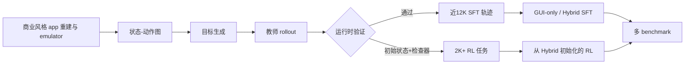

# OpenMobile-2：把移动 Agent 的瓶颈从模型改成可扩展的交互经验

- 原文：OpenMobile-2: Building Versatile Mobile Agents with Scalable Environments and App-Native Tools
- 类别：大模型 Agent / 移动端 GUI 与工具混合 Agent
- 论文：[arXiv:2610.14157](https://arxiv.org/abs/2610.14157)；[项目页](https://os-copilot.github.io/OpenMobile2-Home/)
- 官方日期：arXiv 分类 RSS 于 2026-10-14 标记该 v1；本文据此纳入本周窗口。

## TL;DR

- **它做什么**：OpenMobile-2 不是单独换一个视觉语言模型，而是把移动 Agent 的训练底座拆成可规模化环境、可验证轨迹、GUI 与 app-native tool 两个动作通道，以及在可执行任务上继续 RL 的完整闭环。
- **关键机制**：MobileGym++ 重建 35 个商业风格应用，并与已有环境合成超过 110 个 app；每个 app 的状态和业务对象可重置、可检查，因此可以把“是否完成”写成程序验证器，而不是只让另一个模型猜。
- **数据与训练**：作者给出近 12K 条 SFT 轨迹、2K+ 可执行 RL 任务、50+ app 上 300+ 个 scoped tool；最终 SFT 混合 GUI 和 tool 轨迹，RL 从 hybrid SFT 初始化。
- **证据**：27B 模型在 AndroidWorld 达 **79.9 Pass@1**、MobileWorld GUI 达 **50.4**；真实 Android 设备上的 SPA-Bench L3 从底座 **31.9** 升至 hybrid SFT **57.4**、再至 RL **59.6**。同一 MobileGym++ Bench 中，hybrid SFT 的 GUI+tool 成功率为 **65.6**，高于 GUI-only SFT 的 **57.7**。
- **最有价值的实验**：在未见的 MobileWorld MCP tools 上，9B/27B hybrid SFT 是 **27.5/45.0**，GUI-only 是 **12.5/35.0**。这比“在训练见过的工具上更高分”更接近 tool-use 抽象能力的证据。
- **局限**：环境中的商业 app 是功能性重建而非真实线上 app；部分 emulator 轨迹成功由 VLM judge 判定；RL 对训练环境匹配度敏感，27B 的 AndroidWorld 从 hybrid SFT 80.8 到 RL 79.9 反而略降。论文证明的是可控环境与真实设备间存在可观迁移，不是所有真实 app、账号状态或不可逆操作都已被解决。

## 研究问题：为什么“更多截图”不等于更多交互能力？

移动 Agent 的难点并不只是识别按钮。一个真实任务往往要跨页面搜索、筛选、填写、保存，并把一个 app 的动态值带到另一个 app。若训练只收集静态示范，模型难以学到失败后如何回滚、何时确认业务状态已经写入，也无法廉价地为每次新任务生成可信 reward。

作者将这个缺口拆成两个互相制约的条件：

| 条件 | 只用真实 app 的问题 | 只用浅层模拟器的问题 | OpenMobile-2 的回答 |
| --- | --- | --- | --- |
| 规模 | 登录、重置和并发昂贵，副作用难清理 | app 少、流程浅 | 商业风格功能重建 + 可扩展状态后端 |
| 训练信号 | 成功常需人工或模型评审 | 易有“玩具任务”偏差 | 任务绑定初始状态与程序检查器 |
| 动作接口 | 纯 GUI 泛化强但步骤冗长 | 纯 API 高效但接口窄 | 同一任务可选 GUI 或前台 app 的 native tool |
| 评测 | 点击/轨迹相似不等于业务完成 | 可能只考局部页面 | 比较前后 business-state diff |

因此论文的中心主张不是“工具调用胜过 GUI”，而是：**只有在可重置、可验证、足够多样的环境中，GUI 与工具的互补性和 RL 的收益才可以被可控地检验。**

## 论证路线：claim → mechanism → evidence → boundary

| Claim | Mechanism | Evidence | 仍不能证明什么 |
| --- | --- | --- | --- |
| app 覆盖是移动 Agent 训练的瓶颈 | 35 个重建商业 app 与已有 app 合为 110+ playground | 新 app 的中位数为 37 routes、166 interactive actions、86 transitions | 功能重建是否保留了线上 app 的全部例外状态 |
| 可验证数据能替代大规模人工演示 | 用状态-动作图生成任务，教师 rollout 后保留通过 checker 的轨迹 | 近 12K 轨迹、118,582 step-level SFT 样本、2,475 个 RL goals | 教师偏好和验证器盲区不会被数据放大 |
| GUI 与 native tools 是互补的 | 前台 app 才暴露其 tool catalog，策略逐步选择动作通道 | hybrid 在同任务的 hybrid 评测上优于 GUI-only | 所有真实 app 都能安全地提供 tool surface |
| RL 可带来额外收益 | 从 hybrid SFT 出发，在 512 个可执行任务上优化 | MobileGym SR、SPA-Bench 均上升 | 训练环境外、不同 reward 定义下仍会稳定上升 |

这张表也指出论文的严格边界：作者没有把任何一个数字解释为“通用手机自主性”完成。它给的是一条经验链：更宽的交互覆盖 → 可检查训练样本 → 在若干异构 benchmark 上的提高。

## 方法机制：环境、数据和动作空间如何接起来？

### 1. MobileGym++：把 app 变成可测状态机

对一个 app，论文可抽象为状态转移系统：

\[
s_{t+1} = T(s_t, a_t),\qquad a_t \in \mathcal A_{gui}\cup\mathcal A_{tool}(app_t).
\]

- \(s_t\) 包含屏幕可见内容，也包含不可见但决定任务是否真的完成的业务对象状态。
- \(\mathcal A_{gui}\) 包括 click、long press、swipe、type、system button、wait 与 terminate。
- \(\mathcal A_{tool}(app_t)\) 只在对应 app 位于前台时可用；因此它不是全局 API 快捷键，而是受上下文约束的第二动作通道。
- 成功并非“轨迹看起来合理”，而是检查初末状态差：\(V(s_0,s_T,g)\in\{0,1\}\)。这让同一任务能公平比较 GUI-only 与 hybrid。

MobileGym++ Bench 有 215 个任务、七个业务域：109 个单 app、74 个双 app、27 个三 app、5 个四 app。跨 app 难度来自信息搬运：Agent 必须读出一个业务值、跨边界带过去、写入目标对象；用户指令不会告诉它按钮名、tool 名或 checker 字段。

### 2. 从状态图生成可训练任务，而非只收集“漂亮演示”

作者先探索 app，合并感知相似的页面，得到代表性节点与动作边；再以全局/局部状态-动作图约束教师生成用户目标。这个顺序重要：它让任务生成依赖可达功能，而非让语言模型任意编造需求。

随后教师 Agent 执行目标并产生屏幕、动作与可选 tool call 的序列。保留条件是：

\[
\text{keep}(\tau)=1 \iff \text{complete}(\tau,g)\land \text{verify}_{runtime}(\tau)=1\land\neg\text{degenerate}(\tau).
\]

- Emulator 任务以视觉语言 judge 检查完成度；MobileGym++ 则以程序化 verifier 检查业务状态。
- 逐步过滤会删除无状态变化的动作与无意义循环，避免把“多点几下”学习成策略。
- 每个 SFT step 的输入包含任务、截至当前的历史和最近三张截图；更早的图被折叠成文本提示。输出是 Thought 加一个动作，坐标被归一化到 \(999\times999\) 空间。

这里的关键不是教师模型多强，而是数据工厂使“成功的 rollout”能被再次运行、复查、用于 RL，而不是一次性标注资产。

### 3. 训练流程：GUI-only、hybrid SFT 与 RL 是可分离比较

```text
Input: 任务 g、绑定初始状态 s0、GUI action set、foreground tool catalog、verifier V
State: policy πθ, trajectory τ ← ∅
for t = 1 ... T:
  observe screenshot/history and app_t
  choose a_t ~ πθ(. | g, τ, A_gui ∪ A_tool(app_t))
  execute a_t; append transition to τ
  if V(s0, s_t, g) = 1: return success, τ
  if terminate or budget exhausted: return failure, τ
SFT: maximize log πθ(a_t | g, history)
RL: initialize from hybrid SFT; optimize verified rollout reward
Failure boundary: judge/verifier false positive, unavailable tool, or state reset mismatch
```

两种 SFT 都训练 5 epochs；GUI-only 只见 GUI 轨迹，hybrid 吃完整混合；RL 再从 hybrid checkpoint 出发、从 2K+ 任务中随机取 512 个训练。这样设计使下面的比较各自回答不同问题：SFT 数据本身是否够用、工具是否带来附加通道、可执行 reward 是否还带来增益。



## 实验设置：数字真正比较的是什么？

论文的五类评测跨 emulator、真实设备与可重置模拟 app：AndroidWorld 有 116 个任务/20 个真实 app；MobileWorld 有 201 个更长的跨 app 任务；MobileGym 用 state-based verifier；MobileGym++ Bench 用相同 checker 比 GUI-only/hybrid；SPA-Bench 在物理 Android 上评测。

作者还检查了训练-测试文本重叠：SFT instruction 与 AndroidWorld、MobileWorld、MobileGym、MobileGym++ Bench 的 cosine similarity 超过 0.7 的比例分别为 1.11%、0.39%、0.46%、2.25%，没有超过 0.9；2,475 个 RL goals 对 MobileGym++ Bench 为 6.1% 超过 0.7、同样没有超过 0.9。这是必要的泄漏诊断，但它只排除了文字近似，不能完全排除 workflow 或 app-template 的结构相似。

## 主结果：SFT 是主要跃迁，RL 是有条件的附加项

| 模型/阶段 | AndroidWorld Pass@1 | MobileWorld GUI | MobileWorld MCP | MobileGym++ Hybrid | SPA-Bench L3 |
| --- | ---: | ---: | ---: | ---: | ---: |
| 9B base | 54.3 | 12.8 | 12.5 | 12.1 | 25.5 |
| 9B hybrid SFT | 73.3 | 39.3 | 27.5 | 44.7 | 48.9 |
| 9B + RL | 74.0 | 38.5 | 27.5 | 46.5 | 48.9 |
| 27B base | 67.1 | 35.9 | 32.5 | 50.7 | 31.9 |
| 27B hybrid SFT | 80.8 | 48.7 | 45.0 | 65.6 | 57.4 |
| 27B + RL | 79.9 | 50.4 | 42.5 | 67.0 | 59.6 |

三个解读要分开：

1. **数据贡献最大**：27B 从 31.9 到 57.4 的真实设备提升发生在 hybrid SFT 后；这说明数据与动作表述的迁移证据强于“RL 万能”。
2. **RL 并非单调优胜**：27B 在 MobileGym SR 从 48.4 到 51.2、SPA-Bench 从 57.4 到 59.6，但 AndroidWorld 80.8 降至 79.9、MobileWorld MCP 45.0 降至 42.5。作者自己的数据支持“对齐的可执行环境上获益”，不支持跨所有目标无损。
3. **工具不是替代 GUI**：在 MobileGym++ 中，GUI-only SFT 的 GUI 成功为 54.9，hybrid SFT 为 55.3，接近；但 hybrid 评测从 57.7 到 65.6。工具主要补足长链中结构化、高效的局部操作，而 GUI 保留面对未结构化界面时的覆盖。

## 消融与 Figure/Table：哪些证据最能支撑作者主张？

### Figure：更广 app 覆盖的意义不是样本数本身

论文的覆盖分析固定 2K 条 trajectory，再增加 app 范围，观察 held-out AndroidWorld。这个控制比直接比较 2K 与 12K 更有解释力：若性能上升，指向的是功能/状态分布更宽，而不只是 token 更多。数据分布也以 Gini 衡量：全量 0.43、emulator 子集 0.52、模拟客户端 0.25；较低值意味着域覆盖较均衡。

但 Gini 只能描述域频率，不能证明任务语义同样均匀；“旅行、购物、学习”等域里仍可能集中在少数高频 workflow。未来应报出状态图覆盖、跨 app 边数和长尾 task success，而不只报域名数量。

### Table：未见工具的迁移是 hybrid 论点最关键的消融

| 设置 | 9B MobileWorld MCP | 27B MobileWorld MCP | 可支持的判断 |
| --- | ---: | ---: | --- |
| GUI-only SFT | 12.5 | 35.0 | 只有 GUI 经验时，接入 MCP 工具并不自动有效 |
| hybrid SFT | 27.5 | 45.0 | 混合训练可迁移到训练时未见的工具接口 |
| hybrid + RL | 27.5 | 42.5 | RL 不保证未见工具迁移继续提高 |

这个结果反驳了一个容易的叙事：工具提升并非只因为训练时背下 API。它更可能学到的是何时从屏幕读取、何时调用受限结构化操作、何时把结果写回 GUI 的协调策略。可是 benchmark 中 MCP 的 schema 与训练 native tool 是否足够异构，仍需更细的 interface-distance 分析。

## 相关工作中的位置：两个传统之间的折中

- **真实设备/模拟器环境**提供高保真 UI 与真实 app 行为，但有登录、重置、并行化和副作用成本。
- **可控 mock environment**可重置、可直接检查状态，适合 RL，但往往 app 数少、流程浅。
- **OpenMobile-2**选择功能性重建商业工作流，并补回真正重要的成分：持久业务状态、跨 app 数据流、程序化 checker 与 GUI/tool 对照。

这条路线的研究价值在于把“环境工程”提升为模型能力研究的变量。它不要求相信 simulator 等同真实世界，而是要求把 fidelity、覆盖、可验证性和训练成本放在同一张实验设计表里。

## 更细地看环境：为什么业务状态比截图更重要？

移动 Agent 论文经常把观察写成图像 \(o_t\)，再让策略预测坐标或动作。但一个截图通常无法告诉评测器：商品是否真正下单、闹钟是否真的保存、课程是否真的加入、另一 app 中读到的日期是否被原样写入。OpenMobile-2 的重要选择是把页面交互放在更完整的业务状态之上。

可以把任务写成一个受约束的后置条件集合：

\[
g=(P^+,P^-,C),\qquad V(s_0,s_T,g)=\mathbf 1[P^+(s_T)\land P^-(s_T)\land C(s_0,s_T)].
\]

- \(P^+\) 是必须出现的对象变化，例如创建的提醒、写入的预约或修改的偏好。
- \(P^-\) 是不应被破坏的状态，例如不应额外删除无关条目；这也是“任务做成但副作用不干净”能被区分的基础。
- \(C\) 描述跨 app 绑定关系，例如目标字段必须等于源 app 当次读取的值，而不是只填入一个看上去合理的常数。

论文没有以该公式逐项描述 checker，却明确说明 checker 基于 before/after business-state diff，不看截图或轨迹。研究意义在于：这让训练数据中的正确性与评测中的正确性能够共享同类语义。相较于“让 judge 看末屏”，它更便于构造反事实测试：界面路径相同、最后一个业务对象不同；或业务对象正确、但意外多写一个对象。

不过，程序验证也不是中性真相。checker 的字段选择定义了任务的奖励边界；遗漏字段时，Agent 可能学会利用未检查的捷径。因此论文真正可复用的资产不仅是 2K+ 任务数，而是每个任务的初始状态、状态变更语义和 verifier 版本。没有这些，外部复现者无法判断提升是 policy 本身、任务分布，还是奖励函数的产物。

## 数据质量：12K 条轨迹究竟过滤了什么？

“近 12K 条”容易被读成规模叙事，但作者在生成链路中给了三个实质过滤点：

1. **可达性先于语言生成**：从状态-动作图导出全局/局部功能视图，再生成用户指令。这样可以避免目标要求一个根本不存在的控件或业务对象。
2. **成功先于保留**：教师不仅写出步骤，还要在环境里实际 rollout；只有通过运行时验证的序列进入数据集。MobileGym++ 由程序验证，emulator 部分则交给视觉语言 judge。
3. **去掉退化动作**：状态不变的点击、循环和冗余交互被清理。它的作用不是让轨迹看起来短，而是避免最大似然训练把无效操作当作“思考过程”的统计常态。

这三层分别控制任务可实现性、结果正确性和局部动作质量。仍缺的一层是**策略多样性**：若教师在同一任务上总走同一条容易路径，数据可能覆盖多个 app，却没有覆盖多种故障恢复或替代路线。论文报告平均 task-goal pairwise cosine similarity 为 0.43，说明文本请求不是高度重复；但文本多样性不等于 action-plan 多样性。未来可再报告每个状态节点被访问次数、同一 goal 的多解数量和 failure-recovery 的占比。

从训练表示看，118,582 个 step-level 样本把一条轨迹拆成多个条件预测任务。优势是每一步都有监督；代价是长任务中的早期状态会出现更多次，短轨迹和长轨迹在 token 层的权重不同。论文报告 hybrid 轨迹平均 6.8 步、AndroidWorld 11.9 步、MobileGym 10.7 步、MobileWorld 8.8 步，这使我们应把“12K 条轨迹”与“每类状态贡献多少监督 token”分开理解。

## RL 的 reward：为何报告结果必须区分 relaxed 与 strict？

附录说明训练中使用 relaxed state verifier：目标满足且额外状态变化被视为良性时 \(v=1\)；最终报告准确率则使用要求 clean state 的 strict verifier。与此同时，hybrid 轨迹中至少调用一次 native tool 可得到 \(m_{tool}=2\)，否则为 1；过长输出和格式错误会扣分。

可把其训练奖励概括为：

\[
r(\tau)=v\cdot m_{tool}\cdot \ell - \lambda_f n_{fmt}-\lambda_s f_{succ}.
\]

- \(v\)：relaxed goal verifier；它鼓励先把目标做成。
- \(m_{tool}\)：让策略有理由探索合法 tool，而不是在混合动作空间里永远退回 GUI。
- \(\ell\)：长度因子；12,000 token 内为 1，至 28,672 token 线性降到 0.5，避免效率完全被忽略。
- \(n_{fmt}\) 与 \(f_{succ}\)：分别惩罚格式坏动作与“声称完成、验证却失败”的虚假终止。

这也解释了 RL 的一部分风险。若 tool bonus 太强，Agent 可能偏爱 tool，即便 GUI 在某情境更稳；若 relaxed verifier 允许过宽的附带修改，policy 可能学到“完成主目标即可”的行为，而 strict test 才暴露副作用。因此 27B 在训练相近的 MobileGym 与 SPA-Bench 上提高、在另一些基准未必提高，是值得报告而不是要被平均数掩盖的现象。

## 表格的反面：哪些失败信息仍没有被量化？

论文给出了良好的 aggregate 指标，但研究者仍应追问错误构成。下面列出数字不能直接回答的诊断问题：

| 未被主表直接拆开的失败 | 为什么重要 | 应补的证据 |
| --- | --- | --- |
| 页面理解错、坐标错、状态估计错 | 三者对应视觉、控制与记忆的不同瓶颈 | step-level error taxonomy 与首错位置 |
| tool 参数错、tool 选择错、GUI/tool 切换错 | hybrid 的优势可能被少数简单 tool 驱动 | 按 tool schema 长度和 app 频率分层的成功率 |
| 跨 app 值拷贝错 | 是长链工作流的核心难度 | source value、carry state、target write 的单独准确率 |
| checker 漏检或 judge 误判 | 会污染 SFT 和 RL 两条链 | 人工复核抽样、judge 与 strict checker 的分歧矩阵 |
| 状态重置失败 | 会夸大或压低 agent 能力 | reset reproducibility、seed 方差与重跑日志 |

这不是要求所有论文都做昂贵人工审计，而是说明本工作将环境作为主贡献后，环境的测量误差也应成为主结果的一部分。特别是安全敏感的移动任务，错误完成与多余完成之间的区别可能比单一 success rate 更关键。

### 一个可检验的后续实验设计

若要把作者的“覆盖带来泛化”主张推进一步，可以采用二维 held-out protocol：横轴保留未见 app，纵轴保留已见 app 中未见的 workflow；再把每个任务标记为纯 GUI、单 tool、GUI→tool、tool→GUI 和跨 app 值传递。这样可分别测量视觉/页面迁移、API-schema 迁移和跨状态记忆，而不是把它们压进一个 success rate。对每格同时报告 strict completion、额外副作用、平均步数、token 数与失败后恢复率，才能回答效率提升是否以可靠性为代价。

同样，安全版本应加入“高风险但表面相似”的对照：目标业务状态相同，授权来源不同；或任务可完成，但 tool 调用越过了最小权限。若 Agent 只在普通业务 benchmark 上得分高，却无法识别此类差异，那么它学到的是工作流模式，而非受约束的行动能力。

对复现者而言，最小可行核验不是重训整个 27B 模型，而是固定一个 app、一个初始状态、一个 checker 和一组动作预算，重复执行同一 checkpoint。若 success、状态 diff 与调用日志不能稳定重现，再大的跨基准均分都应暂缓解释。

这也是开放环境应有的最低标准。

## 对 Agent 安全与后训练的具体启发

OpenMobile-2 的数据闭环可以帮助安全研究，但不能把“可验证”自动等同于“安全”。有三条直接启发：

- **训练前置条件应进入状态**：许多高风险动作需要授权、来源或确认记录；若环境状态只含业务对象，policy 无法学会在授权缺失时停下。
- **工具 surface 应被最小化且可审计**：文中 tool 仅对前台 app 暴露是一个自然的 scoping 起点；但仍需把每个 tool 的读写权限、可逆性、调用 provenance 纳入 checker。
- **后训练需要失败而非只有成功 rollout**：当前过滤优先留下成功轨迹。对于稳健 Agent，还应收集输入注入、参数边界、网络失败、权限拒绝和恢复路径，并让 verifier 区分“拒绝危险动作”与“任务完全失败”。

若把这三点补进来，OpenMobile-2 类环境会从移动 GUI benchmark 进一步成为研究“在状态丰富、权限受限、动作混合的系统里如何可靠学习”的试验场。它的真正贡献，正是把这些问题变得足够具体，可以被训练、测量、反驳和迭代。

## 证据边界、失败模式与可复现性

- **验证器依赖**：MobileGym++ 的程序 checker 很强，但 emulator 成功使用 VLM judge；两者的误判结构不同，混在同一数据工厂里会引入不一致噪声。
- **重建偏差**：35 个功能重建 app 可确保 reset，却可能省略真实商业 app 的权限、反爬、支付、网络失败、异步通知和账户历史等摩擦。
- **安全边界**：论文的 tool catalog 是按前台 app scoped 的训练接口，不等于真实系统中已经解决权限最小化、恶意 tool、提示注入或不可逆副作用。高效调用会扩大可行动作半径，也需要相应的 authorization 与审计设计。
- **成本与开放性**：论文报告数据和 recipe，但复现实验仍依赖高分辨率截图、教师 rollout、模拟/设备评测和可执行后端；应进一步公开 checker 覆盖、失败轨迹和环境版本锁定。
- **指标解释**：SPA-Bench 的进步是重要的跨环境证据，却不能代替长期账户状态、真实用户隐私或跨周工作流的可靠性测试。

## 领域延伸：下一步该把什么当作一等公民？

我认为 OpenMobile-2 最值得延伸的不是再增加一个 benchmark，而是把 **状态、权限与恢复** 联合成训练对象。当前的 \(V(s_0,s_T,g)\) 只评估任务最终业务状态；未来可以记录动作的授权来源、最小权限需求和可逆性，把“完成任务”扩展为“以被授权且可审计的方式完成任务”。

这会把移动 Agent 的能力问题与安全问题接起来：native tool 可缩短路径，但也把高影响操作压缩为更少步骤；GUI 更通用，却让意图、来源与权限边界更难判定。能同时公开状态机、验证器、失败轨迹与授权语义的环境，才可能让后续工作区分模型是真的学会可靠行动，还是仅在一个友好的动作宇宙里获得高分。
