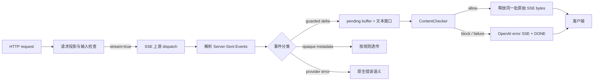

# NeMo Guardrails 如何把 OpenAI 流式输出变成一条可审计的安全边界

> **类型**：代码变更深读（AI 安全）  
> **上游提交**：[NVIDIA-NeMo/Guardrails #2437](https://github.com/NVIDIA-NeMo/Guardrails/commit/21ec4f4d3390c35b1508267a822f79db00e943c9)  
> **提交时间**：2026-10-13 11:50:37 UTC  
> **范围**：31 个文件，新增 2,344 行、删除 533 行；核心新增为 OpenAI Chat Completions 的 SSE 流式护栏。  
> **阅读材料**：[Guard contracts](https://github.com/NVIDIA-NeMo/Guardrails/tree/main/nemoguardrails/server/experimental/contracts)、[Chat Completions 集成说明](https://github.com/NVIDIA-NeMo/Guardrails/tree/main/nemoguardrails/server/experimental/providers/openai/chat_completions)、提交中的测试目录。

## TL;DR

- 这次变更不是简单地“让代理支持 streaming”。它把 OpenAI `/v1/chat/completions` 的流式 SSE 响应拆成**可检查文本**、**只透传元数据**、**提供方错误**和 `[DONE]` 终止信号四类，并让每一类都有可导出的契约。
- 入口只接受极窄的 `single_text.v1` / `single_text_delta.v1` 能力边界：一个用户文本输入、至多一个 `choices[0]`、`index=0`、assistant 的 `delta.content` 才是受护栏检查的输出；工具调用、音频、推理字段、refusal、token logprobs 等不是“默认安全”，而是被禁用、限制为 `null` 或空集合。
- 流式输出先进入 pending buffer；只有 `ContentChecker` 对一个带上下文的窗口作出允许决定后，原始 SSE bytes 才会释放。因此 commit 中明确禁止 `release_before_check`：否则“先显示、后拦截”会泄漏已显示的内容。
- 它的关键证据来自代码和测试而非模型 benchmark：新增的 streaming integration test 文件约 593 行，另有约 332 行 stream-contract 导出测试；测试覆盖输入先拦截、输出窗口被阻断、上游 schema 漂移隐藏、provider error 保留、异常后用 OpenAI 原生 SSE error 加 `[DONE]` 收尾等路径。
- 局限也同样明确：这是实验性 `1.0.0-alpha.1` 契约，JSON Schema 不等同于 Python 严格校验；状态机顺序、终止信号和错误编码仍是手写 hook；它不支持多轮历史、system/developer 消息混入、工具/多模态/推理内容，也不证明覆盖了所有未来 OpenAI 或兼容服务字段。

## 研究问题：为什么“给流套一层审核”并不够？

### 流式安全的难点在于时间顺序

非流式响应可以先收齐 JSON、提取 `choices[0].message.content`、检测、再返回。SSE 则把内容切成不规则事件：一个事件可能只有角色、一个事件是文本 delta、另一个是 usage，还可能出现 provider error、keepalive 或 `[DONE]`。

若代理网关只对每段字符串调用分类器，会留下四类缺口：

| 缺口 | 朴素实现的失败方式 | 该提交的处理 |
| --- | --- | --- |
| 内容泄漏 | 文本已经发给客户端，才得出 block 结果 | 先缓存受检查 delta；通过前不释放对应 bytes |
| 架构漂移 | 新字段被当作无害元数据而原样转发 | 投影对象默认 closed，未知成员被拒绝 |
| 协议混淆 | 错误、keepalive、`[DONE]` 与内容事件混在一起 | 显式分类 shape，并由状态 hook 检查顺序 |
| 文本替换 | 检查的是规范化后的文本，转发的是原始文本 | 分类器从原 JSON 取文本并拒绝“改变原文”的投影 |

这里的安全主张不是“模型一定识别所有危险内容”，而是更窄、更可验证的：__任何被声明为 guarded text 的字节，不能在输出检查允许前越过代理边界__。这是工程控制面上的完整性主张。

### 作者如何组织这个主张？

变更的论证顺序很清楚，可概括为：

这条链路将**字段政策**、**事件语义**、**状态语义**和**网络字节**分别放在不同层。它避免让 YAML 契约承担所有运行时责任，也避免把 Python 运行时细节伪装成“schema 已证明”。

## 能力边界：先把能检查什么说清楚

### `single_text` 不是对完整 OpenAI API 的声称

`contracts/openai/README.md` 把支持范围限定得很严格：

- 请求侧是一个非空的用户字符串 `messages[0].content`；它不是聊天历史解析器。
- 缓冲响应侧是一个 assistant choice 的字符串内容。
- 流侧允许至多一个 choice，且 choice 的整数 `index` 必须为 `0`；`choices=[]` 可以是 usage chunk。
- `delta.content` 缺失或 `null` 只算元数据；空字符串仍是需要检查的文本。
- `model`、`id`、`usage` 等已审阅 provider 元数据可以 opaque 地保留，但 opaque 的含义是“护栏不独立检查其嵌套值”，绝不是“可信”或“安全”。

这种缩小范围有实际价值。代理开发者常把“兼容 OpenAI 格式”误认为“可以安全代理 OpenAI 的任意字段组合”。该实现反而把不覆盖内容写成操作性限制：`audio`、`function_call`、`reasoning_content`、`refusal` 为 disabled；stream `tool_calls` 仅允许 `null` 或空数组；`logprobs` 为 `null`。非空值不能因调用者宣称“不会用”就被放行。

### 投影规则可以写成一个集合约束

令一个流事件的 JSON payload 为 $e$，投影器为 $P$，被检查的文本抽取为 $T$。可接受事件并非只要求“能解析”，而是近似满足：

$$
e \in \mathcal{A}
\iff
P(e)\ \text{通过闭合字段与类型约束}
\land\ \operatorname{shape}(e)\in\mathcal{S}
\land\ \bigl(T(P(e)) = T(e)\bigr).
$$

变量含义如下：

- $\mathcal{A}$：允许穿过受护栏代理的原生事件集合；
- $\mathcal{S}$：契约明确列出的事件 shape 集合；
- $P$：Pydantic 投影和字段 policy；
- $T$：从原始 JSON 的 `choices[0].delta.content` 提取的 assistant 文本。

最后一项尤其重要：若投影、别名处理或容器转换使 $T(P(e))$ 与原始 $T(e)$ 不同，检查器看到的对象就不再等于用户收到的对象。提交中的 classifier 因而要求原文本一致；测试也专门构造“转换投影但原始 unsafe text 被转发”的情形，预期是不调用输出检查而直接返回 `unsupported_chat_completions_response_shape`。

## 机制一：从声明式字段政策到可审计契约

### 四种分类不是装饰性标签

`guard-contract` 文档把字段归为 `guarded`、`constrained`、`opaque`、`disabled`：

| 分类 | 在 Chat streaming 中的例子 | 对安全论证的作用 |
| --- | --- | --- |
| guarded | `choices[0].delta.content` | 是唯一需要输出检查的 assistant 文本主体 |
| constrained | `object="chat.completion.chunk"`、`role="assistant"`、`index=0` | 防止对象类型、角色或多 choice 造成歧义 |
| opaque | `id`、`model`、`usage`、`system_fingerprint` | 保留必要 provider 数据，但不把它误判成已检查文本 |
| disabled | tool/audio/reasoning/refusal/logprobs | 明确告诉调用者该能力没有安全覆盖，而不是静默漏检 |

导出的 `*.guard.yaml` 是 Python projection、binding 和 endpoint 的描述，不是第二份配置真相。文档反复强调 source of truth 仍是类型化 Python 实现；导出物用于审阅和漂移检查。这个选择降低了“手写 YAML 和代码政策逐渐不一致”的风险。

### 闭合对象与 Unicode 别名

实现将 reviewed object 默认设为 closed，并标记 `reject_case_aliases: true`。这不只防 `Model` 与 `model`：文档特别讨论 Unicode `casefold()` 的多字符折叠，例如 `Straße` 与 `STRASSE`、Kelvin sign 与普通 `K`、long-s 等。原因是某些 provider 或兼容层可能在名称匹配上大小写不敏感；如果代理 schema 与上游处理不一致，攻击者能用近似字段名绕过本应受 policy 约束的成员。

不过此处也不能过度推论。契约允许受信配置对 configurable object 选择未知字段策略；generic JSON Schema 工具并不会自动实现这些附加 annotation。它是**契约感知验证器的要求**，不是“任何 YAML validator 都已获得同等保护”。

## 机制二：流分类器与状态机各自负责什么？

### 静态分类：每个 event shape 只能有一个角色

`stream_classifier.py` 定义 `openai.chat_completions.stream.text.v1`：

- `chat.completion.chunk:content`：匹配 `object="chat.completion.chunk"`，文本路径来自 typed projection；无文本时转为 `chat.completion.chunk:metadata` 的 opaque metadata。
- `error`：具有 `error` 字段的 provider error。
- `[DONE]`：不透明 sentinel；无 data 的 SSE 是 `keepalive`。

底层 `StreamShapeCoverage` 会拒绝一个 shape 同时属于 guarded、snapshot、opaque、provider-error 两类。这个看似细小的互斥性决定了安全路径：如果同一事件既被当作 metadata 立即放行、又被视为文本待检查，路径依赖会造成泄漏。

### 状态语义：为什么不能只靠 JSON Schema？

JSON Schema 能表达对象结构，却不能表达“错误后不得再有 payload”“成功流必须以 `[DONE]` 收束”。因此 `ChatCompletionsStreamHooks` 保留手写状态：

1. 收到真实 `[DONE]` 后，任何 data event 都会失败；
2. provider error 之后，不允许 payload；随后可有 sentinel；
3. keepalive 可以在全程出现；
4. 流结束时若既没有 `[DONE]` 又没有 provider error，判为不完整；
5. 代理自身出错时编码为 `data: {OpenAI-style error}\n\n` 再追加 `data: [DONE]\n\n`。

这正是代码把 `classifier` 和每请求新建的 `hooks` 分开的原因：前者是无状态、可导出且可审查的；后者有流生命周期状态，不能安全地伪装成静态 schema。endpoint 测试还断言两次 adapter 创建得到不同的 hook 实例，避免并发请求共享 `_done` 或 `_provider_error`。

## 机制三：缓冲窗口如何保证“检查先于释放”？

### 释放条件

设第 $i$ 个 guarded delta 为 $d_i$，上下文窗口长度为 $c$，批量长度为 $k$。当收集到一批时，检查器观察：

$$
W_i = d_{\max(1,i-c+1)} \Vert \cdots \Vert d_i,
$$

只有当 $\operatorname{check}(W_i)=\text{allow}$，属于本批的原始 SSE event 才能释放。代码中 `_text_windows` 负责构造带上下文的处理窗口，`_take_checked_events` 以 guarded text 的个数为准从 pending 队列取回相应原始事件；因此 metadata 事件不会在队列顺序中跨越未检查的文本。

输出 checker 收到的是 `OutputContentCheck(input_message, "".join(window.processing))`。保留用户输入的意义是：输出审核可以依据同一条已投影、已检查的 user message 做上下文判断，而不是重新解析原始 provider 请求。

### 有界性与失败行为

安全缓冲会牺牲一部分首 token 延迟，因此实现还把资源边界写成拒绝条件：

- `max_event_bytes` 限制单 SSE event；超限不是截断后转发，而是 projection failure。
- `max_pending_bytes` 限制尚未审核的事件积压；超过即停止。
- snapshot 历史的字节数也有上限；若不能再证明 snapshot 等于累计 delta，就拒绝后续 snapshot 验证，而不是猜测。
- 如果 policy 配置成 `release_before_check`，函数在 dispatch 前报 `UnsupportedStreamInspection`；不是降级为“不检查”。

因此性能公式不应被误读为固定常数。近似地，首段可见延迟为：

$$
L_{first} \gtrsim L_{upstream} + L_{buffer(k)} + L_{check}(W_1),
$$

其中 $k$、上下文大小与 checker 时延由部署 policy 决定。提交没有提供吞吐、P50/P99 或误拦截率数据；任何“仅增加多少毫秒”的结论都超出证据。

## 证据：测试实际证明了哪些性质？

### 关键测试路径

本次 diff 中新增 `test_openai_chat_streaming_integration.py` 约 593 行，以及 `test_stream_contract_export.py` 约 332 行；同时更新 contract、projection、HTTP streaming 等测试。下表是可从测试名称和断言直接观察的行为，不把它扩展成生产可靠性结论。

| 场景 | 断言的可观察结果 | 支撑的结论 | 不能证明 |
| --- | --- | --- |
| 输入被 block / policy 不支持 | dispatch 列表为空，分别返回 400 或 422 | 危险输入或不安全 policy 在上游调用前停止 | detector 本身的召回率 |
| 输出窗口含 `INTERNAL-` / `SECRET` | 原字节不在 response，出现 `content_blocked` error 与 `[DONE]` | pending window 没有先泄漏 | 多节点网络缓冲中的全部泄漏面 |
| provider schema 漂移 | 隐藏字段不出现在响应，返回 unsupported response shape | 未建模的 event 不静默透传 | 对未来字段的自动兼容 |
| provider error SSE | 流原样保留，checker 只记录 input | error 与 assistant 文本没有混淆 | 错误信息是否适合最终用户 |
| upstream 中途失败 | 已开始 streaming 后仍编码 `upstream_stream_failed` 并以 `[DONE]` 结束 | 客户端可得到 provider-native 流格式的失败收束 | 恢复、重试或幂等性 |
| 无 output inspection | 原 SSE 流原样 relay，仅检查 input | 明确的性能/策略分支存在 | 输出仍受到护栏保护 |

### 反例和失败路径比 happy path 更有信息量

值得注意的是，测试没有只验证 `200 + token`：

- transforming projection 的测试确保代理不会“检查安全替身，转发危险原文”；
- successful but non-SSE / bodyless upstream success 会在 headers 写出前失败并关闭 source；
- oversized upstream error body 被限制，避免把 provider 私有内容无限带回；
- OpenAPI success content 只在 stream dispatcher 配置时声明 `text/event-stream`，否则不会声称该路由可流式 dispatch；
- route、method、content-length 的原生拒绝仍在 dispatch 前保留。

这组负例让设计的防御边界更可信：它保护的是受支持形状的严格代理，而不是为了兼容性在未知形状上“尽力而为”。

## 图表/配置解读：哪些信息没有被藏进实现细节？

### 生成的 guard contract 承担什么证据作用

本次提交删除旧的 buffered-only `chat-completions.buffered.guard.yaml`，新增约 613 行 `chat-completions.guard.yaml`。这不是单纯文件改名：流契约必须描述 selector、event `oneOf` 分支、text/missing-text 分类、SSE sentinels 与非 data keepalive 等信息。

但它的证据等级有限：

- **能支持**：字段与事件 policy 有一个可版本控制、可 review 的表述；export test 可发现部分 Python 声明与契约格式的漂移。
- **不能支持**：YAML 自己能够创建 endpoint、加载 rails、检查任意 provider schema，或取代状态机 hook。
- **仍需人工审查**：provider OpenAPI source pin 的 revision/digest、guarded/opaque/disabled 归类是否随着上游字段演化而更新。

这与文档中“source pin 是 review baseline，不是涵盖所有当前或未来字段的保证”一致。对于 AI 安全工程，明确地记录不知道什么，往往比将 unknown fields 悄悄归为兼容性成功更有价值。

## 与相关路线相比，它的位置在哪里？

| 路线 | 主要单位 | 优点 | 本提交相对它补上的部分 |
| --- | --- | --- |
| 应用层 prompt filter | 一次请求/响应字符串 | 易接入、低实现成本 | 不处理 SSE 事件边界、顺序和未审核 bytes |
| provider moderation 前后置 | provider API 调用 | 适合已有审核服务 | 未必知道代理转发的字段、协议错误和 token 级时序 |
| 通用 JSON Schema 校验 | 静态 payload | 结构清晰 | 不能表达严格 Python 类型、文本等价、状态机和检查-释放时序 |
| 本提交的 guarded proxy | provider 原生事件流 | 结构、分类、状态与 release gate 联动 | 能力面刻意小；需要 provider-specific binding 与持续维护 |

它没有试图替代模型层的内容检测、权限系统或 agent tool allowlist。更准确的定位是：为这些上层判断提供一个不会在协议边界上先行泄漏、也不会把未知字段伪装为已审阅内容的执行壳。

## 逐段走读：一次安全流从请求到结束经历了什么？

### A. 请求先被投影，而不是直接转发

请求到达 `create_openai_chat_router` 后，endpoint 根据 `stream` selector 选择 buffered 或 streaming 分支；`false`、`null` 或省略仍是 buffered，只有严格布尔 `true` 才进入 streaming。这个细节避免了字符串 `"true"`、整数 `1` 等宽松输入意外打开另一个安全路径。

随后共享的 request projection 先验证输入边界，再交给 input checker。若输入被阻断，或 output inspection 已打开但没有 buffering policy，代码直接返回 error，根本不构造上游请求。测试中两条断言特别关键：`dispatched == []`，而不是“上游已经收到请求、客户端只是不显示结果”。在 agent 场景，后者仍可能触发模型、工具、计费或审计副作用；前者才是完整的 pre-dispatch 控制。

### B. dispatch 后，字节先成为事件而非文本

上游成功的 `text/event-stream` 被 SSE parser 解析为 `ServerSentEvent`。此时还不能把 event.data 当成文本：它可能是 keepalive、`[DONE]`、带 usage 的空 choices、error envelope 或 chat completion chunk。`adapter.classify_event(event)` 先给 shape 定义角色，`validate_stream_event` 再确认角色与声明契约一致。

这个双重动作可以理解为把“不确定 JSON”缩减到有限代数数据类型：

$$
\operatorname{Event} ::= \operatorname{Text}(s)
\mid \operatorname{Metadata}
\mid \operatorname{ProviderError}
\mid \operatorname{Sentinel}.
$$

只有 `Text(s)` 进入输出 checker；这不是因为其他分支没有风险，而是当前 capability profile 明确承认只对这一类 assistant 文本有检查语义。`ProviderError` 不被错误地作为模型输出审核，避免将服务端错误消息重写成“模型安全回复”；`Metadata` 也不越过未完成的 pending 文本队列。

### C. 检查完成后释放“原始事件”而非重组 JSON

允许决定对应的不是重新序列化后的 JSON，而是 pending event 保存的 `event.raw`。这很微妙：重新编码 JSON 可能改变空白、字段顺序、Unicode 转义或 SSE framing，既会破坏 OpenAI 客户端兼容性，也会使“检查对象”和“传输对象”之间新增难审计变换。

同时，保留原 bytes 并不意味着一切都可透传。实现先用投影和原文等价检查证明需要检查的文本没有被悄悄改变，再用 pending 队列保证原 bytes 尚未发出。可将这看成一个小型的 *validate → authorize → release* 协议：

1. **validate**：结构、字段 policy、shape、文本路径和状态顺序均成立；
2. **authorize**：checker 对带上下文的 output window 给出 `allow`；
3. **release**：按原接收顺序释放同批原始 SSE records。

任一阶段失败都不进入下一步。这比“把 guardrail 放在 async generator 旁边”更接近可检查的安全不变量。

### D. 失败也必须保持协议闭合

流一旦已经开始，HTTP status 和 headers 往往已发送，代理不能再改为普通 JSON 502。该实现将自身失败编码成 OpenAI 兼容的 SSE error，然后追加 `[DONE]`。这并不让错误变得无害，却保持客户端 parser 的终止预期，并避免泄漏内部异常文本；`_log_outcome` 记录失败类型与阶段，而刻意不写入 provider/被检查文本或 traceback。

对于可观测性，这是一个值得保留的边界：安全系统需要知道发生了 projection failure、checker failure、upstream failure 还是 policy 不支持；但把原始 token 或 provider body 放进 warning 日志，会把本来阻断的数据重新引入日志系统。

## 外部对照：速度与“不先泄漏”确实是不同策略

为避免只在项目内部自证，本次还检索了 `NeMo Guardrails streaming OpenAI Chat Completions October 2026` 与 `NeMo guardrails OpenAI Chat streaming #2437`。未发现这次 2026-10-13 commit 的独立技术评测；可用的外部对照是 OpenAI 的 [openai-guardrails-python streaming output 文档](https://github.com/openai/openai-guardrails-python/blob/main/docs/streaming_output.md)。该文档将 blocking 描述为完整检查后再展示，将 streaming 描述为输出护栏并行运行、因而可能短暂展示违规内容。

两者并非直接的性能或效果比较，因为检查器、部署和 API 都不同；但它准确凸显了本提交的设计取舍：

| 选择 | 用户体验 | 安全时序 | 本提交的立场 |
| --- | --- | --- | --- |
| 立即 token relay，审核并行 | TTFT 低 | 检出后可能已有暴露 | 明确拒绝 `release_before_check` |
| 先缓冲一个检查窗口再 relay | 需等候窗口和 checker | 被 block 的窗口不应暴露 | 采用，并以 pending byte 上限控制资源 |
| 完全收齐再检查 | 简单、最保守 | 不暴露完整响应 | 不是其目标；保留流式粒度 |

这是一个机制类比，不是对任何产品安全强度的排名。真正可比的数据仍需要统一攻击集、统一 checker、相同网络条件下的泄漏率与延迟测量。

## 证据边界、可复现性与局限

### 已被这次提交直接支撑的结论

- OpenAI Chat Completions 的特定实验 endpoint 获得了 streaming dispatch、分类、缓冲检查与原生 error framing 的实现。
- 支持集被显式限制到单 user 文本与单 assistant delta；未知或禁用内容走拒绝路径。
- 项目为上述行为编写了契约导出、集成、投影和流处理测试，且 diff 中能看到具体断言。

### 仍然不能从提交推出的结论

- 没有真实线上流量、吞吐、延迟、内存、误拦截或漏拦截 benchmark；不能量化安全收益或性能成本。
- `ContentChecker` 的语义、模型、阈值和对抗鲁棒性不由这个 commit 证明。该网关只能保证“按配置调用并在允许前不释放”，不能保证 checker 判断正确。
- 只支持一个 choice / 简化输入并不等于生产聊天系统普遍可用。多轮上下文、tool calls、reasoning、音频、多模态、兼容 provider 的额外字段都需要独立设计、投影和测试。
- SSE 字节在应用层 pending 并不自动覆盖浏览器、中间代理、重试、日志或旁路观测系统；端到端部署还需审查日志脱敏、超时、取消和资源回收。

### 可复现建议

1. 固定上游 commit `21ec4f4d3390c35b1508267a822f79db00e943c9`，运行该仓库的 streaming integration、contract export 与 projection 测试子集。
2. 使用包含安全 token 的模拟上游流，验证在 block 情形下客户端永远看不到 pending event 的原 bytes。
3. 生成未知字段、错误后 payload、无 `[DONE]`、超大 event、Unicode case-alias 等变体，确认均走预期拒绝或原生错误编码。
4. 在启用 output inspection 与关闭它的两个模式分别测量 TTFT、窗口大小、积压上限和连接取消行为；把性能数据与安全策略配置一起发布。

## 研究者视角：下一步真正值得问的问题

这次更新把“streaming 的安全性”从模型输出文本问题，推进成**可验证的信息流控制问题**。下一步不应只是给更多字段贴 `guarded` 标签，而要回答：

- 当 agent 有多轮消息、并行 tool calls 与 reasoning token 时，怎样定义多个 text subject 的依赖图，既不把一个已审查路径的结论错误复用到另一路，也不让缓冲无限增长？
- 对 token/delta 级检测，窗口 $W_i$ 的大小、重叠和 release 策略如何在攻击检出率、TTFT、memory 上构成可测量的 Pareto 前沿？
- 能否将手写 stateful hooks 的关键性质（终止后无 payload、错误路径封闭、未检查文本不可达 release）写成 property-based 或模型检测规格，而非只靠示例测试？
- provider schema 漂移不可避免时，是否应把“unknown field 默认拒绝”的兼容性成本量化，并建立从上游 OpenAPI revision 到 contract diff、测试样本和人工审批的供应链流程？

还应把取消语义纳入威胁模型：客户端断开、checker 超时或上游持续发送时，pending 队列和连接关闭必须保持同一所有权规则。否则，即使内容没有被浏览器渲染，也可能在后台继续消耗配额、堆积敏感 token，或让后续重试观察到不一致的终止状态。该提交提供有界清理接口，但没有给出高并发取消压力测试数据。

最有价值的结论不是“Guardrails 已经解决流式安全”，而是：__如果不能把字段归类、事件分类、状态顺序和字节释放统一进同一条证据链，所谓 streaming guardrail 很容易只是在 UI 上看起来存在。__
