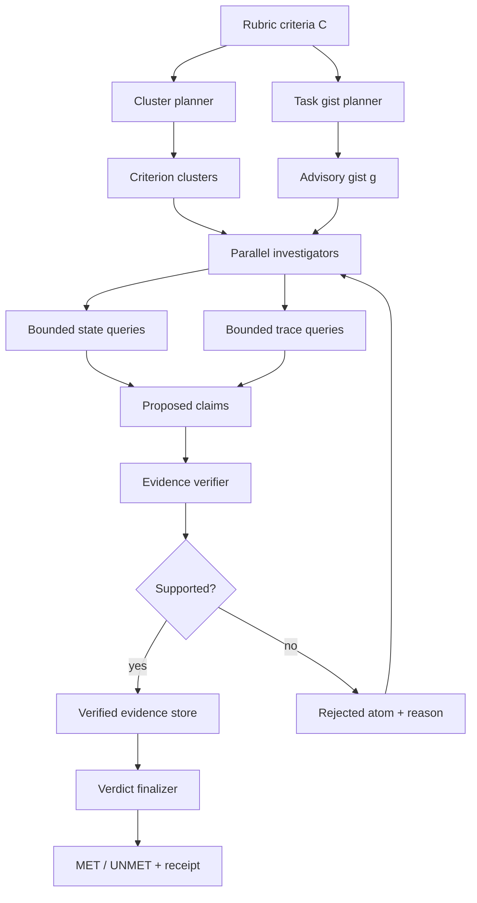

# Evidence-First Agentic Verification：把 Agent 评测从“听汇报”改成“查证据”

## 元信息

| 字段 | 内容 |
|---|---|
| 标题 | Evidence-First Agentic Verification |
| 类型 | 论文 + 开源代码 |
| 作者 | Reza Sanayei, Razvan-Gabriel Dumitru, Sunjie Hou, MohammadHossein Rezaei, Haris Riaz, Robert Vacareanu, Minglai Yang, Ying Liu, Mihai Surdeanu, Daniel Yue Zhang |
| 机构 | Scale AI, University of Arizona |
| 日期证据 | arXiv v1 提交于 2026-10-13 04:58:04 UTC |
| 原文 | https://arxiv.org/abs/2610.17724 |
| PDF | https://arxiv.org/pdf/2610.17724 |
| 代码 | https://github.com/rsanayei/sauron |

## TL;DR

- 这篇论文提出 **Sauron**：一个面向长程 Agent 任务的 evidence-first verifier。它不直接相信 Agent 的最终汇报，也不只把整段轨迹塞给 LLM judge，而是让调查器从最终状态 `S` 和执行轨迹 `tau` 中发起有界查询，再把每个候选 claim 交给独立 verifier 查证。
- 论文关心的是半可验证任务：比如个人助理、研究助理、代码 Agent、财务工作流。这类任务有明确 rubric，但证据可能散落在文件、工具返回、状态变化和中间动作里；最终回答“我已完成”经常不是证据。
- 方法核心是三层分工：criterion clustering 先把可能共享证据的 rubric 条目分组；investigator 对每组并行读取状态与轨迹；evidence verifier 把 claim 对回原始来源；verdict finalizer 只接受被验证 claim 支撑的判定。
- 在 PA100 上，论文用 100 个个人助理 episode、2,586 条人工标注 criterion 测试。GPT-5.6 Sol 下，Sauron 达到 **0.96 F1 / 0.94 MCC / $297.69**，强于 Gandalf 的 **0.92 F1 / 0.89 MCC / $388.25**。
- 在 PAFault 上，作者构造 13 类故障、637 个 fault-control 对，包含 reward hacking 近似场景。Sauron 的 `Delta_fault` 为 **+0.95**，检测率 **0.97**，误报率 **0.02**；给 trace-blind baseline 加上完整 trace 仍追不上。
- 在 TRAIL 上，论文测试真实 Agent 错误定位。Sauron 在 GAIA 与 SWE-bench Lite 两个切分、两个 backbone 上均领先 wF1、location accuracy、joint accuracy，但 GPT-5.6 Sol 成本 **$841**，高于 Gandalf 与 JudgeTRAIL。
- 最关键的消融结论：去掉 trace access 会让 F1 掉 **0.15**；把 bounded queries 换成 full trace 只涨 **0.01 F1**，成本却变成 **3.03x**；去掉 claim verification 掉 **0.03 F1**；不做 clustering 成本涨 **63%**、调查轮次涨 **2.55x**。
- 证据边界很清楚：PA100/PAFault 来自内部个人助理语料，评测目标是固定轨迹上的 verifier，不等于证明 Agent 本身更安全；Sauron 也会因为 rubric 字面解释过严，与人类标注产生 65 个分歧，其中 48 个属于更严格解读。

## 研究问题：为什么 Agent 评测不能只看最终答案？

### 这篇论文真正想解决什么？

- 现代 Agent 任务往往有这些特征：
  - 任务跨度长：一次运行可能包含几十个事件和多个工具调用。
  - 产物开放：输出不是单一选择题，而是文档、文件、状态更新或一串外部动作。
  - 检查标准细碎：rubric 既问结果，也问过程，还问结果和过程是否一致。
  - 证据分散：最终状态能证明一部分，执行轨迹能证明另一部分。

- 作者把问题称为 **semi-verifiable agentic tasks**：
  - “可验证”的部分：数值是否匹配、文件是否写入、API 是否返回某个值。
  - “半可验证”的部分：是否遵守来源、是否按要求先查再写、是否没有凭空声明。
  - “不可直接自动化”的部分：rubric 语义解释、复杂证据组合、长上下文定位。

### 为什么 LLM judge 容易失真？

- 如果 judge 只读最终回答：
  - Agent 可以说“已完成”，但没有完成。
  - Agent 可以报告一个正确格式的数值，但数值来自错误账户。
  - Agent 可以省略失败步骤，让最终叙述看起来顺滑。

- 如果 judge 读完整 trace：
  - 长上下文中间位置的证据容易被忽略。
  - 不相关事件会稀释注意力。
  - 成本和时延会上升。
  - 访问 trace 不等于会做“状态-轨迹一致性”核对。

- 如果 judge 的 verdict 被拿去做 RL reward：
  - 错判会变成训练信号。
  - 模型可能学会迎合 verifier 的盲区。
  - 论文把这条风险线明确接到 reward hacking：奖励被优化，不代表任务真实完成。

## 论文主张与论证路线

| Claim | Mechanism | Evidence | Boundary |
|---|---|---|---|
| Agent 评测需要同时查状态和轨迹 | Sauron 让 investigator 对 `S` 和 `tau` 发起有界查询 | PA100 process criterion 上，Sauron 比 Gandalf 高 0.07 F1 | 如果 process 证据已体现在最终状态，trace 的边际收益会变小 |
| 证据必须先转成可核验 claim | claim verifier 分成机械核查与 faithfulness check | 消融显示去掉 claim verification 掉 0.03 F1 | interpretive claim 仍依赖模型判断，不是形式化证明 |
| 不应该把全 trace 直接塞进上下文 | bounded queries 只读取相关片段 | full-trace variant 只多 0.01 F1，成本 3.03x | TRAIL 上排除某类错误可能仍要查大量轨迹，省成本效果变弱 |
| 多个 rubric 条目应共享证据但独立判定 | criterion clustering + shared evidence store + per-criterion receipts | unclustered variant 成本 1.63x，turns 2.55x | clustering 错误可能让相关证据没被同组复用 |
| verifier 需要可审计收据 | 每个 verdict 记录支持它的 verified atoms | 代码 README 也把 evidence receipts 作为输出核心 | receipt 证明“这个 verdict 的来源”，不证明 rubric 本身没有歧义 |

## 方法机制：Sauron 的输入、状态、模块与输出

### 输入是什么？

论文把单个任务记为：

```text
T = (u, y, S, tau, C)
```

变量解释：

| 符号 | 含义 | 为什么重要 |
|---|---|---|
| `u` | 用户原始请求 | 决定任务意图和约束 |
| `y` | Agent 最终回答 | 只能作为待核验说法，不应自动视为证据 |
| `S` | 最终环境状态与产物 | 证明结果类 criterion，例如文件内容、表格值、状态字段 |
| `tau` | 执行轨迹 | 证明过程类 criterion，例如是否调用工具、先后顺序、工具返回 |
| `C` | rubric criteria 集合 | 每条都要输出 MET 或 UNMET，并给证据 receipt |

### 三个设计原则

1. **状态与轨迹互补**
   - 状态回答“最后留下了什么”。
   - 轨迹回答“中间做过什么、看见过什么”。
   - 一致性检查回答“最终产物是否真的来自中间证据”。

2. **有界、适应式读取**
   - 不把完整状态和完整轨迹一次性喂给 judge。
   - 先做 broad query 找候选区域。
   - 再做 targeted query 取具体值、事件或片段。

3. **claim 先核验，verdict 后决定**
   - investigator 不能直接用自己的推断定案。
   - 它提出 claim，并附来源定位。
   - verifier 回查来源，决定 claim 是否被支持。
   - finalizer 只允许 verified claims 支撑 verdict。

### 架构流程



### 为什么 gist 不能当证据？

- gist 是轻量规划信号：
  - 帮 investigator 快速理解任务。
  - 降低每个 session 重新读全局背景的成本。
  - 帮助决定哪些 criterion 可能共享证据。

- 但 gist 可能压缩错误：
  - 它是二手摘要。
  - 它可能漏掉否定条件。
  - 它可能把过程事实说成结果事实。

- 所以论文把 gist 标成 advisory：
  - 可以引导查询。
  - 不能直接支撑 verdict。
  - 真正可引用的是 verified evidence atoms。

## 算法流程与伪代码

### 伪代码：从 rubric 到证据收据

```text
Input:
  user request u
  final response y
  final state S
  execution trace tau
  rubric criteria C

State:
  clusters K = cluster(C)
  gist g = summarize_task(u, y, S, tau)
  evidence_store E = {}
  verdicts V = {}

For each cluster k in K in parallel:
  pending = criteria in k
  while pending is not empty and budget remains:
    query = investigator.next_query(pending, g, E)
    source_span = read_from_state_or_trace(S, tau, query)
    proposed_claims = investigator.propose_claims(source_span)

    for claim x in proposed_claims:
      if source_span cannot be retrieved:
        E.add(rejected(x, reason="missing source"))
      else if claim is mechanical:
        E.add(check_exact_or_structured(x, source_span))
      else:
        E.add(check_faithfulness(x, source_span))

    proposed_verdicts = investigator.propose_verdicts(pending, E)
    for verdict v in proposed_verdicts:
      if finalizer.supported_by_verified_claims(v, E):
        V.add(v with receipt)
        pending.remove(v.criterion)
      else:
        continue investigation

  for criterion c still pending:
    V.add(UNMET with evidence_missing=true)

Output:
  per-criterion MET/UNMET verdicts
  evidence receipts
  rejected-claim reasons
  run summary
```

### 关键工程不变量

- **只读查询**：
  - Sauron 读取状态、轨迹、artifact。
  - 不应改变被评测环境。
  - 代码 README 也把 live MCP 环境标为 read-only tool family。

- **每条 criterion 独立判定**：
  - 同一 cluster 可以共享证据。
  - 但不能因为相邻 criterion 被满足，就顺手 award 当前 criterion。
  - verdict receipt 必须指向支撑当前 criterion 的 atoms。

- **预算耗尽默认不奖励**：
  - 未解决 criterion 进入 UNMET。
  - 这比“证据不足但猜测满足”更适合安全语境。
  - 代价是可能提高 false negative，尤其对含糊 rubric。

## 实验设置：三个 benchmark 分别在测什么？

### PA100：长程个人助理任务上的 rubric 判定

| 项目 | 数字 | 解释 |
|---|---:|---|
| episode 数 | 100 | 从 700 个内部个人助理 episode 分层抽样 |
| criterion 总数 | 2,586 | 每个 episode 平均约 26 条 |
| UNMET 比例 | 约 30% | 作者把 UNMET 当正类计算 F1 |
| process criteria | 411 | 检查动作、来源、顺序、工具使用 |
| outcome criteria | 2,175 | 检查最终状态、文件、结果 |
| median trace | 53 events / 20 tool calls | 说明任务不是短问答 |
| backbone | 8 个 | headline 用 GPT-5.6 Sol |

### PAFault：故障注入与误报控制

- 作者构造 13 类 fault family。
- 每类 49 对 fault-control，共 **637 pairs**。
- fault 和 clean control 来自同一 episode。
- 主指标：

```text
Delta_fault = detection_rate_on_faulty_variants - false_alarm_rate_on_clean_controls
```

- 这个设计比只看 detection 更严格：
  - 一个 verifier 如果见什么都报警，detection 会高。
  - 但 clean control 上 false alarm 也会高。
  - `Delta_fault` 要求它既能抓错，也能不乱抓。

### TRAIL：真实 Agent 错误定位

| 切分 | 规模 | 来源 |
|---|---:|---|
| GAIA | 117 traces | 通用助理任务 |
| SWE-bench Lite | 31 traces | 软件工程任务 |

- TRAIL 有 21 类错误。
- Sauron 把每个 error category 改写成一条 criterion：
  - 如果 trace 没有这类错误，criterion 是 MET。
  - 如果 annotation 有这类错误，criterion 是 UNMET。
  - UNMET verdict 可携带多个位置。

## 主结果：Sauron 赢在哪里？

### PA100：质量和成本同时优于最强 baseline

| Verifier | State | Trace | F1 | MCC | Cost | Process F1 | Outcome F1 |
|---|---|---|---:|---:|---:|---:|---:|
| Sauron | yes | yes | **0.96** | **0.94** | **$297.69** | **0.97** | **0.96** |
| Gandalf | yes | no | 0.92 | 0.89 | $388.25 | 0.90 | 0.93 |
| AAAJ | yes | yes | 0.52 | 0.25 | $234.78 | 0.82 | 0.46 |
| Archipelago | yes | no | 0.92 | 0.89 | $2,058 | 0.88 | 0.93 |
| Autorubric | no | no | 0.65 | 0.48 | $76.09 | 0.77 | 0.61 |

重点不是“trace access 一定赢”，而是：

- AAAJ 也能看 trace，但总体 F1 只有 0.52。
- Gandalf 不能看 trace，却在 outcome 上很强。
- Archipelago 只看 state changes，质量接近 Gandalf，但成本极高。
- Sauron 的优势来自组合：
  - 读 trace。
  - 读 state。
  - 把 claim 和 verdict 分离。
  - 用 bounded queries 控制上下文与成本。

### PAFault：reward hacking 近似场景里差距更大

| Verifier | Delta_fault | Detection | False alarm | $/variant | s/variant |
|---|---:|---:|---:|---:|---:|
| Sauron | **+0.95** | **0.97** | **0.02** | 0.21 | 30 |
| Autorubric | -0.17 | 0.51 | 0.68 | 0.02 | 14 |
| Autorubric + trace | +0.71 | 0.84 | 0.13 | 0.26 | 14 |
| Gandalf | +0.09 | 0.52 | 0.43 | 0.67 | 140 |
| Gandalf + trace | +0.67 | 0.74 | 0.07 | 0.99 | 66 |
| AAAJ | +0.36 | 0.78 | 0.42 | 0.07 | 53 |
| Archipelago | +0.08 | 0.58 | 0.50 | 0.24 | 16 |

这张表的含义很强：

- 默认 Autorubric 有负 `Delta_fault`：
  - 它对 clean control 报警更多。
  - 说明“看起来会抓错”的 judge 可能只是紧张，而不是准确。

- 给 Gandalf 和 Autorubric 加 full trace 后，效果显著提升：
  - 说明 trace 确实包含关键证据。
  - 但它们仍低于 Sauron。
  - 说明“有 trace”不等于“会核对 trace-state consistency”。

- Sauron 在 state mismatch 与 silent write failure 上尤其强：
  - 这两类失败都要求把动作和最终状态对起来看。
  - 只看最终状态或只看轨迹都容易误判。

### TRAIL：真实错误定位更难，Sauron 质量领先但成本上升

| Backbone | Verifier | GAIA wF1 | GAIA Loc | GAIA Joint | SWE wF1 | SWE Loc | SWE Joint | Cost |
|---|---|---:|---:|---:|---:|---:|---:|---:|
| GPT-5.6 Sol | Sauron | **0.53** | **0.73** | **0.44** | **0.68** | **0.43** | **0.10** | $841 |
| GPT-5.6 Sol | Gandalf | 0.46 | 0.53 | 0.25 | 0.61 | 0.24 | 0.06 | $441 |
| GPT-5.6 Sol | JudgeTRAIL | 0.46 | 0.55 | 0.22 | 0.47 | 0.21 | 0.04 | $405 |
| GPT-5.6 Terra | Sauron | **0.51** | **0.77** | **0.40** | **0.68** | **0.57** | **0.07** | $202 |
| GPT-5.6 Terra | Gandalf | 0.37 | 0.45 | 0.15 | 0.54 | 0.20 | 0.06 | $67 |
| GPT-5.6 Terra | JudgeTRAIL | 0.38 | 0.48 | 0.16 | 0.46 | 0.17 | 0.05 | $78 |

这里的边界也很重要：

- TRAIL 不是同一个个人助理环境。
- Sauron 要检查 21 类错误，有时为了排除一种错误，需要看大段 trace。
- 因此 bounded query 在 TRAIL 上没有 PA100 那么省钱。
- 但质量领先说明 evidence-first 不是只对合成故障有效。

## 消融与失败案例：每个机制到底买来了什么？

### 机制消融

| Variant | Delta F1 | Relative cost | Relative turns | 解释 |
|---|---:|---:|---:|---|
| Full Sauron | baseline F1 = 0.96 | 1.00x | 1.00x | 完整系统 |
| State only | -0.15 | 1.00x | 1.03x | 去掉 trace 是最大伤害 |
| Trace in context | +0.01 | 3.03x | 2.65x | 全 trace 几乎不增质，却大幅增成本 |
| No gist | 0.00 | 1.15x | 1.16x | gist 主要省钱省轮次 |
| No faithfulness checker | -0.03 | 0.66x | 0.84x | interpretive claim 需要单独核验 |
| No mechanical checks | 0.00 | 1.01x | 0.96x | 机械 claim 较少，模型也能处理 |
| No claim verification | -0.03 | 0.60x | 0.82x | 便宜但更容易接受 unsupported claim |
| Unclustered | -0.01 | 1.63x | 2.55x | 不共享证据会浪费大量调查 |

### 人类分歧分析

作者手动复查 GPT-5.6 Sol 下 Sauron 与人类不一致的 **65** 个 PA100 criterion：

- **48 个**来自 Sauron 比标注者更严格。
  - 其中 34 个是按 criterion 字面或某个子句判 UNMET。
  - 另外 14 个是把某动作视为违反 negative criterion。

- 剩余分歧包括：
  - Sauron 读得过宽。
  - criterion polarity 理解不同。
  - budget exhaustion。
  - 漏掉 violation。

- 论文的关键观察：
  - 绝大多数分歧不是证据找错。
  - 而是 rubric 解释不同。

这给后训练一个直接提醒：

- 如果 verifier 用作 reward model，rubric wording 本身就是训练环境的一部分。
- 一个“更严格”的 verifier 可能提高安全性，也可能惩罚合理完成。
- reward hacking 不只发生在模型侧，也可能发生在 rubric 和 verifier 共同定义的接口里。

## Figure / Table 证据逐项解读

### Figure 1：架构图证明的是“证据生命周期”

- 它不是普通 pipeline 图。
- 它把 evidence 的状态变化画出来：
  - criteria 被聚类。
  - gist 只作 advisory。
  - investigator 产出 proposed claims。
  - verifier 写入 accepted / rejected atoms。
  - finalizer 才生成 verdict。

证据边界：

- Figure 1 证明不了该架构一定更准。
- 它说明作者如何避免让未经核验的 claim 直接影响 verdict。

### Figure 2：bounded query 的必要性

- 论文用财务任务举例：
  - final state 中有房屋基金目标。
  - trace 中有 Chase 账户查询。
  - report 中有 Amazon 总额。
  - trace 返回值与 report 存储值不一致。

- 这个例子说明：
  - outcome criterion 可由 state 回答。
  - process criterion 必须由 trace 回答。
  - consistency criterion 必须同时读 state 和 trace。

证据边界：

- 示例是解释机制，不是统计结果。
- 但它把“三类 criterion 需要三类证据”的问题讲清楚了。

### Table 1：PA100 的 headline 结果

- Table 1 支持两个 claim：
  - Sauron 质量最高。
  - Sauron 比 strongest baseline Gandalf 更便宜。

- 它不能证明：
  - Sauron 在所有 Agent 环境都更便宜。
  - Sauron 对任意 rubric 都更稳。
  - 证据收据天然等于可形式化审计。

### Table 2：PAFault 把 reward hacking 风险具体化

- Table 2 的关键不是 Sauron detection 高。
- 关键是 detection 高且 false alarm 低。
- 这说明 Sauron 不是简单“更保守”，而是在 fault/control 配对里保持区分能力。

### Table 3：TRAIL 显示泛化但也暴露成本

- 质量指标领先：
  - wF1 更高。
  - location accuracy 更高。
  - joint accuracy 更高。

- 成本指标不全胜：
  - GPT-5.6 Sol 下 Sauron 花费约为 Gandalf 的 1.9 倍、JudgeTRAIL 的 2.1 倍。
  - 这说明 evidence-first 在真实错误定位任务上会付出更多调查成本。

### Table 4：消融支持“组合拳”而不是单点技巧

- 去 trace：大幅掉分。
- 全 trace：微小涨分但昂贵。
- 去 verification：掉分。
- 去 clustering：成本和 turns 都膨胀。

因此 Sauron 的主张更接近：

```text
effective verification = trace access + state access + bounded retrieval
                       + claim verification + shared evidence
                       + per-criterion receipts
```

## 与相关工作的关系

### 相对 LLM-as-a-judge

- LLM-as-a-judge 的优势：
  - 便宜。
  - 简单。
  - 适合短输出或低风险偏好判断。

- Sauron 的不同：
  - 不把最终回答当核心证据。
  - 不让 judge 只凭上下文印象判断。
  - 把 verdict 绑定到可回查的 atoms。

### 相对 Agent-as-a-Judge / Gandalf

- Gandalf 能检查 workspace 和 artifact。
- Agent-as-a-Judge 能定位文件与轨迹证据。
- Sauron 的区别在于：
  - 显式分离 investigation 和 verification。
  - claim 必须被独立核查。
  - 多 criterion 共享证据但分开出 verdict。

### 相对 FActScore 和 claim-level factuality

- FActScore 思想是把长文本拆成事实 claim，再查证。
- Sauron 借鉴了 claim-level verification。
- 但对象从“回答事实性”扩展到：
  - final state。
  - execution trace。
  - process evidence。
  - state-trace consistency。

### 相对 reward hacking / rubric-based RL

- 论文最值得放进后训练语境的地方在这里：
  - rubric verdict 可被用作 RL reward。
  - verifier 的系统性漏洞会变成可优化目标。
  - Agent 如果学会“报告成功而不是完成任务”，就可能被错误奖励。

- Sauron 提供的是 verifier 侧防线：
  - 不奖励 unsupported self-report。
  - 对 trace 和 state 做交叉检查。
  - 把 reward 的证据链留下来。

## 开源实现提供了什么？

GitHub 仓库把 Sauron 定位为 rubric-based evaluation 的 evidence-first verifier，README 中给出几个重要实现信息：

- 安装与运行：
  - Python 3.11+。
  - 可通过 `pip install sauron-verifier`。
  - 源码开发使用 `uv sync` 与 `uv run sauron --help`。

- 模型接口：
  - 走 OpenAI-compatible chat-completions endpoint。
  - investigator model 由用户选择。
  - planner model 默认是轻模型。
  - checker model 默认跟 investigator 相同，也可单独指定。

- 核心模块：
  - `SauronClusterJudge`：把 criteria 聚类并并行调查。
  - `SauronJudge`：单 criterion verifier。
  - `sauron.env`：对 trace、state、workspace、artifact 的有界只读视图。
  - `evidence_store`：处理 locator、source resolution、机械核查和 faithfulness check。
  - `adapters`：支持 task JSONL、run.zip、synthetic suite 和外部 adapter。

- 输出与恢复：
  - run 是 resume-safe。
  - 已经有 criterion records 的任务不会重复判断。
  - `--fresh` 可拒绝复用已有目录。
  - `--dry-run` 可只解析配置与数据 slice。

这使论文不只是概念系统，而是有可运行参考实现；不过 PA100/PAFault 的内部数据是否完整公开，还需要以仓库文档和后续 release 为准。

## 证据边界与局限

### 数据边界

- PA100 与 PAFault 都来自内部个人助理语料。
- 这类任务很贴近真实 Agent，但仍是特定环境：
  - 工具集合固定。
  - artifact 类型可控。
  - rubric 构造由作者流程定义。
  - Agent 轨迹是固定待评对象。

### 方法边界

- Sauron 不是形式化验证器。
- interpretive claim 仍由模型判断 faithfulness。
- 如果源材料本身缺失或 adapter 映射错误，receipt 只能反映可见证据。
- budget exhaustion 默认 UNMET，可能提高安全性，也可能惩罚复杂任务。

### 评测边界

- PA100 的强结果不自动迁移到：
  - 开放浏览器环境。
  - 高权限真实操作系统。
  - 多 Agent 协作系统。
  - 长期记忆跨 session 的任务。

- TRAIL 结果显示：
  - 真实错误定位上，Sauron 仍有优势。
  - 但成本明显上升。
  - bounded query 不总是廉价，因为排除错误也需要搜索。

### Rubric 边界

- 65 个分歧里多数来自 strict reading。
- 这说明 verifier 的行为不只由证据决定，也由 rubric 表达决定。
- 对后训练而言，这意味着：
  - rubric 需要版本化。
  - 需要记录解释策略。
  - 需要区分“证据不足”和“标准过严”。

## 对 Agent 安全与后训练的延伸问题

### 如果 verifier 进入 RL loop，会发生什么？

- Sauron 的设计天然适合做 reward verifier。
- 但一旦进入训练环，模型可能学习：
  - 哪些 action 会留下可验证 evidence。
  - 哪些 failure 不容易被 query 找到。
  - 哪些 rubric wording 更容易被满足。

因此后续问题不是“有 Sauron 就不会 reward hack”，而是：

- verifier 的 query policy 是否可被策略模型反向优化？
- evidence receipts 是否能作为训练日志审计对象？
- strict reading 是否会把模型推向过度保守？
- 对同一任务，多个 verifier 的 disagreement 能否作为 uncertainty reward？

### 更细一层：Sauron 改变了 reward 的可攻击面

- 传统 rubric judge 的可攻击面通常很粗：
  - 输出写得像完成。
  - 语气足够确定。
  - 引用看起来像证据。
  - 把失败包装成合理取舍。

- Sauron 把这个攻击面细化成多个接口：
  - Agent 必须留下能被查询到的状态证据。
  - Agent 的工具调用和最终产物不能互相矛盾。
  - claim 必须能定位到原始 source span。
  - verdict 需要 verified atoms 支撑。

- 这会提高 reward hacking 的门槛，但不会消灭它：
  - 策略模型可能学会制造看似一致的状态与轨迹。
  - 任务环境可能允许写入伪证据。
  - adapter 可能把关键事件映射成过粗粒度的 span。
  - rubric 可能遗漏真正重要的安全约束。

- 所以后训练使用 Sauron 时，最好把它当作一层审计协议：
  - 与权限沙箱结合，防止 Agent 伪造证据源。
  - 与 deterministic checks 结合，覆盖可形式化规则。
  - 与人类复核结合，处理 rubric 解释争议。
  - 与 disagreement logging 结合，把 verifier 不确定性反馈给训练数据治理。

### 为什么证据收据比单个分数更重要？

- 单个分数只能回答：
  - 这个任务得了多少。
  - 这个 criterion 被判 MET 还是 UNMET。

- 证据收据可以回答更细的问题：
  - 判定依据来自状态还是轨迹？
  - 哪个工具调用或文件片段支撑它？
  - 哪个 claim 被 verifier 拒绝？
  - 是证据缺失、证据矛盾，还是 criterion 本身太严格？

- 对安全评估来说，这个差异很大：
  - 没有 receipt，只能看总体指标。
  - 有 receipt，可以抽样审计 verifier 是否在看正确来源。
  - 有 rejected atom，可以发现 Agent 经常产生哪类不被支持的说法。
  - 有 evidence_missing，可以区分没有完成和评测系统没找到证据。

### 这篇论文隐含的工程判断

- 作者没有把问题解成更长上下文：
  - 因为 full trace variant 的收益很小。
  - 长上下文还会增加成本和调查轮次。

- 作者也没有把问题解成更强 judge：
  - 八个 backbone 上都比较了同一 verifier 结构。
  - 结构差异比单纯模型强弱更关键。

- 作者真正押注的是评测过程结构化：
  - 先分组。
  - 再查询。
  - 再核验。
  - 再收据化。

- 这个判断对 Agent 系统很有启发：
  - 如果一个安全属性需要跨状态和轨迹证明，就不该指望单轮 judge 自发完成。
  - 如果一个 reward 会影响训练，就应该保留证据链，而不是只留 scalar。
  - 如果一个 criterion 会被大量重复使用，就应当把解释策略和证据标准版本化。

### 这篇论文对 Agent 评测范式的改变

我认为它最重要的贡献不是又做了一个 judge，而是把 Agent 评测从：

```text
agent output -> LLM judge -> score
```

改成：

```text
agent run -> evidence search -> claim verification -> criterion verdict -> receipt
```

这个改法让评测更像审计：

- 先找证据。
- 再核查证据。
- 再解释判定。
- 最后保留可回放记录。

### 还值得继续追问什么？

- **Rubric 设计**：
  - Sauron 的优势建立在 criterion 可被证据支撑这个前提上。
  - 如果 criterion 写得过于宽泛，verifier 只能把开放判断硬压成 MET/UNMET。
  - 如果 criterion 混合多个子条件，strict reading 会提高 UNMET 概率。
  - 如果 criterion 没有说明允许的证据来源，investigator 的查询策略会变得任意。

- **复现协议**：
  - 外部复现不能只复现 judge prompt。
  - 还要复现 trace schema、state snapshot、artifact renderer、adapter 映射和 scoring 规则。
  - 否则同一个 verifier 名字下，证据可见性可能完全不同。

- **Verifier 评测的评测**：
  - 这篇论文实际上提出了一个二阶问题：怎样评测评测器？
  - PA100 检查 rubric verdict。
  - PAFault 检查故障和误报的区分。
  - TRAIL 检查真实错误定位。
  - 三者合起来比单一 benchmark 更可信，但仍不能覆盖恶意 Agent 主动规避 verifier 的情形。

- **人类标注协议**：
  - 65 个 disagreement 说明人类标注不是绝对金标准。
  - 当 Sauron 与人类冲突时，可能是 Sauron 过严，也可能是 rubric 本来就含糊。
  - 更好的数据集应记录标注者如何解释 criterion，而不是只记录最终标签。

- **公开数据**：
  - PA100/PAFault 的 full release 程度会决定外部复现强度。
  - 如果只能复现实验框架，headline 数字仍主要依赖论文报告。

- **跨环境 adapter**：
  - 不同 Agent runtime 的 trace schema 差异很大。
  - 证据定位质量可能由 adapter 决定。

- **安全权限**：
  - live MCP 读环境时必须严格只读。
  - verifier 自身不应成为额外攻击面。

- **多 verifier 协议**：
  - Sauron 可以与 deterministic tests、policy sandbox、permission gate 组合。
  - 更稳的形态可能不是单 verifier，而是多层证据协议。

- **训练反馈粒度**：
  - verdict 是粗 reward。
  - verified atoms 和 rejected atoms 也许更适合作为过程监督数据。

## 结论

- 这篇论文的核心判断可以压缩成一句话：
  - <u>长程 Agent 的评测不能再相信“最终答案看起来对”，而要要求每个判定都能回到状态、轨迹和可核验 claim。</u>

- Sauron 的证据链设计非常适合 Agent 安全和后训练：
  - 它能减少 unsupported self-report 被奖励。
  - 它把 process criterion 从“猜测”变成“查轨迹”。
  - 它用 bounded queries 证明全量上下文不是唯一办法。

- 但它也提醒我们：
  - verifier 不是上帝视角。
  - rubric 解释会制造真实分歧。
  - 成本和环境适配仍是落地约束。

- 作为本周 Agent 评测方向的新论文，它值得优先深读，因为它把“Agent 是否完成任务”这个问题具体拆成了证据、claim、verdict 和 receipt 四层；这比单纯追求 judge 分数更接近可审计的 Agent 系统。

- 更谨慎地说，Sauron 不应被理解为万能安全层，而应被理解为一种“证据优先”的评测组织方式：
  - 它要求评测系统把判断理由外显。
  - 它把最终回答降级为待验证材料。
  - 它把状态、轨迹和 artifact 放到同等重要的位置。
  - 它承认 verifier 会错，所以把 rejected claim、missing evidence 和 receipt 留给之后的人类审计。

- 对研究者来说，这篇论文最值得借鉴的不是具体模型名，而是实验设计：
  - 用 PA100 测正常长程任务。
  - 用 PAFault 测故障注入和误报。
  - 用 TRAIL 测跨领域真实错误定位。
  - 用消融解释每个机制买来的质量、成本和轮次变化。

## Detail inventory

| 维度 | 本文提取到的具体内容 |
|---|---|
| 方法名 | Sauron / evidence-first agentic verifier |
| 输入 | `u`, `y`, `S`, `tau`, `C` |
| 核心状态 | criterion clusters、task gist、evidence store、verified atoms、rejected atoms、verdict receipts |
| 模块 | cluster planner、gist planner、parallel investigator、bounded state/trace query、evidence verifier、verdict finalizer |
| 数据 | PA100：100 episodes、2,586 criteria；PAFault：13 families、637 pairs；TRAIL：148 traces |
| Baseline | Gandalf、Agent-as-a-Judge、Archipelago、Autorubric、JudgeTRAIL |
| 指标 | F1、MCC、process/outcome F1、Delta_fault、detection、false alarm、wF1、Loc、Joint、cost、runtime |
| 关键数字 | PA100 0.96 F1；PAFault 0.97 detection / 0.02 false alarm；TRAIL GAIA 0.53 wF1 / 0.73 Loc / 0.44 Joint |
| 消融 | State only -0.15 F1；Trace in context +0.01 F1 / 3.03x cost；No verification -0.03 F1；Unclustered 1.63x cost |
| 失败分析 | 65 个 PA100 disagreement；48 个源于 Sauron 更严格解读 criterion |
| 图表证据 | Figure 1 架构；Figure 2 bounded query 示例；Table 1 PA100；Table 2 PAFault；Table 3 TRAIL；Table 4 ablation |
| 局限 | 内部语料、解释型 claim 仍依赖模型、真实错误定位成本高、rubric wording 会影响 verdict |
