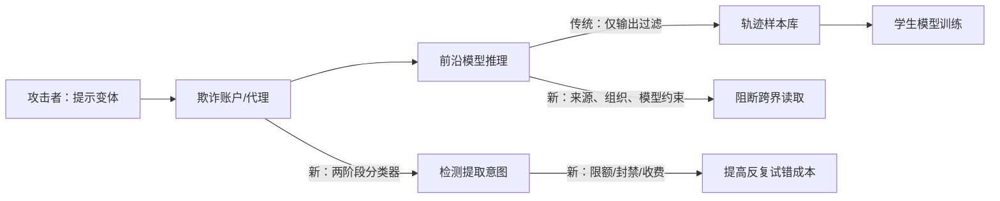

# 强化针对蒸馏攻击的防御：把“推理可见性”变成一个安全边界

> **原文**：[Anthropic, 2026-10-12](https://www.anthropic.com/research/distillation-defenses)  
> **类别**：AI 安全 / 模型能力扩散  
> **材料类型**：官方技术报告；不是同行评审论文。下文将作者自报的观测与可外推的结论严格分开。

## TL;DR

- 这份报告处理的不是一般意义上的知识蒸馏，而是攻击者用海量伪造账户，系统性收集前沿模型输出和**隐藏推理轨迹**，再训练替代模型的“非法蒸馏”。作者的中心判断是：最终答案固然有价值，但完整推理更容易把解题过程、工具使用策略和安全边界一并迁移。
- 防御由三层组成：**推理的流向约束**（禁止跨组织、跨模型或可编辑上下文迁移）、**两阶段提取分类器**（先发现疑似索取隐藏推理的请求，再作更精细判别）、以及**重复尝试的摩擦**（限额、封号和对被拦截请求收费）。它们分别针对数据可搬运性、单次绕过和大规模试错。
- 最直接的能力证据来自同一预训练 Claude 基座的受控蒸馏：用 Opus 4.8 的完整推理轨迹训练后，SWE-bench Verified 得分为 **80.4%**；只给摘要化推理时为 **71.8%**。差距 **8.6 个百分点**，说明“摘要”不是无代价的展示层改动，而会实质降低可转移监督信号。
- 作者称部署分类器后，蒸馏者在其平台可提取的推理 token 长期下降约 **10–100 倍**，即约 **90%–99%**；分类器对良性请求的误报率低于 **0.1%**，并已封禁数万个相关账户，常在活动开始两小时内完成。该指标衡量的是平台内暴露量，不等于攻击者无法从其他供应商、旧模型或最终答案中得到能力。
- 这是一份防御实践报告，而非可独立复现的论文：没有公开分类器模型、攻击分布、置信区间、token 绝对量、长期对抗评估或完整成本函数。作者也承认尚未遭遇“高度复杂且持久”的新一轮绕过；因此它证明的是一次有用的降速和增成本，不是蒸馏问题已被解决。

## 研究问题：为什么“完整推理”是一种高价值攻击面？

### 先区分两个概念

| 概念 | 训练者获得什么 | 风险重点 |
| --- | --- | --- |
| 授权蒸馏 | 经许可的输入—输出、教师分布或轨迹 | 质量、成本、隐私与知识产权由双方约定 |
| 报告讨论的非法蒸馏 | 通过伪造账户和代理网络收集的模型回答，尤其是隐藏推理 | 能力复制快于安全评估、访问控制和治理迁移 |

作者把攻击目标定位为“让较小模型理解教师**怎样**抵达答案”，而不只是模仿“答案**是什么**”。对代码、网络安全或复杂工具任务，轨迹常含有分解步骤、失败后的修正、调用顺序和约束检查；这些是最终短答案压缩后丢失的信息。

可以用一个简化的蒸馏目标表示这种差异。令 $x$ 是任务，$y$ 是最终回答，$r$ 是完整推理轨迹，学生模型参数为 $\theta$：

$$
\mathcal{L}_{\text{full}}(\theta)= -\mathbb{E}_{(x,r,y)}\left[\log p_\theta(r,y\mid x)\right],
\qquad
\mathcal{L}_{\text{summary}}(\theta)= -\mathbb{E}_{(x,\bar r,y)}\left[\log p_\theta(\bar r,y\mid x)\right].
$$

- $\bar r$ 是经摘要化后的可展示推理；如果摘要是多对一压缩，就不可能保留 $r$ 中全部的搜索、比较和工具状态。
- 报告的 80.4% 与 71.8% 不是上式的理论证明，而是对一个特定 Claude 基座、特定轨迹数据和 SWE-bench Verified 协议的经验对照。
- 因而合理结论是：在该设置中，减少 $r$ 的信息量会降低蒸馏后编码能力；不应将其泛化为所有任务、所有学生规模或所有摘要方法都有相同 8.6 点差距。

## 作者的论证路线：主张、机制、证据与边界

| Claim（主张） | Mechanism（机制） | Evidence（原文证据） | Boundary（尚不能证明） |
| --- | --- | --- | --- |
| 仅隐藏或摘要化推理能降低蒸馏价值 | 用 $\bar r$ 替代 $r$，减少轨迹监督 | SWE-bench Verified：71.8% 对 80.4% | 未给数据量、随机种子、方差，也未覆盖非代码任务 |
| 单靠简单过滤不够 | 攻击者会诱导模型复述、翻译、加标签或跨会话搬运 | 原文描述 12,000 条不同诱导请求与代理网络 | 没有公布攻击提示集及成功率随版本的变化 |
| 三层防御能显著降低可抽取轨迹 | 结构约束 + 两阶段分类 + 账户级抑制 | 分类器上线后推理 token 降 10–100 倍 | 指标是内部估算；不能直接推成全行业泄露量 |
| 防御可维持较低良性损害 | 红队修补和两阶段判定降低误杀 | 自报 false positive <0.1% | 未分人群、语言、API 用途报告误报，也未公布独立审计 |
| 平台治理是必要条件 | 攻击流量跨 API、云和推理提供方分散 | 报告要求供应商快速识别并下线欺诈账户 | 跨平台协同、身份归因和合法研究豁免仍未解决 |

这张表也解释了报告的写法：它先用摘要化实验说明“为何保护推理”，再承认早期过滤被绕过，最后给出分层防御和运营指标。它不是在证明某个单一模型绝对安全，而是在把攻击者的单位有效样本成本抬高到必须依赖组织化基础设施的程度。

## 从被动收集到主动提取：攻击面如何升级？

### 阶段一：被动蒸馏

攻击者以普通用户方式请求模型，然后把正常回答作为训练样本。对这一阶段，显示摘要化推理是一个相对直接的控制：用户还能理解答案大意，但训练者较难重构长轨迹中的中间决策。

### 阶段二：主动诱导隐藏内容

报告列出从“逐字输出之前推理”到大规模提示变体搜索的路径。这里的关键不是某一句越狱提示，而是攻击者可把每次失败当作反馈，持续搜索让模型把保护内容重新编码进回答的表达方式。

### 阶段三：把单次绕过扩展成工业化采样

- **跨会话搬运**：把受保护推理放到另一个上下文，使模型误判用户已经拥有原始内容。
- **跨模型搬运**：请求保护较弱的模型读取或复述保护较强模型产生的内容。
- **跨账户与代理网络**：一个账户受限后换另一个，或用大量身份将每个账户的行为稀释为“看起来不异常”。

因此，若系统只在最终输出层做关键词阻断，攻击者会把同一目标分拆成多轮、多账户、多模型流程。作者转向“推理来源—目的地—组织归属”的状态约束，是因为攻击图已经不再是独立的 prompt—response 对。



图中的三条蓝图式防线并非互相替代：流向控制阻止“已拿到一段再转运”，分类器识别“本次请求是否在索取”，账户策略限制“失败后还能试多少次”。这正是报告把它称为三种相互独立破坏方式的原因。

## 方法机制一：把推理的“可达性”绑定到来源

### preserved thinking 的设计意图

作者称，在 Claude Fable 5.1 与 Opus 5.5 中，对 2026 年 8 月 31 日及之后新建的 API 账户，`preserved thinking` 禁止编辑 Claude 的先前上下文。配合两项附加限制：

1. 较早、反蒸馏保护较弱的模型不能读取这些模型的推理；
2. Sonnet 5.5 的推理只对发起该请求的**组织**可访问。

可将每段推理表示为带标签的对象：

$$
z=(r, o, m, c), \quad \text{allow}(z,o',m',c') = [o'=o] \land [m'\in \mathcal{M}_{\text{safe}}] \land [c'\text{ 不可任意改写}].
$$

- $o$ 是产生请求的组织；$m$ 是产生模型；$c$ 是会话/上下文状态。
- 方括号不是原文实现代码，而是对其访问规则的抽象：它把“能看见推理”从一个纯文本权限，变成与主体、模型版本和会话完整性有关的能力令牌。
- 这样设计不能防止同一组织在合法界面中观察其可见内容，也不能阻止攻击者从最终答案学习；其作用是减少把隐藏内容当作可自由复制字符串的接口缝隙。

### 这一层为何值得单独存在？

分类器永远可能漏报。若攻击者已让一段推理跨到弱模型或另一个组织，后续每一步都有机会把它重述得更像正常内容。结构性流向规则相当于在分类前缩小“可被请求”的对象集合；这是安全工程里把高价值状态放到较窄信任域中的做法，而不是期待每条文本判断都完美。

## 方法机制二：两阶段分类与持续修补

作者将提取防御类比为生物和网络安全中的滥用防护，采用两阶段分类器，并以内部与外部红队尝试来补洞。报告没有公开两个阶段各自的特征、阈值、模型或路由，所以只能从功能上重构：

```text
Input: request q, account history h, model/context metadata s
State: stage1_alert, stage2_decision, risk history R
for each request:
    stage1_alert = broad_detector(q, h, s)
    if not stage1_alert:
        allow normal response
    else:
        stage2_decision = high_precision_review(q, h, s)
        if stage2_decision == extraction:
            block response; update R; apply friction
        else:
            allow response; log false-positive candidate
Output: response or block, plus account-level signal
Failure boundary: novel encodings, distribution shift, compromised benign accounts,
                  and attacks that obtain supervision outside this service.
```

两阶段的价值在于将宽松召回和严格精度分开：第一层可以对“把先前推理逐字写出”“换语言转写”“以标签附在答案后”等相近族群发出警报；第二层再降低对正常调试、可解释性或工作流请求的误杀。原文说红队发现的新技术会被快速修补，并举了翻译先前推理、让推理与答案并列标签输出这两类已被封堵的例子。

但 `<0.1%` 只能解读为作者选定评测分布与阈值下的总体误报率。若真正的分母是数十亿次异质 API 调用，极低百分比仍可能对应许多用户摩擦；反过来，低误报并不告诉我们漏报率。报告声称“抓到九月报告所述全部技术”，可支持对**已知攻击簇**的覆盖，不能替代对未知适应性攻击的召回估计。

## 方法机制三：把绕过变成昂贵的重复实验

### 账户级控制补的是“样本量”缺口

蒸馏者需要的不是一次成功，而是可训练规模的样本量。因此，防御的效果不能只问“某条 prompt 能否偶尔泄露”，还要问攻击者取得 $N$ 条有效轨迹的成本。令：

$$
C(N)=N(c_{\text{request}}+c_{\text{identity}}+c_{\text{evasion}})+c_{\text{operations}},
\qquad N_{\text{effective}}=N(1-p_{\text{block}})(1-p_{\text{summary}}).
$$

- $c_{\text{identity}}$ 对应欺诈账户与代理的维护；$c_{\text{evasion}}$ 对应提示搜索和绕过研发。
- 分类、封号和被拦截请求收费会同时增大前三项；摘要化降低每条成功响应的训练信息密度。
- 报告的“封禁数万个账户、常在两小时内”主要是在影响攻击的并发规模和持续时间，而不是给出学生模型性能的直接因果估计。

作者说，自 9 月 24 日起，对在误报低于 0.1% 的领域中被安全防护提前拦截的请求恢复收费。它是一个有意承认的产品权衡：对攻击者，失败也有成本；对被误判的良性用户，失败也不再免费。报告没有提供收费前后的攻击弹性或用户留存数据，因此不能从该描述推断定价措施单独贡献了多少 10–100 倍下降。

## 证据逐项解读：数字各自支撑什么？

| 证据 | 作者观察 | 它支持的最强说法 | 不能推出的说法 |
| --- | --- | --- | --- |
| SWE-bench Verified | full 80.4%，summarized 71.8% | 完整轨迹在该代码任务蒸馏中更有训练价值 | 摘要化对所有模型、所有基准同样有效 |
| 外部/内部红队 | 两阶段分类器持续用提取尝试修补 | 防御不是一次静态规则，已覆盖报告中已知技术 | 已经穷尽攻击空间 |
| false positive <0.1% | 作者对某些受保护区域的内部评估 | 可在低误报目标下部署阻断 | 漏报同样低，或不同语言/客户无差异 |
| 推理 token 降 10–100x | 分类器上线后平台内估计暴露量下降 | 多层措施与大幅减少可采样推理同时发生 | 每一层的因果贡献、外部攻击总量 |
| 数万个账户/约两小时 | 运营处置速度 | 平台可对大规模重复行为作账户级响应 | 关联归因始终准确，攻击者不能重建网络 |

原文的两张关键图分别承担不同角色：第一张把“为什么要保护推理”量化成下游代码能力差；第二张在对数尺度上展示防御前后每日暴露 token 的量级下降。两图之间不能直接相乘：前者是受控的训练—评测实验，后者是生产环境运营指标，中间隔着攻击样本质量、学生架构、数据去重与对手策略等未公开变量。

## 失败、代价与报告主动承认的局限

### 防御已经改变了合法工作流

- `preserved thinking` 迫使部分开发者更新集成；这是访问语义变化，而不只是后台安全补丁。
- 分类器仍会在少于 0.1% 的情形误识别良性请求；对受影响用户，解释、申诉和调试渠道的设计会决定真实体验。
- 被拦截请求收费把反复试错的成本外部化给可疑行为，也可能使边界合法的研究与集成调试承担摩擦。

### 作者没有声称已经赢得对抗

报告的措辞值得保留：其一，攻击者被预期继续寻找绕过；其二，作者尚未看到高度复杂、持续的规避尝试；其三，攻击流量还可能经过第三方云、推理提供方或能力相近但保护较弱的模型。这些限制说明“平台内 10–100 倍下降”最稳妥的读法是一个局部的防御收益。

### 可复现性清单

| 缺失或未公开项目 | 为什么影响判断 |
| --- | --- |
| 分类器训练数据、版本、阈值 | 无法独立复现误报/漏报权衡 |
| 红队攻击集与时间切分 | 无法检验是否对已见提示过拟合 |
| 80.4/71.8 的训练 token、学生规模和方差 | 无法估计效果的统计稳定性与缩放规律 |
| 每日暴露 token 的绝对基数与归因方法 | 无法将倍数下降转换成风险绝对量 |
| 各层消融 | 无法知道流向约束、分类器、封禁和收费的边际贡献 |

这些并不自动否定报告。现实的滥用防御往往不能公开所有检测特征；但它们要求读者把结论停在“可信的运营声明与受控片段实验”，而不是把它读成已被公开审计的通用安全定理。

## 与相关工作的位置：它改变的是能力扩散路径，而非模型内在能力

安全讨论中常把风险分成模型直接执行危险任务、模型被提示操纵、以及模型能力被复制后在更弱治理环境中部署。此报告聚焦第三种路径。它不试图减少教师模型本身的编码能力，而是减少攻击者获得高密度训练信号的速度。

与传统内容审核相比，本文更接近三类机制的组合：

1. **信息流控制**：将敏感推理与组织、模型和会话的来源绑定；
2. **滥用检测**：用多阶段判别器面对策略性文本伪装；
3. **经济与身份摩擦**：通过封禁、限额、收费对抗大规模采样。

这也解释了为什么任何单一实验指标都不够。SWE-bench 的差异说明保护对象有价值；生产 token 曲线说明运营上可能有效；账户处置说明对手需要基础设施；而真正的系统安全仍取决于这些层能否在模型版本、客户行为、地理分布和跨平台迁移中共同保持作用。

## 领域延伸：接下来应如何检验“降速”是否真能转化为安全收益？

值得继续追问的不是“是否还会有人蒸馏”，而是以下可量化问题：

1. **攻击收益曲线**：在不同预算、账户数和提示自适应能力下，$N_{\text{effective}}$ 随时间怎样变化？应报告的不只是阻断倍数，还应是攻击者训练出可用学生所需的总成本。
2. **跨平台替代**：当一家服务收紧推理访问，对手会转向最终输出、开源轨迹、旧版本还是别的云？若只是位移而非减少，单平台曲线会高估安全收益。
3. **防御的公平性与可用性**：按语言、地区、开发工作流和客户规模拆分误报、延迟、集成失败与收费影响，才知道 `<0.1%` 是否掩盖了集中伤害。
4. **适应性红队的前瞻评测**：将攻击提示按时间切分，让红队在不知道当前分类器的条件下探索跨会话、跨模型与工具调用链，才能测到“修补已知洞”之外的鲁棒性。
5. **能力与保障是否共同迁移**：若蒸馏确实让学生接近教师能力，应如何测量安全拒答、滥用检测和访问治理没有同步复制的缺口？这才是报告所担心的风险链末端。

最可取的有限结论是：保护推理不能替代模型安全、账户治理或跨平台合作，但它把一个原本像普通 API 文本的资源重新定义为具有来源和用途约束的敏感状态。对前沿模型部署者而言，真正的工作不是宣布“推理不可见”，而是持续测量：每次架构、分类和运营控制分别把攻击者的有效样本量、迭代速度和迁移路径改变了多少。

### 一个更严格的后续实验设计

若要把这份运营报告推进为可比较的安全证据，未来评测至少应把攻击者建模为能自适应学习的策略，而不是固定提示列表。一个可公开的最小协议可以是：先冻结训练期的攻击家族和防御版本；再让独立红队仅凭接口行为，在限定预算内提出新策略；最后以新策略分别测量完整轨迹泄露率、有效训练 token、学生模型的任务能力与良性用户损失。每个量都需要按模型版本、账户年龄、请求语言和供应商路径分层报告。

特别重要的是把“拦截率”与“风险降低”拆开。若防御使攻击者从同一服务少拿到 token，但对手改从开放模型、合作平台或答案重采样补齐，平台曲线的下降并不自动等于能力扩散变慢。反之，即使存在少量偶发泄露，只要它们不能稳定组成高质量、可去重、覆盖足够任务分布的数据集，攻击的实际训练收益也可能很低。衡量这一点需要把账号治理日志与受控学生训练实验连接起来，而不能只看单一检测分数。

这也是 AI 安全中值得保留的研究态度：防御不是“是否存在一个漏洞”的二元命题，而是攻击者、服务商和下游训练系统共同形成的动态系统。报告已经给出了有价值的第一段因果链——减少高密度推理暴露；下一段仍需证明这种减少在真实对抗下足以改变复制能力、部署安全和滥用门槛。

## 参考材料

- Anthropic, [*Strengthening our defenses against distillation attacks*](https://www.anthropic.com/research/distillation-defenses), 2026-10-12（主材料；机制、受控 SWE-bench 对照与运营指标）。
- Anthropic, [*Preserved thinking* 文档](https://platform.claude.com/docs/en/build-with-claude/extended-thinking#preserved-thinking)（原文所链接的 API 访问语义背景）。
- Anthropic, [*Constitutional Classifiers*](https://www.anthropic.com/research/constitutional-classifiers)（原文所链接的两阶段安全分类器背景）。

> **证据边界重申**：本文所有 10–100 倍、<0.1%、账户规模与两小时处置速度均为报告作者披露，尚无独立外部审计；对公式和伪代码的表述是为解释原文机制的抽象，不是 Anthropic 公开实现。

