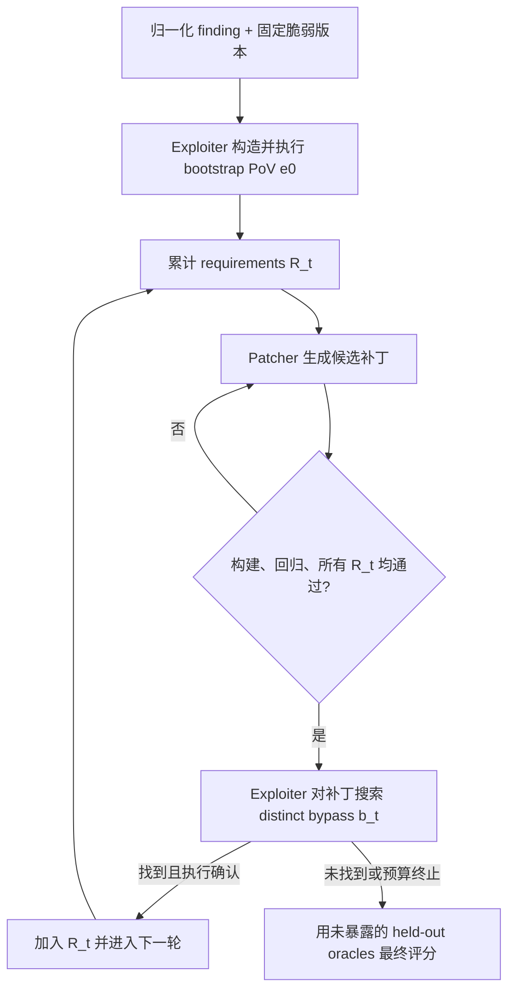

# P2Patch：让漏洞修复 Agent 接受“补丁后的再次进攻”

> **论文**：P2Patch: Exploit-Guided Vulnerability Repair  
> **类别**：AI 安全 / AI for Security  
> **原文**：[arXiv:2610.20245v1](https://arxiv.org/abs/2610.20245)（2026-10-14）｜[HTML 全文](https://arxiv.org/html/2610.20245v1)｜[代码](https://github.com/P2Patch/P2patch)

## TL;DR

- P2Patch 研究的不是「能否针对一份漏洞报告写出能通过测试的补丁」，而是一个更严格的问题：**当补丁已经挡住已知 PoV 后，是否仍能以同一漏洞语义构造另一条可执行攻击路径？**
- 系统把漏洞发现归一化为输入；exploiter 先生成并执行可复现的 PoV，patcher 针对累计 PoV 集合修改代码，随后 exploiter 再攻击补丁后的程序。新找到、且执行确认的绕过 PoV 会加入永久约束，形成 counterexample-guided repair loop。
- 作者把构造阶段看过的证据与评测证据严格隔离：最终分别用 fix-closed oracle（官方修复已经关闭的路径）和 residual oracle（官方修复历史上曾遗漏、后来才关闭的路径）评测，避免「拿训练题给自己判卷」。
- 在 VulnRepairBench 的 101 个 C/C++ 与 Java CVE 上，原始 PoV 已被堵住后，系统仍在 **41%** 的运行中找到同漏洞、不同路径的已确认绕过；相对同一 finding 的单次 Claude Code 修复，held-out fix-closed coverage 从 **78.1% 提升到 84.7%**，beyond-upstream coverage 从 **42.1% 提升到 62.5%**。
- 这不是漏洞修复正确性的形式证明：oracle 只覆盖被收集和认证的攻击路径，公开 CVE 也可能已被模型预训练记住。它真正建立的是一个可复测的安全主张：补丁要经受独立、未参与构造的可执行反例，而不只是在原始复现样例上「绿灯」。

## 研究问题：为什么“PoV 不再触发”并不等于“漏洞已修复”？

自动化程序修复往往把一次静态告警、sanitizer trace、漏洞描述或公开 exploit 当作完整规格。这样的流程有一个隐含跳跃：它把「这个输入不再成功」外推成「导致它成功的安全边界已经被正确表达」。P2Patch 把这个跳跃称为 **oracle-reuse problem**。

### 一个补丁可以如何“答对原题、仍然做错事”？

- 输入校验可能只排除了 PoV 的字面字符串，却没有定义规范化、边界或编码后的等价类。
- 修补者可能只在现有 source-to-sink 路径插入检查，遗漏同一危险操作的另一条调用链。
- 回归测试能确认已有功能没有立即损坏，却通常不能枚举「同一 CWE 还能如何到达」。
- 如果生成 Agent 用 PoV、测试和漏洞报告来构造补丁，再用同一组材料验收，那么验收并不独立；模型可能只是过拟合了它已经看见的证据。

论文的动机例子是 `plexus-utils` 的路径包含检查：早期修复能阻断一个路径样例，却可被 sibling path 绕过；后续上游修复通过 canonicalization 与 separator boundary 才表达了更强的安全语义。这里的重点不是某个路径技巧，而是工程判断：**针对一个见证样例的阻断，和针对一类语义等价攻击的阻断，是两种不同的声明。**

## 作者的论证路线：claim → mechanism → evidence → boundary

| 主张 | 机制 | 证据 | 不能据此断言什么 |
|---|---|---|---|
| 单次修复会漏掉同漏洞的不同攻击路径 | 补丁接受后由 exploiter 再次搜索绕过 | 101 次运行中 41 次出现执行确认的 distinct bypass | 41% 不是现实世界剩余漏洞的普遍比例 |
| 多轮对抗能增强修复 | 每个确认 bypass 变成下一轮必须通过的 requirement | 相比单次修复，两个 held-out coverage 指标都提升 | 不能说明每次额外轮次都经济，收益会递减 |
| 安全评估必须与构造分离 | fix-closed 与 residual 两族 held-out oracle 不给 Agent 看 | 所有方法在同一认证 oracle 下重评分 | oracle 完整性仍取决于基准构建与执行环境 |
| 结果不是只由一个模型偶然造成 | 四个模型族的同一协议比较 | 作者报告跨模型仍会发现已接受补丁的绕过 | 不代表未测试的闭源模型、语言或仓库也相同 |

这张表也解释了论文的克制处：P2Patch 并不把「模型生成了更多文本」包装成安全性；它把每个环节绑定在 build、执行、PoV 行为和独立 oracle 的可观察结果上。

## 方法机制：把修复写成反例约束不断增长的过程

设初始漏洞 finding 为 \(f\)，第 \(t\) 轮已积累的、执行确认的攻击见证集合为 \(R_t=\{e_0,\ldots,e_t\}\)。系统目标不是让某一条 \(e_0\) 失败，而是寻找补丁 \(p_t\)，使其同时满足功能回归约束与所有已知攻击约束：

\[
p_t = \operatorname*{Repair}(P, f, R_t),\qquad
\forall e\in R_t:\;\operatorname{Exec}(P+p_t,e)=\text{blocked}.
\]

随后 exploiter 在 \(P+p_t\) 上寻找一个新见证 \(b_t\)。只有它满足「可执行、确属同一漏洞语义、不是已有 PoV 的重命名或重复」时，才会有 \(R_{t+1}=R_t\cup\{b_t\}\)。找不到绕过并非数学证明，而是给定预算、模型和搜索空间下的一个测试结果。

### 三个角色与一条硬边界

1. **Exploiter**：从归一化 finding 与代码构建可复现 PoV；在补丁被初步接受后，专门搜索不同路径的 bypass。
2. **Patcher**：读取 finding、源码树、构建元数据与累计 requirements，编辑代码直至原有 PoV、回归检查和构建门槛均通过。
3. **Execution referee / orchestrator**：不接受模型口头宣称的「已修好」，而运行构建、PoV、测试与分类检查，决定一个候选能否进入下一状态。
4. **Hard boundary**：CVE 标识、上游 patch、advisory exploit 文本、held-out PoV 文件及其命令均不提供给 Agent；禁用 web retrieval。论文明确承认这降低泄漏却不能消除预训练记忆。

### 流程图：为何不是普通的“生成—测试—重试”？



普通 repair loop 也会重试，但其重试常围绕「原测试仍失败」展开。P2Patch 的差别是：已经通过原测试后，主动把补丁本身重新当作攻击目标，并把成功的攻击从临时诊断升级为持久规格。

## 独立安全 oracle：两种覆盖率在测什么？

作者将构造期的 live PoV 与最终评估彻底拆开，使用两个结论方向相反的集合：

| oracle | 由什么认证 | 指标所问的问题 | 易被误读的地方 |
|---|---|---|---|
| \(S_{fix}\)：fix-closed | 上游官方修复已阻断的路径 | 候选补丁是否至少达到官方修复关闭的攻击面？ | 高分不代表优于上游；只是对该集合的覆盖 |
| \(S_{res}\)：residual | 官方初次修复曾漏掉、后续修复才关闭的路径 | 候选是否超越初版上游修复、关闭历史残余路径？ | 这不是全部未知零日的估计 |

对任一 oracle 集合 \(S\)，文中 coverage 的直观形式可写为：

\[
C(S,p)=\frac{\#\{e\in S\mid \operatorname{Exec}(P+p,e)=\text{blocked}\}}{\#\{e\in S\mid \text{execution conclusive}\}}.
\]

分母只放入执行结论明确的样本，这比把环境未建成、超时或行为含糊的试验强行算作成功/失败更诚实；代价是 coverage 仍依赖 benchmark 的可执行性。论文报告 benchmark 含 **101 个 CVE、61 个仓库、20 类 weakness**，其中 **60 个 Java、41 个 C/C++**；每个 CVE 有 fix-closed suite，存在已认证历史残余 gap 的主题另有 1–5 个 PoV 的 residual suite。

## 算法流程：伪代码与失败边界

```text
Input: vulnerable program P, normalized finding f, round budget B
State: R = {}, accepted_patch = None

e0 = Exploiter.build_and_run(P, f)
if e0 is not execution-confirmed:
    return no-repair-result        # 没有可复现攻击，不能伪称“已修复”
R.add(e0)

for t in 0..B:
    p = Patcher.propose(P, f, R)
    if not Referee.builds(p):
        continue
    if not Referee.regression_checks(p):
        continue
    if any(Referee.executes(p, e) != blocked for e in R):
        continue
    accepted_patch = p

    b = Exploiter.find_distinct_same_vulnerability_bypass(p, f, R)
    if b is None or not Referee.confirms_distinct(b):
        break
    R.add(b)

Output: accepted_patch, R, held_out_score(accepted_patch)
Failure boundary: held_out_score 是测试证据，不是无漏洞证明。
```

这段伪代码刻意保留了三个失败出口：bootstrap PoV 无法复现、候选补丁不满足工程门槛、以及没有找到 bypass。最后一种最容易被营销话术误写成「安全」，论文反而要求此时才调用 held-out oracle，防止循环内部的未发现与外部评测混为一谈。

## 实验设置：比较的是协议，而非只比较模型名字

### 数据与泄漏控制

- 每个 subject 是固定脆弱 revision 上的一对 project–CVE；实验 finding 使用 source-to-sink trace，且对 Agent 遮蔽 CVE ID、上游修复、公告 exploit 和 held-out proof。
- 每次运行在独立 Git worktree 与项目 container 内进行；Agent 产生的命令、编辑和说明被视为不可信输入。
- 论文没有声称该 prototype 能隔离恶意仓库：评测 host 与 benchmark repository 被当作可信基础设施。这是一个重要部署边界，不应把「有 container」误读为完整 sandbox 证明。
- 自动门槛通过后才有人审；两位 reviewer 用固定 rubric 检查非预期功能变更、弱化安全逻辑、构建系统改动、删除/绕过测试、以及新引入风险，且对模型与配置盲评。

### Baseline 与消融应该怎样读？

核心 baseline 是从**同一个 finding**进行的 single-pass Claude Code repair，因此差异不是输入信息更多，而是是否加入 bootstrap PoV、对抗式再攻击与 requirement accumulation。论文还比较 loop ablation、模型变体与若干已发表 agentic repair system；对已发表系统采用 overlapping subject 且相同 held-out oracle 的重评分，而非直接抄取其原论文里不同数据集、不同验收标准的分数。

这一步很关键：若一个系统只在自己的单元测试上报告 pass rate，另一个在更严格的 residual oracle 上报告 coverage，把两个数字并排并不构成比较。P2Patch 至少把比较收缩到共享对象和共享判卷器，虽然仍不能消除实现、预算和模型访问的差异。

## 主结果：41% 的“补丁后绕过”到底说明什么？

### RQ1：已接受修复之后，仍会出现新攻击吗？

会。在 **41/101** 次运行中，exploiter 在补丁已经阻断 bootstrap PoV 后，找到了 distinct、execution-confirmed 的同漏洞 bypass。这个数值的解释应当非常窄：在论文给定的 subject、模型、轮次预算和 distinctness 审核下，单一构造期 PoV 经常不足以代表漏洞类；它不是「41% 的补丁都不安全」的行业统计。

作者还把这类差距与真实上游历史联系起来：有 **14 个** 经认证的 residual gap 后来被上游关闭，最久在原 fix 后 **9.5 年** 才被修正。它支持的不是 P2Patch 预言未来，而是历史版本控制记录确实存在「原始 fix 通过后，同一安全边界仍留下可利用路径」的现象。

### RQ2：相对单次修复，独立覆盖率提升多少？

| 指标 | 单次修复 | P2Patch | 绝对变化 | 应有的解释 |
|---|---:|---:|---:|---|
| held-out fix-closed coverage | 78.1% | 84.7% | +6.6 pp | 更常覆盖官方修复已关闭的路径 |
| beyond-upstream / residual coverage | 42.1% | 62.5% | +20.4 pp | 更常堵住初版官方修复没堵住、后续才修的路径 |

第二行幅度更大，恰好契合机制：若系统只是更好地复写上游模式，应该主要提升 \(C_{fix}\)；residual 指标较大的增益说明「反复攻击当前补丁」可能引入了对遗漏变体的额外压力。不过这仍是 benchmark 内因果证据，不能直接推演为生产 CVE 的平均收益。

### RQ3/RQ4：loop 的作用和模型依赖

论文的轮次预算 sweep 显示收益递减：更多硬化轮次会增加已确认 bypass 与覆盖，但不会线性增加，且必须计入失败运行的时间和模型调用成本。模型实验中，作者观察到四个模型族都会在已阻断原 PoV 的补丁后发现绕过；不同模型在找到 bypass、补丁可构建性和 coverage 上有取舍。因而更合理的结论是：**loop 是协议层改进，模型能力决定其在协议中的有效搜索与修补质量**；不能从某一模型最好便推出 loop 与模型能力可互换。

## Figure / Table 证据逐项解读

### Figure 1：从路径样例到安全不变量

Figure 1 的 `plexus-utils` 例子承担的是问题定义，不是系统性能证据。它把「禁止某一路径」与「正确处理 canonical path 与目录边界」对照，提醒读者一个 exploit 可以是实现缺陷的见证，却未必是完整规格。该图不能证明所有漏洞都适用相同的 canonicalization 修复，只说明为何要搜索语义相同、表面不同的反例。

### Figure 2：累积约束而非覆盖式重试

Figure 2 展示 bootstrap、patch、bypass、accumulate 的闭环。关键细节是新 PoV 不会替代旧 PoV；它加入 requirement set，后续补丁必须同时阻断所有累计证据。若只保留最后一条攻击，系统可能在修复新 bypass 时重新打开旧路径，图中的集合状态正是防回归的机制。

### Figure 3：构造与评分的隔离

Figure 3 画出 construction PoV 与 \(C_{fix}\)、\(C_{res}\) 两个 held-out family 的分界。这是全文最重要的方法论图：即使 loop 内越来越强，也不能用它自己产生的例子给自己作独立安全认证。图不能保证 held-out suites 没有遗漏，只保证它们不作为 Agent 的可见构造材料。

### Tables 2–5：不要只看最高分

- **Table 2** 对应「接受后仍能绕过」的计数，是 41% 结论的直接来源；应留意它是 run-level 统计，不是独立漏洞类别的总体发生率。
- **Table 3** 将 coverage 增益归因到 bootstrap PoV 与对抗循环。若只加 bootstrap 便获益，说明可执行证据本身重要；剩余增益才是 loop 的较干净贡献。文中也记录少数负向 pair，反映 PoV anchoring 可能使模型过度围绕一个样例修补。
- **Table 4** 的跨模型结果用于检验机制是否仅为单模型偶然现象；它不应被读成公开模型排行榜，因为运行预算、工具与 prompt 都是协议的一部分。
- **Table 5** 用共享 CVE 与共享认证 oracle 重评已发表系统，支持「在这套判卷下覆盖更多路径」；它不能反推这些系统在原作者的端到端设置里被全面击败。

## 失败、消融与反例：P2Patch 自己可能在哪些地方失灵？

### 1. PoV anchoring 会把搜索压窄

累积反例是优势，也可能是偏置来源。patcher 若把大量上下文预算花在一条 bootstrap 路径的细节上，可能做出针对性很强、结构性很弱的改动。论文提到存在 coverage regression 的负向 pair；这意味着 loop 不是单调安全函数，requirement representation、轮次上限和补丁审计仍是系统设计变量。

### 2. “没有找到”受到模型、预算和可执行环境限制

Exploiter 搜不到 bypass 至少有三种解释：补丁确实足够强、模型没有想到、环境没有让它复现。论文用执行确认来过滤模型幻觉，但无法把后两种可能消除。因此安全团队应把它的输出理解为「发现到的反例及其覆盖改进」，而不是一个一般性的 absence certificate。

### 3. oracle 质量是新的供应链

fix-closed 和 residual suite 的价值很高，也把可信度转移到 suite 的收集、分类、去重、环境固定和 oracle command 上。作者以时间与接口隔离降低 leakage，并仅用 conclusive execution 计分；但仍不能证明 suites 覆盖每一种输入表示、并发时序、部署配置或跨服务交互。

### 4. 公共 CVE 的预训练记忆没有被完全排除

遮蔽 CVE ID、upstream patch 与公告 exploit，关闭网页检索，能减少本轮直接泄漏；却无法判断模型参数是否已经吸收公开修复或 PoC。作者将此明确列为局限。对真正验证新漏洞修复能力的后续工作，时间切分、私有评测或受控合成漏洞仍然必要。

### 5. 原型不等于部署级安全边界

论文把评测仓库与 host 当可信，并不声称防御恶意 build script、资源耗尽、逃逸或 Agent 自行扩张权限。若把协议用于真实修复流水线，还需要最小权限容器、网络隔离、资源配额、只读基线、补丁审批与可追溯 artifact；这些是 P2Patch 的外部控制面，不是它的实验已证明部分。

## 与相关工作的关系：它把“漏洞修复”从生成任务改成判别协议

P2Patch 位于几个相邻方向的交叉处：LLM 辅助静态分析/PoV 生成负责提供 finding 与可执行见证；自动程序修复负责产生 diff；counterexample-guided synthesis 提供「反例成为新约束」的思想；agentic repair system 则把这些能力组织成能调用工具的长程流程。

它的特殊位置不是声称第一个多轮 Agent，也不是声称第一个 exploit generator，而是把**补丁后的二次攻击**做成一等公民，并将 construction evidence 与 held-out scoring 作为评测契约拆开。对 AI for Security 而言，这比“某 Agent 解决了多少 issue”更接近安全工程的问题：你的闭环到底在优化代码可接受性，还是在优化一个被独立攻击面检验过的安全属性？

## 结论与研究者视角的延伸

P2Patch 最有价值的贡献可以浓缩为一句：**安全修复不应只回答“原攻击还能否成功”，还应回答“我是否用未见过的同类攻击质询过这个补丁”。** 101 个真实 CVE 中的 41% 后接受绕过，以及 78.1→84.7、42.1→62.5 的 held-out coverage 改善，为这一转换提供了比 pass/fail test 更强的实证支持。

接下来的研究问题至少有四个：

- 能否把「distinct same-vulnerability」从人工/规则判断推进到可审计的语义分类，避免模型用表面变体刷轮次？
- 如何将 residual oracle 从历史上游修复扩展到配置、权限、数据流和多服务部署等真实生产状态，而不泄露评测答案？
- 能否把搜索成本、修复收益和残余风险合成停止准则，使系统在有限预算下说明为什么停止，而非默默停止？
- 对会调用 shell、构建工具和 fuzzing infrastructure 的 repair Agent，如何把 P2Patch 的代码级反例循环同运行时权限控制、沙箱和人工发布门槛连接起来？

这些问题也划清本文证据边界：论文有力地证明了独立执行 oracle 与 adversarial loop 能暴露单次验证漏掉的路径；它尚未证明自动化修复可以替代人工安全评审，更未证明任何生成模型可以为复杂软件给出完备安全保证。
