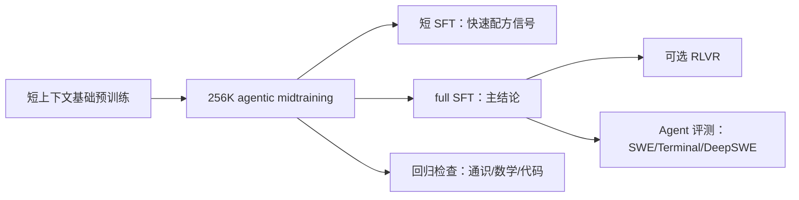
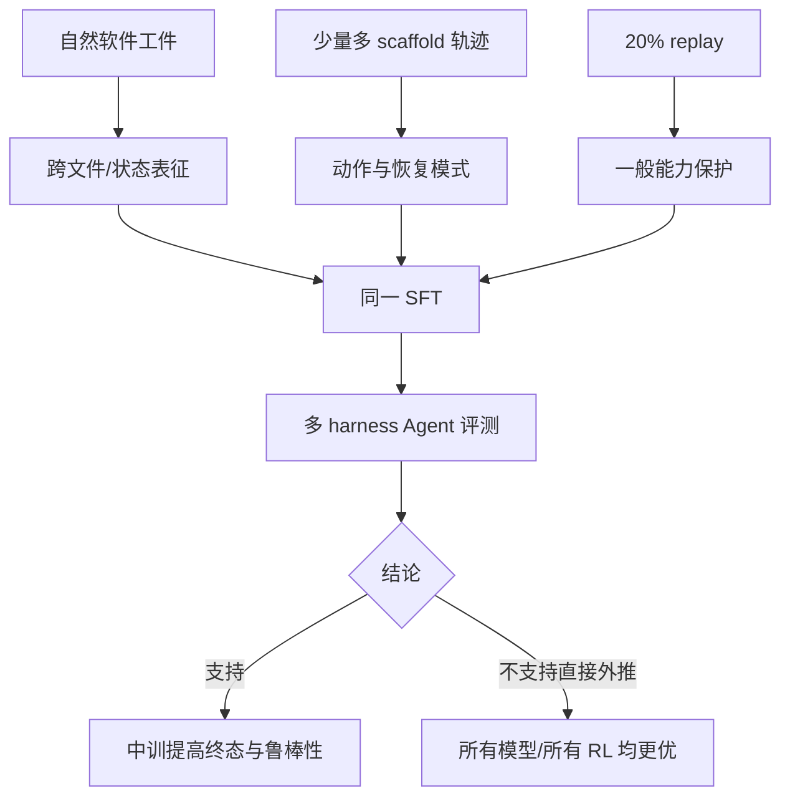

# 把基础模型“预热”为 Agent：一套开放的 Agentic Midtraining 配方

> **论文**：[Priming Base Models for Agentic Post-Training: An Open Midtraining Recipe](https://arxiv.org/abs/2610.22019)（2026-10-15，v1）  
> **分类**：大模型 Agent / 大模型后训练  
> **原文**：[HTML 摘要页](https://arxiv.org/abs/2610.22019)｜[PDF](https://arxiv.org/pdf/2610.22019)｜[arXiv TeX 源码](https://export.arxiv.org/e-print/2610.22019)

## TL;DR

- 这篇论文提出并公开了一种位于预训练与 SFT/RL 之间的 **agentic midtraining**：在已收敛的基础模型上，用 **256K** 上下文、数百亿到数千亿 token 的软件工程与少量交互轨迹继续训练，使模型在进入昂贵的 Agent SFT 前先学会跨文件状态、真实工具循环和长上下文。
- 配方不是“把更多 Agent 轨迹塞进 SFT”。500B-token 混合中，Issue--PR 为 **40.8%**、连通仓库为 **20.0%**、轨迹仅 **10.0%**、预训练 replay 为 **20.0%**、长上下文数据为 **5.0%**；作者刻意把 chat-template 化轨迹控制在 10--15%，以免把中训变成过长 SFT、伤害后续 RL 可训练性。
- 在同一份 100B-token full SFT 之后，30B/3B-active 的 Nemotron Nano 由 **60.7→64.5**（SWE-bench Verified）、**55.8→62.8**（Multilingual）、**32.0→35.5**（SWE-bench Pro）；120B/12B-active 的 Super 模型经 280B 中训后，长程 DeepSWE 由 **11.7→15.7**，Verified 由 **72.9→74.3**。
- 关键证据并非只有榜单：去掉 agent traces 后，100B 中训接 full SFT 在 SWE-Verified 仅比基线高 **0.8** 点，而完整混合高 **3.8** 点；若让 loss 预测工具响应，Verified 约下降 **10** 点。中训后 SWE-Pro 填满 256K 窗口的 rollout 从 **91/2,193** 降至 **13/2,193**。
- 局限同样明确：数据、训练和评测均由作者体系构建；DeepSWE 仅 4 次运行、Super 的 DeepSWE 波动约 2 点；RLVR 仅单 seed、20 步，证明的是优势没有立刻消失，而不是证明中训让 RL 的最终上限更高。

## 研究问题：为什么 Agent 不能只靠最后一段 SFT？

### 两个分布之间有一道缺口

传统基础预训练多是短上下文、独立文件；Agent SFT 则多为合成的多轮 chat 轨迹。真实编码 Agent 却必须同时完成：

1. 在远距离文件间维护状态；
2. 阅读 issue、PR、commit、CI 日志后改动代码；
3. 在工具失败后决定下一步，而非单次生成代码；
4. 在 200 轮左右的 harness 限制和有限 context 内收敛。

作者的命题是：若直接从前者跳到后者，SFT 既要教会交互格式，又要补足仓库结构与软件演化知识，容易变得很长；而极长 SFT 可能损害稍后 RL 的可训练性。因此中训承担的是“把基础模型移到更接近 Agent 后训练的分布”，但不取代 SFT 的高质量示范或 RL 的奖励信号。

### 论证路线：结论要经过完整后训练检验

| Claim | Mechanism | Evidence | Boundary |
|---|---|---|---|
| 中训能改善 Agent 终态能力 | 长上下文软件工件 + 少量轨迹塑形 | 同 full SFT 后 Nano 四类 benchmark 均提高 | 只覆盖作者选定模型、数据和 harness |
| 轨迹不可缺，但不应主导 token | 轨迹教动作循环；自然工件教状态/结构 | 去轨迹消融显著缩小 full-SFT 增益 | 不能推出 10% 对所有模型最优 |
| 代理指标不足以挑配方 | LoCoDiff/BPB 提升未可靠预测 SFT 后表现 | 作者改用短固定 SFT 做快速选择 | 短 SFT 与 full SFT 的相关性仍来自此实验体系 |
| 中训改善鲁棒性而非只改一个分数 | 多 harness、context/turn 使用更经济 | 所测 harness 全部提升；context-failure 降低 | harness 改版或提示词变更可能改变绝对值 |



## 配方拆解：模型究竟看到了什么？

### 混合不是资料堆砌，而是能力分工

| 来源 | 独有 token | 500B run 中所见 | 占比 | 在论证中的作用 |
|---|---:|---:|---:|---|
| 合并 Issue--PR | 216.9B | 205.2B | 40.8% | 以问题、评审和 patch 演化条件化改动 |
| 连通仓库 | 104.1B | 100.7B | 20.0% | 学跨文件依赖与 repository-scale 上下文 |
| Agent 轨迹 | 39.4B | 50.3B | 10.0% | 学 tool call、测试与失败恢复 |
| Diff / 演化历史 | 16.0B | 15.1B | 3.0% | 学状态追踪与多文件编辑 |
| Build/CI 日志 | 6.5B | 6.1B | 1.2% | 学环境反馈、错误与诊断 |
| 预训练 replay | 约 2.0T | 100.7B | 20.0% | 缓冲能力遗忘 |
| 长上下文数据 | 67.4B | 25.2B | 5.0% | 维持长文档覆盖 |

Issue--PR 语料从至少 10 star 的公开仓库的已合并 PR 构造，按仓库与 PR ID 去重；删除不可取 Git 对象、不可重建 patch、生成内容、空或极端变更。关联 issue 的样本还由结构化 LLM judge 判断“问题与 patch 是否匹配”。这一步的意义不是标榜 token 大，而是把“需求—环境—修改”组织成一个条件生成任务。

仓库并非任意拼接文件。作者在 14 种语言上建 import graph，仅保留至少 **20%** 代码文件连向仓库内文件的仓库（Ruby 因 autoload 放宽到 **10%**）；README 在前，连通文件相邻，过长仓库按连通分量切分而非截断。它针对的是 Agent 常见的失败：模型虽然能补单文件，却没有把被调用定义、接口约束和远端状态带进当前决策。

### 轨迹如何进入 loss：学“我做什么”，不背“工具吐了什么”

设一条轨迹为 \(\tau=(u_1,a_1,o_1,\ldots,a_T,o_T)\)，其中 \(u\) 是用户/环境指令、\(a_t\) 是 assistant 的文字或工具调用、\(o_t\) 是工具响应。作者采用的核心目标可写为：

\[
\mathcal{L}_{\text{trace}}=-\sum_{t=1}^{T}\sum_{j\in a_t}\log p_\theta(x_j\mid x_{<j}),\qquad \text{mask}(o_t)=1.
\]

- **被预测**：assistant turn、工具调用格式和下一步行动；
- **被遮蔽**：文件 dump、测试日志、hash、时间戳、重复分隔符等工具或格式噪声；
- **原因**：环境响应可极长且高熵，让模型预测它会挤占“选择动作”的容量。

这不是纯粹的实现偏好。100B 中训后接同一较早 SFT 版本时，将工具响应纳入 loss 使 SWE-Verified pass@1 约低 **10** 点。与此同时，轨迹本身约 39B token、超过 100 万条、约 50 万个不同 query、3,000 万次 tool call，覆盖 OpenHands、Codex、Claude Code、SWE-agent、Terminus 等十余 scaffold；多 scaffold 是为了避免把某一工具接口误学成能力本身。

```text
Input: repository/PR/log documents D, trajectories T, replay R
State: θ ← converged base checkpoint; context = 256K
for packed sequence z ~ 0.75·D + 0.20·R + 0.05·long_context:
    arrange repository files by dependency; keep document attention isolated
    if z is trajectory: predict assistant tokens only; mask tool responses
    redact secrets; remove benchmark-contaminated and low-quality examples
    θ ← AdamW(θ, ∇θ L_masked(z))
    periodically check general capability and short-SFT agent scores
Output: θ_mid, sent to identical full SFT; stop/retune if regressions emerge
Failure boundary: filled context, malformed tool calls, unfinished/leaky traces are excluded or counted as failures.
```

### 训练设置与“不要遗忘”的控制

Nano（总 30B / active 3B）使用峰值学习率 \(5\times10^{-5}\)，Super（120B / active 12B）使用 \(1\times10^{-5}\)，均 256K packed sequence、global batch 64、BF16、Adam \(\beta=(0.9,0.95)\)、weight decay 0.1、gradient clip 1.0。较大模型学习率更保守，目标是保住一般能力。

作者从 **20% replay** 起步：65B Super 中训后，四组一般能力检查均在初始 checkpoint 的 1.2 点以内；试过 40% 并无明确收益。反面结果是学习率不能只追 Agent 指标：从 \(10^{-5}\) 升到 \(5\times10^{-5}\) 时，MATH-500 从 **79.7** 降到 **61.7**。这解释了配方中 replay 与中等学习率不是装饰，而是把“学新分布”和“不毁旧分布”同时纳入验收。

## 实验：比较必须锁住后训练与 harness

### 协议避免了一个常见误判

作者不只看 base-model perplexity 或 RepoBench，而是对每个中训 checkpoint 施加**相同**的 33B short SFT 和 100B full SFT。主评测包括 SWE-bench Verified（500 题）、Multilingual（300）、Pro（731）、Terminal-Bench 2.0（89）与 DeepSWE；SWE 使用 OpenHands SDK 1.17.0、每题 3 rollout，Terminal 使用 Terminus-2、每题 8 rollout且单题 1 小时。

为何严苛？LoCoDiff、RepoBench、repository/trace BPB 的确随中训改善，却不足以可靠排序最终 post-training 表现。作者发现“决策性 DeepSWE assistant turn 的 BPB”相关性最好，但仍把它降格为监控量；真正的 recipe selection 信号是短 SFT 后固定 benchmark。这个选择是全文最可迁移的方法学结论：Agent 中训的 proxy，不应代替带真实 scaffold 的下游闭环。

### 主结果：500B token 不是单调神话

| Nano 中训 token | SWE-V pass@1 / @3 | SWE-Multi | Terminal 2.0 | SWE-Pro |
|---:|---:|---:|---:|
| 0（base） | 60.7 / 72.2 | 55.8 / 72.3 | 22.6 / 43.8 | 32.0 / 41.5 |
| 100B | 64.1 / 74.0 | 57.4 / 71.7 | 22.5 / 44.9 | 34.9 / 45.1 |
| 200B | 64.3 / 73.4 | 59.7 / 76.7 | 21.4 / 39.3 | 35.8 / 45.3 |
| 300B | 63.5 / 73.6 | 62.0 / 76.7 | **24.9 / 48.3** | **36.3 / 46.4** |
| 500B | **64.5 / 75.0** | **62.8 / 77.0** | 23.6 / 46.1 | 35.5 / 45.4 |

三个读法值得区分：

1. **有总体增益**：500B 对四类 benchmark 的 pass@1 都高于 base；pass@k 也上升，因而并非只改善某次采样的稳定性。
2. **不同能力的饱和点不同**：Verified 与 Pro 的多数增益到 100B 已到手，Multilingual 一直涨到 500B，Terminal 更噪且在 300B 峰值。这反对“token 越多必然越好”的简单叙事。
3. **长程任务收益更醒目但不夸张**：Super 的 DeepSWE +4.0 点是最大单项改进；同一模型 Verified 只 +1.4 点，说明该配方更可能在长程状态维护上发挥作用，而非普遍地把所有编码能力同比放大。

### 消融、失败与图表证据

| 证据位置 | 观察 | 它支持什么 | 仍不能证明什么 |
|---|---|---|---|
| Table 1（早期 100B） | 完整混合 full-SFT 的 SWE-V 59.7→63.5；无轨迹为 60.5 | 轨迹贡献多数 Agent 终态增益 | 自然数据没有价值；它仍支持结构和 harness 鲁棒性 |
| Table 2（500B scaling） | Multi 55.8→62.8；TB 在 300B 最佳 | 能力维度有不同训练曲线 | 任意数据混合都会复现该曲线 |
| Table 3（base metrics） | LoCoDiff exact 0→26.8，RepoBench 70.09→72.41 | 跨文件、演化目标确实被学习 | 这些 proxy 足以选择最终配方 |
| Figure 1（blend） | 75% 为中训资料、20% replay、5% long context；轨迹只占 10% | “自然工件为骨架，交互轨迹为接口” | 比例具有普适最优性 |
| Appendix context table | SWE-Pro context-filled 91→13 | Agent 更节制地使用窗口 | 少用 token 一定因更强推理造成 |

还有两个值得保留的失败案例。其一，256K 中训会短暂伤到 1M RULER：Super 从 **79.9** 在 25B 后掉到 **33.0**；补约 9B 纯长上下文数据后回到 **81.0**。这说明 context extension 不是一次性属性，阶段顺序会互相覆盖。其二，RLVR 的 20 个 GRPO step 里，中训模型保持约两点 SWE 优势、Terminal pass@8 保持 45--46，而 base 从 46.1 落到 39.3；但仅 89 个 Terminal 任务、单 seed，作者没有把它包装成“中训提升 RL 上限”。



## 相关工作中的位置

- Qwen3-Coder-Next 报告过 256K、万亿 token 量级中训与 600B repository token，但公开配方细节较少；本文的贡献是把过滤、权重和关键消融摊开。
- GLM-5 报告约 1.55T token 的渐进 context extension，含约 1,000 万 issue--PR pair；Kimi-Dev 使用约 150B diff、commit 和合成互动；daVinci-Dev 主张 trajectory-style 中训。本文没有声称首创中训，而是给出“在 identical SFT 后仍有效”的验证框架。
- 与只优化 SFT 数据质量的路线不同，作者把自然工件和轨迹分层：最高质量轨迹留给 SFT，其余有价值的交互数据进中训。这是数据预算分配的工程判断，不是对轨迹质量的否定。

## 证据边界、可复现性与研究者的后续问题

### 已被论文支持的判断

- 在作者两个 Nemotron 模型、相同 SFT 和所列 harness 中，256K agentic 中训与更好 Agent 终态表现相关；
- agent trace 的 assistant-only loss、20% replay、跨 scaffold 混合都有具体消融或监控证据；
- 长上下文失败数下降是独立于 pass@1 的实用证据，尤其在 SWE-Pro。

### 尚未被充分支持的判断

- 开放“配方”不等于开放可完全重做的训练：论文写明数据构造与统计，但重建 12.1M PR、数百亿轨迹、GB300 训练与去污流程的成本极高；
- 评测与训练 data selection 都在同一研究体系，外部模型、闭源模型或另一个 Agent harness 的效应大小未被验证；
- DeepSWE 的绝对分数低且有约 2 点 run-to-run 变化，+4 点值得关注但应等待多 seed / 独立复现；
- RULER 的 1M 下降提醒我们：把 256K 中训接在已扩到 1M 的 checkpoint 后面会制造阶段顺序混淆，生产训练应把中训放在最终 long-context stage 之前。

### 可以继续追问的三个问题

1. **数据可替代性**：若开源复现实验只能取得小一到两个数量级的 PR/trace，哪一类 token 最先失效？应做固定计算预算的来源置换，而不是只做全量删去。
2. **跨语言与跨 harness**：Multi-SWE 的持续增益来自语言覆盖、跨文件图结构，还是 OpenHands 的具体交互模式？同一 checkpoint 应在未出现过的工具 schema 上盲测。
3. **RL 接口**：20-step RLVR 只显示优势存活。下一步需要多 seed、足够长的 RL 曲线、相同 reward budget 与 cost 记录，回答中训究竟提高样本效率、稳定性还是最终 ceiling。

**总判断**：这篇论文最有价值的不是“500B token 更强”这一句，而是把 Agent 能力看作一条数据分布连续体：基础预训练学代码语言，midtraining 学真实软件世界的结构与交互先验，SFT/RL 再把先验压成能在具体工具环境中完成任务的策略。它同时用完整后训练评测和失败指标提醒我们：若不锁住 SFT、harness、context 上限和一般能力回归，任何漂亮的中训 proxy 都可能是在测量错误的东西。

## 从数据处理细节看：每个过滤器在防什么偏差？

### Issue--PR 的“可学习目标”不是 GitHub 页面

论文把 PR 描述、关联 issue、review discussion、仓库快照和可观察到的 patch 演化排成序列。表面上这是大规模抓取，实际有三个很窄的学习目标：给定需求理解变更范围；给定修改前状态预测修改后状态；在讨论与代码不一致时识别需要更多证据的地方。若只保留最终 diff，模型会把训练做成缺少因果上下文的 patch completion；若只保留 issue，又会把任务做成自然语言猜代码。

过滤的含义也要分开看：

- 删除 Git 对象缺失、patch 无法重放、过大或空变更，首先是保证“目标答案”存在，而不只是清洗噪声；
- 对 issue--PR 运行 judge，标签包括 revert、偶然关联、错 issue、partial fix、无明确 action、需求不充分和远超需求的 PR。它避免把**表面链接**误当成监督关系；
- 对 PR-only 样本用确定性规则，并删除只改 README 或不超过三行的变更，减少“极易预测的文档编辑”淹没真正工程改动；
- 所有 source 都做许可过滤、benchmark 去污染、secret redaction；这同时是法律、泄漏和评测有效性约束，不能被一句“公开 GitHub 数据”取代。

这里可把一个训练样本抽象成条件与目标的分解：

\[
c=(m,\,q,\,r,\,s_{\text{before}}),\qquad
y=(\Delta,\,s_{\text{after}}),\qquad
\mathcal L_{PR}=-\log p_\theta(y\mid c).
\]

其中 \(m\) 是仓库元信息和文件树，\(q\) 是 issue/PR 文字，\(r\) 是评审或演化记录，\(s\) 是代码状态。这个写法揭示作者为什么需要 mask header、hash、日期：若模型能从无意义的标识符猜测目标，损失会下降，却不是在学 \(c\to y\) 所需的工程推理。

### 连通性阈值是一个关于任务分布的假设

作者只选“至少 20% 文件有仓内 import edge”的仓库，不是因为孤立脚本没有价值，而是他们声称 Agent 的瓶颈是跨文件依赖。其验证方式也具有针对性：按依赖图排序时，强模型的 bits-per-byte 更低、弱模型反而更高，说明这种序列化增加的不是相邻 token 复制，而是远距离结构预测。

但这个阈值有可质疑处：静态 import graph 对 Python 动态导入、JavaScript 运行时加载、服务间 API 调用和配置依赖并不完备；Ruby 获得 10% 特例也正说明语言解析质量影响采样。未来更稳妥的版本应报告“图不可恢复”的语言是否被系统性排除，并比较静态图、构建图、调用图与 test dependency graph 的互补性。

### Diff 与日志补的是两种不同的环境记忆

多文件 edit 展示变更前文件再预测变更后文件；code-evolution document 展示从最旧到最新的真实 commit 序列及最终状态。前者近似 patch application，后者近似长程状态机：

\[
s_{t+1}=f_\theta(s_t,\Delta_t),\qquad
\hat s_T=f_\theta(\cdots f_\theta(s_0,\Delta_1),\ldots,\Delta_T).
\]

这正对应 LoCoDiff 的最终文件重建。控制实验中，10B token、50% diff 的设定将 LoCoDiff exact 从 **1.3%** 提至 **29.8%**，而没有 diff 的设定为 **1.3%**、distance 0.507；完整 500B blend 达 exact **26.8%**、distance **0.164**。这并不意味“diff 越多越好”，反而说明一个专门状态目标会非常强地牵引 proxy，故还需由 SFT 后 Agent 结果校正。

CI/构建日志则提供模型动作之后的环境响应。作者从 LogHub 与 GitHub Actions 取 logs，按 120 行 context + 16 行 target 切窗，另做 632 条围绕 warning/error/critical 的诊断样本；secret、hostname、timestamp、hash 和 boilerplate 被遮蔽。它让模型看见错误模式，但不把“逐字复写日志”误当成 action 学习。

## 评测数字应该怎样读：分母、采样和显著性

### pass@1 与 pass@k 分别回答什么？

若每个 task 独立采样 \(n\) 次、成功 \(c\) 次，则常用无放回估计写作：

\[
\mathrm{pass@}k=1-\frac{\binom{n-c}{k}}{\binom{n}{k}}.
\]

- **pass@1** 更接近一次真实执行是否完成，论文主要用它比较终态 Agent；
- **pass@k** 描述在同一预算下多次采样是否有可利用的成功空间，作者将其视为潜在 RL 改进余地的一种间接信号；
- 两者同时提升，比“只提高 pass@k”更能排除仅靠随机重试的解释；但它们都仍依赖具体 agent scaffold、提示、温度 1.0、top-p 0.95 和 execution timeout。

SWE-Verified 的 500 task、每题 3 rollout 给出 1,500 次尝试；SWE-Pro 为 731 task、最多 250 turn；Terminal-Bench 2.0 为 89 task、8 rollout并有一小时限制。因而 0.5--1.0 点的变化在不同 benchmark 上统计含义不同。论文自己报告 Super 模型 Verified/Pro 约有 1 点运行间变动、DeepSWE 约 2 点；读者不应把所有小数差视为稳定排序。

### “短 SFT 能选配方”是一个实用主张，不是定理

早期 100B 实验中，short SFT 下完整中训对 SWE-Verified 的增益仅 **+0.8**，Multilingual 为 **+8.2**；full SFT 后仍有 **+3.8** 与 **+3.7**。这支持短 SFT 可以作为较便宜的 gate，但并不保证每一个 micro-choice 都能被 short SFT 正确排序。特别是 Terminal-Bench 在 short SFT 更噪、full SFT 才改善 pass@1，正是反例。

实际配方开发可据此采用两层 protocol：

1. 用短 SFT 淘汰明显坏的混合、学习率和 masking；
2. 对保留候选做 full SFT、多个 harness 与一般能力回归；
3. 对接近的结果报告 seed、rollout 和成本区间，而非只保留冠军 checkpoint；
4. 将 context-filled、turn-cap、format violation 与纯成功率并列，避免优化出“高分但昂贵、脆弱”的策略。

### Context failure 是很有价值但仍需解释的指标

500B 后，Verified/Multi/Pro/Terminal 填满窗口的次数分别从 **40→26**、**25→14**、**91→13**、**8→1**。在 Verified 还观察到 hit 200-turn cap 从 11 次降到 1 次。最直接解释是模型更早定位相关文件、较少重复 inspect 或无效 edit；但也可能来自输出更短、工具调用策略更保守，甚至是 harness 对不同模型格式的响应差异。

所以若要把“更经济”升级为机制结论，后续应标注每个成功/失败 rollout 的 token、turn、工具类型序列和错误类别，并比较“相同预算下成功率”与“相同成功率下成本”。论文的 RLVR 信号提供了一个起点：中训模型平均 reward **0.308 vs 0.295**、生成长度 **4.6K vs 5.3K**（短 12%）、format violation **0.03% vs 0.34%**，同硬件每条轨迹约快 15%；但这仍是有限 steps 下的训练过程数据。

## 可复现路线图：哪些部分最难复制？

| 层次 | 论文已给出 | 复现者仍需决定 | 主要风险 |
|---|---|---|---|
| 语料 | 来源类别、token 量、部分过滤规则 | 数据快照、PR 重建、许可判定、去污列表 | URL 漂移、不可重放 Git 历史、泄漏 |
| 序列化 | 256K、依赖排序、assistant-only mask | parser 覆盖、packing、跨文档 attention mask | 图错误或文档串扰 |
| 优化 | batch、LR、Adam、并行度、token budget | 硬件等效性、checkpoint 选择、seed | 算力和数值差异 |
| 后训练 | 33B/100B SFT，约 430K trajectory | SFT 数据获取、teacher/version、训练实现 | 最终差异被 SFT 淹没 |
| 评测 | benchmark、rollout、部分 harness 版本 | 容器、依赖、模型 serving、timeout | harness drift 与成本不可比 |

作者公开论文与 TeX 是透明度进步，但不是可一键重训的 release。尤其它所需的 500B 中训、超过百万轨迹与 GB300 集群，把可复现性分成“机制复现”（小规模验证 mask、图排序、短 SFT gate）和“数值复现”（同 token、同 SFT、同 harness 达到表中绝对分数）。报告两者的差别比宣称“开源配方已复现”更诚实。

最后，跨语言证据值得谨慎乐观。SWE-bench Multilingual 是 Nano 中最持续的增益，但论文没有把增益拆成语言、repo graph 质量和 scaffold 交互三项。一个真正有诊断力的后续实验，应在未参与中训的语言/构建系统上预注册评测，同时固定 token 与 wall-clock budget。只有那时我们才能判断它学到的是通用 agentic software prior，还是对当前 GitHub/Java/Python 工件分布的高质量拟合。
