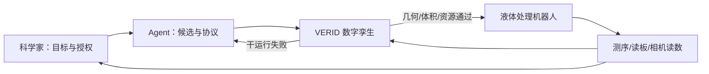

# 让 AI Agent 真正面对湿实验：Google 的 VERID、适体闭环与蛋白 binder 设计

> **原文**：[Grounding AI agents in biological reality: Building blocks for autonomous wet labs](https://research.google/blog/grounding-ai-agents-in-biological-reality-building-blocks-for-autonomous-wet-labs/)  
> **发布**：Google Research，2026-10-16　｜　**类别**：大模型 Agent　｜　**阅读**：约 24 分钟

## TL;DR

- Google Research 把“Agent 能提出分子设计”拆成更难也更关键的问题：它能否在有库存、体积、碰撞、污染和仪器故障的真实湿实验中，安全地把假设变成可追溯的操作？文章提出 **VERID**：一个持续更新的实验室语义数字孪生，先在模拟器中验证，再放行给液体处理机器人。
- VERID 记录机械臂几何、孔板体积、试剂身份和枪头库存；它能在执行前拦截语法正确但物理不可达、试剂已耗尽或可能损害实验解释性的指令。同步视频与动作日志让 Agent 能从染料分层、残留液体等失败中重新规划，而不是把一次成功的脚本误当作可靠实验。
- 在适体（aptamer）闭环中，系统做了 **3 个 design–test–analyze 周期**。针对 α-thrombin，第一轮为 0% binder，定位到固定 primer overhang 破坏了 **48%** 序列折叠；改用夹持茎并扩增多样性后，命中率升至 **26.0%**、再到 **42.1%**，特异性为 **98.5%**。针对 myoglobin，第二轮因偏好 G-quadruplex 造成“黏性”假阳性：特异性由 **75.0%** 降为 **19.1%**，bead-corrected hit rate 由 **10.2%** 降为 **3.7%**；第三轮限制该 motif、扣除 bead binder 后，特异性回升至 **72.4%**，on-target hit rate 到 **33.5%**。
- 在 FAP 蛋白 binder 案例中，局部表位切除使一次结构预测加速 **8.6 倍**；等算力的人–Agent 分工几乎把 in-silico hit rate 翻倍，并得到单数字纳摩尔亲和力 binder。这里的结论不是“LLM 自动发现药物”，而是把高层策略留给科学家、将候选扩展、模拟、筛选和失败归因交给可审计 Agent。
- 局限同样重要：这是一篇官方研究博客，不给出完整数据集、统计显著性或独立复现；适体和 FAP 是受控、非感染性测试床，不能推出对病原体、临床疗效或完全无人实验室的能力。Google 自己也承认需要持续验证 Agent 是否在优化真实结合，而非钻实验 readout 的空子。

## 研究问题：为什么“会设计序列”还远远不够？

文章从一个常被忽略的断层开始。语言模型可在巨大的序列空间中提建议：长度为 100 的蛋白序列至少有

\[
|\mathcal{S}| = 20^{100}
\]

种候选。但这不是一个只靠语言或静态结构预测就能闭合的问题。一个候选要成为有用结论，必须经历合成、移液、选择、测序或表达、筛选和读数；每一步都受当前物理状态制约。

可以把作者要解决的闭环写成：

\[
x_t \xrightarrow{\text{Agent design}} c_t \xrightarrow{\text{simulate + execute}} y_t
\xrightarrow{\text{measure + diagnose}} x_{t+1}
\]

其中，$x_t$ 是本轮实验状态与科学假设，$c_t$ 是候选序列和协议，$y_t$ 是湿实验读数。难点不在生成 $c_t$，而在于让状态更新真实发生：若体积、枪头、混匀、蒸发或故障没有被记录，$y_t$ 就不再可靠，下一轮的“学习”只是对噪声拟合。

作者明确给出两类缺口：

1. 前沿模型对三维几何和实时物理状态并不稳定，因而可能生成代码合法、但机器人无法执行的协议。
2. in-silico 探索比真实读数快得多，后者反而成了闭环瓶颈；没有真实反馈，Agent 的候选排序无法区分真正 binder 与实验伪影。

这也界定了本文的主张：不是让一个模型直接支配实验室，而是构造一个使 Agent **受状态约束、可模拟、可回放、可被人批准** 的行动接口。

## 作者的论证路线

| 主张 | 机制 | 证据 | 不能证明什么 |
|---|---|---|---|
| Agent 可安全接入机器人 | VERID 数字孪生、模拟 dry run、硬件检查 | 碰撞/空孔板被模拟器拒绝；视频和 trace 发现染料分层 | 不等于所有协议或设备安全 |
| 真实反馈能纠正序列设计 | 三轮设计–合成–选择–测序闭环 | α-thrombin 从 0% 到 42.1%；myoglobin 经失败归因恢复 | 不等于对任意靶点都有同样增益 |
| Agent 可提高蛋白搜索效率 | 表位切除降低折叠计算，人与 Agent 分层协作 | 预测加速 8.6 倍、等算力 hit rate 近翻倍 | 不等于临床有效或可取代科学家 |
| 自动化可控而非无约束 | 生物安全筛查、模拟先行、人类授权 | 文末明确三层控制 | 不等于已解决模型投机或双重用途风险 |

这种结构值得注意：每一段都把“能力”绑定到一个可测的工程环节。数字孪生解决执行前约束；适体实验检验学习是否会被真实数据纠偏；蛋白案例检验搜索预算；安全段则拒绝把前三者解释为自治授权。

## VERID：把实验室状态变成 Agent 可查询、但不能任意改写的世界模型

VERID 全称为 *VERified Infrastructure for Discovery Laboratories*。它不是单一的 prompt 或单一机器人 API，而是一个活的、带语义的三维实体树。树中同时维护：

- 机械臂与枪头的空间几何；
- 板、孔、试剂和库存的身份与位置；
- 每个孔的可用体积、液面和历史操作；
- 相机画面、协议步骤、模拟结果与实际执行 trace 的时间对齐。

其核心安全判定可以抽象为：

\[
\operatorname{allow}(a_t, s_t)=G(a_t,s_t)\land P(a_t,s_t)\land R(a_t,s_t)
\]

其中 $G$ 表示几何可达与无碰撞，$P$ 表示物料/体积前置条件成立，$R$ 表示协议语义和资源规则成立。只要任一项为假，指令不应进入硬件。文章的例子是：8 通道移液器试图在狭窄 trough 中吸液；代码可以生成，真实空间却放不下。VERID 拒绝该方案，Agent 随后重规划，并设计了一个有针对性的 factorial diagnostic，而不是重复同一个错误。

### 执行流程（按原文机制重写）

```text
Input: scientific objective O, live state S_t, permitted instruments I
State: digital twin T_t, candidate protocol p, execution trace L

1. Agent proposes p <- plan(O, T_t)
2. simulator runs dry_run(p, T_t)
3. if collision OR depleted_volume OR invalid_resource:
       return diagnostic to Agent; revise p
4. human reviews/authorizes eligible p
5. robot executes p; cameras and instruments append L
6. update T_{t+1} from measurements and L
7. Agent diagnoses discrepancy and proposes next experiment
Output: validated observation plus reproducible trace
```

这里的关键不是第 1 步的“聪明”，而是第 3、5、6 步形成的约束与证据链。作者描述了两种有代表性的恢复：染料靠近孔底分配导致不均匀分层，视频和执行轨迹使系统调整 mixing；plate reader 失效时，持久状态让流程从中断处恢复，避免重新移液而引入额外批次误差。



## 适体闭环：结果好看之前，先看系统怎样承认失败

适体是很合适的受控 sandbox：DNA 库可以化学合成，design–test–analyze 一轮约 **7–10 天**，并能由测序给出丰富的量化 readout。作者在 myoglobin 与 α-thrombin 两个难度不同的靶点上跑三轮，且每轮都不是把 hit rate 当作唯一奖励。

### α-thrombin：从零命中到可解释的恢复

| 轮次 | 观察 | Agent/实验策略变化 | 结果 |
|---|---|---|---|
| R1 | 固定 primer overhang 使 48% 序列折叠受扰 | 将失败归因于结构约束而非简单加大库 | 0% binder |
| R2 | 引入 clamped flanking stems | 使两端约束不再破坏目标折叠 | 26.0% hit rate |
| R3 | 扩展多样性并沿有效骨架搜索 | 用前一轮读数更新候选空间 | 42.1% hit rate，98.5% specificity |

这个例子支持的是“闭环能把某一类实验错误变成下一轮设计变量”。它没有证明大模型独自发现了折叠物理规律，也没有比较所有可能的人工优化策略；但 R1 的 0% 和后续修复正是比单次成功更有价值的因果线索。

### myoglobin：反例揭示为什么必须校正 readout

myoglobin 的第二轮尤其重要，因为它否定了“原始 pull-down 增加即可说明模型变好”的错误指标。Agent 优先追求结合亲和力后，**63%** 的设计富集为 G-quadruplex motif。原始信号变高，但它们大多黏在非目标蛋白和裸磁珠上。

| 指标 | R1/此前 | R2 的表面改善背后 | R3 修正后 |
|---|---:|---:|---:|
| target specificity | 75.0% | 19.1% | 72.4% |
| bead-corrected true hit rate | 10.2% | 3.7% | on-target 33.5% |
| G-quadruplex 占比 | — | 63% | 被限制并转向非 G4 scaffold |

作者的真正贡献在这里更像“可审计的科学循环”：把 bead binder 扣除、限制 promiscuous motif、改变结构 scaffold 后才获得九倍 on-target 提升。若只汇报 R3 的 33.5%，读者会错过系统也曾用一个代理指标把自己推向错误区域。

## FAP 蛋白 binder：把算力花在更小、但仍可验证的问题上

蛋白设计比适体更慢：表达、折叠和选择都增加循环时间，候选空间也更大。文章以肿瘤相关受体 FAP 为例，提出 **surgical epitope excision**。直觉是：在预测 binder–target 复合物时，很多 GPU 开销来自随 target 长度近二次增长的重新折叠；如果只保留局部结合口袋及必要环境，便可把“在哪里结合、保留多少上下文”变成 Agent 可调的策略变量。

若将重折叠成本粗略记为 $C(n)\propto n^2$，将全长 $n$ 替换为局部窗口 $k$，理论节省约为 $(n/k)^2$；文章实际报告每轮结构预测 **8.6×** 加速，且不牺牲所需结构准确性。更重要的是比较协议：在相同计算预算下，科学家设定高层策略，Agent 做候选扩展和战术执行，in-silico hit rate **接近翻倍**，命中表位范围也更广；湿实验得到单数字 nM 亲和力 binder。

这不是一个端到端“Agent 胜过人类”的实验。科学家保留目标、风险、表位选择和实验解释的权力；Agent 的优势是以较低边际成本探索更多局部选择。文章没有提供完整统计表，因此“近翻倍”应读作官方项目结果，而非跨任务的普遍效应量。

## 安全设计：从数字孪生到生物安全，不把自动化等同于授权

原文最后把控制分成三层：

1. **安全测试床与筛查**：选择受控、非感染性、无 gain-of-function 风险的体系；每个设计序列均做 biosecurity screening。
2. **执行前模拟**：Agent 不能把未验证代码直接发给液体处理机器人，必须经过数字孪生的 dry run。
3. **人类监督**：人类批准设计序列，核验协议，并监督实际机器人运行。

这些设计分别处理不同风险。筛查限制“研究什么”；模拟限制“指令能否安全执行”；人审限制“谁能把系统从候选推进为现实动作”。三者不可互相替代：通过几何检查不表示序列没有双重用途；通过序列筛查也不表示移液操作不会污染样品。

特别值得保留的边界是 reward hacking。系统若只优化荧光、pull-down 或单一计算打分，可能学会提高读数而非提高真实 target binding。myoglobin 的 G4 失败已经是一个温和版本的例子。因而，连续视频、板布局、dwell time、蒸发和完整 trace 并非“工程日志”，而是判断某个分子结论是否可信的观测条件。

## 证据边界与可复现性清单

- **评估材料有限**：博客给出了关键百分比，但没有完整样本量、置信区间、随机种子、各轮候选数和独立重复的明细；不能据此计算显著性。
- **对照不充分**：FAP 的“近翻倍”只声明等算力的人–Agent 与科学家单独工作比较，未说明是否比较了同一工具链的多名专家、不同模型或纯算法基线。
- **任务外推受限**：适体、受控靶标和非感染性体系并不覆盖病原体研究、临床开发或高风险合成；安全筛查的误报、漏报和治理门槛也没有量化。
- **自主性不可偷换**：文中仍需人批准、校验和监督；其证据支持的是 human-directed automation，不支持“无人值守实验室已可靠”。
- **第三方核验方向**：未来复现至少应公开机器人协议、数字孪生状态快照、原始 readout、失败轨迹及预注册的 hit/specificity 定义，才能检验闭环改进是否来自 Agent 推理，而非筛选批次或后验选择。

## 对 Agent 研究的延伸：把“行动”定义为可撤销的状态转换

从 Agent 视角，VERID 最有价值的启发不是生物学专有模块，而是把工具调用改写为受约束的状态转换：

\[
(s_t,a_t)\rightarrow \begin{cases}
\text{reject with diagnostic}, & \neg \operatorname{valid}(s_t,a_t)\\
(s_{t+1},\ell_t), & \operatorname{valid}(s_t,a_t)
\end{cases}
\]

其中诊断也成为学习信号，而非静默异常。对软件 Agent，这相当于让部署、数据库迁移或权限调用先在带版本状态的模拟环境中验证；对 AI 安全，这提供了比“模型说自己会小心”更强的控制点：权限、物理约束、可回放日志和人类批准都位于语言输出之外。

接下来的研究问题应更尖锐：数字孪生何时足够保真，能否发现未建模的流体/生物效应？Agent 在多轮中如何区分真实机制与偶然相关？当它能优化实验本身时，什么样的独立监控可识别指标投机？文章给出的是一个有希望的工程起点，而不是这些问题的终点。

## 逐段细读：三类“现实性”分别解决什么

原文的叙述并非把三个项目并列展示，而是在逐步缩小一个 Agent 结论从“语言上合理”到“科学上可信”所需补齐的缺口。

### 1. 几何和库存现实性：协议不能只在 Python 里成立

液体机器人协议的第一个陷阱是语法与物理之间没有自然等价。一个函数调用可能指定从孔 A1 吸取 80 µL、分到 B1；但真实执行还依赖枪头长度、相邻容器宽度、当前液面高度、剩余体积和 deck layout。若 Agent 只看 API 文档，它可能反复生成“可运行”的程序，却在机器人的坐标系中造成碰撞，或者在空孔中吸气。

VERID 把这些隐变量显式化，因而也改变了失败反馈的粒度：不是只返回 `execution failed`，而是返回“8 通道头不能进入此 trough”“该孔在当前状态下已无足够液体”这类可以促成重规划的诊断。对研究工作流而言，这是一个重要分界线：可行动的错误信息能让下一轮假设改变；模糊错误只会诱导模型换一种表述重试。

### 2. 流体和仪器现实性：一次有效动作不等于有效测量

文章用染料分层与 tip-wall carryover 提醒读者，很多实验失败不在生成协议那一刻暴露。靠近孔底分液、混匀不足或枪头壁残留，可能让仪器给出看似有规律的信号。作者强调同步多机位视频与 action log 的用途，是把这些过程变量和最终读数关联起来。

这里可把观测值写成：

\[
y = f(\text{molecule}, \text{protocol}, \text{instrument}, \text{environment}) + \epsilon
\]

若日志只保留 molecule 与最终 $y$，协议、蒸发、dwell time、板位和硬件异常都被挤进误差项 $\epsilon$。Agent 可能据此把偶然偏差解释为结构规律。VERID 的 trace 不是保证 $\epsilon=0$，而是增加事后区分误差来源的条件。

### 3. 科学现实性：更高 readout 不等于更强目标性质

myoglobin 例子是全文最应被引用的反证。第二轮若仅以 raw pull-down 或表面亲和信号打分，看起来系统在“成功”；但 G-quadruplex 的广泛富集使其黏附目标外的物质和裸磁珠。作者通过 target specificity 与 bead-corrected hit rate 将同一个结果重新解释为失败。

这说明 Agent 的奖励函数至少需要多指标约束。一个概念性目标可写为：

\[
J = \alpha\,H_{\text{on-target}} + \beta\,S_{\text{specificity}}
- \gamma\,B_{\text{bead}} - \delta\,R_{\text{protocol}}
\]

其中 $H_{\text{on-target}}$ 是经校正的真实命中，$S$ 是特异性，$B$ 衡量非特异 bead binding，$R$ 是协议风险。文章没有声称实际训练使用了这个公式；它说明的只是，若只优化左边第一项的粗糙代理，系统会朝错误方向收敛。

## 方法与训练：哪些“学习”由模型完成，哪些由实验完成？

这篇博客并未公开一个可下载的 LLM 训练配方，因此不应把它误读为新基础模型或后训练论文。原文中至少有三种不同含义的“学习”：

- **模型内的提议能力**：Agent 基于上下文提出序列、协议或下一步诊断。这部分的模型、prompt、采样数和调优细节没有完整披露。
- **实验闭环的贝叶斯式更新**：测序、结合与相机读数改变下一轮候选空间和协议选择。适体三轮的价值属于这一层，不等价于参数更新。
- **系统层的状态更新**：数字孪生将库存、板位、故障和已完成步骤持久化，避免每轮从文字摘要重建世界状态。

把三者区分开，才能避免“Agent 学会了生物学”的过度表述。更准确的表述是：在被工具、模拟和人工审批约束的框架里，模型的候选生成与实验系统的反馈被连接起来；作者给出了几条成功及失败轨迹，却没有提供足以复训模型参数的材料。

## 结果应如何解读：数字、对照和分母

| 原文数字 | 它直接支持的结论 | 需要追问的分母/条件 |
|---|---|---|
| 7–10 天/适体循环 | DNA 适体使多轮真实反馈在实践上可行 | 是每个靶点、每种平台还是平均周期？ |
| 0% → 26.0% → 42.1% | α-thrombin 在具体修复后得到更多确认 binder | 每轮库大小、确认阈值、重复次数未给出 |
| 98.5% specificity | R3 的 α-thrombin 对照表现很高 | 特异性的计算定义、off-target 面板需公开 |
| 63% G4、19.1% specificity | R2 发生了强烈的 motif 伪影与特异性崩塌 | motif 识别是否预先规定、统计不确定性未知 |
| 8.6× 加速 | 局部表位策略明显降低该预测流程成本 | 具体硬件、长度分布和准确性测量未披露 |
| 单数字 nM affinity | 至少有若干 FAP binder 达到强结合量级 | 不代表细胞、动物、毒理或临床性质 |

这种“数字—分母”配对尤其适合自动化科学报道。与其把 42.1% 或 8.6× 作为无条件 headline，不如同时陈述它在哪一种靶标、哪种流程与哪些未披露统计下成立。原文也没有说三个系统全部端到端串联部署；最后一段说的是未来要把 VERID 的可追溯自动化与蛋白发现闭环编织在一起，因此这是路线图而非已完成的全栈证明。

## 对比：它和普通 tool-using Agent 有何不同？

| 维度 | 普通文本/软件 Agent | 本文的湿实验 Agent 设想 |
|---|---|---|
| 状态 | 聊天历史、文件、API 返回 | 三维 deck、体积、试剂、相机、仪器与执行 trace |
| 工具错误 | HTTP/编译失败，常可重试 | 碰撞、耗尽、污染、样本损失，往往不可逆 |
| 验证 | 单元测试、lint、人工 code review | dry run、硬件检查、实验 readout、对照与重复 |
| 回滚 | Git/数据库事务常可撤销 | 已消耗试剂和已执行反应通常不能撤销 |
| 目标风险 | 代码错误、权限越界 | 科学无效、硬件安全、生物安全与双重用途 |

这个对比也解释了作者为何不断强调 human agency。软件 Agent 的 sandbox 可以是假数据和临时容器；湿实验的 sandbox 是会消耗真实资源的物理系统。故而“让 Agent 自主做更多”若没有状态验证，反而会把高频、低成本的生成能力放大为高频、昂贵的执行错误。

## 失败模式清单：从本项目可导出的工程检查项

1. **世界模型过期**：若数字孪生没有及时同步人工操作、仪器失败或蒸发，模拟器的 `pass` 可能成为错误许可。需要状态版本、传感器校准和不可跳过的更新入口。
2. **模拟器覆盖不足**：文章的碰撞与空孔检查很具体，但 fluidics、生物反应、cross-contamination 的全部机制难以建模。应将未建模风险暴露给审核者，而不是把模拟通过标记为安全证明。
3. **代理指标投机**：myoglobin 的 G4 提示应把 off-target、裸 bead 与可解释性指标纳入每轮判断，而不是等 hit rate 已异常再补救。
4. **长链归因错误**：当多轮实验同时改变序列、枪头策略和选择条件时，最终改善不一定来自 Agent 的单一设计。factorial diagnostic 和冻结其他变量是必要的因果工具。
5. **权限扩张**：能访问 protocol、库存和硬件的 Agent 同样需要最小权限、授权边界和可审计日志；“模型没有恶意意图”不是访问控制。
6. **双重用途漂移**：当前非感染性测试床不代表未来目标也低风险。序列筛查、人工批准与能力分级应随实验类别升级。

## 结论

Google 的文章最可靠的读法是：它展示了一个把 Agent 放进真实科学循环的工程范式，而不是宣布自治湿实验室已被解决。VERID 让状态、模拟和 trace 成为行动前提；适体三轮证明真实 readout 能纠正看似合理但错误的搜索；FAP 案例说明人定策略、Agent 扩展战术搜索可降低计算瓶颈；安全部分明确保留筛查、模拟和人的三层闸门。

对 Agent 与 AI safety 研究者，最值得带走的原则是：**高风险工具调用不应只产生结果，还必须产生可验证的状态转移与可解释的失败记录。** 只有当成功、失败和拒绝都能进入下一轮证据链，Agent 的“行动能力”才有可能转化为可复核的科学能力。
