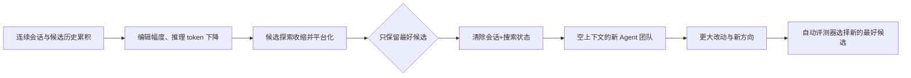
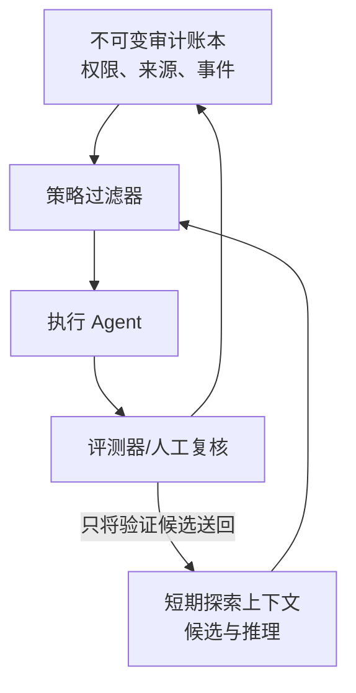

# 让发现重新发生：为什么长程 Agent 团队需要“遗忘”

> **论文**：Scaling Discovery Requires Forgetting（Tan et al., 2026）  
> **原文**：[arXiv:2610.20563](https://arxiv.org/abs/2610.20563) ｜ [PDF](https://arxiv.org/pdf/2610.20563)  
> **类别**：大模型 Agent ｜ **提交时间**：2026-10-14 17:49:37 UTC

## TL;DR

- 这篇论文研究的是：当一个具备自动评测器的 LLM 研究 Agent 被允许长时间迭代时，为什么加长单个会话、增加并行 Agent、或让 Agent 相互通信，最后都会进入性能平台期。
- 作者把原因定位为**历史锚定**：会话消息与候选档案越长，模型越少做大改动、推理 token 越少，也越来越常把尚未验证的方向判为“风险太大”。
- 方法是周期性 **forget**：保留全局分数最高的候选及其分数，却丢弃每个 Agent 的会话、候选历史和工作区记录；新的四 Agent 团队从同一最优候选、空上下文重新探索。
- 在 AHC014、Frontier-CS Q171、VLIW kernel 与 nanochat-autoresearch 四项自动评分任务上，遗忘团队均为最优；平均比四个独立并行 Agent 高 **10%**，比单 Agent 高 **22%**，单项相对并行最高改善 **15%**。
- 最强的因果对照从同一停滞状态开始、每个 Agent 再做 30 次 proposal：团队继续旧会话仅提升 **1.4%**、花 **$24.67**；遗忘后提升 **9.2%**、花 **$15.32**。这支持“状态处理”而非单纯多跑几轮是关键。
- 局限同样明确：只有一个 Agent 框架、DeepSeek V4.1 Flash、四个可自动判分任务、每配置三次重复；论文未证明遗忘适用于含人类偏好、不可逆外部动作或需要保留长程因果证据的开放式研究。

## 研究问题：为何扩展预算却不再扩展发现？

### 三种常见扩展法共享同一脆弱点

自动化发现的基本闭环很直观：Agent 写出候选 (c_t)，评测器给出分数 (s(c_t)) 与反馈，再由 Agent 修改候选。给定更多预算，人们通常会做下列三件事：

| 扩展方式 | 直觉收益 | 论文观察到的失效方式 |
|---|---|---|
| 一个 Agent 跑更久 | 更多局部迭代 | 历史越来越长，改动缩小 |
| 多个 Agent 独立并行 | 更宽的探索面 | 每条轨迹仍各自锚定 |
| 多 Agent 共享候选 | 更快传播好点子 | 同时传播同质化与保守性 |

作者的关键转向是：不要只问“给 Agent 多少 token 或多少并行度”，而要问**哪些过去允许进入下一轮决策**。这里的记忆并不全是资产；失败尝试的叙事、旧 workspace、以及“已经接近极限”的自我判断，会成为后续探索的先验。

### 论文的论证链



这是一条 **claim → mechanism → evidence → boundary** 的路线：先显示多种扩展都会停滞；再定义“会话和文件状态的遗忘”；之后用等预算对照、同状态实验与轨迹数据建立机制证据；最后承认效果依赖自动评分和可继承的候选代码。

## 方法：压缩“成果”，而不是压缩全部历史

### 两种状态，两个都要清

论文区分两层历史：

1. **搜索状态**：每个候选 commit、分数、judge 反馈、工作区可见文件；
2. **会话状态**：产生这些尝试的消息、推理与先前的失败解释。

普通 autoresearch 延续两者。forget 在轮次末将二者均丢弃，只传递当前全局最优的 (c^*\) 及其分数。令第 (r\) 轮开始时的传递状态为：

\[
M_r = \{c_r^*,\ s(c_r^*)\}, \qquad
c_{r+1}^* = \arg\max_{c\in \mathcal C_r} s(c).
\]

这里的 (\mathcal C_r\) 是该轮团队产生的候选集合。公式刻意没有把完整轨迹写入 (M_r\)：**保留的是能被评测器验证的产物，不是“为何当时没做某事”的语言叙事。** 对最小化指标（VLIW cycles、validation BPB），实现上等价为取最小值。

### 团队通信不是聊天，而是异步候选可见性

每队四个 Agent，各自有会话和搜索状态。在 proposal 前，一个 Agent 可以看到其余三个 Agent 的候选 commit 与分数；没有会话内逐对话消息，也没有中央 orchestrator。因此通信是异步的、额外 token 成本很低。

```text
Input: seed candidate c0, judge J, four agents, four rounds
State: per-agent session Si and candidate log Li; global best c*
for round r = 1..4:
    parallel for agent i = 1..4:
        expose peer commits/scores, edit a visible candidate
        score candidate with J; append result to Li
    c* = best scored candidate across all agents
    if r < 4:
        clear every Si and Li
        initialize each agent with only c* and J(c*)
Output: c*
```

这段伪代码也指出失败边界：若 judge 不可靠、候选本身不能携带有效进展，或清空会破坏安全审计链，`best` 压缩就不再是无害操作。

## 实验设计：等模型、等总预算、三次重复

### 任务与设置

作者用 Pi agent 与 DeepSeek V4.1 Flash，在四类任务比较一个连续 Agent、四个不通信并行 Agent、以及“四 Agent + 通信 + 三次 forget”。三种设置使用相同模型与总 token 预算，每个任务/配置运行三次。

| 任务 | 目标与指标 | 为什么有代表性 |
|---|---|---|
| AHC014 | 启发式编程，score 越高越好 | 大型组合搜索与可执行验证 |
| Frontier-CS Q171 | 算法优化，score 越高越好 | 另一类离散优化地形 |
| Anthropic VLIW kernel | cycles 越低越好 | 代码性能与编译/模拟反馈 |
| nanochat-autoresearch | validation BPB 越低越好 | 五分钟小语言模型训练脚本优化 |

这不是“谁的基础模型更强”的 benchmark；控制模型与预算的目的，是隔离 reducer 怎样暴露状态、是否续接会话这一系统变量。也正因如此，结论应读作一个关于**搜索控制器**的经验结论，而非通用模型能力排名。

## 主结果：遗忘团队在四个任务均最好

### Table 1 的数值证据

| 任务（均值 ± 标准差） | 单 Agent | 4 并行 Agent | 遗忘团队 | 相对单 Agent |
|---|---:|---:|---:|---:|
| AHC014 score ×10³ ↑ | 795 ± 210 | 964 ± 57 | **1103 ± 50** | **+39%** |
| VLIW cycles ↓ | 1426 ± 197 | 1220 ± 44 | **1097 ± 18** | **-23%** |
| Frontier-CS Q171 ↑ | 64.0 ± 6.2 | 70.2 ± 1.1 | **80.8 ± 2.9** | **+26%** |
| nanochat validation BPB ↓ | 0.980 ± 0.003 | 0.980 ± 0.001 | **0.961 ± 0.012** | **-2%** |

- AHC014 的最佳单次结果从单 Agent 的 961k 到遗忘团队 1,145k；相对并行的平均分，团队还高约 **14%**。
- VLIW 的“低更好”不可误读成负收益：1,097 cycles 比并行 1,220 少约 **10%**，且标准差更小。
- nanochat 是重要反例式对照：并行本身几乎没有改善（0.980 → 0.980），但遗忘团队达到 0.961。这表明并行宽度不等价于有效多样性。

### Figure 1 与 Table 2：每次 reset 不只是一次偶然跃迁

Figure 1 把最好分数画在累计美元成本上。连续单 Agent 与四并行 Agent 早期都拉升、随后变平；团队也会在每条虚线前变平，但虚线（forget）后再次爬升。Table 2 量化四轮的均值最好成绩：AHC014 从 forget 前 931，第一次后升至 1,035（**+11.2%**），第二次 1,085（+4.8%），第三次 1,103（+1.7%）。

- 四项任务、三轮重置、共 **36 次 forget** 中，有 **32 次**会在下一轮得到新最佳候选。
- 递减收益不是反证：作者将其解释为接近任务显性或隐性上界；但这也说明固定周期并不保证永远值得 reset。
- Frontier-CS 是并行继续改善的例外，最终遗忘团队仍比并行高 **15%**；因此论文没有把“平台化”说成所有轨迹每时每刻都成立。

## 因果压力测试：继续，还是遗忘？

### 相同起点、相同 proposal 数的关键对照

作者从 AHC014 已停滞状态出发，令单 Agent、四并行、四人团队分别再做每 Agent 30 次 proposal；一边继续旧会话，一边清空后再跑。这比最终分数更接近机制检验。

| 起点配置 | Continue：提升 / 花费 | Forget：提升 / 花费 | 读法 |
|---|---:|---:|---|
| 单 Agent | +1.6% ± 0.2% / $6.66 | +4.5% ± 2.1% / $3.44 | 新会话增益更大且更便宜 |
| 4 并行 | +1.9% ± 1.5% / $27.51 | +7.0% ± 3.3% / $13.97 | 并行不能消除历史负担 |
| 4 人团队 | +1.4% ± 1.3% / $24.67 | +9.2% ± 6.9% / $15.32 | 通信与遗忘互补，但方差较大 |

成本下降有直接工程原因：旧会话越长，输入上下文越贵；forget 同时改变了决策条件与 token 账单。因此它并非纯粹“省上下文”的缓存技巧，而是以更短上下文换取更高探索幅度的搜索策略。

## 机制证据与失败案例：Agent 是怎样变保守的？

### Figure 5：编辑与推理的双重收缩

在 AHC014 轨迹中，三类配置最初每次会修改约百行，随后下降。重置前团队的编辑从约 **150 行**降至 **30 行**，推理从约 **28k token** 降至 **7k**；forget 后，前十次 proposal 的中位编辑为 **40 行**，而继续会话仅 **6 行**，中位推理为 **9.4k** 对 **2.9k**。这把“锚定”从抽象心理比喻变成可观测行为代理量。

不过这仍是相关证据：更大的修改未必天然更好，推理 token 也不是正确性的直接量表。它之所以有解释力，是因为变化与同状态对照的分数提升在同一干预后同时出现。

### VLIW 的具体反例

单 Agent 在 $40 预算、三次 replicate 中完成了 763 个 turn，其中 **532 个（66.2%）**没有产生候选；其中 531 个最多读一个文件、不做编辑便声称已平台化。一个会话在 1,710 cycles 后说到达“实际极限”，但后来同一 Agent 达到 1,644，而遗忘团队达到 **1,077**。

另一个 session 连续十一轮没有候选：它提出 selection-tree 实现，先因错误的成本比较拒绝，之后虽纠正比较和寄存器需求，仍以“过于复杂、风险太高”不实施。重置后，一名 Agent 做更大的树读取改动，前两次分别为 1,409 cycles（变差）与持平；它随后吸收同伴的小技巧，组合版到 **1,136**，本轮末 1,114。这个案例支持两个必要条件：遗忘允许大胆试错，通信让失败尝试不必被单人独自放弃。

## 图表逐项解读与消融意义

| 图表/实验 | 它支持什么 | 它不能支持什么 |
|---|---|---|
| Figure 1 | 同预算下连续历史会平台，forget 后再提升 | 不能证明任何任务都应固定频率重置 |
| Figure 2 | 只传递最优候选的状态边界 | 不能验证保留 top-k 或摘要是否更优 |
| Figure 3 | reducer 是可复现的系统干预点 | 不等价于其他 Agent 框架实现 |
| Table 1 | 四任务最终效果与方差 | 三次重复不足以精确估计所有尾部风险 |
| Table 2 | 多数重置后出现新最好候选 | 收益递减，不能外推无限轮数 |
| Table 3 / Figure 4 | 同状态继续 vs 遗忘的较强对照 | 只在 AHC014、30 proposal 窗口测试 |
| Figure 5 | 行为代理量随历史收缩并在重置后恢复 | token/改动不构成因果中介证明 |

## 与相关工作的位置

- 与 FunSearch、AlphaEvolve 一类“LLM proposer + verifier + population”的系统相比，本文关注完整 coding-agent 会话如何被 reducer 续接，而非只在单次 prompt 层维护群体多样性。
- 与 Stateless Language Agents、Fork-and-Flush 相近，作者的差异声称是更激进：不仅开新会话，还删除 workspace 搜索状态，仅留最优候选；同时四 Agent 在轮内共享 commit/score。
- 与多 Agent 辩论或角色分工不同，本文的通信内容是可执行候选及评分。它特别面对开放式优化中“传播改进”与“立即同质化”并存的张力。

这些定位来自论文引用与作者描述，不应当理解为对所有前序方法做过统一复现实验；本文没有给出与这些系统的直接同预算横向基准。

## 结论、局限与研究者的后续问题

### 可以带走的结论

1. 对有强自动验证器的长程发现任务，**可验证最优产物**与**产生它的叙事历史**应被分别对待；后者可能是探索负担。
2. “更多 Agent”只有在遗忘恢复探索多样性时才稳定显现价值；否则同质化和长上下文成本会吞掉并行收益。
3. reducer 是一个值得显式实验的 Agent 系统组件：何时 forget、保留 top-1/top-k、是否附带失败摘要，都应作为可测的策略变量。

### 不能越界的地方

- 论文使用同一 Pi agent 和 DeepSeek V4.1 Flash；没有跨模型、跨提示、跨 judge 鲁棒性检验。
- 四任务都能自动测分，且代码候选能浓缩前期成果。真实科学研究若需要完整谱系、负结果、数据溯源与责任审计，直接清空 workspace 可能有害甚至不合规。
- “最佳候选”依赖 judge。若 reward 被投机、指标与真实目标脱节，遗忘会更高效地放大错误方向。
- 团队 forget 的 9.2% 提升标准差为 6.9%，三次运行不足以排除任务特定的偶然性；固定三次 forget 也不是经验证的最优调度。

### 值得继续验证的问题

未来更有价值的实验不是把周期再调几个点，而是将记忆分层：保留可审计的不可变实验账本，让决策 Agent 只接收经验证的候选、反事实摘要或多样化 top-k。对 AI 安全 Agent，尤其应区分“为了新颖性而遗忘”与“为了可追责而永久保存”的状态：前者可发生在执行上下文，后者必须留在独立、不可被 Agent 任意改写的审计层。

换言之，本文最有启发性的不是一句“忘掉过去”，而是提出一个可检验的系统设计原则：**探索器的可见状态应小于系统的可审计状态。**

## 补充解读：把论文的干预拆成可检验变量

### reducer 才是本文真正改变的算法接口

Figure 3 不只是普通 Agent 流程图。它把干预放到 reducer：reducer 读取候选日志和 session，决定下一回合工作区显示哪些候选、Agent 是否继续旧对话。judge 只输出分数与反馈，Agent 只通过文件工具编辑候选。于是底层模型不变，长期行为却能因状态过滤规则而改变。

可将该接口抽象为：

\[
(W_{t+1},S_{t+1})=R(\mathcal H_t),
\]

其中完整历史 (\mathcal H_t\) 包含候选、评分、反馈和消息；(W\) 是可见 workspace，(S\) 是会话。连续基线近似传递全部相关历史；forget 设定传递 (W=\{c^*\}\) 且 (S=\varnothing\)。论文并未声称这种 (R\) 全局最优，而是给出一个重要反例：向模型暴露更多历史，不等于更好的搜索。

### 为什么轮内通信仍被保留

- 每个 Agent 在 proposal 前仍可读取其他三人的候选 commit 与 score，因此遗忘不是让团队退化成四个盲目重启的单人系统。
- 轮末统一从全局最优候选开始，保证已经被 judge 验证的实现收益可继承；轮内再允许不同 Agent 选择不同大改方向。
- VLIW 案例中，一个新 Agent 的大改前两次表现为 1,409 cycles（更差）与持平；之后它吸收同伴的小修正才达到 1,136。这说明通信提供的是“失败后可被别人修补”的机制，而不只是更多答案。

这也暴露一个未完成的消融：论文比较的是完整组合，缺少 top-k 遗忘、只清 session 不清 workspace、只清 workspace 不清 session、以及不通信但共享最佳候选的系统性矩阵。因而不能从 Table 1 精确归因每个百分点到底来自哪一个组件。

### 对“自动研究”任务的适用条件

| 条件 | 为什么本文需要它 | 不满足时的风险 |
|---|---|---|
| 可重复调用的 judge | 才能定义最好候选并公平比较 | 噪声会把偶然 winner 固化 |
| 候选能承载前期进展 | top-1 压缩不会丢失关键知识 | 科学笔记/数据谱系无法装进代码候选 |
| 可逆的试验循环 | 新 Agent 可以大胆尝试 | 外部 API、权限与现实资源动作不可随意重启 |
| 独立审计层 | 可见状态可被清空 | 责任、数据来源与安全事件会丢失 |

因此本文的“遗忘”更接近优化器的 restart，而不是组织记忆政策。对于涉及 AI 安全或真实用户的 Agent，最合理的实现可能是双层结构：执行上下文可以短、可更新；审计日志必须长期、只追加、且不由执行 Agent 决定是否遗忘。

### 数字应该怎样被谨慎外推

论文报告的“平均高 10%/22%”来自四种异质任务的相对改善，不能把它当成任何 Agent 项目的预期收益率。尤其 BPB 的绝对变化从 0.980 到 0.961 很小，是否具备实际价值取决于训练任务和方差；AHC014 的 +39% 则发生在分数尺度与启发式搜索地形不同的环境。最有信息量的不是把这些数字混成一个排行榜，而是每个任务内都观察到**连续状态变保守、重置后短期探索变大**的同方向模式。

同样，成本结论限定在该模型价格、该提示与该上下文长度。Table 3 中 forget 花费约为 continue 的一半，既包含较短输入的直接账单优势，也包含新会话可能更快做出有效候选的间接优势。若未来模型有极廉价长上下文，经济优势可能收缩；若模型更容易被长历史诱导自我确认，探索优势反而可能扩大。这些都是待测假设，不是本文已证明的定律。

### 一个可复现的后续实验清单

1. 将 forget 触发从固定三次改为基于“最近 (k\) 次最佳分数增量、编辑行数、推理 token”三类信号的自适应策略，并预注册停止规则。
2. 比较 top-1、top-3、多样化 Pareto 候选与“候选加经过验证的失败摘要”；检验压缩率与探索多样性之间的曲线。
3. 在不同模型、不同 judge 噪声、不同上下文价格下重复同状态 continue/forget 实验，而不是只比较终点。
4. 加入需要溯源、需要人审或有不可逆副作用的任务，测量遗忘对安全、复核速度与责任链的代价。

这些实验能把论文的漂亮现象推进为可部署原则：不是简单规定每隔 N 次就清空，而是学习**何时让决策者忘记、何时让系统永远记住**。

## 从表格回到决策：本文真正排除了什么解释？

论文的实验不能排除所有替代解释，但它逐步缩小了范围。首先，Table 1 排除了“只是把四个 Agent 跑起来就足够”的解释：在 nanochat 上并行均值与单 Agent 同为 0.980，而遗忘团队为 0.961。其次，Figure 4 与 Table 3 从同一已平台化起点分叉，排除了“遗忘团队只是较早碰巧拿到一个好 seed”的简单解释。最后，Figure 5 让性能变化与可观测的编辑/推理恢复同时出现，提供了与历史锚定一致的过程证据。

但仍有三种解释没有完全被清除：

- **重新提示效应**：空会话也许只是重新采样了系统提示和随机性，未必是删除失败叙事本身；需要用等长但随机化历史的对照来分辨。
- **上下文长度效应**：短 context 的价格与注意力负担更低；需要控制输入 token 数量、却保留不同语义内容，才能测到“失败历史”特有的伤害。
- **selection 偏差**：每轮只传 top-1 会提高 exploitation；若任务真实目标是多峰的，top-1 可能恰好压掉通往更好解的罕见分支。多样性保留实验不可省略。

换言之，作者对“停滞由累计历史驱动”的证据已经比单纯曲线更强，但“哪一种历史最有害、最小应忘掉多少、何时不该忘”仍是开放问题。将其称为一个有前景的系统假说，比称为已经完成的通用定理更准确。

### 对 Agent 安全设计的有限延伸

把这篇论文移到 AI 安全语境时，最值得保留的是状态分层，而不是直接复制“清空”。执行 Agent 的长会话会积累错误自信、提示注入残留或先前工具结果中的污染；有界的 fresh context 可能减少这种锚定。但安全控制不能随执行上下文一起消失：工具许可、用户意图、数据血缘、攻击告警和审计证据应位于独立的、可信的状态层。

一个保守的设计图景是：



这张图不是论文实验的一部分，而是基于其机制的进一步推论。它的边界是：若过滤器把安全关键历史错误地归类为“探索噪声”，系统会用更高效率重复同类失误。因此任何安全应用都应先定义不可遗忘字段，并用独立评审验证 reset 前后是否仍遵守约束。

最后，论文把一个常被当成工程细节的上下文管理选择，提升为可量化、可反驳的研究变量；这正是它最值得复查和复现的贡献。
