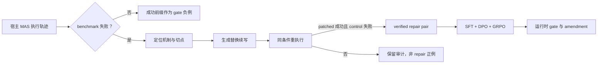

# ARIA：把多 Agent 的“事后调试”前移为运行时可学习的修复策略

> **原文**：[ARIA: Runtime Inspection and Amendment for Multi-Agent Systems](https://arxiv.org/abs/2610.20780)（2026-10-14 v1）  
> **代码**：[LabRAI/ARIA](https://github.com/LabRAI/ARIA)  
> **类别**：大模型 Agent；论文；本文只讨论论文已公开的实验设置与主张。

## TL;DR

- 多 Agent 的难点不只是“最后答案错了”：一个局部误解会被后续角色、消息和工具调用当成前提，最后变成整条执行链的失败。ARIA 把问题定义为：在轨迹尚未结束时，判断是否该介入，并产生可继续执行的替换片段。
- 作者先在 **4 个框架、6 个 benchmark、8 个宿主模型**上收集 **24,000+** 条成败轨迹；再用成对重执行验证，将失败轨迹和真正能恢复任务的修改配成 **3,953** 条 repair pair。这里“可修”不是语言模型说服评审，而是补丁运行后通过 benchmark、未修改对照运行失败。
- 训练不是单一 SFT：结构化修复 SFT 学习诊断、切点与替换续写；DPO 将已验证补丁优于失败续写；GRPO 再把候选补丁真正接回执行环境，并同时训练避免误伤本会成功任务的 gate。
- 在作者的运行时设置中，Qwen2.5-7B 的 ARIA 在域内成功率（SR）为 **20.9%**、有害干预率（HIR）为 **4.54%**；未见过的 Magentic-One 系统上为 **21.0% / 5.59%**。14B 版本到 **22.4% / 3.84%** 与 **22.4% / 4.79%**。数字说明的是给定失败修复协议下的恢复与选择性，**不是**通用 Agent 总任务正确率。
- 最大价值是把昂贵的“每次线上都搜索修复方案”转移到离线数据建设；最大边界是四套被固定版本的框架、有限 benchmark 与重建 continuation 的验证语义。它没有证明任意私有、长周期或安全关键 Agent 都可安全自动修改。

## 研究问题：为什么最终评分不足以修复协作系统？

### 错误会沿着协作依赖放大

1. 单 Agent 的错误常表现为一个错误答案；多 Agent 中，规划者的一次误读还可能成为执行者的工具参数、审阅者的评价对象或下一轮的共享工件。
2. 因而“完成后诊断”只能定位已经坏掉的轨迹；“多跑几次找一个更好答案”则把高成本搜索留在每个线上事件。
3. 运行时修复必须同时回答三个相互依赖的问题：__什么地方坏了__、__何时应该切断__、__替换成什么续写__。只回答归因、或只回答安全拦截，都不足以恢复原任务。

论文把这条论证明确拆为：

| Claim | Mechanism | Evidence | 仍不能证明什么 |
| --- | --- | --- | --- |
| 失败可作为训练信号 | 失败—已验证修复对 | 3,953 条 pair、对照重执行 | 不证明标签穷尽所有失败类型 |
| 不同系统可共用修复器 | 统一轨迹接口与结构化输出 | 4 框架、留出系统测试 | 不证明无轨迹接口的闭源系统可用 |
| 运行时动作可学 | prefix gate + continuation amendment | SR/HIR 与预算曲线 | 不证明低 HIR 足以用于高风险自治 |

## 数据构造：不是挑“最会失败”的模型，而是挑“最产出可验证修复”的格子

一个 source cell 写为 \(c=(A,B,M)\)：\(A\) 是固定 harness 的多 Agent 框架，\(B\) 是任务分布，\(M\) 是宿主基础模型。作者不把全局平均准确率当作数据选择准则，而定义：

\[
S(c)=(1-a(c))\,r(c).
\]

- \(a(c)\)：源执行成功的概率；故 \(1-a(c)\) 是能提供失败事件的概率。
- \(r(c)\)：该失败在固定 repair protocol 下被成功修复的条件概率。
- 若独立执行 \(N\) 次，预计得到 \(NS(c)\) 个已验证修复样本。它刻意避免两种极端：几乎从不失败的系统没有训练素材；总失败但几乎修不回来的系统也没有可信 supervision。

这一定义是本文很关键、也最容易被忽略的选择偏置：论文优化的是“每次执行获得多少**可验证修复**”，并不等价于选择最真实世界、最危险或最常见的 Agent 失败分布。基础设施异常不进入 source accuracy；没有解析出来的修复尝试另报 unresolved，不能冒充失败或成功。

### 从 taxonomy 到 repair attribution

作者将局部机制映射为 **6 组、26 类** repair attribution。每条记录不止含一句“这里错了”，还要落到切点 \(k\) 与可替换的续写 \(e\)。保留正例的门槛很严格：patched continuation 必须被 benchmark evaluator 接受，未改动 control 必须失败。这样避免“换一次随机采样恰好成功”被误记为补丁功劳。



图中“同条件”比语言上看起来苛刻：附录说明完整 trial 均被执行，首个 verified success 作为 canonical repair；但后端恢复的是 continuation context，而非框架完整内部 checkpoint。因此它验证的是__这种重建协议下的恢复__，不是对原执行做了严格因果回放。

## 三阶段后训练：将“会解释”变成“会在代价下行动”

令 \(x_i\) 为轨迹上下文，结构化修复为 \(y_i=(d_i,k_i,e_i)\)：诊断 \(d\)、切点 \(k\)、替换续写 \(e\)。

### 阶段 1：结构化 SFT 同时训练修复器和检查 gate

\[
\mathcal L_{SFT}=-\mathbb E\,[\log p(d|\tilde x)+\log p(k|\tilde x,d)+\log p(e|\tilde x,d,k)].
\]

- \(\tilde x\) 有 feedback dropout：训练时偶尔去掉 evaluator feedback，迫使模型既能做事后修复，也能面对没有最终反馈的运行时前缀。
- gate 写作 \(g_\theta(\tau_{\le t})\)，以 \(z_{i,t}=\mathbb1[t>k_i]\) 标注认证切点之后是否应介入；成功轨迹与已替换前缀作为负例。
- 这一步的工程含义是输出格式受到约束：模型不是泛泛提出建议，而要返回可接回 runtime 的诊断、位置、续写三元组。代价是部署时上游诊断一旦错，切点和续写会级联出错。

### 阶段 2：DPO 学习“已验证补丁优于失败续写”

在同一前缀 \(h=(\tilde x,\hat d)\) 下，将已验证补丁 \(a^+=(k,e)\) 与观察到的失败后缀 \(a^-=(k,\tau_{>k})\) 比较：

\[
\mathcal L_{DPO}=-\mathbb E\log\sigma\{\beta[\Delta_\theta(a^+|h)-\Delta_\theta(a^-|h)]\}.
\]

- \(\Delta_\theta\) 是相对阶段 1 参考策略的对数概率变化；\(\beta\) 控制偏离参考策略的强度。
- 对诊断文本，作者承认它没有直接“成功/失败”标签，于是用它是否提高同族 incident 的修复 likelihood 作 proxy。这个 proxy 不等于 executed repair success，论文也明确区分二者。
- 因此阶段 2 主要是把“什么时候不要乱改”压进偏好边界；从消融看，它对降低 HIR 特别明显，而不宜被解读为独立完成真实的跨任务因果验证。

### 阶段 3：以执行结果做 GRPO，并把误伤纳入回报

补丁执行回报为：

\[
r(y|x)=\mathbb1[\text{evaluator accepts}]-\lambda_h\mathbb1[\text{harmful}]-\lambda_c b(y),
\]

其中 \(b(y)\) 为执行开销，\(\lambda_h\)、\(\lambda_c\) 分别惩罚有害干预与预算消耗。诊断价值还会在跨 cell 的 sibling repair 上评估，因此并非只奖励记住某一套框架的字面补丁。gate 的 matched-seed reward 是：

\[
r_{gate}=S_{int}-S_{base}-\lambda_c\Delta EB.
\]

这使恢复失败任务为正、把本会成功的任务弄坏为负，并直接比较相同 seed 下介入与不介入的差别。它是本文把“成功率高”与“少插手”合在同一优化目标的关键；但 reward 仍依赖 benchmark evaluator，若 evaluator 漏检风险，优化器不会自动看见该风险。

## 实验：四套框架、六类评测与两个容易混淆的指标

作者固定 OpenManus、MetaGPT、Magentic-One、AG2 的原生版本；Magentic-One 还需 Playwright Chromium。宿主模型包括 Llama-3.1-70B、Qwen3 8B/32B、GPT-5.5 不同 reasoning tier、Claude Sonnet 4.6 与 Opus 4.8；真正被后训练的 repair backbone 是 Qwen2.5 1.5B/3B/7B/14B，并以 Llama-3.1-8B 作跨族对照。

| Benchmark | 论文的通过判定 | 这个判定覆盖不到的东西 |
| --- | --- | --- |
| GSM-Plus、MMLU | 抽取答案与参考答案/选项比对 | 合理但非标准表达、推理过程可靠性 |
| HumanEval | 生成代码执行 benchmark tests | 未覆盖测试、依赖与供应链风险 |
| OlympiadBench | 公共数学答案 scorer | 步骤正确性与证明质量 |
| GAIA | 验证任务、附件与准精确匹配 | 长期环境漂移与外部副作用 |

作者特别强调 native termination 不等于 benchmark success，这一点让“修复成功”的标签比单纯 agent 自报完成更可信。不过不同 RQ 使用固定子集以控制重复运行成本，跨表的比例并不能简单横向当作同一总体。

### 主结果与规模趋势

| 运行时方法 | 域内 SR↑ | 域内 HIR↓ | 未见系统 SR↑ | 未见系统 HIR↓ |
| --- | ---: | ---: | ---: | ---: |
| Spark to Fire（7B） | 17.4% | 7.18% | 16.8% | 9.18% |
| SafeAgent（7B） | 18.2% | 5.05% | 17.6% | 6.19% |
| ARIA Qwen2.5-7B | 20.9% | 4.54% | 21.0% | 5.59% |
| ARIA Qwen2.5-14B | **22.4%** | **3.84%** | **22.4%** | **4.79%** |

- 7B 是论文声称开始稳定超过 strongest runtime baseline 的转折点；1.5B 与 3B 更接近基线，不能把“ARIA 方法”与“任何小模型都能修”混为一谈。
- 未见系统实验将全部 Magentic-One trajectory 从训练、校准、验证和 checkpoint selection 移除。因而结果确实测试了系统转移，但仍在同一作者定义的接口、任务和 evaluator 生态内。
- 同尺寸 Llama-3.1-8B 的 SR/HIR 为 20.6%/4.81%（域内）、20.6%/5.79%（未见），支持“效果不只属于 Qwen”这一较窄主张；它不构成所有模型家族的充分抽样。

### 消融：三阶段各自提供了什么？

| Qwen2.5-7B 变体 | 域内 SR / HIR | 未见系统 SR / HIR | 可合理归因 |
| --- | --- | --- | --- |
| Zero-shot | 11.7% / 10.3% | 9.78% / 11.4% | 无专门 repair 训练时，既难恢复又易误伤 |
| 仅 Stage 1 | 14.5% / 8.22% | 12.4% / 8.78% | 结构化 schema 与 gate 的起点 |
| Stage 1+2 | 16.6% / 4.15% | 14.6% / 5.19% | 偏好对比明显降低有害干预 |
| Stage 1+3 | 17.6% / 3.13% | 16.4% / 3.79% | 执行反馈带来更强 recovery 增益 |
| 全部阶段 | **19.2% / 1.49%** | **18.2% / 2.20%** | 两种信号互补，而非可互相替代 |

这组消融支持“Stage 2 主要改善选择性、Stage 3 主要改善恢复”的解释，但它们共享同一数据构造与 reward 设计；不能据此断言 DPO 或 GRPO 在任何 Agent 任务上都有同样因果分工。

## Figure/Table 应怎样读，而不是只抄数字？

1. **Figure 1** 用“定位误解—替换故障步骤—恢复正确结果”给出最小工作例子。它的证据作用是定义干预对象，不是证明真实分布上的成功率。
2. **Figure 2** 把 dataset construction、三阶段 post-training、运行时 gate 连成闭环；读图重点是 repair search 被放在离线数据阶段，线上并非为每个错误展开完整候选搜索。
3. **Figure 3** 同时画 success–harm trade-off 与 execution budget。它支撑 ARIA 在低预算时已领先、预算提高后仍领先的说法；但预算曲线受执行环境定价与重试政策影响，不能直接换算为生产成本。
4. **Table 3** 是跨规模与未见系统的核心证据。单调的 1.5B→14B 趋势说明容量帮助表示轨迹状态、判断介入、生成兼容续写；它没有识别是训练数据更多、模型更大还是优化更稳定中的哪一项主导。
5. **Table 4** 是反对“只要 SFT 就够”的直接反例：全流程在 SR 与 HIR 都最好。它仍是有限 fixed subset 上的消融，不能排除不同任务族会有相反权衡。

## 相关工作中的位置：归因、防护、修复不是同一件事

- MAST 一类 failure taxonomy 告诉我们“常见什么错”；Who&When、AgentRx、ErrorProbe 更接近“谁在何时犯错”。论文引用的 Who&When 最好 responsible-agent accuracy 为 53.5%，但 decisive-step 只有 14.2%，说明仅靠日志归因本身就很难。
- Spark to Fire 试图压制错误传播，SafeAgent 围绕 agent loop 阻断不安全动作；两者偏预防。ARIA 的指标则是恢复一个已经失败的任务，并额外统计介入造成的伤害。
- CausalFlow 对单 Agent trace 做反事实替换；DoVer 针对有明确 orchestrator/checkpoint 的 MAS 搜索并验证 message 或 plan edit。ARIA 的差异不只是“又一种 patcher”，而是把大量离线 verified repair 压缩成一次前向预测，并尝试避免需要宿主内部 checkpoint/replay hook。

这里要守住术语边界：没有宿主内部 checkpoint 不代表没有系统要求。ARIA 仍要求能暴露执行轨迹、能进行 continuation replacement，并且要有可调用的 task evaluator。这在研究框架中很可行，在真实 SaaS、涉密工具或不可逆外部动作中可能正是最难满足的前提。

## 把一次修复拆开看：输入、状态、循环、输出与失败边界

论文虽不是以传统算法框呈现，但它实际实现的是一个带验证器的离线—在线闭环。将其写成伪代码，有助于区分作者真正训练的对象与读者容易脑补出来的“万能调试器”。

```text
Input: 系统 A、任务集 B、宿主模型候选 M、可执行 evaluator E、预算 EB
State: 轨迹 tau，故障归因 d，切点 k，替换续写 e，已验证集合 D

for 每一个 (A, B) 组合:
    对每个 M 采样源执行，估计 a(c) 与 r(c)
    选择使 (1-a(c))*r(c) 最大的 source cell
    for 每条失败轨迹 tau:
        产生 d、k、e 候选；从 k 重建 continuation 并运行 E
        若 patched 通过 且 fresh control 失败:
            将 (tau, d, k, e) 加入 D
        否则:
            只记录审计结果，不将其作为 verified repair 正例

用 D 做结构化 SFT、repair DPO、执行反馈 GRPO 与 gate GRPO
在线时: 对前缀 tau_<=t 估计 gate；仅在 gate 触发时输出 (d,k,e)
Output: 继续原执行，或用 e 替换从 k 开始的续写
Failure boundary: evaluator 不覆盖的副作用、无法重建的隐藏状态、错误 gate 均不被该流程自动消除
```

### 为什么这个状态定义比“给 Agent 加一个 reviewer”更严格？

- reviewer 可以说“这一步可疑”，但没有规定可操作的 \(k\) 与 \(e\)，也没有要求被建议的修改重新跑通。ARIA 的正例约束迫使模型输出能消费的接口。
- 只在终态调用 repairer 容易利用完整失败反馈；ARIA 的 gate 输入刻意省略 evaluator feedback。这样训练目标才可能在 partial trajectory 上部署，而不是把答案泄漏进前缀分类。
- 但 gate 的标注不是每一个时间点都有独立的人类裁决。若没有 first-bad index，只有 terminal prefix 取正；replacement 后的 prefix 被投影成负例。这是可扩展的训练工程选择，不该被夸大为细粒度“真实何时开始出错”的完整标注。

## 数字背后的计数单位：不要把 repair pair、trial 与 training row 混为一谈

论文附录特别解释，source task、repair trial、verified repair 与训练样本行是不同数量级：一个 incident 能衍生多个 gate prefix，也可以有多个 verified patch；训练视图再把详细记录投影成 SFT、DPO 与策略优化所需的行。因此“3,953 个 pair”不能直接读成 3,953 个独立原始任务，也不能把 24,000+ trajectory 当成同等数量的修复监督。

| 名称 | 最小含义 | 容易发生的误读 |
| --- | --- | --- |
| source execution | 某 cell 下的一次原始任务运行 | 把它当成一条可训练正例 |
| failed incident | evaluator 未接受的运行及其归因候选 | 假定每个失败都可修 |
| repair trial | 对一处切点/续写的重执行尝试 | 把多次 trial 当独立任务样本 |
| verified repair pair | patch 成功且对照失败的通过记录 | 忽略重建 continuation 的语义 |
| training row | 从记录投影出的 SFT/DPO/gate 样本 | 用 row 数夸大数据覆盖面 |

分割也以 task identifier 为单位做名义 **60%/20%/20%**，并用有种子的 hash 在 cell strata 内分配；同一任务若出现在多个 cell，只拿一个全局 assignment。小于三个任务的 strata 落进训练集，故逐 cell 比例只是近似。作者还检查 held-out task identifier 与规范化 task text 的重叠。这比随机打散 prefix 更能防止同一任务的相邻轨迹泄漏，但不能取代面向全新应用域的外部验证。

## 运行时成本与“低预算领先”到底意味着什么？

离线阶段需要大量执行来发现 verified repair，在线阶段的收益来自避免对每次故障再开展开放式搜索。Figure 3 的预算结果因此应分两层读：

1. **在线层**：在作者设定的 execution budget 下，ARIA 在较低预算便有领先，说明学习到的结构化输出能减少现场候选试错；预算增加后优势仍在，支持“不是只靠一次幸运采样”。
2. **全生命周期层**：论文没有把收集 24,000+ 轨迹、构造 repair trial、训练多个阶段的离线成本折算为每个未来任务的摊销曲线。若目标系统频繁变化，离线语料的价值会更快折旧。
3. **风险层**：\(\Delta EB\) 只把额外执行记作成本的一部分。真实工具中的速率限制、第三方收费、隐私暴露、外部状态污染与人类审核等待，未必和一次 benchmark rollout 同构。

这也是为什么 SR 与 HIR 必须同时报。一个只优化 SR 的 intervention policy 可以通过“对每个前缀都改一次”获得某些恢复，却伤害本来正确的 run；一个只压 HIR 的策略又可能从不出手。ARIA 的贡献是给出可优化的平衡框架，而不是替用户选择 \(\lambda_h\) 与 \(\lambda_c\) 应是多少。

## 更细的局限清单：哪些失败会让本文的保护机制失效？

| 失败或变化 | 为什么 ARIA 可能失效 | 需要补充的实证 |
| --- | --- | --- |
| 隐藏状态未被轨迹记录 | continuation context 不是完整 checkpoint | 对状态快照与重建误差做配对比较 |
| 工具产生不可逆写入 | 从 k 续写不能撤销之前操作 | 事务、sandbox、rollback 与权限实验 |
| evaluator 被投机利用 | “通过”未必代表完成用户真实目标 | 对抗测试、人工审计与多 evaluator 一致性 |
| 新工具或提示模板 | 输入格式、错误模式与可修复性迁移 | time-split 与 tool-version holdout |
| 多重故障相互作用 | 单个 canonical repair 可能掩盖替代补丁 | 多补丁多样性与因果责任分解 |
| 安全攻击混入消息 | 诊断和补丁生成器本身可被污染 | 明确的 untrusted content 隔离评测 |

尤其在安全场景，论文使用的“harmful intervention”是任务结果的运行时对照概念，不是安全团队通常关心的泄密、绕权或政策违规集合。将两者并列可以启发未来系统设计，但不应把 HIR 直接报道为“安全率”。

另一个实践性问题是版本漂移：宿主模型更新、工具返回格式变化、Agent 提示词重写，都可能同时改变失败率 \(1-a\) 与可修复率 \(r\)。因此 repair-optimal cell 不是一次选定后永久有效的配置；若要长期部署，应周期性重估 \(S(c)\)，并以时间切分验证旧 repair corpus 在新版本上是否仍然减少而非放大干预伤害。

## 证据边界、失败模式与可复现性

### 已被论文证据直接支持的结论

- 在作者固定的框架、版本、任务集合和 evaluator 上，执行验证的 repair pair 能用来训练结构化修复与 gate。
- 全三阶段模型在给定 runtime 评测中同时提高 SR、降低 HIR；留出 Magentic-One 的评测显示一定的系统转移。
- 提供源码与固定配置的方向是可复核的。附录说明四个原生环境分离，adapter 统一消息、工具活动与工作区工件，而不修改这些 checkout。

### 不能由这些结果外推的结论

- 不等于模型能可靠识别 prompt injection、数据泄露、越权工具调用等安全事件；本文的 harmful 定义来自任务评测与匹配 seed，和安全政策合规并非同一标签。
- 不等于能安全执行任意“修改续写”。若 Agent 已发出不可逆 API、支付、删除或对外通信，切点之前的副作用无法由文本 patch 回滚。
- 不等于 3,953 对覆盖了长尾协作组织、记忆污染、跨日状态、真人介入或动态工具文档；作者的 source admission、family mining 与 task-level split 都会塑造可见分布。

复现时至少应检查：固定框架 revision 与依赖环境；每一 benchmark 的 evaluator；源模型和 repair 模型身份；paired control 的 seed；训练/验证/测试按 task identifier 的 60/20/20 划分；以及 held-out framework 是否真的完全排除在 calibration 和 checkpoint selection 外。仅复现一个“最终通过率”不足以核验 repair attribution 是否有效。

## 研究者视角：下一步问题是“修复能力”和“可授权性”如何拆开

ARIA 的新意不在于声称 Agent 会自愈，而在于提出一条可检验管线：__失败必须变成可执行、可验证、带对照的训练样本__。这比用自然语言 judge 给“修复建议”打高分更接近可训练的机制。

但若把它放到 AI 安全与 Agent 基础设施中，后续研究应把三个层次分开评估：

1. **认识层**：gate 是否真的在第一个有害状态后触发，而非只在末尾看出失败？需要 prefix-level 校准、延迟与 false-positive 曲线。
2. **行动层**：修复文本能否在模拟器中恢复任务？这正是本文已覆盖最多的层。
3. **授权层**：即使补丁提高任务分数，系统是否有权修改后续动作、访问凭证或重新调用外部工具？这一层需要权限、可撤销性、审计日志和人类升级机制，不能由 SR/HIR 替代。

一个有价值的后续实验是把 \(\lambda_h\) 从单一“有害干预”拆为不可逆副作用、策略违反、预算超限与用户意图偏离，并在含真实工具 sandbox 的任务上报告每一类。这会迫使 repair 研究从“怎样让失败变少”进入“何种修复可以被允许”的更严格问题。

## 参考

- Shen, B. & Dong, Y. (2026). *ARIA: Runtime Inspection and Amendment for Multi-Agent Systems*. arXiv:2610.20780v1.
- ARIA 项目代码仓库（论文链接的实现入口）：[LabRAI/ARIA](https://github.com/LabRAI/ARIA)。
- 相关工作与评测定义均以论文正文及其附录为准；本文未将第三方复述当作实验事实来源。
