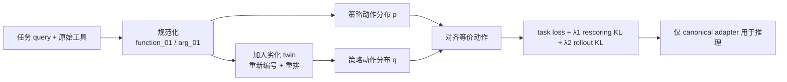

# 一个任务，多套接口：用策略分布一致性降低工具 Agent 的接口捷径

> **原文**：Artin Tajdini、Manpreet Kaur、Peng Qi，[*One Task, Many Interfaces: Simple Cross-Interface Consistency Training Improves LLM Agent Robustness*](https://arxiv.org/abs/2610.20576)，arXiv:2610.20576v1，2026-10-14。
> **定位**：大模型 Agent / 后训练；本文以公开预印本为准，代码链接由作者列在论文中。
> **关键词**：工具调用、接口鲁棒性、GRPO、函数调用、KL 正则、shortcut learning。

## TL;DR

- 这篇论文问的不是“模型会不会调用工具”，而是更部署化的问题：**任务语义未变、工具名称/顺序/周边选项变了时，后训练 Agent 为什么会突然选错工具？** 作者把它解释成对名称和位置的捷径依赖。
- 方法 **CIPR（Cross-Interface Policy Regularization）** 将同一训练任务构造成可对应的两套接口：一套把名称规范化为 `function_01`，另一套再改名、重排并插入劣化副本；训练时显式最小化两套接口上“等价动作”的策略分布 KL。
- 它不是要求逐 token 输出相同。作者分别使用固定轨迹即可算的 **rescoring KL**，以及允许推理路径不同的 **rollout KL**；正确完成任务仍由 GRPO 或蒸馏任务损失负责。
- 在 2,501 个 BFCL v4 单轮函数调用题和两种 backbone 上，论文称持出接口扰动可让常规后训练模型掉近 25 个百分点；CIPR 恢复 **10.5 个点**，且原始接口准确率没有下降。Qwen2.5-3B 上，三类扰动均值从 ToolRL 的 **49.5%** 到 CIPR 的 **56.1%**；Qwen3.5-4B 从 **73.4%** 到 **80.7%**。
- 证据也有边界：最大模型仅 9B、主要是单轮函数调用、每个设置只跑一次；CIPR 必须知道跨接口的动作对应关系，并在推理时保留 canonicalization adapter。它降低的是“选哪个工具/是否调用”的接口敏感性，**不直接约束参数填写**。

## 研究问题：为什么“接口是同一个 API 的外衣”仍会击穿 Agent？

### 作者针对的失败不是能力缺失

- 一个天气任务中，`get_forecast(city, date)` 改名、换到工具列表另一个位置，或旁边新增一个更贵/更慢的等价服务，**可完成的底层任务并没有改变**。
- 但固定接口上的奖励无法区分两种策略：一类阅读描述、类型和必需参数；另一类只记住熟悉名称或列表位置。两者在训练接口都能得分，后一类在部署接口变化时才暴露。
- 因而这不是传统的训练集记忆或任务泛化失败，而是“**跨表示不变性**”没有被目标函数要求。论文将其归为 shortcut learning：模型找到了足以优化当前损失、却不因果地指向工具语义的线索。

| 训练/测试关系 | 标准单接口训练 | 多接口随机化 | CIPR |
| --- | --- | --- | --- |
| 训练中见过的改名 | 容易失败 | 可能学会 | 应保持一致 |
| 未见过的新工具/重排 | 容易失败 | 仍可能失败 | 用动作对应直接约束 |
| 目标函数是否比较等价动作 | 否 | 否 | **是** |
| 部署时是否依赖原始名称 | 是 | 可能 | adapter 后不依赖 |

### 现有补救为何还不够

- **Function masking** 随机替换工具/参数名，能去掉名字这个线索，却没消除工具位置、候选集合等线索。
- **Multi-interface training / domain randomization** 给训练样本更多接口版本，扩大经验分布；但它还是逐样本评分。模型可以分别适配每个版本，而不学习“这两个动作其实等价”。
- CIPR 的关键增量不是再造更多数据，而是保留构造扰动时本来就有的对应表，并把它变成一个可微的行为约束。

## 作者的论证路线：claim → mechanism → evidence → boundary

| 环节 | 论文的主张 | 支撑它的机制/证据 | 不能直接推出什么 |
| --- | --- | --- | --- |
| Claim | 后训练会绑定接口表面形式 | 改名、重排、干扰工具下的持出评测 | 不等于所有 Agent 都同样脆弱 |
| Mechanism | 应比较等价动作的概率而非字符串 | canonicalization、映射、两个 KL 项 | 映射未知时如何自动获得 |
| Evidence | 一致性项优于只做多接口训练 | BFCL、WebShop、消融、错误分类 | 不是超大模型或长程任务的定论 |
| Boundary | 选工具改善不代表参数也改善 | 附录错误分析中参数错误变化很小 | 不应宣称端到端 Agent 安全已解决 |

作者的推理顺序很干净：先用图 1 区分“见过的改名”与“未见的新干扰”；再指出随机化只覆盖前者；随后用可知的工具对应关系定义不变量；最后以同一扰动训练数据、仅是否加入 KL 不同的对照，检验机制而非只报告性能。

## 方法：先去名字，再比较两套接口上的动作分布

### 1. 规范化接口，不是修改真实工具

对任一接口，CIPR 把工具名替换为中性编号，把参数名替换为该工具内的编号：

```text
forecast(city, date)  →  function_01(arg_01, arg_02)
```

- 描述、类型、必填参数和值仍保留，所以模型需要从**语义描述**中判断工具，而不是从字符串习惯中猜测。
- query、历史轮次和训练目标里出现的名称同步转换，避免 prompt 与目标不一致。
- 推理时 adapter 将入站接口规范化，并把模型生成的调用翻译回真实 API；因此线上 API 本身不必迁移。

这一步很重要，但作者没有把它误称为完整方案。名称被抹平后，工具在列表中的顺序、编号、候选数量仍可能成为捷径，因此需要第二个接口。

### 2. 为每个样本构造“更难但语义可对齐”的接口

从规范化接口出发，论文依次做三件事：

1. **twin expansion**：为每个原工具加入一个劣化 twin，例如描述为 deprecated/slower，或删换任务需要的参数；
2. **relabeling**：为扩展后的所有工具重新编号；
3. **reordering**：打乱工具及其参数顺序。

原工具的描述和 query 不变；twin 只在描述或 schema 上显示更差。构造者因而知道“canonical 中的动作 (a_i)”对应 perturbation 中的哪个动作 (a_i')，也知道 twin 在另一边没有等价物。这个已知映射是 CIPR 可行的前提，不是模型从无标注互联网中凭空发现的能力。



### 3. 动作概率而不是 token 文本的一致性

令 prompt (x) 包含接口、query 和历史，模型策略为 (pi_\theta)。在响应 (y) 的第 (t) 个决策点，动作 (a) 是“调用某个已声明工具”或不调用 (\varnothing)。论文从工具调用开头 token 和名称 token 的概率读出并归一化：

\[
\pi_\theta(a\mid x,y_{<t}).
\]

- 跨接口不按名字或位置索引动作，而按上文的**等价类**索引；只有 perturbed 侧存在的 twin 在 canonical 侧概率定义为 0。
- 所以把概率移给一个更慢/更贵的 twin 会被计作不一致，不能靠“它也像个天气工具”蒙混。
- 参数 token 不进入此分布；这预测了后文的结果：CIPR 的主改善会集中在工具选择，而非 argument correctness。

### 4. 两个 KL 对应两类合理的不相同

对仅改名的 pair，可把 canonical 侧已经生成的 response 重标记，在相同决策位置平均 KL：

\[
\mathcal L_{\mathrm{re}}=
\frac{1}{n_y}\sum_{t=1}^{n_y}
D_{\mathrm{KL}}\!\left(pi_\theta(\cdot\mid x,y_{<t})\;\|\;
\pi_\theta(\cdot\mid\tilde x,\tilde y_{<t})\right).
\]

它**不需额外生成**，适合仅名称变化。可当接口新增/删除工具时，强迫两边复用同一条 chain-of-thought 又不合理；作者分别从 (x) 与 (x') 采样 (G) 条 rollout，比较各自平均动作分布：

\[
\mathcal L_{\mathrm{ro}}=
D_{\mathrm{KL}}\!\left(\frac1G\sum_g\bar\pi_\theta(\cdot\mid x,y_g)
\;\|\;\frac1G\sum_g\bar\pi_\theta(\cdot\mid x',y'_g)\right).
\]

总目标为：

\[
\mathcal L=\mathcal L_{\mathrm{task}}
+\lambda_1\mathcal L_{\mathrm{re}}
+\lambda_2\mathcal L_{\mathrm{ro}}.
\]

这一区分避免一个常见误读：一致性不是替代正确性。RL 中任务项是 ToolRL 的 GRPO；监督后训练中是原模型到 canonical 学生的蒸馏损失。若只最小化 KL，两个接口可以一起稳定地调用错误工具；任务损失仍负责把策略拉向正确调用。

## 实验设置：用持出扰动检验“学到了不变性”

### 强对照设计

- RL 使用 ToolRL 的 **3,920** 个训练样本和 GRPO；backbone 为工具写入 prompt 的 Qwen2.5-3B，以及开启 thinking/native function calling 的 Qwen3.5-4B。
- 每个 backbone 比较 Base、标准 ToolRL (GRPO)、+ multi-interface、+ CIPR。后两者接受**相同的**扰动接口和 canonical 名称；差别只有 CIPR 的一致性项。
- BFCL v4 取 **2,501** 个有参考调用的单轮 item、跨 10 个 partition；所有方法在同一题目变体上比较。解码温度 0，最多 4,096 新 token。
- 持出扰动分三组：typo/distractor；明确要求更便宜/更快的 cost & latency；以及论文新增的 implicit 版本——先要求解释工具属性而不指明偏好，更能暴露模型是否被熟悉名字牵引。

| 训练超参（RL） | Qwen2.5-3B | Qwen3.5-4B | 解释 |
| --- | ---: | ---: | --- |
| examples | 3,920 | 3,920 | 相同任务数据 |
| learning rate | (10^{-6}) | (10^{-6}) | 作者沿用 ToolRL optimizer |
| 训练预算 | 15 epochs / 约105 updates | 同左 | 不是大规模 sweep |
| 每接口 rollouts (G) | 4 | 4 | rollout KL 的额外采样成本 |
| (\lambda_1,\lambda_2) | 0.02, 0.005 | 0.02, 0.005 | rescoring、rollout 权重 |

## 结果：收益主要发生在“熟悉名字指向更差工具”时

### 表 1 的压缩读法

| backbone / 方法 | 原始接口 | 三组扰动均值 | 原始−扰动 gap |
| --- | ---: | ---: | ---: |
| Qwen2.5-3B ToolRL | 73.3 | 49.5 | 21.2 |
| Qwen2.5-3B + multi-interface | 74.0 | 54.2 | 19.8 |
| Qwen2.5-3B + CIPR | **74.9** | **56.1** | **18.8** |
| Qwen3.5-4B ToolRL | 84.8 | 73.4 | 11.1 |
| Qwen3.5-4B + multi-interface | 84.8 | 79.7 | 5.1 |
| Qwen3.5-4B + CIPR | **85.0** | **80.7** | **4.2** |

- 这支持论文最窄、也最可信的主结论：在这些持出构造下，CIPR 并没有用原始接口准确率交换鲁棒性；两种模型上它都超过同数据的 multi-interface baseline。
- 但不能跨 Qwen2.5 与 Qwen3.5 直接比较绝对强弱：前者是 prompt 工具格式，后者是原生结构化 parser，并非仅模型尺寸不同。
- 最醒目的差别在 Qwen3.5-4B 的 implicit cost/latency：ToolRL 为 **52.3%**，multi-interface 为 **70.7%**，CIPR 为 **73.0%**。这比“query 明说选便宜/快”更能检验是否真正读取描述。

### WebShop 的监督后训练并非另一个 benchmark 炫技

论文还以 AgentLM 的 trajectory 为对象做 self-distillation：教师在原名接口产出分布，学生在 canonical 名称下学习，加入 rescoring KL、**不采样 rollout**。其意义不是证明 WebShop 全面领先，而是显示该约束并不绑定 GRPO；作者报告它能使轨迹微调的 Agent 对动作改名更稳健。这个实验应与 BFCL 分开看：前者说明方法可移植，后者才是详细量化主体。

## 消融与失败：CIPR 具体去掉了什么错误，又带来了什么代价？

### 劣化 twin + 重排是有作用的

Qwen2.5-3B 的 Table 9 很能说明随机化不足在哪里。只训练“一项新增工具”时，正确工具排前准确率 **70.8%**，但让成本更高的等价物排前仅 **16.5%**；只重排能把偏差翻转，仍没有消除依赖。加入 twins 与重排后，两个 order 的差异收窄；再加一致性项，costlier-first 为 **46.9%**，高于 ToolRL 的 **32.4%**。

- twin 让“存在多个看起来类似的工具”变成训练常态；
- 重排破坏位置捷径；
- KL 让模型不能只在每一种训练排布上各自凑对答案，而要对同一语义选择保持对应。

### Figure 5 给出了比均值更有用的边界

在 Qwen3.5-4B 的 implicit 扰动中，作者对 **30,012** 个 perturbed item 的失败分类。CIPR 相比 ToolRL，调用更贵/更慢等价物这一最大失败类别下降 **24.56 个百分点**；但正确工具已被选中时，参数错误率几乎未变：ToolRL **12.07%**，CIPR **11.61%**。

更值得保留的是负面结果：CIPR 多了 **388** 个“不调用任何工具”和 **120** 个“调用数量不对”的 item。隐式 query 要求先解释工具，模型有时解释后停下；因为 no-call 也在动作分布中，把概率移到 no-call 可以部分降低跨接口差异。这是目标函数可被利用的真实失败模式，而非只需调大数据即可忽略的噪声。

## 图表、可复现性与证据边界

### 应如何读论文中的关键 Figure/Table

| 证据 | 它支持什么 | 不支持什么 |
| --- | --- | --- |
| 图 1 | 见过的改名与未见的新增干扰要区分 | 不给出真实线上频率 |
| 图 2 | canonical、映射与双 KL 的数据流 | 不是吞吐或成本测量 |
| 表 1 / 表 6-7 | 同训练接口下 CIPR 的持出准确率更稳 | 不代表所有 API 协议 |
| 表 9 | 位置与 twin 的消融机制 | 不是完整超参搜索 |
| 图 5-6 | 主要错误类型及 no-call 副作用 | 不覆盖长程工具链 |
| 表 10（RoTBench） | canonicalization 对名称污染的影响 | CI 较宽，且不同协议不可混比 |

### 可以复现什么，暂不能确认什么

- 论文列出代码仓库、ToolRL recipe、训练超参和算法伪代码；这是正向的可审计信号，但本次没有执行作者代码或复跑结果。
- 每个配置只报告一次训练 run，最大为 Qwen3.5-9B；未给出跨随机种子方差，也没有证明 frontier-scale 或长期多轮任务的稳定增益。
- 训练构造假设 action correspondence 已知。工具列表容易做到这一点；对代码编辑、网页操作或开放世界行动，何谓等价动作、如何安全地建立映射，仍是难题。
- 因而本文应被读作“**一个针对接口表面捷径的可验证训练干预**”，而不是“Agent 可靠性或安全性的一般解”。

## 研究者视角：从接口鲁棒性延伸到 Agent 安全

1. **接口即攻击面。** 若工具描述、名字或顺序可由不可信插件、MCP server 或中间层影响，模型对表面词的依赖不只是掉分，还可能成为诱导调用的路径。CIPR 只处理已知等价改写，不替代来源认证、权限分层与执行前策略检查。
2. **应把 action 与 argument 分开评估。** 本文的错误分析表明“选对工具”与“填对参数”不是同一鲁棒性维度；未来基准应分别扰动工具语义、schema、参数别名和跨轮状态，而不是只报一个 pass rate。
3. **不变量需要任务定义。** 这里的等价关系由合成过程提供，因而 KL 的语义清楚。若对非等价工具强行配对，会把有用的差异抹平；对安全敏感 API，映射生成本身应该是受审计的策略组件。
4. **成本需要与收益一起报告。** rollout KL 为每个 prompt 多采一组 rollout。论文承认训练开销上升，却没有给出完整 wall-clock 或 token 成本曲线；工程采纳前应量化每一单位鲁棒性收益的训练与推理代价。

## 可带走的判断

**CIPR 最有价值的地方，不是把工具名随机化，而是把“同一任务在两套接口下应如何一致”写进优化目标。** BFCL 消融与错误分类支持它确实削弱了名称/位置引导的错误选择；同时，no-call 增加、参数不受约束、映射必须已知和实验规模有限，也明确限定了结论。对研究者而言，下一步不该泛化地宣称“Agent 已鲁棒”，而应追问：在多轮、权限差异、真实工具演化和对抗性描述下，哪些动作必须不变，哪些差异本来就应当被保留？

## 补充细读：把方法当作一个可检验的因果假设

### 训练信号到底排除了什么解释？

论文的设计并不只是让 CIPR “看见更多变体”。+ multi-interface 与 + CIPR 都经历 canonical 名称、同样的 twin 扩张、同样的重标号和同样的顺序打乱；若 CIPR 更好，最直接的解释不是数据量或困难样本不同，而是**同一对接口的动作概率被绑在了一起**。这使消融比“新增一种数据增强后涨分”更有解释力。

不过这个因果解释也不是无条件成立。两种方法的优化动态不同：KL 会改变梯度尺度、rollout 会改变采样分布，因而仍可能有未报告的优化交互。最理想的后续实验应报告多个随机种子、各项 loss 曲线、不同 (\lambda_1,\lambda_2) 的敏感性，以及按训练 token 或 GPU 时长归一后的比较。论文给出了固定超参，却没有把这些稳定性信息展开。

### 为什么 canonicalization 在推理时不能省？

一个容易犯的工程错误是：训练中把名称匿名化，部署时再把真实名称原样送给模型，期待模型自动忽略它们。论文的设置不是这样。adapter 在推理时仍把真实 schema 转成 `function_01` 等中性 token，再把输出反译回真实调用；也就是说，训练与推理的表示保持一致。

- 这避免了明显的 distribution shift：模型若训练时从不看 `get_weather`，部署时却再次看见它，名字仍可能重新成为强提示。
- 代价是 adapter 必须精确处理工具名称、参数名称、query、历史调用和模型输出；任一映射漏项都可能产生 parser 或执行层错误。
- 对动态注册的工具，编号必须在每次请求中稳定且可逆；若编号策略意外泄露工具来源或排序，新的表面捷径又会出现。

因此，CIPR 的生产化接口不是“模型权重 + API 列表”这么简单，而是一个带有确定性转换器的系统。转换器应单独测试：原始调用经规范化和反规范化后，工具名、参数键、参数值、权限域和审计记录是否保持等价。

### 评测协议里的两个强点

第一，BFCL 的每一项扰动都应用于相同的 2,501 个 reference-call item，这使方法间比较是 item 配对的；差异不来自不同题目抽样。第二，cost/latency 的隐式版本刻意不在 query 中说“选便宜的”，而是先问工具属性。这避免模型仅凭显式偏好词完成任务，更接近真实工作流中“解释后执行”的场景。

但也要看到它的局部性：劣化 twin 的“更慢、更贵、参数不匹配”由合成规则表达，真实 API 的质量差异常常是文档不完整、版本延迟、认证失败、额度耗尽或返回数据不一致；这些不一定能用等价动作映射表示。故 BFCL 结果是对明确接口扰动的有效证据，不是对真实 SaaS 演化的全覆盖模拟。

### 安全语义不能被“等价”掩盖

在非安全任务里，`search_v1` 与 `search_v2` 可以因为返回同类信息而配对；但在安全敏感操作中，相同功能名不意味着相同权限、成本或副作用。例如两个“发送邮件”工具可能差在收件人域、附件大小、审计、撤回能力或是否真实执行。若训练管线错误地把它们标成等价，KL 反而会鼓励忽略关键的安全差别。

所以可部署的扩展应把动作映射写成带条件的关系：仅当 capability、权限范围、执行副作用、可逆性与数据域满足预先定义的条件时才对齐；否则把差异呈现给策略并要求显式确认。CIPR 提供的是一个优化模板，**不是自动定义语义等价的本体论**。

### 一个面向后续实验的最小清单

| 问题 | 可操作的下一步 | 成功标准 |
| --- | --- | --- |
| 长程状态会怎样 | 在多轮 browser/MCP 轨迹中构造映射 | 成功率与越权率同时报告 |
| 参数是否稳健 | 将 argument schema 重命名、重排、加可选项 | tool 与 argument 指标拆开 |
| 代价是否值得 | 记录额外 rollout token、GPU 小时、吞吐 | 每 1 点鲁棒性对应成本 |
| 映射错误有多危险 | 人工注入错误 correspondence | 错配时是否拒绝或显著退化 |
| 泛化是否稳定 | 多 seed、不同模型族、真实版本变更日志 | 均值、方差和最差组一起给出 |

这份清单也说明本文的贡献应被放在正确尺度上：它给出一个小而清晰的训练原语，并用较严谨的合成接口测试表明原语能起作用；它没有完成工具语义建模、线上安全治理或现实 API 兼容性工程。正因边界清楚，CIPR 值得作为后训练研究的基线，而不宜被包装成一劳永逸的 Agent 可靠性方案。

最后，文章给研究实践留下一个朴素的检查题：当某个 Agent 在接口升级后失败时，先不要只问“是否重新微调”，而应问“它是不是把名称、顺序或格式当成了任务本身”。若答案是肯定的，数据增强只能覆盖已知改写；需要像 CIPR 这样，把应保持的决策关系明确写进训练目标、测试集和上线转换器的合同中。值得验证。

## 参考

- [论文 HTML 全文与附录](https://arxiv.org/html/2610.20576v1)
- [论文 PDF](https://arxiv.org/pdf/2610.20576)
- [作者公开代码仓库](https://github.com/ArtinTD/cross-interface-policy-regularization)
- [第三方索引：DeepPaper 页面](https://arxiv.deeppaper.ai/papers/2610.20576v1)（仅用于交叉确认题名、作者与发布日期；方法与数字均以论文原文为准）
