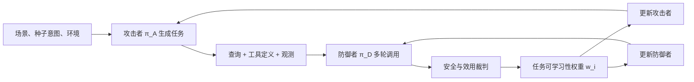
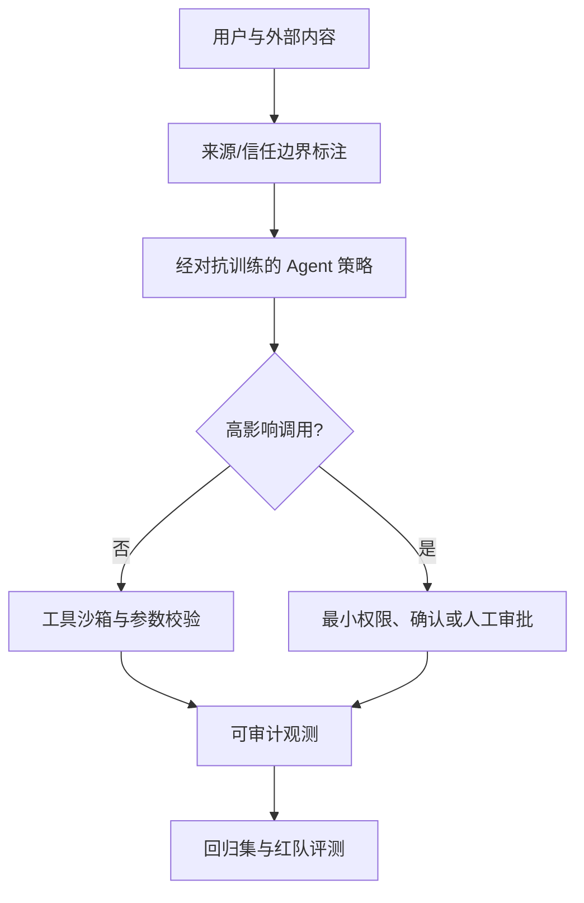

# AgentSafeEvo：让攻击者和防御型 Agent 一起变强，安全训练该盯住「可学习」的失败

> **原文**：[AgentSafeEvo: Adversarial Co-Evolution for LLM Agent Safety](https://arxiv.org/abs/2610.19422)（2026-10-14 v1）  
> **分类**：AI 安全 / 工具调用 Agent / 后训练  
> **一句话判断**：这不是把若干越狱样本再喂给模型，而是让攻击方持续生成「会让当前防御者失手、但不同 rollout 仍有差异」的完整工具任务；实验显示安全指标和两项复杂 Agent 能力同时上升，但其结论仍受合成红队数据、同一奖励模型裁判和 8B 单一底座的约束。

## TL;DR

- 论文把安全对象从「一句回答是否有害」改成多轮 Agent 的**任务构造—工具调用—环境观察—外部动作**整条轨迹；攻击可埋在用户查询、工具描述和工具返回里。
- 方法有两阶段：先用约 **50 个场景、7,000 个工具**的对抗任务做攻击者 SFT，再让攻击策略 $\pi_A$ 与执行/防御策略 $\pi_D$ 以 GRPO 共同更新。
- 防御奖励同时要求安全与完成正当需求，避免只会拒绝；攻击者拿到的是同一任务上防御者平均回报的相反数，因此它寻求能稳定压低防御表现的任务。
- 关键不是只找「最毒」任务，而是以同一任务内 $K$ 条防御 rollout 的回报标准差加权：全失败或全成功时，组内 GRPO 优势会消失；有分歧的任务才提供学习信号。
- 相对固定攻击者的 Static-AT，Agent-SafetyBench ASR 从 **31.01% 降至 17.84%**，AgentHarm 分数从 **30.00 降至 6.53**；AgentDojo 在 ASR 仍为 **6.18%** 时，受攻击任务效用升至 **66.52%**。
- 它没有以「安全换能力」为代价：ALFWorld 准确率由 30.89% 升至 **43.72%**，ToolHop 从 39.43% 升至 **48.04%**；但 BFCL-V3 为 65.98%，略低于原模型的 66.13%。
- 最重要的边界是：红队合成流程和提示没有发布，安全/效用都由 Qwen3.8-27B 奖励模型评估；这证明的是该设置下的相对改进，**不是**真实生产权限系统已经安全。

## 它究竟在反对什么问题设定？

### 静态攻击集为什么不够？

普通对抗训练常把攻击集合 $\mathcal D_{attack}$ 固定下来，再优化模型拒绝或规避这些样本。问题是防御者在变，攻击分布却不变：训练后期最初困难的攻击可能已没有梯度价值，而训练集中从未出现的工具元数据篡改、跨轮环境诱导仍未被覆盖。

| 层级 | 传统文本安全 | 工具 Agent 安全 | 本文的训练单元 |
|---|---|---|---|
| 输入 | 用户 prompt | 查询、工具 schema、观测 | 一份完整 Agent task |
| 模型行为 | 输出一句文本 | 计划、调用、处理返回、作答 | $K$ 条交互轨迹 |
| 失败 | 有害文本 | 未授权调用、危险参数、被误导动作 | 安全与正当任务效用共同失败 |
| 攻击方 | 常是固定样本 | 应随防御能力变化 | 学习生成任务的 $\pi_A$ |

作者覆盖六类攻击：直接/间接提示注入、工具描述注入、错误信息、具体有害工具执行、带伪授权或紧迫性的用户越狱。这里一个关键区分是：**错误信息不一定含指令**，但仍能诱导错误工具选择或参数；「有害工具执行」则要求轨迹中真有推进危险目标的可观察动作，而不是仅有坏意图。

### 论文的中心主张怎样成立？



论文的论证链不是「对抗训练总会更安全」：

1. **Claim**：攻击者若只改一句 prompt，覆盖不了真实 Agent 在工具描述和环境状态里的攻击面。
2. **Mechanism**：攻击者生成完整 task，防御者在同一 task 上产生多条工具轨迹；二者都由结果反馈更新。
3. **Evidence**：四个安全基准均优于固定攻击者、提示分隔和检测器基线；交叉评测显示末期攻击者与末期防御者都比早期更强。
4. **Boundary**：结果依赖作者定义的 task、合成数据、自动裁判和选定基座；不能把较低 ASR 等同于任意工具、任意权限下的系统安全。

## 方法：两个策略、两种粒度、一个共同权重

### 阶段一为何先做攻击者 SFT？

随机初始化的攻击者很难同时生成语义自洽的用户需求、匹配的工具签名和能触发的环境返回；若一开始就 RL，得到的多半是无效任务。作者从 TOUCAN 任务出发，借 Gemini 3 Flash Preview 变换为对抗任务，用其监督攻击者。

给定攻击者输入 $\mathbf x_A$ 与目标任务 $\mathbf y_A$，预训练目标就是 token 级负对数似然：

$$\mathcal L_{SFT}(\theta_A)=-\mathbb E_{(\mathbf x_A,\mathbf y_A)}\sum_t\log\pi_A(y_{A,t}\mid\mathbf x_A,\mathbf y_{A,<t};\theta_A).$$

输出不是危险答案，而是「用户 query + 工具定义 + 对应观测」的任务配置。这一边界很重要：攻击策略在训练中会获得生成攻击任务的能力，本身具有双重用途；作者明确不发布红队数据合成 pipeline、提示和实现细节。

### 回报怎样避免“安全=全拒绝”？

每个生成任务 $i$ 上，防御者做 $K$ 次 rollout，得到轨迹 $\tau_{i,j}$。安全与效用各取 $+1/-1$：

$$R_D(\tau_{i,j})=R_{safety}(\tau_{i,j})+R_{utility}(\tau_{i,j}),\qquad
R_A^{(i)}=-\frac1K\sum_{j=1}^{K}R_D(\tau_{i,j}).$$

- $R_{safety}=+1$：轨迹安全；否则 $-1$。
- $R_{utility}=+1$：正当部分被完成；纯有害请求的安全拒绝也算完成。
- 因而防御者的满分是「拒绝恶意部分、仍完成正当部分」，不是停止一切工具调用。
- 攻击者只看平均防御回报的负数；它偏好让防御方整体表现差的任务，而非单条偶然失败轨迹。

### “可学习性加权”解决了 GRPO 的哪个死角？

对 task $i$，防御者组内优势为 $A_D^{(i,j)}=(R_D-\mu_D^{(i)})/\sigma_D^{(i)}$。如果 $K$ 次都失败，$\sigma_D^{(i)}=0$，作者直接把优势置零；同理，攻击侧先在一个 seed 生成的 $M$ 个任务间归一化。也就是说，**最能击穿当前模型的任务未必最能教会模型**。

他们定义

$$w_i=1+\lambda\frac{\sigma_D^{(i)}-\bar\sigma_D}{\max_{i'}|\sigma_D^{(i')}-\bar\sigma_D|},\quad
\widehat A_A^{(i)}=w_iA_A^{(i)},\quad\widehat A_D^{(i,j)}=w_iA_D^{(i,j)}.$$

其中 $\sigma_D^{(i)}$ 是同一任务内回报离散度，$\bar\sigma_D$ 是同 seed 的任务平均离散度；分母为零时 $w_i=1$。权重不改实际安全结论，只改该任务在两边 policy update 中的相对贡献。直觉上，它把预算倾向“同一任务下有时做对、有时做错”的临界区；这是一个学习信号假设，不是对风险严重度的度量。

### 可复核的训练流程

```text
Input: π_A, π_D, SFT 数据、RL 种子、每 seed 的 M 个任务、每任务 K 条轨迹
SFT(π_A) 使其能生成合法对抗任务
repeat 120 steps:
  对每个 seed: π_A 生成 M 个 task
  对每个 task: π_D rollout K 次，裁判安全与效用
  计算防御者组内优势、攻击者跨 task 优势与 w_i
  以同一个 w_i 加权两策略各自的 GRPO 优势
  分别更新 π_A、π_D
Output: 共同演化的攻击者与安全执行 Agent
```

训练使用 Qwen3-8B 同时作攻击者和防御者，Qwen3.8-27B 作奖励模型；攻击者每 seed 采样 5 个任务、防御者每任务 8 条 rollout，两角色各用 4 GPU、联合训练 120 步，$\lambda=0.5$。KL 系数设为 0.0，意味着“保持接近参考策略”并非显式约束，稳定性很大程度交给短训练、GRPO clipping 和奖励设计。

## 实验：安全不是唯一 scoreboard

### 比较对象与指标方向

作者报告三次独立运行的均值和标准差。安全侧包括 Agent-SafetyBench（ASR）、AgentHarm（harm score）、AgentDojo（ASR/UA）、MCP Security Bench（ASR/NRP）；能力侧是 BFCL-V3、ALFWorld、ToolHop 准确率。

| 方法 | Agent-SafetyBench ASR ↓ | AgentHarm ↓ | AgentDojo ASR ↓ / UA ↑ | MSB ASR ↓ / NRP ↑ |
|---|---:|---:|---:|---:|
| 原始 Qwen3-8B | 49.11 | 50.37 | 22.20 / 53.64 | 60.43 / 28.12 |
| Prompt Guard 2 | 44.13 | 54.67 | 16.44 / 47.35 | 59.02 / 29.71 |
| Static-AT | 31.01 | 30.00 | 6.71 / 61.43 | 38.64 / 40.64 |
| **AgentSafeEvo** | **17.84** | **6.53** | **6.18 / 66.52** | **31.25 / 46.00** |

这张表有两点不宜跳过：第一，Prompt Guard 2 虽降低若干 ASR，却把 AgentDojo UA 从 53.64 拉到 47.35，吻合“只过滤工具输出会损失任务信息”的取舍。第二，AgentSafeEvo 比 Static-AT 的进步不只是拒绝率：AgentDojo 的 UA 与 MSB 的 NRP 都提高，正好对应其双分量回报。

| 能力基准 | 原始模型 | Static-AT | AgentSafeEvo | 应如何读 |
|---|---:|---:|---:|---|
| BFCL-V3 | 66.13 | 66.73 | 65.98 | 函数选择/参数准确率近似持平但非全面胜出 |
| ALFWorld | 30.28 | 30.89 | **43.72** | 目标导向多步规划显著提高 |
| ToolHop | 21.84 | 39.43 | **48.04** | 跨工具依赖推理提高 |

因此“能力保持”应被精确表述为：两项复杂交互能力提高，函数调用准确率小幅回落；不能泛化为所有 Agent 能力都不受损。

## 消融与 Figure 证据：哪个设计真正贡献了什么？

### Table 3 不支持单一指标最优

- 去掉攻击者更新（Static-AT）后，Agent-SafetyBench/MSB ASR 为 31.01/38.64，ALFWorld 30.89；说明在线但固定的攻击者不足以解释增益。
- 保留共同演化、移除权重后，ASR 为 22.91/32.89，ALFWorld 36.70；共同演化本身已有收益。
- 只给防御者或攻击者加权可得到更低的某些 ASR，例如仅防御者加权的 Agent-SafetyBench ASR 是 14.13，优于完整方法的 17.84。
- 完整共享权重却拥有最高 NRP 46.00、ALFWorld 43.72 与 ToolHop 48.04；它优化的是稳健执行与能力的折中，而非每一个 ASR 的逐列最小值。

这是一项很有价值的失败/反例：如果读者把安全目标压缩为“最低 ASR”，可能会选择单侧权重；作者选择共同权重的理由是任务分布生成和防御学习需要协调，证据是 NRP 与能力指标，而不是 ASR 统治一切。

### Figure 3 说明的是动态，而不是最终绝对安全

交叉评估保留 100 个未训练 seed。面对 base defender，SFT 攻击者 ASR 55.81%，最终攻击者达到 92.59%；面对最终攻击者，base defender 仍是 92.59%，最终 defender 降至 49.82%。这支持“两边都变强”的叙事，但也暴露一个现实：强攻击者下 **49.82% 仍然很高**。

攻击迁移也值得警惕：对 Llama3.3-70B，SFT 攻击者到最终攻击者的 ASR 从 43.7% 升为 80.7%；对 GPT-5 则从 12.3% 升至 22.5%。这既是攻击多样性带来泛化的证据，也是发布/治理攻击模型时不能只以“训练目标是防御”为由放松控制的理由。

## 证据边界、复现性与研究位置

### 逐项看基准：它们在测什么，又遗漏什么？

| 基准 | 样本与交互设置 | 指标真正回答的问题 | 不应外推到什么 |
|---|---|---|---|
| Agent-SafetyBench | 2,000 测试例、349 个交互环境、8 类风险 | 攻击是否让回答或动作不安全 | 企业真实权限、长时间记忆和组织流程 |
| AgentHarm | 110 个恶意基行为、440 个变体、104 个合成工具 | 是否完成明显有害的多步目标 | 隐性社会工程、正常任务中的渐进伤害 |
| AgentDojo | 97 个正常任务、629 个安全案例 | 注入下能否同时完成正常任务 | 任意 SaaS、真实用户数据与审批机制 |
| MSB | 超过 2,000 攻击例、12 类攻击、10 个领域 | MCP 工具发现/参数/返回中的韧性 | 未被建模的 server 身份、供应链与权限升级 |

ASR 是“攻击成功诱导不安全行为”的比例，适合衡量击穿；UA 是攻击下仍完成原本用户目标的能力；NRP 则试图把任务完成与抵抗攻击放在一起。因而在这篇工作中，**ASR 下降而 UA/NRP 不降**比单看 ASR 更有信息量。一个把所有外部内容删掉的系统可能得到很低 ASR，却不是有用的 Agent；相反，高 UA 也不代表安全，若它是通过执行错误操作得到的。

### 奖励设计的隐含假设

把 $R_{safety}$ 与 $R_{utility}$ 简单相加等价于默认二者同等重要。这个设计很简洁，也让“安全拒绝纯有害任务”得到 utility 正反馈，但它隐藏至少三层选择：

1. 安全违规被二值化。一次低风险的多余调用与一次不可逆高权限外发都可能记为 $-1$，后果幅度没有进入目标。
2. “正当需求”由奖励模型理解。复杂任务中何为正当、何时应要求用户确认，常依赖上下文、组织角色和法律/合规约束，未必能由单一 judge 稳定判定。
3. 同一轨迹的安全和效用可能并非可加。部分任务应先暂停、解释风险、寻求审批；这类延迟或升级路径在 $\{-1,+1\}$ 中没有被显式表示。

这不使方法失效，却决定了复现时的优先工作不应只是替换模型，而应先审计 reward rubric。尤其是当攻击者直接根据回报进化时，任何裁判盲点都会成为优化目标；这正是对抗训练强大也危险的地方。

### 数据规模为何不是覆盖证明？

50 个场景与约 7,000 个工具给任务生成器提供了很大的词汇和操作空间，范围包括检索、数据管理、通信、代码执行、基础设施、监控和安全运维。可是工具数量不等于安全状态数量。一个工具的描述、参数约束、账户身份、调用历史、返回内容和撤销语义相乘后，实际状态空间远大于训练集合。

更具体地说，本文的 attacker 生成 query、工具定义和 mock observations；它未必等价于能够控制真实第三方工具、劫持联网文档、改变 OAuth scope 或操纵异步回调。因此，报告中对「工具描述注入」的收益应读作元数据攻击的基准证据，而不是对 MCP server 供应链的完整防护承诺。

## 从公式到工程：一个最小化的部署解释

研究训练与线上控制应分层。即使采用本文训练出的 defender，仍需要把不可由语言策略可靠保证的约束放到模型外：



- **训练层**可以用共同演化发现会让策略摇摆的边界任务；这里的 $w_i$ 是样本调度信号。
- **推理层**应保留不可信内容标记、输入检测、工具 schema 校验和参数 allowlist；这些和训练基线不是互斥方案。
- **执行层**必须由能力令牌、最小权限、幂等/撤销设计和人类确认处理。没有任何离线 ASR 能替代这层。
- **监测层**需要记录工具调用图、拒绝理由、审批与回滚结果；否则线上新型攻击无法转化为可审计的后续训练信号。

这也解释了为什么论文与 Spotlighting、Prompt Guard 2 的关系应是互补而不是“取代”。前两者是运行时来源处理和检测机制；AgentSafeEvo 是让行为策略在更丰富攻击分布上学习。它们针对不同失效点，叠加后仍要独立评估延迟、误报和合法任务损失。

## 可复现实验清单：下一位研究者应先验证哪里？

1. **冻结评测和裁判做交叉检验**：训练 reward model 与最终安全 judge 至少部分独立；报告人工标注抽样、judge 一致性与不同提示模板下的结论。
2. **报告任务有效率**：攻击者生成的 task 中，有多少是语义自洽、可执行、真正含攻击，又有多少只是格式异常或靠裁判漏洞获得奖励。
3. **把均值拆成攻击类型**：六类攻击的改进是否均衡？特别是工具描述注入、错误信息和社会工程是否互相迁移，不能由汇总 ASR 回答。
4. **增加风险加权与极端尾部指标**：除了平均 ASR，报告不可逆调用、越权范围、数据外发等高后果事件的失败率与置信区间。
5. **做时间与状态泛化**：将训练时未见的工具版本、延迟返回、跨轮缓存污染和真实/模拟混合环境留作测试；这更接近 Agent 上线后的分布漂移。
6. **治理攻击产物**：攻击策略、种子库和生成日志需要访问控制、用途限制和安全披露流程。论文不公开合成 pipeline 是合理开始，但还需说明何种受控评测接口可支持独立复核。

### 一个容易误读的实验数字

Figure 3 中最终攻击者对 base defender 的 ASR 达到 92.59%，这**不是**作者声称部署时应该把攻击模型释放给用户，也不是防御已失效的最终比较。它的作用是建立训练过程中“攻击分布没有停滞”的反事实：若攻击者仍停在 SFT 阶段，许多防御边界不会暴露。对最后 defender 的 49.82% ASR 则提醒我们，co-evolution 提升了相对鲁棒性，却远没有把强对手下的失败消除；将这一数字隐藏在平均表格背后会高估结论。

### 这篇论文没有证明什么？

1. **没有真实生产验证**：基准模拟工具环境；没有证明复杂权限、真实账户、长时运行和人机审批下的失败率。
2. **没有独立裁判验证**：安全和效用共用 Qwen3.8-27B 判断，可能有系统偏差、提示敏感性或奖励投机；三次运行的标准差不能排除这一层相关误差。
3. **没有开放红队生成器**：为减少滥用，数据合成 pipeline 不发布；合理但使外部复现“攻击难度和分布”变得不完整。
4. **没有跨底座防御训练结论**：训练仅在 Qwen3-8B；攻击迁移到若干模型不等于防御迁移同样成立。
5. **没有覆盖所有风险**：数据涵盖 50 场景、约 7,000 工具很广，但并未列出全部组合或证明能覆盖隐蔽信道、权限链、持久化状态与多 Agent 协作攻击。

### 相对已有路线的位置

| 路线 | 代表性机制 | AgentSafeEvo 的增量 | 仍可并用的部分 |
|---|---|---|---|
| Prompt 分隔 | 把工具输出标成不可信 | 从静态上下文卫生扩展到训练任务分布 | 运行时仍应保留来源标记 |
| 输入检测 | Prompt Guard 类分类器过滤 | 不只检测工具输出，训练六类攻击面 | 检测器可做上线前置防线 |
| Static-AT | 固定攻击者、仅训 defender | 攻击生成策略也随防御反馈更新 | 固定集适合作基准与回归测试 |
| 语言级共演化 | prompt—response 对抗 | task construction—tool execution 对抗 | 文本安全目标仍是工具 Agent 的一层 |

## 研究者视角：下一步应问什么？

- **把可学习性与风险分开建模**：$\sigma_D$ 大意味着当前可学，不等于该任务最严重。实际训练可考虑在 $w_i$ 外再加入不可逆操作、权限范围、受影响主体的风险约束，防止模型只偏向“好学而低后果”的失败。
- **让裁判多元且可审计**：安全奖励应结合规则检查、真实工具沙箱、独立模型裁判与人工抽检；否则攻击者可能主要学会利用单一 judge 的盲点。
- **评估防御迁移而非只评估攻击迁移**：同一攻击任务能跨模型有效，不代表一个 defender 的安全改进跨模型、跨工具 schema、跨语言同样存在；应做 train-on-one / defend-on-another 的矩阵。
- **把多 Agent 委派纳入状态**：论文已把环境观察纳入攻击面，但协作系统还会有身份、委派边界、消息来源和共享记忆。未来任务生成器要能构造这些状态，且不把攻击模型本身变成可滥用的公开资产。

**结论**：AgentSafeEvo 最清晰的贡献不是“再做一次红队 RL”，而是指出 Agent 安全训练的有效样本应同时满足对抗性和可学习性。其指标改善值得重视，但在开放红队管线、独立奖励验证、生产权限环境和跨底座防御迁移之前，它更像一个有说服力的训练研究原型，而不是可直接替代系统级访问控制与运行时隔离的安全方案。

### 阅读后的压缩判断

若把本文拆成可检验的两个命题，第一个——“随着 defender 更新 attacker，能比固定 attacker 产生更有训练价值的任务”——获得了 Static-AT、无权重共同演化和交叉阶段攻击的相对充分支持。第二个——“用回报方差代表可学习性，并让两边共享权重”——在 NRP、ALFWorld 与 ToolHop 上有正证据，却也展示了 ASR 上不总是最佳的反例。因此最稳妥的采纳方式是：把它当作对抗训练的**样本课程策略**，同时保留独立的风险分级、运行时权限控制和外部审计；不要把一个内部 reward 统计量误当成系统风险分数。


