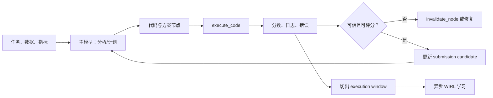

# MLExpert：把长程机器学习工程中的“实验回报”归因给一段决策窗口

## 元信息

- **类别**：大模型后训练（`llm-post-training`）
- **原文**：[MLExpert: Towards a Generalist Agentic Model for Autonomous Machine Learning Engineering](https://arxiv.org/abs/2610.22344)
- **公开时间**：2026-10-15 17:56:32 UTC（arXiv v1）
- **代码与模型**：[InternScience/MLExpert](https://github.com/InternScience/MLExpert)；[模型页](https://huggingface.co/InternScience/MLExpert)
- **分析对象**：论文 HTML、附录和作者公开的代码/模型入口；本文不把公开的对比模型能力表述为独立复现结论。

## TL;DR

- MLExpert 研究的不是“让模型写出一次性 ML 代码”，而是让一个 35B MoE 模型在**最多 3,000 次交互、12 小时**的真实工程预算里，持续查看日志、修改代码、运行实验、回退坏分支并维护最终提交候选。
- 难点是一次 `execute_code` 的回报，实际由此前多轮分析、改代码和工具调用共同造成。作者把两次实验结果之间的连续模型输出定义成一个 **execution window**，给窗口内所有新增 token 同一份可验证奖励；这就是 Windowed Interaction RL（WIRL）。
- 训练先做分层 Agentic SFT：通用编码/工具轨迹打底，再用 MLE 与科学实验轨迹适配；再用 WIRL 从在线实验回报学习。MLE-Bench Lite 的任意奖牌率从基座 Qwen3.6-35B-A3B 的 **37.9% 提至 72.7%**，但这仍只是 22 个历史 Kaggle 任务、固定计算预算与作者 harness 下的结果。
- 消融特别有信息量：MLE SFT 已达 **62.1%**；同一初始化下 GRPO 为 **56.1%**、PPO-style 为 **60.6%**，完整 WIRL 为 **72.7%**。移除局部趋势奖励或异步策略校正后分别降至 **66.7%** 与 **65.2%**，说明作者的主张不只是“再做一点 RL”。
- 证据边界也很清楚：窗口奖励仍把复杂探索压成一次实验的标量结果；Kaggle Factory 从 11,649 个元数据条目筛到 154 个可用任务，任务构造、教师轨迹、内部验证和 harness 都可能塑造优势。它证明的是一种有前景的**训练归因单位**，尚不能证明通用自主科研或递归自我改进已经可靠实现。

## 研究问题：为什么“完整轨迹一个终局 reward”不够用？

### 机器学习工程不是单步问答

一次端到端 MLE 循环常含有：读数据、提出假设、写特征或模型、启动耗时训练、诊断指标、回滚、再提交。外部工作流可以把这些阶段写死；论文选择更难的设置：**下一步由模型自己决定**。因此，错误不只发生在代码生成，也可能发生在“何时停止”“应不应该相信这个 validation 分数”“现在该探索还是利用”。

作者将任务写为 $e=(d_e,\mathcal{D}_e,m_e)$：描述、数据与评测指标。候选管线 $y\in\mathcal{Y}_e$ 经隐藏测试评分 $S_e(y)$；在预算 $B_e$ 内，策略 $\pi_\theta$ 生成交互轨迹 $\tau$，目标是最大化最终选择的提交质量：

$$
J(\pi_\theta;e)=\mathbb{E}_{\tau\sim p_{\pi_\theta}(\cdot\mid e,B_e)}[S_e(\hat y_\tau)].
$$

这里的关键不是公式本身，而是它暴露了归因问题：$\hat y_\tau$ 的质量到轨迹末尾才知道，可是一个训练运行里中途实验已不断给出信息。若全部等待终局，样本昂贵、更新慢；若把每一次工具调用当成独立动作，又会把“先诊断、再补数据清洗、最后训练”的因果链切碎。

### 作者的论证路线

| Claim | Mechanism | Evidence | Boundary |
|---|---|---|---|
| 长程 MLE 需要模型主导实验，而非固定 workflow | 可持久化状态的 Interaction Harness 与实验树 | 图 1、图 2；MLSP Birds 案例连续改进 | harness 本身仍编码了工具、状态与预算 |
| 结果可以为一段多轮决策提供可训练监督 | 两次 `execute_code` 结果之间定义 execution window | WIRL 对 GRPO/PPO 的消融比较 | 一个窗口中仍可能混有好、坏与无关决策 |
| 中途回报值得尽早使用 | 异步收集 window，按 rollout/old policy 做 token 校正 | 完整 WIRL 高于去校正版本 | 没有报告跨基础模型的稳定性方差 |
| 学到的不只是 Kaggle 专用技巧 | NatureBench、AIME scaffold、MLS-Bench-Lite 迁移 | 10/10、12-task 等补充评测 | 样本小，且执行框架/预算仍高度特定 |

## 环境与数据：训练对象先被“做成可执行问题”

### Kaggle-MLE Factory 的作用

作者没有直接把 Kaggle 网页交给 Agent，而是建立 Factory：发现 Agent 筛选竞赛；分析 Agent 抽取字段与模态；生成 Agent 制备数据、隐藏标签与 evaluator；validator 运行任务并检查数据完整性、提交格式、标签退化、ID 重叠和评分函数。这个流水线解决的是训练环境可执行性，不是模型能力本身。

- 元数据快照有 **11,649** 个竞赛；默认筛选要求竞赛完成、至少 **50** 支队伍、数据不超过 **200 GB**。
- 最后对 **160** 个注册任务人工复核，剔除 **6** 个标签或评分仍有问题的任务，留下 **154** 个用于收集轨迹。
- 这既提升了环境质量，也引入选择偏差：能离线化、能造隐藏集、能统一接口的竞赛，不必然代表开放世界科研任务。

### Interaction Harness：把状态外置，而不是塞进上下文

每个 solution node 保存候选代码、执行日志和元数据；父子链接形成实验树。模型可调用 `list_nodes`、`select_node` 进行回看，使用 `write_full_code` / `patch_code` 修改方案，用 `execute_code` / `control_run` 启动与控制实验，最终以 `update_answer` 维护有效提交。上下文接近上限时，早期消息被摘要；复杂诊断可委派给分析子 Agent 并仅返回摘要。



这张图的研究含义是：模型得到的不是一个纯文本“奖励”，而是有版本、有日志、可回退的实验状态。相应地，报告的提升也不能完全归给权重训练；状态树、工具集合、分析子 Agent 与 evaluator 共同构成能力脚手架。

## 分层 Agentic SFT：先学会操作，再学会在反馈中推进

### 两层监督不是简单数据拼接

第一阶段使用通用编码和工具调用轨迹，建立基本的编辑、执行与工具语法能力；第二阶段才用 MLE 教师轨迹和从 Nature-family 文献构造的科学实验任务，学习设计实验、解释结果和迭代优化。作者还按结果筛选长轨迹：若达到峰值后明显退化，就截取**第一次最佳提交**附近的完整工具边界；否则使用最终提交。

这个选择值得重视。长轨迹并不天然是高质量监督：它可能先找到好方案，随后因为盲目继续搜索而退化。截断的目标是保留到达强解前的探索和失败恢复，却不模仿“已经成功却继续毁掉结果”的尾部。代价是 SFT 不再代表完整的自然探索分布，而是被结果选择过的轨迹分布。

### 数据规模与训练单位

| 数据域 | 教师 | 保留源轨迹 | 序列化输入记录 |
|---|---:|---:|---:|
| MLE | GLM-5.2 | 412 | 4,961 |
| 科学实验 | GLM-5.2 | 143 | 342 |
| 科学实验 | Qwen3.8-Max | 81 | 236 |
| 合计 | — | **636** | **5,539** |

MLE 部分覆盖 236 个任务，科学实验覆盖 77 个任务；来源池还包括 Factory 的 154 个任务、MLE-Dojo 的 134 个任务，以及来自 164 篇 Nature-family 论文的构造任务。训练与 MLE-Bench、NatureBench 的重叠任务被排除，这是一项必要但仍有限的污染控制：按“任务”去重不等于按数据、相似竞赛结构或教师先验完全去重。

## WIRL：把延迟反馈切成可验证的实验窗口

### 奖励如何定义

令 $u_m$ 是从上一次结果到这一次 `execute_code` 返回之间的连续决策。若模型导致执行错误，$R_m=-1.0$；没有此类错误但没有可评分提交，$R_m=-0.6$；有提交但低于奖牌线为 $-0.4+T_m$；铜/银奖为 $1.0+T_m$；金奖为 $2.0+T_m$。

$$
R_m=\begin{cases}
-1.0,&\text{模型动作导致执行错误}\\
-0.6,&\text{无此错误但无可评分提交}\\
-0.4+T_m,&\text{低于奖牌阈值}\\
1.0+T_m,&\text{铜牌或银牌}\\
2.0+T_m,&\text{金牌}
\end{cases}
$$

其中 $T_m\in\{-0.2,0,0.2\}$ 比较当前与最近一次有效提交的局部趋势；第一次有效提交设为 0。奖牌阈值提供跨不同指标任务的共同尺度，趋势项则鼓励“比上一个有效解更好”。这一设计避免仅奖励罕见的最终金牌，也将局部上升误当成可学习信号的风险带进来：一个 leaked validation score 同样会带来正趋势，所以 `invalidate_node` 只是工具能力，不是数据泄漏已经被证明消除的证据。

### 为什么需要异步策略校正

实验耗时不等，长轨迹会跨越多次参数更新。若老 rollout 的 token 直接用当前策略训练，采样策略与更新策略会失配。论文记录 rollout 与更新前策略的 log-prob：

$$
q_{mjt}=\exp(\ell^{old}_{mjt}-\ell^{roll}_{mjt}),\quad
c_{mjt}=\operatorname{sg}\left(q_{mjt}\mathbf 1[q_{min}\le q_{mjt}\le q_{max}]\right).
$$

- $j,t$ 分别是窗口内第 $j$ 次模型调用和其中第 $t$ 个 token；$q$ 是重要性校正比值。
- 比值落在区间内时保留并加权；区间外 token 被排除，避免极端 off-policy 样本支配梯度。
- 每个窗口以其可训练输出 token 数 $N_m$ 归一化，再在 batch 内平均；工具反馈和继承历史只作条件，不计进损失。

伪代码可以更直观看到它的训练单位：

```text
Input: task e, current policy πθ, workspace state
State: last_valid_score, window u, asynchronously finished windows B
while budget remains:
  action ← πθ(history, workspace)
  apply action; append generated tokens to u
  if action launches and returns an experiment result:
    R ← medal-tier reward + local trend
    record rollout log-probabilities for u
    add (u, R) to B; reset u
  if B contains trusted completed windows:
    discard out-of-range importance-ratio tokens
    update πθ with shared R over each window's new output tokens
Output: best valid submission candidate
Failure boundary: a scorable result may still be overfit, leaky, or causally misattributed.
```

相对于 trajectory-level GRPO，WIRL 的新意不是“使用 reward”，而是提出了一个介于单步 token 与整条任务轨迹之间的归因粒度。它假设实验边界是一个合理的因果切点；这是非常实用的工程假设，但在多并行实验、延迟日志或中途人工/子 Agent 修改状态时，需要更精细的信用分配验证。

## 实验设置：哪些数字能比较，哪些不能？

主要评测是 MLE-Bench Lite 的 **22** 个历史 Kaggle 任务，报告金、银、铜、任意奖牌和超过人类中位数（Med+）；任意奖牌为主指标。每个任务最多 3,000 步、12 小时、20 vCPU、220 GB RAM 和一张 H200。MLExpert 从 Qwen3.6-35B-A3B 初始化，论文称总参数 35B、约 3B active。

| 组别与模型 | Harness | 任意奖牌率 |
|---|---|---:|
| Qwen3.6-35B-A3B（基座） | MLExpert | 37.9% |
| Ornith-1.5-35B-A3B | MLExpert | 39.4% |
| Nex-N2.5-mini | MLExpert | 47.0% |
| GLM-5.3 | MLExpert | 72.7% |
| Kimi-K3 | MLExpert | 72.7% |
| **MLExpert** | **MLExpert** | **72.7%** |
| GPT-5.6 Sol | MLExpert | 77.3% |

作者还给出 Claude Code 下的交叉 harness 数字：基座 42.4%，MLExpert 69.7%。这削弱了“只会适应自家 harness”的解释，但不是严格的控制实验：不同系统的提示、工具适配、模型服务和运行稳定性都可能影响长程结果；同一张表中的模型也并非在相同可见性、上下文或价格约束下比较。

## 主结果、消融与反例

### 主结果支撑什么

- MLE-Bench Lite：37.9% 到 72.7% 是 **34.8 个百分点**绝对提升；论文把它解释为长程 Agentic post-training 可把同规模模型推进到若干更大前沿模型水平。合理的最小结论是：在该环境与协议内，训练流程显著改变了 22-task 的奖牌产出。
- NatureBench Lite（10 个任务）：Surpass-SOTA 从 **0/10 到 5/10**，Match-SOTA 从 **4/10 到 7/10**。10 项的粒度意味着每个任务就占 10 个百分点，50% 不是精确稳定率，应同时报告分子分母。
- AIME 2025 scaffold optimization：固定 GPT-4.1-nano solver 时，MLExpert 优化的 scaffold 在 held-out 为 **43.7%**，基座为 **23.3%**；但调用数是 8.40 vs 5.74，提升不能被简化成“同成本更强”。
- MLS-Bench-Lite：12 个任务、同样五小时预算下 verifier reward 均值从 **0.322 到 0.425**，其中 10 胜、1 平、1 负。这是跨任务迁移的积极信号，却仍是小样本且使用 verifier reward 的评测。

### 消融最直接地检验机制

| 训练阶段或算法 | Any Medal | 相对 MLE-SFT 的解释 |
|---|---:|---|
| Base | 37.9% | 初始能力 |
| + General Agent SFT | 47.0% | 通用工具/编码可贡献 9.1 点 |
| + MLE SFT | 62.1% | 领域轨迹与结果筛选再贡献 15.1 点 |
| + WIRL | 72.7% | 在线窗口反馈再贡献 10.6 点 |
| GRPO（同一 MLE-SFT 初始化） | 56.1% | 终局/组相对优化在此处低于 SFT |
| PPO-style | 60.6% | 仅用终局轨迹奖励也低于 SFT |
| WIRL 无趋势奖励 | 66.7% | 局部进度提供 6.0 点差异 |
| WIRL 无策略校正 | 65.2% | 异步 off-policy 校正提供 7.5 点差异 |

论文还给出一个反直觉但重要的失败信号：GRPO 和 PPO-style 都低于 62.1% 的 MLE-SFT。它提示长程工程环境中，把极稀疏最终回报直接灌进通用 RL 算法并不自动有效。与此同时，表格没有给出多随机种子、置信区间或每任务回报分布，因此 6.0 和 7.5 个百分点能否稳定复现仍未知。

### Figure/Table 如何阅读

- **Figure 1** 对比外部编排和模型主导交互：它支撑问题设定，不证明模型已具备通用研究自主性。
- **Figure 2** 将 Factory、Harness、SFT 与 WIRL 串成数据闭环：它说明系统贡献高度耦合，不能把性能只归给一个 loss。
- **Figure 3** 的 MLSP 2013 Birds 案例从 ROC-AUC 0.58 提至 0.964，SFT 从 0.60 到 0.88；它展示了从 audio feature、PANNs、AST fine-tuning 到 snapshot averaging 的路径，但单个代表性案例不能估计失败概率。
- **Table 1–4** 是论文最强证据：同规模对比、跨 harness、分阶段和 RL 设计的消融共同支撑“窗口化 + 校正有用”。仍应注意主体评测只有 22 任务。
- **Table 5 / Figure 4** 将结论伸向 scaffold 与算法组件优化；它们支持迁移假设，却不消除使用同类工程接口、固定时间预算和内部 verifier 的共同结构。

## 与相关工作的关系

论文把自己放在两条线之间：一条是 AIDE、MLE-STAR、MLEvolve、MARS、R&D-Agent 等以搜索、记忆或多角色组织实验的自动 ML 系统；另一条是 SWE-Gym、Search-R1、WebRL、AgentFlow 等从可执行环境与回报训练多轮 Agent 的后训练工作。其定位差异是：不让外部搜索框架固定实验次序，而试图训练模型在真实 MLE 状态中选择下一步，并把实验输出作为中间学习边界。

这个定位比“通用 Agent 更强”更准确。MLExpert 的可检验贡献是：对于包含昂贵运行、异质指标与持续状态的环境，**实验完成事件**可能是比 token 或全轨迹更合适的信用分配单位。未来对比应控制相同工具、相同状态表示和相同算力，只替换归因单位；否则系统 scaffold 的差异会掩盖算法差异。

## 证据边界、可复现性与后续问题

### 已经得到支持的结论

1. 在作者的 22-task MLE-Bench Lite 协议中，分层 SFT 加 WIRL 显著高于给定基座与两种 RL 对照。
2. 局部趋势奖励与异步策略校正在该协议的消融中均有正向贡献。
3. 小规模 NatureBench、AIME scaffold 与 MLS-Bench-Lite 提供了跨相邻优化任务迁移的初步证据。

### 尚未得到支持的结论

1. 这不等于模型已经能以可靠、低成本方式完成开放世界的机器学习研发；12 小时 H200 与大量工具权限本身就是昂贵条件。
2. 这不等于 reward hacking、泄漏或选择性报告被根除；作者提供了 invalidation 工具，但没有报告其触发率、漏检率或对最终名次的影响。
3. 这不等于任意 Agent 域都应以“工具结果之间的窗口”做奖励单位。网页、软件工程和物理实验的观测延迟、并发与不可逆成本不同。
4. 代码与模型链接提高可审计性，但论文当前数字仍需要独立复跑，尤其应公开任务构造版本、种子、失败任务日志、每窗口样本统计和成本分布。

### 研究者视角的延伸

最值得继续追问的不是怎样再把 72.7% 推高，而是怎样让窗口归因对齐真正的研究价值。一个方向是在奖励中显式区分“局部验证提升”“隐藏测试提升”“资源代价”和“可复现性”，可写成多目标形式：

$$
R^{safe}_m=R^{score}_m-\alpha C_m-\beta L_m+\gamma V_m,
$$

其中 $C_m$ 是计算/调用成本，$L_m$ 是泄漏或异常验证风险，$V_m$ 是跨重跑稳定性；$\alpha,\beta,\gamma$ 必须由部署目标与风险预算决定，而非由单一 benchmark 自动决定。另一个方向是将因果信用从硬窗口扩展为实验 DAG：当一个分析结论被多个并行运行共享时，奖励应如何分配给共同祖先动作？

对于 AI for AI 的安全讨论，这篇论文提醒我们：能力训练与评估基础设施不可分开。更会自主优化的 Agent 需要同样自主但可审计的状态记录、权限边界、回滚、数据泄漏检查和成本上限。MLExpert 给出了一个可实验的后训练方案；它尚未替代这些治理与验证层。

## 补充细读：几个容易被结果表掩盖的设计选择

### “模型主导”仍然是在有护栏的行动空间内

论文用模型主导（model-directed）来区别预先规定阶段转换的 workflow，但不应把它理解为完全无结构的开放行动。模型的可见状态、可调用工具、`execute_code` 的资源配置、实验树的数据结构、历史压缩方式与提交接口，都已经定义了什么动作容易做、什么证据容易取得。模型可以选择分析、修改、运行或回退，却不能跳出 evaluator 自行改变隐藏集，也不能任意改变训练预算。

这不是缺点，而是理解结果的前提。与其问“模型是否真的自主”，更精确的问题是：在一套可重复的闭环里，**哪些控制逻辑从外部脚本迁移到了模型策略**？作者把选择下一个实验、维护当前最好答案、决定是否使节点失效等一部分控制权交给模型；把资源、验证和状态完整性仍留在环境。这种分层尤其适合高成本工具环境，因为它让学习问题可控，也让 audit log 可以对应到具体动作。

### 为什么奖励不采用纯分数差？

若只使用 $S_m-S_{m-1}$，不同任务的指标尺度、方向和可达范围会使奖励不可比：一个 AUC 增加 0.01 与一个 log-loss 降低 0.01 未必同样困难。奖牌分层把分数映射到相对人类竞赛门槛，局部趋势只作为 $\pm0.2$ 的小修正。因此，它优先回答“这次是否达到了具有共同含义的质量档位”，再回答“相对于刚才是否更好”。

| 奖励成分 | 它试图解决的问题 | 它没有解决的问题 |
|---|---|---|
| 执行错误 -1.0 | 惩罚模型直接引入的不可运行操作 | 环境故障与模型错误的归因可能混淆 |
| 无可评分提交 -0.6 | 区分能运行却无法产出有效候选的状态 | 不能说明失败是否有信息价值 |
| 奖牌档位 | 对齐不同任务的质量尺度 | 阈值附近的不连续性与奖励投机 |
| 趋势 $T_m$ | 给予中间改进信号 | validation 改进未必能泛化到隐藏集 |

值得做的后续消融是把阈值奖励、单纯分数差、排名分位数、成本惩罚与重跑一致性分别置换，而不是只报告“有/无 trend”。这样才能知道 WIRL 的收益主要来自窗口化，还是来自非常适合 Kaggle 体系的奖牌编码。

### 异步采样改变的不是吞吐量而已

长程实验里，快窗口会先完成，慢窗口可能跨过数个 learner update。如果训练只等一整条轨迹，GPU 会因慢实验闲置；如果不校正直接混用旧样本，更新又会越来越 off-policy。作者将 rollout 时记录的 log-prob 与更新前固定策略相比，把不可信比例的 token 剪掉。附录称异步 execution-window 收集降低了 learner waiting fraction，但正文没有给出完整墙钟时间、丢弃 token 比例或不同实验时长分布。

因此，72.7% 是能力/算法/系统的混合测量。对生产级 Agent，更完整的报告至少应同时列出：每个奖牌的平均 GPU 小时、每任务实验次数、失败运行比例、因 correction 被丢弃的 token 比例、从第一次有效提交到最佳提交的增益分布，以及策略更新延迟。没有这些数，读者难以判断一个更高分的策略是否值得更高资源与复杂性。

### 案例研究应怎样被使用

MLSP 2013 Birds 的案例很有教育意义：模型并非只调一个学习率，而是经过音频特征、LightGBM、PANNs representation、AST 微调、attention pooling、MLP head、schedule 调整和 snapshot averaging 等一串路线，ROC-AUC 从 0.58 到 0.964。它恰好说明“窗口”容纳的是一段策略，而不是一行代码。

但案例天然是条件化选择：作者选择了能代表持续优化的成功轨迹。它不告诉我们多少任务停在无可评分提交，多少次错误是不可恢复的，也不告诉我们分支搜索是否消耗了比 baseline 更多的预算。把案例看成机制可视化是恰当的；把它看成总体成功率的证据则是不恰当的。报告中 Table 3/4 的总体消融应始终优先于漂亮案例。

## 可复现检查清单：独立验证最该补什么

若要把论文结论从“作者实验”升级为可依赖的工程知识，最有价值的不是只运行一次公开模型，而是固定并公开下面这些变量：

1. **环境版本**：154 个 Factory 任务的精确数据快照、隐藏集生成逻辑、评分器版本和被排除的 6 个任务原因。
2. **预算对齐**：每种 baseline 的 CPU、GPU、墙钟、上下文长度、并发数、工具错误重试和 token/调用额度；仅对齐 12 小时不保证实际消耗相同。
3. **样本谱系**：636 条源轨迹、5,539 条输入记录、截断前后长度分布、教师来源、相似任务去重规则与污染审计。
4. **RL 诊断**：窗口长度、每档 reward 的频率、$q$ 的分布、裁剪比例、KL/entropy 系数、更新次数以及 reward 与隐藏测试指标的相关性。
5. **失败报告**：无可评分提交、验证分数虚高、节点被 `invalidate_node` 的原因、跨任务退化与策略崩坏案例。

只有这些信息齐全，社区才能区分三种不同解释：模型学会了更好的实验策略；模型更擅长使用这套 harness；或者任务 factory 与训练轨迹让评测变得更可预测。MLExpert 的价值正在于把这些解释变成可以测量、可以反驳的系统问题，而不是把“自主 ML 工程”当作一个无法拆解的营销标签。

