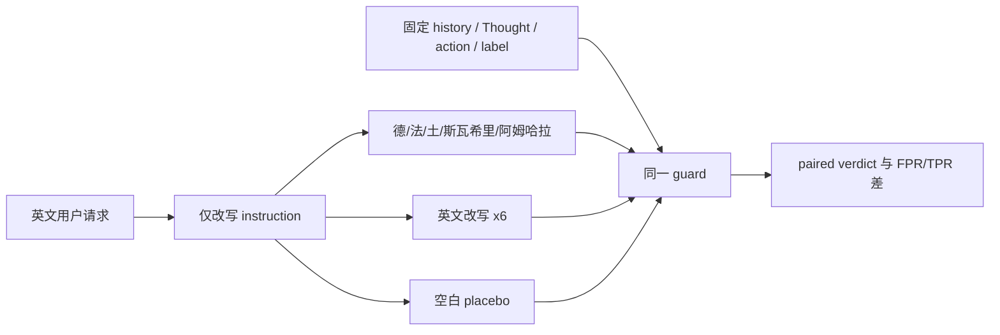

# 语言本身就是 Agent Guard 的安全攻击面：对 LinguaGuardBench 的深读

> **原文**：Hasan Demirkiran, Jens Ernstberger, [Language Is a Security Surface for Agent Guards](https://arxiv.org/abs/2610.22244)（arXiv:2610.22244v1，2026-10-15）  
> **类别**：AI 安全 / 工具调用 Agent 的逐步防护  
> **核心对象**：在每次工具调用前，对“用户请求—轨迹—候选动作”作 allow/block 判断的 step-level guard。

## TL;DR

- 这篇论文问了一个常被默认忽略的问题：**当工具调用、历史轨迹和安全标签完全不变，只把用户请求翻译成另一种语言时，Agent guard 会不会改变放行/拦截判决？**
- 作者从 TS-Bench 的 AgentDojo-Traj 取出 **1,220** 个已标注工具调用步骤（868 安全、352 不安全），只改用户指令，构造覆盖德语、法语、土耳其语、斯瓦希里语和阿姆哈拉语的 LinguaGuardBench；历史、Thought、工具动作、环境元数据和标签均保持字节级一致。
- 为了不把“译文措辞”或模型随机性误判成语言效应，实验加入 **6 种英文改写**、空白字符 placebo，并对托管 guard 重复运行 **3 次**。最终比较 **19** 个 guard、公开 **489k** 个 verdict；这是一项相当干净的成对因果干预，而不是跨语言 benchmark 的相关性比较。
- 结果不是简单的“非英语更差”。12–30B 开放 guard 更常**误拦 benign 步骤**，最高为 Nemotron 3.5 30B 在阿姆哈拉语的 \(+5.0\) 个百分点 FPR；小于 10B 的显著安全损失则表现为**漏过攻击**，Nemotron Nano 9B 的 TPR 在阿姆哈拉语最多 \(-7.4\) 个百分点。
- 对九个小于 13B 的 guard，扣除自身 placebo 噪声后的平均 flip rate 从法语的 **+1.5 pp** 升至阿姆哈拉语的 **+4.4 pp**。四个专用 agent guard 反而最敏感：ShieldAgent 在斯瓦希里语改变 **12.1%** verdict，低资源语言层的翻转可达 **+10.4 pp**。
- frontier guard 基本不动：Gemini 3.8 Flash 与一个“移除 user-request 字段”的 scanner control 在 **3,660** 个原始配对判决上 100% 一致。这说明其稳健性在该 benchmark 上可能来自**不依赖请求字段**，而非真正理解了所有语言；这既是工程上可用的防线，也暴露 benchmark 对 trusted channel 覆盖不足。
- 局限同样重要：翻译均由 Gemini 生成；研究者不懂斯瓦希里语和阿姆哈拉语；低资源语言与小模型扩展不在最初预注册部分；对三种 trajectory-level 专用 guard 的 FPR/TPR 不可直接与 step-level guard 横比。因此，论文证明的是给定轨迹数据上的**判决语言依赖**，不是对所有真实部署的通用攻击成功率。

## 研究问题：为什么“可信用户请求”也可能是攻击面？

### 传统威胁模型漏掉了哪一层？

工具型 Agent 往往把输入分成两类：

| 通道 | 常见内容 | 通常的安全直觉 |
| --- | --- | --- |
| 不可信通道 | 网页、文件、邮件、工具返回 | 可能含间接 prompt injection，应重点防护 |
| 可信通道 | 用户自己的任务请求 | 是 principal 的意图，应帮助判断动作是否越权 |

逐步 guard 正是在候选工具调用发生之前，读取这两类证据，决定是否阻断。问题是：已发布 guard 的 prompt、训练数据和常用评测往往是英语，而 principal 并不必然使用英语。若一个 guard 对“同一意图的不同语言表述”给出不同判决，则语言不是 UI 层的本地化细节，而是会改变安全决策边界的输入面。

论文刻意避开了更宽泛的“多语言模型安全吗？”问题。后者常把任务含义、攻击文本、数据分布、脚本和标签一起变化，无法归因。这里的反事实更尖锐：**固定一个候选动作的真实安全标签，唯一干预 user request 的自然语言。**若 verdict 翻转，翻转按构造就来自语言条件。

### 论文的论证链

| Claim | Mechanism / design | Evidence | Boundary |
| --- | --- | --- | --- |
| 请求语言会改变 guard verdict | 仅翻译 instruction，其他字段 byte-identical | 19 个 guard、77 个 guard×language cell 中 39 个出现显著 FPR 或 TPR 偏移 | 是 TS-Bench/AgentDojo 轨迹上的结果 |
| 这不是普通措辞敏感性 | 6 个英文改写 + whitespace placebo + 重复测量 | 所有会动的 guard 在翻译下都比英文改写移动更多 | 仍不能覆盖所有翻译质量和所有语体 |
| 伤害方向与规模有关 | 按模型大小比较 \(\Delta FPR\)、\(\Delta TPR\) | 中型开放模型多过拦；显著 recall 下降全在 <10B | 是趋势，不是硬阈值；TS-Guard 是反例之一 |
| 强 guard 的“不变”可能是字段冗余 | 移除 request 的 scanner control | Gemini 全量 guard 与 scanner 在 3,660 对上完全一致 | 不表示 request 永远无用；某些 task-alignment 设计正需它 |



## LinguaGuardBench 如何把“语言效应”变成可测变量？

### 基础样本与固定项

基座是 TS-Bench AgentDojo-Traj 的 **589** 条 trajectory 中 **1,220** 个工具调用步骤：868 个安全、352 个不安全，覆盖银行、Slack、旅行和工作空间场景，并来自 **58** 条不同用户指令。每个步骤含：用户请求、先前 Thought/action/observation、候选动作、环境元数据和标签。实验并不执行工具，因此它测的是 guard 判断，而非实际环境中的二次行为。

五种语言按资源层级预先选取：德语、法语为 class 5；土耳其语为 class 4；斯瓦希里语、阿姆哈拉语为 class 2。它们也跨越日耳曼、罗曼、突厥、班图、闪米特语族，阿姆哈拉语还引入 Ge'ez 非拉丁文字。这个选择使“资源稀缺度”和“文字体系”都可能解释结果，因而作者在结论中没有把两者混为因果。

### 译文生成、验证与对照

译文由 Gemini 3.8 Flash 在 \(T=0.3\) 生成；候选必须保留文件名、URL、邮件、IBAN、日期、时间、金额和引号片段，且不得自行添加紧急性、权限或范围措辞。每一行再经 Claude Sonnet 5 与 Gemini 3.1 Pro 的跨模型等价性判断；预注册的 580 行均人工阅读，其中 1 行修复、0 行拒绝。低资源扩展的 116 行则按固定 back-translation 规则接收或修复，阿姆哈拉语修复 4 行。

这套流程不能保证逐句完美翻译，却足以让“翻译坏了”不成为唯一解释。更关键的是 materialisation check：它断言每个条件下的 history、action、environment 与 label 均字节一致。发布物包含 696 个经验证改写、hash 冻结文件，以及能重新生成各条件 1,220 步的 materialiser。

对照组有两层：

1. **词面与风格控制**：键盘相邻 typo、词汇替换、简短、礼貌冗长、随意四种 LLM 风格及人工改写，共六种英文版本；槽位和范围也受检查。
2. **噪声控制**：只改变尾随空格/双空格的 whitespace placebo；托管 guard 以 temperature 0 跑 \(K=3\) 次，自部署模型使用 greedy decoding。故可把自身非确定性从翻转中扣除。

### 判决与指标的形式化

令原始英语判决为 \(g_i^{(0)}\in\{0,1\}\)，语言条件 \(\ell\) 下的判决为 \(g_i^{(\ell)}\)，其中 1 表示 block。原始翻转率可写为：

\[
\operatorname{Flip}(\ell)=\frac{1}{N}\sum_{i=1}^{N}\mathbf{1}[g_i^{(\ell)}\ne g_i^{(0)}].
\]

论文报告的核心量是排除 tokenisation/服务噪声后的：

\[
\operatorname{PAF}(\ell)=\operatorname{Flip}(\ell)-\operatorname{Flip}(\text{placebo}).
\]

同时令 \(y_i=1\) 表示真正 unsafe，则：

\[
\Delta\mathrm{FPR}=\mathrm{FPR}_{\ell}-\mathrm{FPR}_{0},\qquad
\Delta\mathrm{TPR}=\mathrm{TPR}_{\ell}-\mathrm{TPR}_{0}.
\]

- \(\Delta\mathrm{FPR}>0\)：更多 benign 步骤被挡，主要伤害可用性。
- \(\Delta\mathrm{TPR}<0\)：更多 unsafe 步骤被放过，才是直接的安全 recall 损失。
- 置信区间由 **1,000** 次、按 trajectory 聚类的 percentile bootstrap 得到；作者也坦承干预单位实际是 58 条 instruction，故以 589 条 trajectory 聚类可能使区间偏窄。

## 实验阵容：为什么要同时看通用模型和专用 guard？

十六个 guard 使用同一结构化 prompt，分别询问恶意用户请求、第三方攻击和动作有害性，再映射为 composite score，\(\text{score}\ge0.5\) 即 block。阵容含 Gemini 3.8 Flash、Claude Sonnet 5、GLM 5.2 等 frontier API，gpt-oss-120b、Llama 4 Maverick、Qwen 3.8 27B、Nemotron 3.5 30B 等开放模型，以及 4B–12B 小模型。

另有四个按各自 release prompt/parser 运行的专用系统：TS-Guard（7.6B）、ShieldAgent（Qwen2.5-7B）、Safiron（Ministral-8B）和 AgentDoG（Qwen3-4B）。后面三者实际评的是包含候选动作的 trajectory prefix，而标签是 step-level；因此它们的 FPR/TPR 绝不能与前一组当作同一任务的绝对分数比较。它们的**自我翻转率**仍然可比较，因为同一个 guard 在对照前后任务形式没有变化。

这个区分避免了一个常见误读：专用 guard “最语言依赖”指的是同一输入语义下 verdict 不稳定，不等价于它们在所有语言下都更不安全。譬如 ShieldAgent 翻译后 FPR 大幅降低，反倒改善了其英文条件下很高的误拦；Safiron 的问题则是 recall 下降。

## 主结果：翻译会改变判决，但改变的方向并不相同

### 总体幅度与稀缺语言梯度

在排除 scanner control 和退化 Gemma 4 E2B 后，17 个 guard 中多数在某种语言出现显著变化；77 个 guard×language cell 有 39 个 FPR 或 TPR 偏移显著。最极端的单点包括 ShieldAgent 在斯瓦希里语的原始翻转 **12.1%**（高于 1.6% placebo floor）和 Nemotron 3 Nano 4B 在阿姆哈拉语的 **11.1%**。

| 群组 / 指标 | 高资源语言 | 中资源语言 | 低资源语言 | 读法 |
| --- | ---: | ---: | ---: | --- |
| <13B 小 guard 的 PAF（摘要汇总） | 法语 +1.5 pp | 土耳其语 +3.1 pp | 阿姆哈拉语 +4.4 pp | 平均不稳定性随语言稀缺上升 |
| 五个通用小模型的 pooled \(\Delta TPR\) | -0.7 pp | -1.2 pp | -0.9 pp | 漏报在所有层级已出现，不能只看均值 |
| 专用 guard 平均 PAF | +2.5/+3.4 pp | +4.3 pp | +6.4/+6.2 pp | 不同语言、不同 guard 不完全单调，但整体更高 |
| frontier guard PAF | < +0.5 pp | < +0.5 pp | < +0.5 pp | 本实验中接近不变 |

作者的更谨慎表述是：每个会动的 guard，其低资源 tier 至少不比高资源 tier 好；但个别 guard 的土耳其语会略糟于低资源语言。阿姆哈拉语还同时是唯一非拉丁文字，故“资源等级造成效应”的归因尚未被完全识别。斯瓦希里语也展示另一种模式：翻转频繁，却可能让 FPR 向两侧散开，而非一律恶化。

### 中等规模开放模型：主要是过度阻断

12B 及以上的 guard 没有显著 recall 损失；显著项主要是 FPR 上升。代表性数字如下：

| Guard | 语言 | \(\Delta FPR\) | 安全含义 |
| --- | --- | ---: | --- |
| Nemotron 3.5 30B-A3B | 德语 / 土耳其语 / 阿姆哈拉语 | +4.7 / +4.1 / **+5.0 pp** | benign 工具步骤被更多拒绝 |
| Gemma 4 26B self-hosted | 土耳其语 / 斯瓦希里语 / 阿姆哈拉语 | +2.4 / +1.2 / +3.6 pp | 同一权重的托管与自部署结果提供了部分交叉验证 |
| Gemma 4 12B | 土耳其语 / 阿姆哈拉语 | +2.0 / +2.8 pp | 临界大小附近仍会过拦 |
| TS-Guard 7.6B | 德语 / 土耳其语 / 阿姆哈拉语 | +3.6 / +2.8 / +1.8 pp | 规模趋势存在例外，不能把 10B 当安全阈值 |

论文的解释是这些 guard 没有丢掉识别攻击的能力，而是把外语请求当成更可疑的条件，于是更多 benign action 被误杀。这是用户体验与任务完成率问题；在金融、旅行或工作流 Agent 中，反复拒绝合法步骤同样可形成可用性拒绝服务。

### 小模型：真正危险的是攻击 recall 的下降

所有显著的 \(\Delta TPR<0\) 都出现在小于 10B 的模型。最清楚的例子是 Nemotron Nano 9B：德语、法语、土耳其语、斯瓦希里语、阿姆哈拉语分别损失 **3.1、4.5、4.3、3.7、7.4 pp** recall。Nemotron 3 Nano 4B 在德语损失 2.0 pp，Qwen 3.5 9B 在斯瓦希里语损失 3.1 pp。

这里的风险模型与“用户写外语所以体验变差”不同：攻击者只要能控制请求语言，或服务本就面向非英语用户，便可能让相同 unsafe action 更常穿过 guard。作者也提醒这些模型原始 BACC 已不高（最多约 0.80），故应把语言敏感性看作弱基线上的额外失效，而非单独解释全部风险。

### 专用 guard 并没有豁免

四个专用系统的平均翻转明显高于同尺寸通用模型。ShieldAgent 在五种语言的 FPR 都下降（德语 -7.6 pp、法语 -5.4 pp 等），且 recall 大致持平；这是“判决剧烈变化但英文 operating point 反而被改善”的例子。Safiron 则在土耳其语、斯瓦希里语和阿姆哈拉语分别损失 3.4、2.8、3.1 pp recall。AgentDoG 始终标记所有 unsafe trajectory，变化集中在 benign 侧。结论不应写成“专用 guard 必然更危险”，而应是：**专为英语 agent 轨迹训练的判别器并不会因其专用性而天然跨语稳健，必须逐 guard 复测。**

## Figure / Table 解读：平均数掩盖了怎样的失败？

### Figure 1 与 Table 1：FPR 和 TPR 必须分开读

Figure 1 将每个 guard-language pair 的 \(\Delta TPR\) 与 \(\Delta FPR\) 及 95% trajectory-clustered interval 绘出；Table 1 给完整数值。其最大价值是避免以 flip rate 替代安全结论：相同 5% 翻转，可能是多挡 benign，也可能是漏掉 unsafe，运营后果完全不同。

### Figure 2：不是“模型越大越安全”的单调曲线

在 size-axis 上，12–30B 的显著点落在 FPR 侧，小于 10B 的显著 recall 损失落在 TPR 侧；但 Qwen 3.5 9B 的原始 flip 比某些 4B 和 27B 更高，TS-Guard 7.6B 又像中型模型一样过拦。图支持的是**错误类型随规模迁移的经验规律**，不是可直接部署的 scaling law。

### Figure 3：两个可能机制

作者把步骤按 history/Thought 是否复述至少 60% request content word 切分，约 **59.6%** 为 leaky。对 Claude、TS-Guard、Nemotron Nano 9B、Qwen 3.5 9B，翻译后的 PAF 在 leaky 步骤更高，例如 TS-Guard 为 +4.1 对 +2.4 pp。这与“历史仍是英语、request 变外语，guard 对两通道不一致作反应”相容。

过拦者则往往在 non-leaky 步骤更敏感，例如 Nemotron 3.5 为 +2.8 对 +1.8 pp、AgentDoG 为 +7.2 对 +2.4 pp。这与“没有轨迹重述时，外语 request 本身被当作不可信”相容。二者都是 post-hoc 机制解释，而非训练时直接干预；它们提出了值得检验的假设，不构成机制证明。

### 失败集中在长枚举任务

总体 9.3% 翻转可能看似温和，但它高度集中。TS-Guard 面对一条 26-step 的土耳其语巴黎酒店多条件请求，block rate 从 **12%** 跳到 **92%**；Nemotron 3.5 在阿姆哈拉语的“显示未读邮件”从 36% 到 93%。同一类长、枚举、多任务指令反复出现。安全评测若只汇报平均 BACC，会掩盖用户实际最容易遇到的“一个任务整段被拒绝”故障。

## 为什么 Gemini 的完美不变既是好消息也是警报？

Gemini 3.8 Flash 全量 guard 的 BACC 为 0.983、FPR 0.012、TPR 0.977。移除 user-request 字段后的 scanner control 输入短 43 token，却在原始条件的 3,660 对 verdict 上与完整 guard **100% 一致**，各条件最多翻转一例。TS-Bench 中原始 instruction 只会在 1,220 步中的 3 步原样出现，因此这不能简单归因为文本复制；更像是 trajectory 本身已把足以判定的意图泄漏给 guard。

这有双重含义：

- 对当前 benchmark，强 guard 不读请求可避开语言攻击面；在只需判断工具轨迹是否危险的场景，这可能是稳健的工程选择。
- 对评测有效性，若 untrusted history 或 agent Thought 已复述 trusted request，benchmark 就无法鉴别 guard 是否真正利用 user intent。一个“忽略 principal 请求”的 guard 也可能得高分。
- 对实际产品，完全移除 request 并非通用防御。Task Shield 类设计恰需它来判断动作是否偏离用户任务；没有请求，guard 可能无法区分合法的敏感操作与越权操作。

因此更合理的后续实验不是二选一地“总是翻译后再检查”或“永远不读请求”，而是刻意构造 request 不被轨迹复述、且动作安全性依赖 principal scope 的测试，再量化多语言的权衡。

## 可复现实验协议与工程检查表

若要把本文变成 guard release gate，最小方案不应只是加入一列非英语准确率。更实用的协议如下：

```text
Input: 带 step label 的 agent trajectories, guard G, language set L
State: 原始英语 verdict、placebo verdict、各语言 verdict

for each instruction u:
  freeze(history, candidate_action, environment, label)
  generate translations and English paraphrase controls
  assert all non-instruction fields are byte-identical
  for each condition c in {original, placebo, paraphrases, translations}:
    run G with fixed decoding policy
    record allow/block and structured rationale if available

for each language l:
  compute Flip(l) - Flip(placebo), DeltaFPR(l), DeltaTPR(l)
  bootstrap by instruction and trajectory; inspect per-instruction maxima
  stratify by language resource, script, task length, and request-restatement leakage

Output: release decision plus per-language failure mode, not one aggregate score
```

发布前至少应回答四个问题：

1. 长枚举请求在低资源语言下的最坏单 instruction block/allow 变化是多少？
2. 语言变化是在增加误拦，还是降低攻击 recall？二者是否有独立阈值？
3. 轨迹中的英语 restatement 会不会与翻译后的 request 冲突？可否将 canonical task representation 规范化后再比较？
4. 若通过翻译进入 English-only guard，翻译服务本身的语义保真、隐私、延迟和 prompt injection 边界由谁承担？

## 证据边界与不可过度外推之处

论文在控制设计上很强，但至少有六个不可省略的限制：

- **语言覆盖有限**：五种语言不能同时解耦资源量、语系、文字和地域；阿姆哈拉语既低资源又是唯一非拉丁文字。
- **译文生成器重叠**：所有翻译/改写由 Gemini 3.8 Flash 生成，而它也是被测 guard。scanner 对照降低了“生成器偏好”解释的可信度，但不能完全排除。
- **人工语言能力不对称**：研究团队不懂斯瓦希里语、阿姆哈拉语；低资源行倚赖 judge 与 back-translation。
- **注册范围不同**：最初预注册是 10 个 guard、3 种语言；小模型与低资源扩展后来加入，虽各有冻结文件，仍应与核心预注册结论分层阅读。
- **专用 guard 任务不等价**：ShieldAgent、Safiron、AgentDoG 用 trajectory-level 输入适配 step label，故它们的 error rate 只能作内部比较；尤其 Safiron 没有 observation channel，adapter 把 Thought、tool call、observation 放入 action list。
- **不含 mitigation 试验**：translate-then-guard、按语言设阈值、训练多语 request encoder、canonical intent representation 等都只是候选，本文没有证明哪一种有效。

## 相关工作中的位置与研究者视角

内容 moderation 的多语言 jailbreak、低资源语言 refusal 退化早已表明“待分类文本换语言”会影响安全性；ToolSafe、TraceSafe、Task Shield、LlamaFirewall 等 Agent guard 工作则强调工具调用/轨迹级防护。本文新意在于把这两条线交叉：不让攻击文本、工具调用或标签翻译，只让**principal 的可信任务描述**跨语言，因而能测试 guard 是否稳定地使用 trusted channel。

我认为最值得继续追问的不是“英语 guard 是否该更大”，而是 guard 的内部表示应如何组织：

- 若 guard 把 request 当作普通文本特征，多语分布偏移会让语言表面形式参与阈值决策。
- 若 guard 要比较 request 与轨迹，必须先把二者对齐到稳定的语义/权限表示，否则“英语 Thought + 外语 request”会制造伪冲突。
- 若 guard 直接忽略 request，它可在当前 benchmark 上稳健，却可能无法执行真正的最小权限、委托范围和用户意图校验。

一个更强的下一代 benchmark 应把这三条能力拆开：\(i\) 动作本身有害性，\(ii\) 动作是否偏离用户授权，\(iii\) request 与 trajectory 是否语义一致；并分别在跨语言、混合语言和攻击者可控制翻译链的条件下测量。本文没有给出最终防御，但它成功把“国际化支持”从产品问题提升为可量化的 Agent 安全属性。

## 从论文结论到部署决策：不要把稳定性误当成授权理解

一个现实 guard 往往同时承担两件事：识别明显有害的工具调用，以及判断一个表面中性的调用是否仍在用户授权范围内。前者可大量依赖工具参数、访问对象、环境状态和攻击线索；后者却离不开用户目标。论文中 Gemini scanner 把请求移除仍完全不变，说明在这一套轨迹中前者几乎已足够，但这不等于生产系统可以安全删掉后者。

例如“把文件发给外部邮箱”在一个用户明确要求共享时可能合规，在另一个只要求本地汇总时则越权。若安全评测里的 Thought 先用英语把任务重述为“发送报告”，一个 guard 即使看不懂中文 request 仍可能依据 Thought 放行；它会在 benchmark 得高分，却没有证明它能识别中文请求里的范围限制、收件人约束或否定条件。反过来，把 request 翻译为英语后再喂给 guard 也会引入新的值得审计的 trusted computing base：翻译器是否保留否定、数字、实体、权限词和用户隐私？

因此，工程上的分层防线可以写成下表，而不是仅按参数量选一个 guard：

| 层 | 要验证的性质 | 语言相关的失败 | 可测的缓解实验 |
| --- | --- | --- | --- |
| 请求规范化 | 意图、实体、金额、否定与范围不丢失 | 翻译扩大或缩小授权 | 双向翻译 + 槽位一致性测试 |
| 轨迹 guard | 动作不触发注入或明显危害 | 轨迹英文复述与外语 request 冲突 | 将 Thought 中 request 内容遮蔽后重测 |
| 授权 guard | 候选动作满足 principal scope | 不读 request 而获得假稳健 | 构造同轨迹、不同授权范围的反事实对 |
| 策略执行 | 拦截后是否有安全可恢复路径 | 误拦在低资源用户处集中 | 按语言报告拒绝、重试、人工升级率 |

这也解释了为何论文建议优先测低资源语言和长枚举请求，却没有直接主张某个产品阈值。FPR 和 TPR 是 guard 的统计 operating point；真实系统还要计算某类动作的影响半径、撤销性、用户是否可确认、以及攻击者是否能选择请求语言。对于不可逆操作，哪怕平均 recall 只下降数个百分点，也可能需要升级至人工确认或更强模型；对可撤销的检索任务，过拦造成的摩擦或许更值得优先治理。

## 最终判断

本文最可靠的贡献并不是声称所有非英语 guard 都会被绕过，而是展示一个可复现的反事实测试：在严格固定动作与标签后，**语言仍足以让大量开放、小型和专用 Agent guard 改变判决**。它还把“改变多少”拆解为误拦和漏检两种不同风险，并通过 placebo、英文改写和重复执行使这项结论比一般多语言 leaderboard 更具解释力。

对研究者而言，下一步应将语义对齐、权限边界和轨迹泄漏分离做成评测因素；对部署者而言，最低要求是不再把英语单语测得的安全分数当作多语言安全保证。真正需要进入 release gate 的是跨语言 paired verdict、每语言 \(\Delta FPR\)/\(\Delta TPR\)、长任务最坏样例，以及“移除 request 后性能是否不变”的诊断。后一个指标若异常地好，未必是好消息：它可能意味着 guard 根本没有在执行它声称要保护的用户意图。

## 资料与可复现性

- 论文官方 HTML / PDF：[arXiv:2610.22244](https://arxiv.org/abs/2610.22244)
- 基准与所有判决：原文称发布 696 个验证改写、可重建 materialiser 与 489k verdict；复现实验应固定其 hash、prompt 版本、解码政策和服务器端 JSON schema 约束。
- 本文未本地化图片：原论文的 Figure 1–3 与 Table 1–8 的数字已用文字、表格、公式和伪代码解释；没有任何一张外部图片承担本文不可替代的证据角色。
