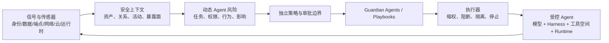

# 把高权限 Agent 当作“内部人”：Microsoft 的持续围控架构深读

> **原文**：[Securing the agentic insider](https://blogs.microsoft.com/blog/2026/10/19/securing-the-agentic-insider/)（Microsoft，2026-10-19）  
> **类别**：AI 安全 / AI for Security　**类型**：官方技术博客　**阅读定位**：架构与产品方向说明，不是同行评审论文

## TL;DR

- Microsoft 将企业中能访问数据、工具、系统并能执行关键流程的 Agent 重新界定为“Agentic insider（Agent 内部人）”。论点不是模型天生恶意，而是其输出、上下文和计划会变化；一旦配上常驻权限，错误、被操纵或被攻破都会成为内部风险。
- 文章把防护拆成独立于模型的闭环：跨 identity、data、endpoint、network、cloud、runtime 的传感信号进入上下文，计算随时间更新的 Dynamic Agent Risk；外部的策略与 Guardian Agents 再按风险收缩、批准或隔离动作。
- 关键机制不是给模型加一条“请安全行动”的提示，而是给每个 Agent 独立身份、任务限定且可撤销的权限、受控运行时与可审计的执行面。其控制原则可概括为：模型提供智能，模型之外的系统保留授权权。
- 10 月 19 日配套的 Microsoft Security 文章提供了更具体的工程材料：已声明可发现 **60** 种本地 Agent（新增 **35** 种），并给出费用审批 Agent 遭遇提示注入后“保留读、撤销写、缩窄资源、请求可证明人工批准、最终隔离/停止”的分级例子。
- 但这里没有准确率、攻击成功率、误报率、延迟、成本、红队覆盖率或同基线对照；“可实时监督”“更准确风险”“数十万 Agent”的表述是厂商架构主张或部署叙述，不能读成已由公开实验验证的安全收益。
- 对研究者，真正值得追问的是：动态风险函数怎样校准、外部控制器如何避免被同一上下文投毒、何时升级到人工批准，以及在无法读取完整推理轨迹时如何仍然做可验证的意图漂移检测。

## 这篇文章真正要纠正什么问题？

### 从“外部攻击者”转向“已获授权的行动主体”

文章的起点不是传统入侵者，而是组织自己部署的 Agent。它们往往同时具备下列能力：

1. 能读企业资料、凭据或工单；
2. 能调用 API、MCP 服务、脚本和其他 Agent；
3. 能在运行时随新文档、工具回包、用户对话改变计划；
4. 能以机器速度连续工作，因而比人工账号更快放大一次错误决定。

这一步重述很重要。若风险只被看成“坏人攻破模型”，安全团队会把注意力放在模型供应链或输入过滤；若风险被看成“拥有行动权的非确定性执行者”，身份、授权、执行容器、网络路径和写操作都变成防线。文章因此明确反对让模型自己担任自己的安全裁判。

### 作者的论证顺序

| 原文推进 | 它要建立的判断 | 需要的安全对象 |
| --- | --- | --- |
| Agent 有数据、工具和关键流程权限 | 不能因“由本组织部署”而默认可信 | Agent 资产发现与归属 |
| 上下文会变、输出不确定 | 初始许可不等于整个任务期间仍安全 | 连续观测和风险重算 |
| 人工无法逐条跟上机器速度动作 | 仅靠告警队列不会形成及时控制 | 自动化、可撤销的执行控制 |
| 控制不能由被控制模型实现 | 模型遭操纵时仍应无法扩大权力 | 独立身份、策略、容器与审计面 |

这里是博客最强的概念贡献：它不承诺先把智能变得完全可预测，而是假设智能可能失败，再把失败的可达范围做小。该假设比“通过更好提示词解决风险”更接近传统的纵深防御。

## Project Perception：六层栈如何被改写为 Agent 围控

Microsoft 在 7 月提出 Project Perception 的新 cyber stack：Signals and sensors、Context、Models、Harness、Agents、Actuators。10 月文章将同一栈转用于“管理企业内部 Agent”。两篇文章合起来，能还原如下数据流。



### 1. Sensors / Signals / Actuators：把“看见”接到“能控制”

原文列出的信号层跨越 identity、data、cloud、endpoint、network 与 runtime。文章要求系统先发现 Agent，再给它分配 **identity、container、policy 和 permissions**。这避免把“发现某进程”误当作“已经能追责并约束它”：只有持久身份才可成为授权、生命周期、审计和策略的锚点。

安全博客进一步说明，发现来源可以是原生集成、连接器和传感器；其当前说法是新增 35 种本地 Agent 后，合计支持 60 种，其中列举 Claude Code、OpenAI Codex、GitHub Copilot。该数字证明的是厂商声明的发现覆盖清单，**不**证明每一类 Agent 都获得同等质量的行为理解或防护。

执行器则是这套设计的分水岭。7 月文章强调安全系统不应只产出告警；它需要把洞见变成行动。对 Agent 内部人而言，执行器可落在权限、数据范围、网络路径、容器状态及人工审批上。没有执行器，风险评分再精细也只是一张仪表盘。

### 2. Context：从原始遥测到可决策的任务语义

Microsoft 将 Context 描述为把安全数据、威胁情报与组织语义连接起来的近实时表征。其目标是让 Agent 不必每次从原始日志重建资产关系、身份图、暴露面和活动历史。

对内部人控制，这一层还有更苛刻的要求：风险不是“这个模型危险吗”的静态属性，而是“此 Agent 在此任务、此资源、此时间点、此输入来源下，能否继续拥有当前权力”。因此上下文至少应包含：

- Agent 的所有者、任务目的、生命周期与当前容器；
- 工具调用、目标资源、读写方向和数据敏感性；
- 调用链中是否出现不可信内容、异常网络目的地或新 MCP 服务；
- 当前权限是否仍小于等于委托人权限，且是否仍为任务所必需。

文章没有公布 Context 的数据模式、保留期、延迟或缺失值处理。它的“token-efficient”叙述是架构意图，不应外推为公开证明的成本结论。

### 3. Models、Harness 与 Guardian Agents：智能可以参与，但不能成为边界

文中将 Agent 分为模型、编排工作的 harness、工具与资源组成的 action space、以及 runtime。10 月版本主张 Guardian Agents 以 green 与 blue Agent 组成团队，持续监督每一个 Agent 的每一个动作；7 月版本补充了 red/blue/green 分工：红队寻找可被利用的路径，蓝队调查并判断有意义的风险，绿队修复和强化防线。

这一拆分的价值在于职责分离：被观察的业务 Agent 不应同时决定自己的风险和权限；Guardian 也不应直接获得无边界修复权。人定义 policy、approval boundary 与 delegation rule，Playbook 定义预期安全结果，Guardian 才在既定边界内解释证据、建议或执行围控。

## 用一个可审计的风险函数理解“动态”

文章没有给出公式。为了说明其机制，可把其文字主张抽象成一个**解释模型，不是 Microsoft 已发布实现**：

\[
R_t = \sigma(w_i I_t + w_p P_t + w_d D_t + w_b B_t + w_u U_t + w_c C_t)
\]

| 符号 | 可对应的观测量 | 为什么影响风险 |
| --- | --- | --- |
| \(I_t\) | 身份可信度、所有者、生命周期状态 | 未归属或过期身份难以问责 |
| \(P_t\) | 当前有效权限、是否超出任务 | 过宽或常驻授权放大后果 |
| \(D_t\) | 数据敏感性、写入目标 | 读公开资料与改账本并非同一风险 |
| \(B_t\) | 行为/意图漂移、异常工具序列 | 新输入可能把计划推离原任务 |
| \(U_t\) | 不可信内容、提示注入或来源不明工具 | 外部内容可能影响后续行动 |
| \(C_t\) | 容器、网络、端点和云配置 | 脱离执行边界会增大横向移动面 |

其中 \(\sigma\) 可理解为把分数映射到 0–1 的校准函数。真正困难的不是写出加权式，而是获得经验证的权重、阈值和不确定度。若提示注入告警本身高误报，盲目提高 \(U_t\) 会让大量正常任务被卡住；若只依赖已知恶意模式，\(B_t\) 又可能漏掉新型漂移。

风险到动作可用分级策略而不是二元“允许/禁止”表达：

\[
\pi(R_t)=
\begin{cases}
\text{正常执行，持续记录} & R_t < \tau_1\\
\text{缩窄工具与数据范围} & \tau_1 \le R_t < \tau_2\\
\text{保留读、阻断写，要求人工批准} & \tau_2 \le R_t < \tau_3\\
\text{隔离 runtime 或停止执行} & R_t \ge \tau_3
\end{cases}
\]

这与原文的 Dynamic Conditional Access 描述一致：动作应当 gradu­ated，而非只能全杀或全放。公式也暴露了文章尚未回答的问题：\(\tau_1,\tau_2,\tau_3\) 如何按业务损害、延迟和误阻断成本校准？

## 原文最具体的链路：费用审批 Agent 遇到提示注入

Microsoft Security 的配套文章给出一个相对完整的叙事例。费用审批 Agent 本来只需读取提交、核对政策、批准例行报销；它不应继承其发起员工的全部权限。后来它读到不可信内容，并试图做无关动作。此时并非等到“模型被证明恶意”才处理，而是新证据提高 Dynamic Agent Risk。

```text
Input: task、agent identity、time-bound permissions、runtime telemetry
State: risk score R, policy boundary B, immutable action log L
for each proposed action a:
    collect identity/data/network/runtime/tool evidence e
    R <- assess(task, a, e, B)
    if a exceeds task scope or R >= high:
        block write; preserve permitted reads; request verifiable human approval
    else if R >= critical:
        revoke short-lived grants; isolate runtime; stop execution
    else:
        allow the least-privileged action
    append (a, e, R, decision) to L
Output: bounded action outcome + traceable rationale
Failure boundary: contaminated evidence or a compromised policy plane must trigger independent fallback, not self-approval
```

伪代码中的 `assess`、审批证明格式、日志不可篡改性均是工程空白，不是原文已经公开的协议。不过它忠实表达了文章的控制逻辑：风险变化应改变权力，而不是只增加一条事后告警。

## 哪些机制有直接证据，哪些仍是承诺？

| 主张 | 文本中的直接材料 | 可以支持什么 | 不能支持什么 |
| --- | --- | --- | --- |
| Agent 应有独立身份 | Entra Agent ID 扩展到额外模式；身份承接归属、权限与策略 | 设计上可把 Agent 与委托人区分 | 无公开数据说明身份覆盖率或误归属率 |
| 权限应按任务收缩 | Dynamic Permissions：组织策略设外边界，授权可任务化、限时和撤销 | 最小权限与可撤销授权是明确产品方向 | 无最小权限策略的可用性/延迟评估 |
| 风险应连续更新 | Dynamic Agent Risk 汇集身份、数据、端点、云、网络、runtime、活动 | 风险输入维度与非一次性评分原则 | 无特征、模型、阈值、校准或检出指标 |
| 回应应渐进而非二元 | 可撤写、缩资源、限制网络、缩短授权、审批、隔离、停止 | 动作空间比单一 kill switch 丰富 | 无法比较每档动作的安全与业务损失 |
| Guardian 可规模化监督 | Playbook 与 Guardian 的分工、人保留目标和关键决定 | 自动化控制应受人设边界约束 | 无公开负载、并发、故障恢复或跨租户实验 |
| 模型透明度可加强围控 | 文章提到 CoT 等模型级信号可作为证据 | 更丰富的证据可能辅助风险判断 | 不等于应暴露原始 CoT，也未证明其可靠性或隐私处理 |

尤其要避免把 7 月文章中的 **96% CyberGym any-crash** 与本文的 Agent 内部人防护混在一起。该数字是 MDASH 与 MAI-Cyber-1-Flash 在特定漏洞场景的 any-crash 指标，不能迁移为 Guardian Agents 对提示注入、越权或数据泄露的防护成功率。

## 设计细读：四个持续责任而非四个产品

配套文章用 Know、Contain、Protect、Adapt 概括系统责任，并强调它们并不是串行阶段。

### Know：资产清单必须走到“谁负责、为什么存在”

发现只回答 Agent 是否存在；独立身份才可把所有者、任务、生命周期、权限和操作记录连起来。对安全研究而言，这对应 agent inventory 的完整性问题：影子 Agent、SDK 嵌入 Agent、临时本地 Agent 都会让“未知即未治理”。

### Contain：运行时与行动空间都要有门

文章提出将模型和 harness 放进受控环境，例如 Microsoft Execution Container，使控制点在 Agent 难以触及的位置运行。同时，行动空间不能是“发现任意 MCP、API、资源或其他 Agent 即可调用”。目的地控制也不够：系统还要理解进出 Agent 的内容敏感度、来源以及不可信数据是否正在影响其行为。

这是对提示注入治理的重要补充。仅做输入过滤会漏掉工具返回、网页、附件和其他 Agent 的间接注入；仅做网络 allowlist 又看不到敏感数据是否被写入错误位置。文章要求把路径与内容一起放入 policy plane。

### Protect：从零权限开始，而不是继承员工账号

“员工保留员工权限；Agent 获得自己的、仅对当前任务和持续时间有效的权限”是全文最清楚的授权语句。它把 Delegation 从身份冒用变成可过期的能力授予。高影响动作则可要求可验证的人类批准，避免 Guardian 或业务 Agent 自行突破后果很高的边界。

### Adapt：变化的是风险与权限，而不只是标签

适配层的本质是把行为漂移翻译为授权变化。对于正常审批任务，保留阅读而撤销写入可在不中断调查的同时减少不可逆损失；对于持续升高风险，隔离容器或停止运行才成为最终选项。这是比“检测到注入就杀死 Agent”更细颗粒度的安全目标，但代价是策略冲突、恢复流程和可解释性都更难。

## 可复现性、失败面与尚未披露的实验

这是一篇官方产品/架构博客，不能套用论文式“实验设置—主结果—消融”。更准确的证据清单如下：

- **有的**：10 月 19 日官方发布日期；信号层与控制层的文字架构；60 种本地 Agent 的厂商支持数量；费用 Agent 的分级围控案例；7 月 Project Perception 栈的更完整说明。
- **没有的**：公开数据集、攻击轨迹、模型版本、训练方法、风险分类器、规则语言、基线系统、测试协议、误报/漏报、P95 决策延迟、权限撤销传播时延、成本或人工审批负担。
- **未解决的失败面**：风险输入可能遭日志投毒；Guardian 可能误解业务语义；控制面配置错误可能导致全局停摆；为了“模型透明度”采集过多中间推理也可能造成隐私、保密与新的攻击面。
- **隐含依赖**：外部 policy plane、身份服务、容器边界和审计日志自身必须更可信；否则“把授权移出模型”只是把单点风险移到另一处。

因此，不能据此宣称该方案已在真实企业中降低了多少提示注入或越权事故。文章最后提及 Microsoft 作为 Customer Zero 已运行在“数十万 Agent”的世界；这是一段经验主张，没有相应公开遥测或第三方审计，适合作为后续索取材料的线索，而不是量化结论。

## 放进 AI 安全研究版图：它改变了哪一个问题？

这篇文章最有价值的转向，是将 Agent 安全的评价对象从“模型是否对齐”扩展成“即使模型未完全对齐，系统是否仍能限制损害”。它与能力安全、零信任、reference monitor 和纵深防御相邻，但针对 Agent 增加了三项动态性：上下文会变、工具链会扩张、执行速度很快。

后续值得被严格验证的研究问题包括：

1. **风险校准**：相同风险档在不同 Agent、行业和任务上是否意味着相同的真实损害概率？能否报告 calibration curve、误报/漏报与干预成本？
2. **独立性**：风险模型、Guardian、日志和执行器若共享同一模型供应商、上下文存储或权限服务，独立控制还能剩多少？
3. **意图证据**：在不保存或暴露私密 CoT 的前提下，能否用工具调用计划、数据流 provenance、任务契约和结果验证检测漂移？
4. **人机交接**：什么风险阈值应触发人工批准？批准者能否获得足够但不过载的证据，并对错误批准形成追责链？
5. **对抗评测**：应在多跳提示注入、代理间串谋、权限升级、审计日志投毒、网络侧绕行与控制面故障中比较该架构与静态 RBAC、单点内容过滤、人工审批队列的差异。

## 如果把它落实为评测，最小实验应怎样设计？

博客没有实验，因此不能替作者补造结果；但其主张足够具体，可以反推出应被检验的实验单元。一个可复现实验不应只让 Agent 在干净任务上跑通，而应把同一业务任务置于普通条件和受干扰条件下，并将“业务完成率”与“有害动作被约束的比例”同时报告。

| 评测轴 | 需要固定的变量 | 对照组 | 应报告的结果 |
| --- | --- | --- |
| 权限继承 | 同一员工权限、同一任务、相同工具 | 继承员工常驻权限 vs. 每任务 capability | 过度授权资源数、任务成功率、撤权后恢复率 |
| 内容注入 | 外部文档或工具回包的恶意指令位置与强度 | 输入过滤、静态 RBAC、动态围控 | 越权写入率、误阻断率、检出到执行器动作的延迟 |
| 行为漂移 | 任务中途改目标、引入新 MCP 或资源 | 无行为模型、只看目的地、全量人工审批 | 漂移检出率、人工升级次数、正常任务受损比例 |
| 控制面鲁棒性 | 日志缺失、风险服务超时、策略下发失败 | fail-open vs. fail-closed vs. 降级只读 | 可用性、损害上界、审计完整度 |
| 多 Agent 协作 | 委托链长度、互相工具调用、权限组合 | 单 Agent policy vs. 链路级 policy | 权限放大率、跨 Agent 横向移动成功率 |

其中最容易被忽略的是负例：一个好的 Guardian 系统不能只在显然恶意的提示上表现良好。它还要处理财务季末的高频合法审批、工程事故中的紧急变更、跨地域合规数据访问等“看起来风险高但业务上合理”的任务。否则动态风险只是在把罕见攻击转写成日常摩擦。

### 一个分层指标框架

可将效果分为四层，避免一个单指标掩盖控制失败：

1. **感知层**：已登记 Agent 发现率、身份绑定正确率、遥测缺口率；它回答系统是否真的看见对象。
2. **判断层**：风险校准误差、漂移检出率、误报与漏报；它回答分数是否有可解释的统计含义。
3. **执行层**：从证据出现到撤销写权限/隔离的 P50、P95 时延，和执行器失败后的安全降级；它回答判断是否赶得上机器速度。
4. **后果层**：被阻止的越权动作、允许的正常任务、恢复时间、人工负荷与最终业务损害；它回答系统究竟是否比简单基线更好。

文章的“实时”一词只有在第三层被量化才有工程意义。若风险服务需要数分钟汇聚，而 Agent 可在秒内连续调用 API，则系统仍可能只能做到事后取证。反过来，若为了低延迟把所有不确定性都映射为阻断，第二和第四层会显示出高误阻断和低任务完成率。因此延迟、安全与可用性应共同作为 frontier，而不是分别挑选最好看的数字。

### 对控制平面的反向威胁建模

把授权移出模型并不会自动消除风险，它要求为控制平面写出更严厉的假设。至少应问：Guardian 的上下文是否能被恶意文档污染？策略更新是否有双人审批和可回滚版本？执行器是否拥有比业务 Agent 更广的、从而更危险的权限？审计日志的写入者能否修改自己刚刚的记录？

一个保守的工程原则是：当上下文、风险分类器或网络遥测不可用时，不让系统悄悄回到原有宽权限状态。可选择只允许低风险读操作、冻结新的短期 grant、要求人工确认，或在高损害操作上 fail closed；具体选择应由任务关键性决定，并在审计中留下“因证据缺失而降级”的原因。这个降级路径正是本文架构若要成熟，最需要公开和评测的部分。

结论是克制的：Microsoft 已提出一个结构清晰、可工程化的 Agent 围控蓝图，其中“独立身份 + 最小且可撤销权限 + 连续风险 + 外部执行控制”比单纯模型自约束更可操作。它尚不是安全效果的公开证明；要让这套蓝图从合理主张变成可比较的科学与工程结论，仍需要透明的风险定义、对抗基准、延迟/成本数据和独立审计。
