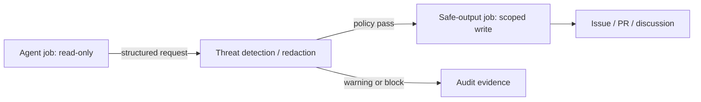

# gh-aw v0.92：把 Agent 工作流从“能跑”推向“可审计地运行”

## 元信息

| 项 | 内容 |
|---|---|
| 类别 | 大模型 Agent |
| 类型 | 官方工程周报／代码项目更新 |
| 原文 | [GitHub Agentic Workflows Weekly Update – October 19, 2026](https://github.github.com/gh-aw/blog/2026-10-19-weekly-update/) |
| 观察对象 | `github/gh-aw` v0.92.1–v0.92.5；周报日期为 2026-10-19，五个预发布实际落在 10 月 15–17 日 |
| 核心主题 | 结构化报告、子 Agent 可观测性、MCP 最小权限、发布前脱敏、日志调查与网络审计 |

## TL;DR

- GitHub 的 `gh-aw` 是把 Markdown 工作流编译为 GitHub Actions 的 Agentic Workflow 工具。本周周报汇总的 v0.92.1–v0.92.5 并非“模型能力升级”，而是将 Agent 运行的**证据链、权限边界和失败显性化**。
- v0.92.5 把生成 issue 的报告变为规范化 report AST，并加入 AW Markdown 与原生 Actions 两种 workflow AST；关键意义是让报告、检查和编译面向结构而非脆弱字符串，从而更可校验、可复现和可审计。
- 子 Agent 失败、模型不可用，以及缺少 `agentId` 的子 Agent 会话现在被 `audit`／`logs` 识别。它纠正了“父工作流 green 就代表委派任务成功”的危险代理指标。
- MCP 编译默认只读，只有显式启用 write tools 才允许工作流写入；再配合检测产物、CLI proxy 启动诊断在发布与上传前脱敏，形成“能力默认收紧、输出离开边界前再过滤”的两层控制。
- `daily-firewall-report` 的 3 次示例运行各耗时 **10–27 分钟**，合计记录 **81** 个请求，均允许、**0** 个被阻断；但三次又都停在 MCP Gateway 启动步骤。因此 0 blocked 只能说明记录到的请求没触发策略，**不能**证明工作流端到端健康、也不能证明没有未观测到的网络访问。
- 局限在于：这是项目方的官方周报与工程变更，不是受控实验；81 个请求和三次运行不足以估计真实攻击拦截率、误杀率或跨仓库可靠性。周报把五个预发布聚合到 10 月 19 日，发布时间也须与各 release 的实际日期区分。

## 这篇周报真正解决的是什么问题？

Agent 工作流的风险并不只在“模型会不会写错代码”。当一个工作流可调用工具、委派子 Agent、读取日志、生成 issue 或 PR 时，维护者同时面对四类不确定性：

1. **执行语义不透明**：自然语言工作流、编译后的 YAML 和最终执行行为可能偏离；仅检查文本很难覆盖导入、默认项和跨 job 数据流。
2. **成功信号过粗**：顶层 job 成功不能推出每个子 Agent 成功，更不能推出其结果被正确恢复、汇入或审阅。
3. **权限随便利扩张**：编译器或 MCP 工具若默认可写，一次错误调用或提示注入就可能把“生成配置”升级成“改动仓库”。
4. **观测本身泄密**：日志、检测输出、代理启动诊断通常最有助排障，却也最可能把 token、端点或敏感上下文带进 artifact 与公开讨论。

因此这组更新的主张可压缩成一条链：

> **不要把 Agent 的最终自然语言回答或单个 GitHub Actions 结论当作审计对象；应审计有类型的工作流、带身份的委派事件、最小权限的工具调用，以及经脱敏的发布产物。**

这不是凭周报口号推断。原文依次给出 report／workflow AST、子 Agent 异常可见性、MCP 只读默认、redaction、日志故障聚类和实际 firewall reporter 运行记录；它们分别对应上述链条的不同断点。

## 从“文本拼接”到结构化 AST：为什么这是安全改动？

### 报告的 AST 不只是排版升级

v0.92.5 的首项是“generated issues 使用 normalized report AST”，并增加 Actions-native 与 AW Markdown workflow AST。AST（抽象语法树）把原先可能混杂在 Markdown、YAML 或字符串模板里的结构拆为显式节点。直观地说，`标题—结论—证据—建议` 不再只是一段可任意插入的文本，而可被当作带字段、层级和约束的数据结构处理。

可将处理过程抽象为：

$$
R = \operatorname{render}(\operatorname{validate}(\operatorname{normalize}(x)))
$$

其中：

- $x$ 是 Agent 或工具产生的原始报告片段；
- `normalize` 把不同来源规约为同一 report AST；
- `validate` 可检查必填节点、允许的链接或输出类型；
- `render` 才把已验证结构渲染为 issue／Markdown。

重要的不是公式本身，而是验证的位置发生了变化：若只在最终 Markdown 上做关键词匹配，结构被拼接、转义或换行后很容易漏检；若在 AST 上限制节点和属性，检查可在输出副作用之前进行。

### 两种 workflow AST 让检查对准两个真实层面

周报说新增的是 **Actions-native AST** 和 **AW Markdown workflow AST**。项目文档进一步区分：AW source AST 表示作者写下的工作流源，而 Actions execution AST 表示编译后实际执行的原生工作流。它们不可互相替代：

| 层 | 回答的问题 | 仅检查这一层的缺口 |
|---|---|---|
| AW Markdown AST | 作者声明了哪些指令、frontmatter、导入意图？ | 看不到编译展开、默认注入和真实跨 job 执行 |
| Actions AST | runner 最终会执行哪些 job、权限与步骤？ | 很难回溯作者意图或源级可读性 |
| Report AST | 自动化准备对外说什么、写什么？ | 不证明执行过程真的正确 |

这解释了为什么更新同时出现三类 AST。它们分别覆盖“作者意图”“执行计划”“对外陈述”，合在一起才接近可审计工作流的最小闭环。仍需强调：AST 能减少**表示层**歧义，不能自动验证模型结论为真，也不能替代运行时策略。

## 子 Agent 可观测性：修复被绿色状态掩盖的失败

### 父任务成功不是委派成功

v0.92.5 让 sub-agent failures 可见，诊断 unavailable models，并使 `audit`／`logs` 能处理没有 `agentId` 的子 Agent instance。这个改动正对多 Agent 系统最常见的统计误区：把工作流最终结论 $W$ 当成每个委派任务 $A_i$ 成功的充分条件。

实际上：

$$
W=\text{success} \not\Rightarrow \bigwedge_{i=1}^{n} A_i=\text{success}
$$

可能发生的路径包括：子 Agent 超时但父 Agent 用旧缓存继续；某模型路由不可用却被降级；子任务返回错误而上层仍生成了 issue。项目现有审计实现明确把“父工作流完成、但若干子 Agent invocation 失败”标成需复核的 finding，而非静默吞掉。

### 缺少 `agentId` 为什么会破坏取证？

日志系统依赖身份把事件归属到调用实例。若一个 `subagent.started`／`completed` 事件没有顶层 `agentId`，简单按名称聚合会造成两类错误：

- 多个同名子 Agent 的 token、工具调用和失败被错误合并；
- 完成事件找不到开始事件，进而把成本、时长或异常误归因于父任务。

可把正确关联理解为一个尽量一对一的映射：

$$
f: \text{lifecycle event} \rightarrow (\text{invocation},\ \text{parent},\ \text{model})
$$

当 `agentId` 缺失时，v0.92.5 的目标不是假装身份完整，而是让 `audit`／`logs` 仍能处理该实例并暴露不确定性。对于高风险写操作，这一原则尤其重要：不应因“无法正确归因”就默认无事发生。

### 日志聚类把排障从逐条浏览变为待验证假设

v0.92.1–v0.92.2 为 `logs` 增加自动 failure clustering 与 investigation plans，`health` 也支持与 logs 相同的日期窗口。可以将其看为：

```text
Input: run logs within [t0, t1], sub-agent events, terminal failures
State: clusters keyed by failure signature and affected workflow revision
for each failed event:
  normalize error + execution context
  attach to an existing compatible cluster, or create a new one
for each cluster:
  output evidence links, recurrence, impacted runs, investigation plan
Output: prioritized hypotheses, not an automatically proven root cause
```

这里“not a proven root cause”是边界。聚类能降低人类在重复错误之间切换的成本，却可能把不同根因的相似报错合并，也可能将同一根因因错误消息变化而拆散。它适合作为调查排序器，不应成为自动修复或自动合并的唯一触发器。

## 最小权限：MCP 编译默认只读，写操作必须显式打开

### 默认拒绝改变了风险基线

周报中最直接的安全硬化是：MCP compile 在未启用 write tools 时为只读。其含义不是 MCP 永远不能写，而是把“写”从隐式能力改成显式配置。令 $C$ 表示编译请求，$P_w$ 表示写权限已被可信操作者显式授予，则期望策略是：

$$
\operatorname{canWrite}(C)=P_w \land \operatorname{toolAllowed}(C) \land \operatorname{policyPass}(C)
$$

而不是“只要发起 compile 就可写”。这会增加少量配置摩擦，却使错误工具调用、未经审阅的客户端和提示注入更难跨越编译边界。

### 这与 safe outputs 如何配合？

项目的 safe outputs 文档给出另一层分离：Agent 部分以只读权限运行，通过结构化请求提出创建 issue、PR 或评论；独立的、受权限控制的 job 执行这些请求。默认 `create-issue` 的上限为 1，且可用 `create-issue: false` 显式关闭——这正是 v0.92.3–v0.92.4 周报提到的 opt-out。



注意图中的 `policy pass` 不是“模型说没问题”。项目文档称 safe outputs 旨在提供 least privilege、prompt-injection 防护、可审计性和每项操作的限额；这降低了 Agent 直接写入的爆炸半径，但目标仓库、批准规则、token 范围和输出 schema 仍必须由维护者配置。

## 发布前脱敏：观测不能反过来成为泄露通道

v0.92.5 还在检测输出、CLI proxy startup diagnostics 的发布和 artifact upload 之前加入 redaction。工程意义在于把“日志是内部的”这类假设改为明确数据流控制：一旦 artifact 可下载、issue 可见或报告被转载，诊断内容就是外部边界的一部分。

项目的 threat-detection 文档说明，检测 job 会分析 prompt injection、secret leak 与恶意 patch；在收集 firewall log 后、渲染／发布之前执行清理，且第二次 redaction 覆盖新生成的 usage 文件。它还明确提醒：Actions 控制台 masking 并不会自动清理可下载 artifact 内容。

因此更准确的流水线不是“收集 → 直接上传”，而是：

1. 收集运行输出、网络与检测数据；
2. 将内容视为不可信输入，而非后续 Agent 的指令；
3. 执行检测与脱敏；
4. 若所需清理失败，在活跃检测运行中阻止发布；
5. 只让通过流程的、可追溯产物进入日志页面、artifact 或 safe output。

边界同样清楚：redaction 是最后防线，不应成为把广泛 secret 暴露给 Agent 或日志的理由；正则与已知模式也不保证识别所有敏感业务数据。

## `daily-firewall-report`：一个有价值、也有反例价值的运行样本

### 它设计成怎样的网络审计 Agent？

周报挑选的 “Agent of the Week” 并非泛泛介绍。工作流配置显示它运行在 Copilot engine、默认只读的 `contents/actions/issues/pull-requests/discussions/security-events` 权限下，配置 `safe-outputs.create-discussion`，并设置 45 分钟 timeout。它读取预抓取的过去 24 小时 `run_summary.json`，只选取含 `firewall_analysis` 的运行；没有数据就提前退出，避免生成空讨论。

它的报告目标包括总请求数、allowed／blocked、block rate、阻断域名排行、按 workflow 的详细模式和安全建议。关键指标为：

$$
\text{block rate}=\frac{\text{firewall\_requests\_blocked}}{\text{firewall\_requests\_total}}\times100\%
$$

这个指标只能在“采集覆盖完整、分类正确、请求确实经过 firewall”的前提下解释；否则分母仅是可见流量，而非 Agent 的全部网络行为。

### 81 个允许请求为什么不是成功证明？

周报给出三次 10 月 6–8 日凌晨运行：每次 10–27 分钟，共 81 请求，所有请求允许、0 blocked，目的地分布于 `api.githubcopilot.com`、Sentry、Grafana ingest。按表面统计，block rate 为 $0/81=0\%$。但同一段文字紧接着给出关键失败：三次运行都停在 MCP Gateway start step。

| 观测 | 可以支持的结论 | 不能支持的结论 |
|---|---|---|
| 81 requests，0 blocked | 被记录的 81 次访问未触发当时策略 | 网络策略完整、安全或没有未知域名 |
| 10–27 分钟运行 | 该路径存在分钟级运行开销 | 工作流完成了全部预期报告步骤 |
| MCP Gateway 启动停止 | 启动链是端到端可靠性风险点 | firewall 收集、分析、发布都成功 |

这正是此案例比“全绿 demo”更有研究价值之处：一份网络 watchdog 可以忠实报告没有阻断，而自身仍未越过工具网关的启动边界。健康度必须至少同时报告**策略结果**与**执行完整性**。

## 证据表：主张、机制、证据、边界

| 主张 | 机制／原文证据 | 适用边界 |
|---|---|---|
| 输出更可验证 | normalized report AST；AW 与 Actions workflow AST | 结构正确不等于事实正确或运行安全 |
| 委派失败不再被顶层 green 掩盖 | sub-agent failure、unavailable model、无 `agentId` instance 的 audit/logs 支持 | 仍依赖日志完整性与关联规则 |
| 编译面收紧默认权限 | MCP compile 默认只读；写工具需显式启用 | 显式允许后仍需审查工具范围和调用者 |
| 观测产物更安全 | detection/proxy diagnostics 发布、上传前 redaction | 脱敏无法保证覆盖未知敏感模式 |
| 日志更利于调查 | failure clustering 与 investigation plans | 聚类是待检验假设，不是根因裁决 |
| firewall 可带来运行证据 | 3 次、10–27 分钟、81 allowed、0 blocked | 三次都在 MCP Gateway start 停止，不能推出端到端成功 |

## 研究者视角：下一步该问什么？

- **把可观测性纳入 Agent benchmark**：现有 Agent 评测常统计任务成功率、token 或成本；对于可部署工作流，更应报告子 Agent 完成率、未归因事件率、失败聚类精度、从异常到人工可行动证据的延迟。
- **比较“默认只读”带来的可用性代价**：需要实验测量显式 write-tool 配置是否减少误写，以及是否让合法自动化因配置摩擦而失败。安全机制的价值应由攻击面下降与操作失败共同衡量。
- **测试 redaction 的对抗鲁棒性**：应构造多编码、分片、上下文拼接和非 token 型敏感数据，测量 artifact／issue 途径的漏检率；只对常见密钥格式有效的测试并不足够。
- **将 firewall 完整性与策略效果拆分**：报告至少应有 `collection_coverage`、`gateway_start_success`、`policy_decision_count`、`report_publish_success` 四个字段。否则 0 blocked 很容易被误读为“没有风险”。
- **审计 AST 版本演化**：当 source AST、compiled Actions AST 与 report AST 同时存在时，应记录它们的版本、编译 hash 与关联 run ID，才能回答“这份对外报告究竟来自哪一版声明、哪一版执行计划”。

## 结论与局限

这篇 10 月 19 日周报最值得带走的不是某个 CLI 参数，而是一种工程判断：Agentic workflow 的可信度取决于**可解释的结构、可归因的委派、默认收紧的能力、以及可安全发布的证据**。v0.92 的多项更新正把这些条件从分散的最佳实践推进到工具默认行为。

不过，它仍是官方变更汇总而非独立实验：没有给出 prompt-injection 拦截率、脱敏召回率、AST 检查误报率或多仓库部署样本；firewall 案例也只有三次，并且暴露了 MCP Gateway 启动失败。因而最稳妥的结论是：该版本加强了构建可审计 Agent 工作流的机制与失败可见性，**尚不能**据此断言其在生产环境已经实现全面安全或高可靠性。
