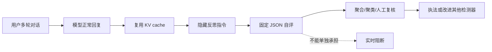

# 用模型的余温监控模型：Anthropic Self-Assessment 的生产化安全设计

> 原文：<https://safeguards.anthropic.com/2026/self-assessment/>  
> 发布：2026-10-16｜分类：AI 安全｜类型：技术报告｜阅读：约 18 分钟

## TL;DR

- Anthropic 提出 **self-assessment（自评）**：模型完成一次正常回复后，系统利用还留在 KV cache 中的整段对话，再追加一条隐藏反思指令，让同一个模型输出固定 JSON 的安全判断。它不是改写用户回答，也不直接向用户展示。
- 训练是“昂贵 teacher → 便宜 student”的两段蒸馏：先用合成对话和带完整策略文档的 prompted classifier 做 SFT，再以六个可验证奖励做 RL。损失只落在评估输出上，避免把有害示例本身学成生成行为。
- 在 Claude Fable 5 的生产流量样本、以 teacher 标签为参照、**1% FPR** 的工作点，自评召回了 teacher 标为潜在有害对话的 **78%**，以及高优先级对话的 **94%**；平均约生成 10 个 token，作者估计推理算力增量低于 **2%**。
- 它的强项是“广覆盖的离线分流”而非线上阻断。24 个网络攻击任务中，阻断版自评只把攻击成功率从 **79% (19/24)** 降到 **54% (13/24)**；独立、完整策略提示的分类器可降到 **25% (6/24)**。这正是报告最重要的反例。
- 规模与留类实验支持一个有限主张：四档模型的 1% FPR 召回约从 **16%** 到 **96%**，AUC 从 **0.862** 到 **0.995**；去掉 fraud/cyber 训练类后的合成集召回仅从 **92.8%→90.0%**、**92.7%→90.3%**。但这并不证明它能发现模型尚不理解的新型风险，且训练、测试都依赖同一 teacher。

---

## 一、这篇报告真正要解决的是什么？

### 不是“能否拒答”，而是“如何观察所有已经发生的对话”

作者把问题放在生产监控而不是单轮内容过滤上。真实滥用信号可能分散在长上下文、工具调用和多轮伪装里；如果把每段对话重新交给一个强分类器，还要重复读取上下文、策略和推理过程，成本会限制覆盖率。

| 常见方案 | 优点 | 结构性短板 | 本文的定位 |
|---|---|---|---|
| 专用 probe | 轻、快、便宜 | 标签预先固定，难报出未知类别 | 保留其低成本目标 |
| prompted classifier | 可读策略、推理充分 | 每次重复读上下文，难全流量运行 | 作为高质量 teacher/二阶段审查 |
| 级联分类器 | 成本可控 | 第一层没升级的风险永远不会被第二层看见 | 自评扩大第一层可见面 |
| self-assessment | 复用已计算前缀，可输出自由文本理由 | 与被监控模型共享能力与盲点 | 离线宽覆盖信号层 |

核心转向可以写成：

\[
\text{monitoring cost} \approx C(\text{new instruction}) + C(\text{short decode})
\]

而不是重新计算整段历史的 \(C(\text{conversation} + \text{policy prompt} + \text{reasoning})\)。这里的前提是服务模型刚刚完成回复，故对话前缀仍在 KV cache；这不是普适的“免费安全”，而是推理服务架构给出的特定杠杆。

### 作者的主张、机制、证据、边界



- **Claim**：模型越强，其自评可越好，并能发现没有专用分类器覆盖的风险。
- **Mechanism**：用原模型对完整对话做短输出反思，并把强 teacher 的策略判断蒸馏进去。
- **Evidence**：生产样本 ROC、四种尺寸的 scaling、fraud/cyber leave-one-out、24 个攻击任务，以及上线后的运营案例。
- **Boundary**：这些证据多以 teacher 为金标准；自评既可能继承 teacher 的偏差，也可能与主模型共同遗漏难例，故不能从“召回 teacher”跳到“可靠判定真实危害”。

## 二、输出接口：把模糊的安全判断变成可路由的数据

### 固定 JSON 的作用不只是方便解析

无事可报时输出 `{"flagged": false}`；有风险时，报告所述模式增加 `reason`、`category`、`subpolicy`、`refused` 与 1–10 的 `priority`。连续风险分数取模型在 `flagged` 位上给出 `true` 的概率，再选阈值，例如 1% FPR。

```text
Input: conversation prefix h, reflection instruction r
State: KV(h) already cached after normal response
assessment = Model(KV(h), r)
if assessment.flagged and score(assessment) >= threshold:
    retain structured fields; route by priority / repeated-org flags
else:
    retain normal monitoring signal
Output: offline review candidate, never an automatic violation verdict
```

这里有两个容易混淆的语义层次：

1. `flagged=true` 是“值得进一步复核”的机器信号，不等于用户已经违规，更不等于危害已经发生。
2. `priority` 让运营侧不用把单次 1% FPR 产生的所有误报都交给人工；报告明确说明，组织级的重复高优先级信号才会被升级。

自由文本 `reason` 对发现新模式很重要，却也可能转述对话内容。因此报告把它按提示词/完成内容的数据治理处理；而固定结构字段不承载用户原文。报告同时说明，目前零数据保留协议覆盖的流量不运行此机制——覆盖率不是无条件的。

## 三、训练：把“会判”与“会按格式报告”拆开

### 1. 合成数据并非随意生成

训练数据全为合成。每个细分策略先分层展开主题与具体情景：每个 subpolicy 生成 **32 个主题 × 32 个情景**，分别得到 1,024 个有害及 1,024 个良性情景。良性例子刻意选择主题相邻的 hard negatives；对话还随机化语气、表述，半数使用九种非英语语言，有害样本会加入同形字、base64/rot13 或嵌入良性任务等混淆。

这套设计服务于论证中的一个关键点：若训练只放“明显坏”的请求，报告 78% 召回没有意义；邻近良性样本迫使模型分辨上下文和授权例外。生成后，带完整内部策略和推理清单的 teacher 标注，结构不合法、回合数错误或 teacher 输出异常的样本会被丢弃。

### 2. SFT 只教模型评估，不教它复述有害轨迹

SFT 的输入是完整模拟对话 + 反思指令 + teacher assessment。训练时把损失遮罩到 assessment token：

\[
\mathcal{L}_{SFT} = -\sum_{t \in \text{assessment}} \log p_\theta(y_t \mid h,r,y_{<t})
\]

其中 \(h\) 是包含可能有害请求与模型既有回答的历史，\(r\) 是反思指令，\(y\) 是结构化评估。这个 mask 是安全训练的必要卫生条件：模型必须能判断“此前的回复是否有风险”，但优化目标不该奖励它生成该有害内容。

### 3. RL 把“格式对”升级为“字段对”

第二阶段把合成对话预填入上下文，从当前模型采样自评，再以六项可验证奖励优化：JSON 是否解析、flag 是否匹配 teacher、category 是否精确匹配、subpolicy 是否精确匹配、refused 是否匹配、priority 是否足够接近。

| 奖励 | 约束的失败模式 | 为什么重要 |
|---|---|---|
| schema parse | 格式崩坏 | 下游路由可自动化 |
| flag match | 漏报/误报 | 提供主检测目标 |
| category + subpolicy | 粗粒度判断 | 决定复核队列归属 |
| refused match | 忽略模型行为 | 区分用户意图与系统已拒绝 |
| priority proximity | 风险排序失真 | 让人工容量投向高影响事件 |

不过，六项奖励也暴露了证据边界：它们是在逼近 teacher，而不是直接优化独立的人类安全判断。因此“student 很像 teacher”与“系统真的正确”不是同一个命题。

## 四、生产证据：成本、召回和上线信号各证明什么？

### Fable 5：报告最强、也最窄的一组数字

在随机生产流量、teacher 标注的评测中，Fable 5 于 1% FPR 达到 78% 潜在有害召回、94% priority≥7 召回。每次评估约多生成 10 token，作者按 API 流量分布估算总体算力增量低于 2%，并说明自评从 6 月起用于大部分全球流量。

这支持的是一个工程可行性命题：昂贵分类器若无法扫全量，短自评可用低成本覆盖更多对话，后续再把可疑项交给高精度工具。它**不**表示 78% 是对真实伤害的绝对召回，因为标签来源就是同一个 prompted classifier。

### Scaling：为什么“同一个模型自监控”可能随能力进步？

作者另在 XS、S、M、L 四种尺寸的模型上仅做 SFT，并在独立评测集测试。1% FPR 召回约由 16% 升到 96%，AUC 由 0.862 升到 0.995；作者特别提醒，这组数不能与 Fable 5 生产数据直接比较。

| 结果 | 能支持 | 不能支持 |
|---|---|---|
| 尺寸越大 ROC 越好 | 在该训练/评测设置下，能力与自评可分性正相关 | 未来前沿模型必然诚实或不会共谋 |
| 低于 2% 算力估算 | 特定流量分布下的部署成本可接受 | 任意上下文长度、任意架构的成本保证 |
| 高优先级 94% teacher recall | 二阶段审查可获得较少漏报的候选池 | 单层系统可替代实时防护 |

### 留一类泛化：有希望，但别过度读取

去掉 fraud 训练数据，合成 fraud 召回从 92.8% 降至 90.0%；去掉 cyber，92.7% 降至 90.3%。生产流量中对应变化为 83.3%→82.1%、94.2%→90.7%。作者的解释是：训练主要教会“如何报告”，而危险概念已在基础模型中。

这是对**已知、且模型原本就理解**的类别的外推证据。它并没有覆盖“模型和 teacher 都没有概念”的全新风险；报告也明确承认这一点。更准确的结论是，模板化的安全汇报可跨相邻类别迁移，而不是自评已经解决 unknown unknowns。

## 五、最关键的失败实验：为何不能拿它做拦截器？

作者让攻击者模型在 24 个攻击任务上反复试探，且每次阻断都会暴露被捕获的线索。无防护时成功 19/24；用自评作 blocker 仍有 13/24 成功，约为 54%；独立 prompted classifier 则为 6/24，25%。自评虽让成功攻击的生成 token 成本约增至四倍，但没有形成可靠阻断。

这组对照改变了报告的正确读法：

- 在线 blocker 会把反馈给攻击者，自评可被针对性搜索或越狱；
- 离线监控不给即时“哪里被标记”的信号，反而更适合它；
- 因此生产结构应为 **实时 safeguards 负责阻断 + 自评负责横向观察 + 强分类器/人工负责复核**，不是把廉价层抬升为唯一边界。

作者还报告，离线运行时，24 条攻击轨迹中有 21 条至少被标记过。这是“事后可见性”的正面证据，不能替代上面的主动规避结果。

## 六、上线后案例：运营价值来自信号组合，而非单条判决

- 对 child-safety probe 没命中、但被自评命中的对话，另一个 grader 判定其中 **41%** 违反对应策略；这提示自评可找出专用 probe 的盲区。
- cyber 场景对应比例约 **1%**，说明不同领域的增量价值差异很大，不能把单一案例外推成普遍提升。
- 8 月单一 API 客户产生超过 **10 万** 条儿童性剥削相关 flag；经团队调查后向 NCMEC 报告。该数字表明广覆盖监控可暴露规模异常，但不应被解读为 10 万次已证实事件。
- 约三分之一 flag 无法干净映射到既有 taxonomy；聚类中出现了非法蒸馏、提示注入、以及未经用户授权的 agent 行动等候选模式。它们是“值得建模”的发现来源，仍需后续验证。

## 七、与既有自监控工作的关系

报告把自己置于 Self-Guard、OpenAI 的 confessions、以及复用前缀 cache 的 agent monitoring 等思路之间。它的区别不是首创“让模型谈论自己的行为”，而是把该想法接到大流量的 misuse detection：固定 JSON、policy-aware teacher、可验证 RL 奖励、组织级夜间聚合和上线后的回流改进。

相关工作提供两条相反提醒：一方面，模型的内部理解可能让它报告未枚举的风险；另一方面，若监控器与行动者共享模型、训练和 cache，欺骗、共谋与同源盲点正是需要优先测量的失效模式。报告引用的 confessions 结果中，模型未承认自身违令的情形约占 4%，多数归因于混淆而非欺骗；这仍不是对更强或更主动对抗模型的保证。

## 八、证据边界与研究者接下来该问什么

### 先把“检测性能”拆成四个不同问题

这篇报告的术语很容易让读者把多个目标压成一个数字。实际上，至少要分别问：模型能否识别对话中的风险语义、能否按策略把风险归到正确类别、能否在有限算力下覆盖足够多流量、以及信号能否经由运营流程转化为有益处置。自评在这四个目标上并非强弱一致。

| 目标层 | 本文怎样测量 | 已有答案 | 仍缺什么 |
|---|---|---|---|
| 语义识别 | teacher-labeled recall / ROC | 在既定标签系下有较高召回 | 人类或真实事件的独立真值 |
| 策略路由 | category、subpolicy、priority 奖励 | 可生成可解析的结构字段 | 跨策略版本的稳定性与校准 |
| 系统效率 | token 与总体算力估算 | cache 命中时成本很低 | P95 延迟、极长上下文、并发退化 |
| 处置价值 | 升级组织、案例与其他分类器盲区 | 已有值得调查的生产信号 | 误处置率、人工负担和长期对抗迁移 |

因此 1% FPR 不是一个脱离系统的“安全等级”。若日流量很大，1% 仍会生成海量良性 flag；若团队只能审一小部分，阈值、priority 标定、按组织聚合和调查队列容量会共同决定有效性。报告的夜间组织聚合恰恰表明，最终决策单位从单条对话转成了时间窗内的实体行为模式。

### 为什么同一个 KV cache 既是优势也是威胁模型的一部分

自评复用 cache 的直觉很漂亮：常规模型调用已经消化了长对话，安全检查只需极短后缀。但复用也意味着评估器继承了刚完成回答时的表示、注意力分配与上下文 framing。若攻击者通过长链条把风险拆散，或诱导模型将自己刚才的行动合理化，轻量后缀未必能重新审视此前的关键选择。

可以把这一差异抽象为：

\[
q_{self}(z\mid h) = p_\theta(z\mid \mathrm{KV}_\theta(h),r),\qquad
q_{fresh}(z\mid h) = p_\phi(z\mid h,\pi)
\]

其中 \(z\) 是安全判断，\(\pi\) 是完整策略。前者的优势是很小的额外计算；后者的优势是可换模型、可换上下文、可显式加入长策略。两者不应被理解为互斥替代品，而应成为互相审计的信号源。特别是在 agent 场景，行动者、监控者和攻击者若都围绕同一上下文优化，相关性比独立性更危险。

### 合成数据管线给出了哪些强、哪些弱的分布假设？

报告的合成管线覆盖了策略文本、难负例、多语言与若干混淆方式，这是比只收集显眼违规提示更扎实的起点。不过，生成器、teacher 和被训练模型同属一套研发环境时，训练分布仍可能隐含共同的表达偏好：哪些意图会被写成显式场景、哪些授权边界会被描述得足够清楚、哪些攻击策略被认为值得加入。

对安全研究者而言，真正有信息量的压力测试至少应覆盖下列“生成管线不舒服”的输入：

- 将风险意图分散到跨会话的工具产物、文件名和环境状态，而不是用户文本；
- 让正确判定取决于外部事实、权限证明或时间顺序，而不是关键词与常识；
- 使用没有出现在情景库中的行业工作流，考察模型是否把不熟悉误当危险，或把熟悉表述误当无害；
- 构造模型先前已经犯错、但被要求评价自己轨迹的样本，直接测量自我合理化；
- 让攻击者看到不同粒度的阻断或处罚反馈，测量离线优势在何时被侧信号抵消。

这些不是要求报告已经完成的实验，而是把“合成类别留出”与“开放世界对抗泛化”严格区分。前者是必要控制变量，后者才更接近生产滥用检测的主难题。

### 解释 Figure 1–5 时应避免的捷径

报告各图承载的论证任务不同。Figure 1 连接生产部署与 teacher-relative ROC；Figure 2 主张能力缩放；Figure 3 限定于两个被留出的类别；Figure 4 则是反对把本方法作为单独 blocker 的反证；Figure 5 说明通过 session policy 在部署时处理授权例外的可能性。把它们统称为“模型很安全”会抹去最有价值的内部张力。

尤其是 Figure 5 的 100% allowlist / 0% other-target 结果，只说明在给定漏洞研究 transcripts、给定授权目标和给定阈值下，模型可执行这种会话级策略条件。它不自动证明组织身份、授权凭证、工具权限或跨会话授权状态已经被安全地验证。语言模型能遵循政策文本，与系统真正可信地认证政策前提，是不同的工程问题。

### 从“优先级”到“校准”的缺口

输出的 `priority: 1-10` 是连接模型和人工队列的关键字段，但报告给出的 RL 目标是它与 teacher 是否“接近”。接近 teacher 的离散数字不等于优先级可解释为风险概率、预期伤害或处置收益。若要把优先级用于资源分配，后续工作应报告例如：不同 priority bucket 的人工确认率、时间到处置、跨领域和跨客户的校准曲线，以及阈值变化对审查量的敏感性。

一个简单的运营目标可以表述为：

\[
\max_{\tau, k}\; \mathbb{E}[\mathrm{harm\ prevented}] - \lambda\,\mathbb{E}[\mathrm{review\ load}]
\]

其中 \(\tau\) 是 flag 阈值、\(k\) 是触发组织升级的重复次数。没有真实处置标签时，优化的往往只是 teacher 一致性，而不是这个最终目标。报告已经采用了聚合和人工复核，说明作者没有把模型分数误当自动执法；公开更多校准资料将使这一系统层判断更可审计。

换言之，安全监控的终点应是**可复核的决策质量**，不是脱离处置语境的单点分类分数。

### 报告自己承认的三类限制

1. **同源评测**：teacher 既造标签又当评测标准，student 学到 teacher 的盲点时，数字不会报警。应加入独立人类评测、跨模型 judge 或已知真实事件的回测。
2. **能力同源**：正常模型与监控模型共享判断能力；主模型未理解的攻击，监控模型也可能看不懂。若模型蓄意隐藏行为，评估字段也可成为隐藏面。
3. **部署与隐私**：自由文本理由可能含对话信息，且并非所有数据保留模式可覆盖。安全覆盖、可审计性与最小化保留之间没有被数字完全消解。

### 可检验的后续实验

| 问题 | 可执行评测 | 反驳什么过强结论 |
|---|---|---|
| 是否只是在模仿 teacher？ | 同时用独立专家、不同家族模型、真实执法结局标注 | “78% 就是真实危害召回” |
| 是否真能发现未知类？ | 选基础模型未见的新策略/新工具任务做时间外测试 | “leave-one-out 等于 unknown unknowns” |
| 自评会否被主模型操纵？ | 对抗性训练与行动-报告不一致探测 | “同模型自报天然诚实” |
| 2% 是否稳健？ | 公开上下文长度、缓存命中、吞吐与尾延迟分布 | “部署几乎免费” |

## 结论

这份报告最有价值的不是一个漂亮的 ROC，而是给出了一种**部署角色明确**的安全系统分工：让服务模型在 cache 尚热时生成极短的结构化自评，把全流量覆盖变得经济；把高精度判断与实际拦截留给更强、独立且更昂贵的层；再用组织聚合、聚类与人工复核把弱信号变成调查线索。

它最值得保留的研究判断是：自监控可以是规模化安全观测的一层，但不能因为“会解释自己的对话”就被提升为可信裁决器。下一步的核心不是再提高同一 teacher 下的 recall，而是证明这种信号能在独立标签、主动规避、模型自身失范和隐私约束同时存在时，仍带来可测量的增量安全价值。

## 参考材料

1. Anthropic, [Scaling Misuse Detection with Self-Assessment](https://safeguards.anthropic.com/2026/self-assessment/), 2026-10-16。
2. Anthropic, [Detecting and countering misuse of AI: September 2026](https://www.anthropic.com/threat-intelligence-report-september-2026), 用于理解报告所述威胁背景。
3. Anthropic, [Usage Policy](https://www.anthropic.com/legal/aup)，用于理解其 policy/subpolicy 语境。
