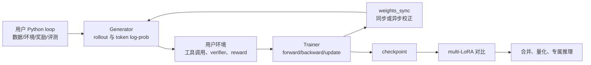

# Together Post-Training：把“可编程训练循环”接到可控的 RL 系统契约上

> **原文**：Together AI，2026-10-19 发布的 [Together Post-Training](https://www.together.ai/blog/together-post-training)。  
> **类型**：官方技术/产品报告；**主题**：大模型后训练。  
> **阅读提示**：本文把作者的能力陈述与可由公开材料直接核对的机制分开。该文不是同行评审论文，未提供统一 benchmark 曲线或独立复现包。

## TL;DR

- Together 把后训练抽象为一个由用户编排的循环：用户提供数据、环境、奖励或监督与评测；平台提供 `Trainer`、负责 rollout 的 `Generator`、权重同步和专属 GPU 资源。SFT 可不启动 Generator；RL 则在采样、打分、反传、更新、同步之间迭代。
- 它真正试图解决的不是“有没有 GRPO”，而是 **训练端与推理端不一致会让 RL 目标失真**：同一 checkpoint 若在两个栈得到不同 token log-prob，回报归因、重要性校正和梯度都会建立在错误行为策略上。
- 官方列出 cross-entropy、GRPO、CISPO、DPPO 与本地计算自定义 loss、上传梯度；同步 RL 用新权重采样，异步 RL 让生成与训练重叠，并声明 loss 会校正一轮陈旧样本。
- 面向 MoE，产品页进一步称 Trainer 会重放 rollout 时的 expert 选择；面向多轮 Agent，前缀缓存让后续轮只处理新增 token。二者都是**降低 policy/执行轨迹漂移与重复计算**的系统设计，而不是新的学习目标。
- 资源层允许同一 GPU reservation 上开多个 LoRA session，也允许部分模型 full-weight 训练；结束后可在一个 multi-LoRA endpoint 横向比较 adapter，再合并/量化为生产部署。
- 可量化、可直接核对的公开数字很少：首六周 B200 标价为每 GPU 小时 9 美元；一名早期用户说可在同一 GPU 容量上并发至多 5 个 RL 实验。它们不等价于训练加速、准确率提升或通用成本下降的实证结论。
- 最大边界是：文章没有给出模型、数据、奖励、步数、吞吐、成功率、方差或基线对照。因此它证明的是一个很具体的**接口与系统承诺**，不是已被公开实验验证的“frontier-grade”后训练效果。

## 这篇报告究竟在回答什么问题？

### 后训练的困难已从“调用一个 loss”转向端到端闭环

对带工具 Agent 或 verifier reward 的 RL 而言，一步训练可写成：

\[
\tau_t \sim \pi_{\theta_t}^{\mathrm{gen}}(\cdot\mid x),\quad
r_t=R(\tau_t),\quad
g_t=\nabla_\theta \mathcal L(\theta_t;\tau_t,r_t),\quad
\theta_{t+1}=\operatorname{Update}(\theta_t,g_t).
\]

其中 \(x\) 是 prompt/环境状态，\(\tau\) 是可能含工具交互的整段轨迹，\(R\) 是外部奖励或 verifier，\(\pi^{\mathrm{gen}}\) 是生成引擎实际执行的策略。表面上，用户只需指定 \(R\) 与 \(\mathcal L\)；实际中还必须保证训练栈解释的是 **同一条行为策略**。

| 常见断裂点 | 会如何污染学习 | 本文对应的系统回答 |
| --- | --- | --- |
| rollout engine 与 trainer 数值/内核不同 | 记录的 log-prob 与训练时重算的 log-prob 不同 | 针对每个模型优化两端，并强调数值对齐 |
| 新梯度已更新、旧 generator 仍在采样 | off-policy 程度随时延扩大 | 显式权重同步；异步模式声明进行陈旧样本校正 |
| MoE 路由重算后走了别的 experts | 同 token 序列不再对应相同计算路径 | 支持模型上重放 rollout expert choices |
| 多轮 Agent 重复处理历史上下文 | rollout 成本随轨迹长度累积 | 缓存此前轮次前缀，后续只新增量计算 |
| 多个 LoRA 试验各占一份部署 | sweep 与比较的容量成本膨胀 | 一个 reservation 多 session 与 multi-LoRA serving |

这张表也是理解全文的钥匙：作者把“模型塑形”定义成 API 层的可编程性，加上基础设施层的正确性与吞吐约束；它没有把奖励设计、数据质量、环境安全或评测选择替用户自动化。

## 作者的论证路线：claim → mechanism → evidence → boundary



### Claim：用户应拥有训练“配方”，平台负责危险的底层耦合

- **机制**：先申请 `Model Resource`（专属 GPU allocation），再在其中创建一个或多个 `Training Session`。每个 session 使用同一 base model、通常对应一组 LoRA；Trainer 执行前向/反向/更新，Generator 执行策略 rollout。
- **直接证据**：官方博客明确区分 SFT 与 RL，并称 SFT 可用 0 个 Generator；产品页把一轮 RL 示意为 `sample()`、用户 reward、`forward_backward()`、`optim_step()`、`weights_sync()`，SFT 则省略采样与同步。
- **边界**：这只是资源与职责划分。用户仍要给出可执行的 sandbox、工具协议、reward/verifier、数据版本与外部 benchmark；没有这些，平台不能把“可运行”变成“有用”。

### Claim：RL 的质量首先取决于生成和学习是否在谈同一种策略

若 rollout 来自旧策略 \(\mu\)，训练目标却以当前策略 \(\pi_\theta\) 解释，许多目标会出现比率项，例如：

\[
\rho_t=\frac{\pi_\theta(y_t\mid x)}{\mu(y_t\mid x)},\qquad
\mathcal L_{\mathrm{pg}}=-\mathbb E\big[\rho_t\,\widehat A_t\big].
\]

- **机制**：博客称 Generator/Trainer 为每个模型做联合优化，并用 Rollout Routing Replay 与训练稳定性优化消除 policy drift；产品页把“匹配输出精度、重放 expert choices、对旧版本样本作校正、坏步停止训练”列为质量护栏。
- **为何重要**：若分母的 \(\mu\) 来自不同数值精度、不同 kernel 或不同 MoE 路由，\(\rho_t\) 已不再是同一分布之间的比值。对长 rollout，这类误差会被回报加权而放大；因此“快”不能独立于“对齐”讨论。
- **边界**：报告没有公开 drift 的度量定义、允许误差阈值、触发停止条件，或有/无 replay 的收敛曲线。读者不能从营销图中的近似 log-prob 数字推导任何跨模型保证。

### Claim：异步 RL 值得做，但只在陈旧性被显式处理时成立

- **同步模式**：更新后将 Trainer 权重送给 Generator，再开始下轮采样。其优点是 \(\mu\approx\pi_{\theta_t}\)，诊断简单；缺点是长 Agent rollout 时 GPU 易互等。
- **异步模式**：Trainer 更新第 \(t\) 步时，Generator 继续用较早权重生成；这样训练和生成重叠，设备利用率更高。官方 FAQ 具体称样本可能“落后一轮”，loss 会为差距作校正。
- **实践准则**：先用同步模式建立 reward、评测和失败回放的基线；只有当 profiling 显示步时主要消耗于 rollout，且能记录 policy/version/log-prob 时，才切换异步。否则吞吐提升可能只是更快地优化了错配数据。

## 方法库存：接口开放到哪里，约束又留在哪里？

### 标准目标与自定义梯度的边界

官方点名 cross-entropy、GRPO、CISPO、DPPO；它也允许用户在本地算任意训练目标，再把梯度交给 Trainer 更新。可以将后者抽象成：

\[
g=\frac{\partial \mathcal L_{\mathrm{custom}}(z, r, m)}{\partial z},
\qquad \theta \leftarrow \theta-\eta\,J_\theta(z)^\top g,
\]

其中 \(z\) 是 Trainer 产生的 logits/中间量，\(m\) 是 mask 或辅助状态。它给研究者以 loss 级自由度，却把反传、分布式并行、序列 packing 和参数更新交给服务。

```text
Input: prompts X, environment Env, reward R, session S
State: policy version v, trainer weights θv, rollout buffer B
repeat until budget/evaluation stop:
    τ, logμ, route = S.generator.sample(X, version=v)
    outcome = Env.run(τ)              # 工具、sandbox、多轮观测
    score = R(τ, outcome)
    if async: correction = C(logμ, v, θcurrent)
    else:      correction = 1
    gradients = loss(τ, score, correction).backward()
    if guard(gradients, numerics) fails: stop_or_skip_step()
    S.trainer.optim_step(gradients)
    v = S.weights_sync_or_schedule()
    B.record(τ, score, logμ, route, v)
Output: checkpoints, evaluation records, deployable adapter/weights
```

这段伪代码不是官方 API 的逐字实现，而是将文章的职责关系显式化。尤其是 `B.record`：没有 rollout 的版本、路由、log-prob、奖励和环境版本，异步校正与事后失败分析都不可审计。

### LoRA、多实验与 full-weight：服务抽象改变的是什么？

| 能力 | 文章的说法 | 研究/工程含义 | 不应外推的结论 |
| --- | --- | --- | --- |
| 多 LoRA session | 多个 adapter 共用一个 Model Resource | 同一 base 的 reward、学习率、数据 mix 可并行 sweep | 不代表不同试验完全没有显存/吞吐竞争 |
| full-weight | 为选定模型提供 | 适合 adapter 容量不足的知识密集适配 | 不能推出所有列举模型均支持全参训练 |
| 专属 GPU | 资源不与其他请求争 priority | 减少排队与可变邻居造成的实验噪声 | 不等于固定成本或自动更高利用率 |
| 每 GPU-minute 计费 | scale 后声称可低于 token pricing | 计费对象从 token 转到保留且 ready 的容量 | 未给 break-even 公式，需按自己的并发与空闲测算 |

文章列出 Muse Spark Open、GLM 5.3、Kimi K3 与 Qwen 3.8-27B 为启动模型；产品页还区分 LoRA/full-weight 与 RL/SFT 支持。版本、模型可用性与价格都属于服务状态，应在实际实验时再从控制台核对，不能把首发清单当成长期兼容性承诺。

## 证据与“数字”应怎样读

### 已公开的数字很有限

1. 官方给出促销条件：前六周，B200 使用价格为 **9 美元/GPU-hour**。这是一条价格信息，不能直接变成一个训练成本估计；成本还取决于所需 GPU 数、资源 ready 时间、rollout 并发、空闲策略和实验次数。
2. 早期客户 Deel 的引述称，可在同一 GPU capacity 上运行“最多五个”并发 RL 实验。这是客户陈述，不含模型、GPU、上下文长度、吞吐、奖励计算与统计重复，不能作为平台普遍并发度。
3. Jack & Jill 表示其离线评测中开源模型匹配某 closed-source 模型质量且更便宜；缺少任务集、置信区间与成本口径，适合当作采用案例，而不是基准结果。

### 图示在论证中承担什么、又不承担什么

- 博客的总览图支持“用户命令在左、Together 组件在右”的职责划分；它不证明任何模型质量。
- 产品页的 token/log-prob 与 expert replay 示意，解释了为什么 MoE 的生成路径需要被保留；它不提供随机种子、多样本方差或比较实验。
- “未调优 stack”与“Together”时间轴图在说明生成、reward、训练、同步能够如何被压缩/重叠；它没有标注秒数、批量、模型或硬件，因而不是可引用的加速倍数。

本轮不本地化图片：这些图主要是架构示意，所含关键关系已由表格、公式和伪代码更精确地表达；没有一张图是理解结论不可替代的定量证据。

## 从训练到部署：最值得注意的是“评测交接”

文章最后的链路是 checkpoint → multi-LoRA side-by-side comparison → winning adapter → 合并、量化、Dedicated Model Inference，或下载权重自行部署。这个顺序有一个容易被忽略的科学含义：**训练期胜者未必是服务期胜者**。

- 训练/rollout 可能使用不同精度、GPU 配置与 kernel；生产端又可能是合并后的 FP4 推理。
- 因此文章强调从 multi-LoRA sampling 到合并高吞吐 FP4 inference 的质量保持。正确的评测应在部署候选的实际精度与 serving 配置上重跑，而非只读训练 loss。
- 但是“确保保留质量”仍是声明。公开材料没有给出 merge/quantize 前后的 exact-match、偏好胜率、工具成功率或长程 Agent 安全失败率。

## 反例、失败模式与可复现清单

### 不能被这套服务自动修好的问题

- **奖励错设**：可验证的短答案 reward 不能保证工具调用安全、事实可靠或用户意图对齐；更快的 rollout 只会更快放大奖励漏洞。
- **环境漂移**：工具 API、sandbox 镜像、数据权限变了，历史轨迹的分数可能不可重算。应版本化环境与评测，而非仅保存 checkpoint。
- **异步偏差**：一轮落后不必然无害；当学习率高、KL 漂移大或 episode 很长时，校正方差可能吞没吞吐收益。
- **MoE 可复现性**：route replay 解决的是一项重要条件，但不能替代对 tokenizer、precision、sampling 参数和 kernel 版本的记录。
- **部署错觉**：多 LoRA 比较若不固定 prompt 集、temperature、工具可用性与成本口径，挑出的“胜者”可只是评测噪声的胜者。

### 最小可复现实验设计

1. 用同步 RL 跑一个小预算基线，记录每个 rollout 的版本、seed、token log-prob、reward 及工具轨迹。
2. 在相同模型、相同奖励、相同总 GPU-minute 下比较同步与异步；报告 task success、KL、有效样本数、wall-clock、GPU 利用率和方差，而不是只报最快 step。
3. 若使用 MoE，分别禁用/启用路由重放并量化 log-prob 差、训练发散率与最终评测差异。
4. 对 multi-LoRA sweep 预注册选择规则，在独立 holdout 上比较 adapter；再在合并、目标精度的 serving 路径复测。
5. 把 reward hacking、超时、工具拒绝、格式合法但任务失败的轨迹单列为失败集，避免平均奖励掩盖风险。

## 把“正确性”拆开：数值、行为、统计与语义四层

博客反复使用 quality、correctness、alignment 等词，但它们不是同一个变量。为了避免把平台术语误读成端到端保证，可以按四层检查：

| 层次 | 需要回答的问题 | 文中给出的机制 | 仍缺的公开证据 |
| --- | --- | --- | --- |
| 数值正确性 | 同一 token 的概率与梯度是否在两端一致？ | 针对模型的训练/rollout 优化、精度匹配 | 最大/平均误差、容差、测试集与失败样本 |
| 行为正确性 | Generator 生成的动作是否正是 Trainer 所学习的动作？ | 权重同步、旧样本校正、路由重放 | policy lag 分布、importance weight 方差、轨迹重放率 |
| 统计正确性 | 所见改善是否超出随机 seed/评测集波动？ | 无统一公开实验 | 重复次数、置信区间、holdout 与显著性设计 |
| 语义正确性 | 高 reward 是否真的代表任务完成且无越权？ | 奖励、sandbox、judge 都由用户提供 | 攻击集、人工审查、权限/安全失败率 |

这四层之间有严格的非蕴含关系。数值完全一致的系统可以学到错误奖励；一个任务 success 上升的 demo 也不能证明异步校正正确。相反，数值或行为层的误差会使统计层的提升难以解释。因此，报告中最扎实的部分是前两层的工程问题定义，而不是后三层的效果宣称。

### 为什么“同一个 checkpoint”仍可能不是同一个策略？

语言模型的采样分布不只由权重 \(\theta\) 决定，还由 tokenizer、提示模板、context truncation、temperature、top-p/top-k、随机数、精度、attention kernel、KV cache 与 MoE routing 共同决定。可写成：

\[
\pi(y\mid x) = F(\theta, x; q, k, c, h, r),
\]

其中 \(q\) 表示量化/数值精度，\(k\) 是 kernel 与并行配置，\(c\) 是 cache/context 状态，\(h\) 是采样超参数，\(r\) 是路由或随机状态。只保存 \(\theta\) 而未约束其余项，就不能保证 Trainer 重算到的 \(\log\pi\) 与 Generator 写入 buffer 的值可交换使用。

- 对普通 dense 模型，低精度舍入和 kernel 近似会造成细小差别；在 ratio、KL 或长序列求和里，细小差别可能累积。
- 对 MoE，router 的 top-k experts 是离散选择。即使最终 token 文本相同，专家组合不同也会改变隐状态与 log-prob；因此“重放 choices”比单纯重放 token 更接近原执行路径。
- 对 Agent，轨迹还含环境返回。一次网页、数据库或工具响应变化，就会让之后所有 token 的条件分布改写；此处路由重放无能为力，必须固定或记录 environment snapshot。

这解释了为什么作者把模型训练与推理的共同优化视为产品核心。它也是一条值得迁移到自建 RL 系统的原则：**训练数据里的行为元数据应被视作算法输入，而非可有可无的日志。**

## SFT、RL 与 Agentic RL：同一资源抽象下的不同失败面

### SFT：generator 可以省掉，但数据契约没有消失

对于监督微调，常见目标是 token 级交叉熵：

\[
\mathcal L_{\mathrm{SFT}}(\theta)=-\sum_{i=1}^{n}\sum_{t=1}^{T_i}m_{it}\log\pi_\theta(y_{it}\mid x_i,y_{i,<t}),
\]

其中 \(m_{it}\) 用于忽略 prompt、padding 或不应学习的 token。文章据此允许 SFT 使用零个 Generator，避免为不需要在线采样的任务占用 rollout GPU。这个节省是明确的系统优化；但 SFT 的主要风险变为数据去重、泄漏、role/template 格式、长序列 packing 后的 mask 与验证集代表性。文章没有声称自动治理这些风险，用户仍需负责。

### 结果型 RL：奖励是接口，不是证明

在数学题、代码测试或结构化抽取中，verifier 可给出较明确的 \(R(\tau)\)。但一个可计算 reward 至少还要面对：

- **稀疏性**：长轨迹只有最后成功/失败，早期错误没有可信 credit；
- **可钻空子性**：模型可能满足 parser、超时规则或 judge 的表面条件而没有完成用户目标；
- **观测不完整**：测试通过不等于鲁棒，尤其是存在隐藏依赖、权限或真实世界状态时；
- **分布偏移**：训练环境 deterministic，不代表生产工具会 deterministic。

服务提供了接入外部 reward 的地方，却没有也不应替用户声明 reward 的语义。这是阅读“客户达到某质量”类案例时必须保留的边界。

### 多轮 Agentic RL：缓存提高效率，也改变了测量对象

若第 \(j\) 轮的上下文为 \(c_j=(x,a_{<j},o_{<j})\)，朴素执行会反复 prefill \(c_j\)。prefix cache 把此前计算复用，使第 \(j+1\) 轮更接近处理 \(\Delta c\)，而不是再次处理完整 \(c_{j+1}\)。不过缓存命中率取决于会话粘性、分支数、上下文修改与调度策略；“多轮更省”不能简化为固定倍数。

更重要的是，缓存加速的常常是同一条失败轨迹。评测应同时记录每轮工具成功、回合长度、重试次数、累计 token、wall-clock 与任务终态。只看每 token 成本会偏好极短但频繁失败的 Agent；只看成功率又会掩盖不成比例的计算开销。

## 一套可执行的评测表，而非一张宣传图

下表不是 Together 公布的结果，而是依据文中声称的机制给出的最小报告模板。任何想检验这些主张的团队都应能填出它，而不是只汇报一个总分。

| 假设 | 干预组/对照组 | 最少指标 | 主要混杂因素 |
| --- | --- | --- | --- |
| 数值对齐减少训练漂移 | 对齐栈 vs 人为改变 rollout precision | token log-prob 误差、KL、发散率、终评 | 模型、prompt、seed、采样参数 |
| routing replay 对 MoE 有价值 | replay on vs off | expert match、loss 方差、task score | 路由温度、batch、专家负载 |
| async 更有效率且不伤质量 | 同步 vs 不同 lag 的异步 | GPU util、time-to-target、最终 holdout | 总 tokens、更新次数、资源大小 |
| multi-LoRA 节省实验成本 | 独立资源 vs 共享 reservation | ready 分钟、吞吐、tail latency、干扰 | 并发 session、adapter rank、上下文长度 |
| FP4 服务保留质量 | rollout checkpoint vs merged quantized endpoint | 相同提示的 task score、拒答/工具错误 | 解码参数、硬件、serving 模板 |

实验上还要预先决定预算口径。例如比较同步与异步时，应固定总 GPU-minute、固定 wall-clock、固定完成 rollout 数，还是固定 optimizer update 数？四种选择会得到不同故事。没有口径，所谓“更快”不可比；没有 holdout，所谓“更好”不可推广。

## 对安全与治理的有限延伸

本文归入后训练而非 AI 安全报告，但它触及一个安全相关事实：当 reward、环境和训练循环由客户定义时，**模型行为的责任边界被拆成平台正确性与应用语义正确性两部分**。

- 平台可以降低“训练的不是 rollout 过的策略”这一类隐性风险；它无法判断奖励是否鼓励权限提升、数据外泄或绕过人类批准。
- 专属资源和可下载权重增加可控性，也要求组织自行做好访问控制、checkpoint provenance、数据最小化与离线评测的审计。
- multi-LoRA 并行使实验更便宜；同样也应让每个 adapter 的数据来源、奖励版本、工具权限和安全评测可追溯，否则部署时难以解释行为差异。
- 生产量化/合并是另一道行为变换。对高风险 Agent，部署前应将拒绝、权限边界、异常工具调用与恢复路径加入回归集，而不只验证通用任务分数。

这些是从其接口设计作出的机制性推论，并非原文宣称已解决的安全能力。恰当的要求不是让基础设施供应商替应用选择价值观，而是要求它提供可记录、可复现、可拒绝坏步骤的底座，并要求应用方用可审计的 reward 与评测完成语义闭环。

## 相关位置与研究者应继续追问的问题

这份报告处在 SFT、偏好优化、RLHF/RLAIF 与 Agentic RL 的工程交叉处。它没有提出新的公开优化算法；其贡献主张是把既有目标函数与生成、路由、同步、缓存、资源隔离、adapter 评测和生产推理合并为可编程服务。从研究视角，最有价值的命题不是“平台会替代算法研究”，而是：**当训练系统足够复杂时，系统误差本身成为后训练算法的隐变量。**

后续最值得索取或自行测量的材料包括：

- 生成/训练 log-prob 偏差的分布与其和奖励改善的关系；
- 异步校正的明确公式、可容忍 policy lag 与不稳定触发条件；
- expert replay 对不同 MoE、不同 temperature、不同任务的消融；
- 训练时、multi-LoRA 比较时、量化 serving 时三套评测的一致性；
- 对真实 Agent 环境的安全指标：权限越界、错误工具调用、恢复行为和成本上界。

**结论**：Together Post-Training 给出的可信阅读方式，是一份对“后训练系统契约”的清晰产品蓝图：用户保留问题、奖励和评测的控制权，平台试图把最容易悄然出错的策略生成—学习—部署链路收紧。公开证据足以说明其设计目标和接口边界，不足以证明普遍的质量、速度或成本优势。对研究者而言，下一步应把这些系统护栏变成带公式、消融、误差分布与端到端 Agent 失败集的可检验主张。
