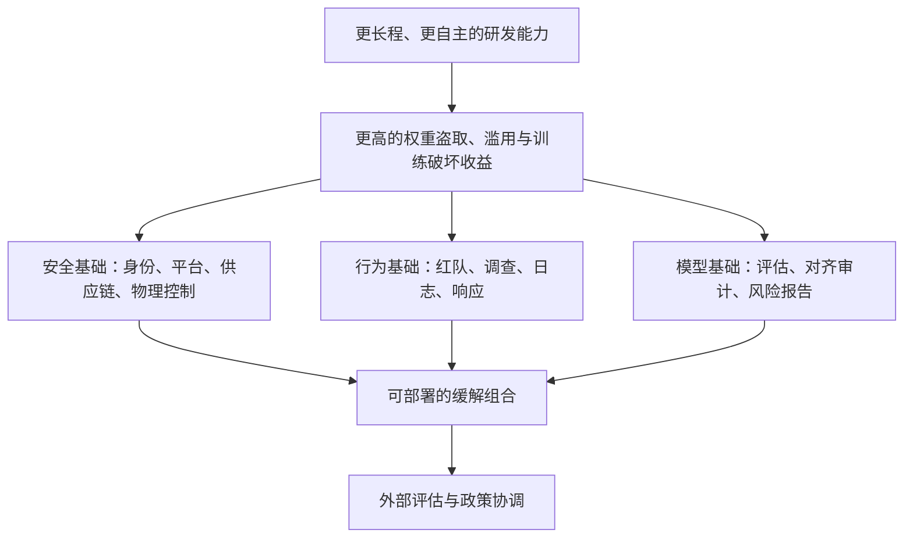

# Frontier Safety Roadmap：把安全承诺写成可复核的目标、阈值与更新日志

> **原文**：Anthropic，[Frontier Safety Roadmap](https://www.anthropic.com/responsible-scaling-policy/roadmap)，2026-10-19 更新。  
> **类别**：AI 安全 / AI for 安全；**性质**：官方路线图与进展披露，不是同行评审论文。  
> **阅读边界**：本文分析公开页面可核对的目标、定义和作者自报的完成情况；删节部分、内部证据、未发布的红队细节均不可见。

## TL;DR

- **这份路线图做什么**：Anthropic 把安全工作拆成 Security、Safeguards、Alignment 与 Policy 四条线，并把若干公司级承诺写成有截止日期、验收门槛、负责人审阅流程和后续更新的公开项目。
- **10 月 19 日最可量化的更新**：自动化内部红队在生物武器分类器的 **8 个 bounty 问题 × 3 代生产分类器 = 24** 个问题—分类器配对里，匹配或超过最佳人工提交；其中 **23/24** 获胜，耗时 **24–48 小时**，而 bounty 周期为数周至数月。
- **它改变的不是“模型是否安全”的单一指标，而是治理接口**：弱点、审计证据、补救责任和公开叙事被放到同一张路线图中。可把它看作一份面向组织的安全 case，而不是一份模型能力基准。
- **最具体的未来验收机制**：到 2027-07-01 的“全面升级”以一组 security invariants 评分；至少 **60%** 达到“fully or near-fully in place”，且至少 **80%** 达到“mostly in place”，并要经历公司内至少 **7 天**评论期。
- **新目标的方向**：截至 2027-01-01，目标包含自动化调查一大部分复杂 cyber misuse、建设内部 AI 开发活动的集中可检索记录、并用人类和自动红队/模型 organism 评估监控；政策端还承诺在 2026-12-15 前提出 embedded third-party evaluator 方案。
- **证据不能支撑什么**：23/24 不是对真实攻击覆盖率、误报率或对所有产品面的保证；“moderate confidence”是组织自己的判断，不等于外部独立认证。公共文本还明确做了删节，故无法由页面复算控制实际强度。

## 1. 这不是一张愿景海报：它试图解决什么失败模式？

### 1.1 从“原则”到可检查的中间层

路线图的前提很直接：能力可能快速增长，而安全准备不能只依赖事后响应。作者把需要同时提升的对象分为四类：

| 线索 | 页面给出的风险对象 | 路线图想产生的组织产物 |
|---|---|---|
| Security | 模型权重被盗、训练被破坏、模型被操纵 | 身份、网络、供应链、检测、物理与平台控制 |
| Safeguards | 经由产品表面或公司内部的危险滥用 | 分类器、调查、威胁情报、访问控制与响应 |
| Alignment | 模型自主造成伤害或不遵循 Constitution | 评估、监控、红队、解释性证据与风险报告 |
| Policy | 单家公司做得好仍不足以应对行业风险 | 评估者访问、治理提案与跨行业规则 |

关键不在分类本身，而在将抽象原则改写为可问责对象。页面把公开目标称为一种 **forcing function**：跨安全、研究、基础设施和政策团队的协调任务，若没有日期与检查点，容易被短期产品优先级吞没。

### 1.2 论证路线：承诺如何变成证据？

可以把该页面的逻辑压缩成下面的安全论证链：

- 这条链的优点是承认目标会变：页面记录了撤销数据保留子目标、推迟 moonshot 阶段目标、以及退休原有 Constitution 目标。
- 但“更新”本身并不自动表示安全改进；它只是让外界可以区分 **完成、重排、取消与尚未证明**，避免把旧承诺悄悄遗忘。

## 2. 10 月 19 日更新到底新增了哪些可核对事实？

### 2.1 自动化红队：快，并不等于全面

作者称已提前完成“world-class internal red-teaming”目标。实验对象是 2026-04-20 至 09-11 期间、针对生物武器分类器进行的 bug bounty；比较单位不是全部模型行为，而是固定的 **8 个 bounty 问题** 与 **3 代生产分类器**的笛卡尔积。

| 指标 | 官方披露 | 应如何读 |
|---|---:|---|
| 比较单元 | 24 个问题—分类器配对 | 是狭窄、明确的覆盖面，不是 24 次真实攻击 |
| 自动系统相对最佳人工 | 24/24 匹配或更好 | “更好”依赖 bounty 的评分规则与提交可比性 |
| 自动系统获胜 | 23/24 | 支持在此任务集上有很强的发现效率 |
| 自动运行时间 | 24–48 小时 | 证明迭代速度差，不能推出生产响应端到端时延 |
| 人工 bounty 时间 | 数周至数月 | 是计划周期比较，非每题严格的墙钟时间对照 |

若把第 \(i\) 个问题—分类器配对的最佳发现效用记为 \(u_i\)，自动红队与人类最好提交分别为 \(u_i^A\)、\(u_i^H\)，页面声称的是：

\[
\sum_{i=1}^{24}\mathbf{1}[u_i^A\ge u_i^H]=24,
\qquad
\sum_{i=1}^{24}\mathbf{1}[u_i^A>u_i^H]=23.
\]

这是一条关于**给定基准和评分定义下的相对发现结果**的主张。它没有公布 \(u\) 的构成、漏洞新颖性、false positive、同一问题上的重复性，因而不能推导为自动红队在任意领域具有 95.8% 成功率。

### 2.2 “moonshot”进展：从概念项目转向可运行原型

更新称两项原先的项目已大体达到实质组件：

1. **极端安全环境**：已做关键工作流与基础设施原型，探索达到 air-gapped operation 所需的长前置期系统改变；当前更多是在原型环境测量生产率成本，而非同步完成全部物理控制。
2. **inference verification**：在生产推理上做原型，核对输出来自特定模型权重集合；同时对内部 token traffic 部署签名，并称已发现一次罕见、良性的完整性异常。

两者共同回答的是供应链式问题：部署中的“这段输出”能否被追溯至“预期权重和预期执行边界”。不过页面也刻意将术语从 *provable inference* 改为 *inference verification*，这应理解为收窄承诺：它没有宣称对所有推理正确性给出数学证明。

## 3. 目标如何验收：把“做得更安全”替换为阈值

### 3.1 Security 的 60% / 80% 双阈值

“Leveling up across the board”计划截至 2027-07-01。负责人要将每条 invariant 评级为：未到位、基本到位、完全或近乎完全到位；公司内部有至少 7 天评论期。达到目标要求：

\[
\frac{\#\{\text{fully or near-fully}\}}{N}\ge0.60,
\qquad
\frac{\#\{\text{mostly in place}\}}{N}\ge0.80.
\]

这比单一平均分严格：即使少数项目做得极强，也不能完全掩盖大量未建立的基础控制。但它仍有边界：\(N\) 的完整列表、权重、评分证据与具体安全姿态并不公开；因此外部读者能审查的是验收结构与未来更新，而不是自行重算分数。

### 3.2 不变量清单为何重要

页面列出的例子跨越多个“最弱一环”：

- 短生命周期、加密验证身份；自动轮换敏感凭据，持续清理过期/过宽权限；敏感服务采用经批准的认证授权与传输加密。
- frontier cluster 的 hardened-default 偏离需明确批准和跟踪；敏感环境出网采用 allowlist；公网可达系统持续监控。
- 构建来源与依赖完整性可追溯；部署被记录并入清单；关键系统做 threat modeling、审查和渗透测试。
- 对模型权重、训练完整性、内部人员威胁与滥用情景维持已验证的检测能力，并测量覆盖、检测时间与准确性。
- 数据中心硬件移动有授权与可审计 custody；平台层将设备视为敌对方、用内存隔离与不可变执行策略减少横向蔓延。

这里的研究价值在于，模型安全被放入传统 security engineering 的约束中：即便分类器或对齐评测有效，权重、训练或日志基础设施失守仍会绕过上层策略。

## 4. 从“拦一次输出”到“调查一次攻击链”

### 4.1 自动化调查的声明与评测义务

Safeguards 目标设为 2027-01-01：在部分产品表面构建系统，以极少或无需人工的方式检测大部分复杂 cyber attacks，并制定 precision/recall 评估计划，可能使用红队。这里的表述有三个谨慎限定：

| 限定 | 对结论的影响 |
|---|---|
| 初期仅覆盖一部分 product surfaces | 不应把它读成全产品安全防线 |
| “intended to detect a large majority” | 是目标，不是当前已测得的召回率 |
| 评估计划“likely based on red teaming” | 暗示协议尚未公开，precision/recall 未披露 |

其隐含的检测问题可写为：对跨账号、跨会话的事件 \(x\)，输出调查决策 \(d(x)\in\{0,1\}\)。真正应报告的不只是拦截数，而是

\[
\mathrm{Recall}=P(d=1\mid\text{complex misuse}),\quad
\mathrm{Precision}=P(\text{complex misuse}\mid d=1),\quad
\mathrm{TimeToTriage}.
\]

路线图提到第三项的必要性，但尚未给出数值。未来公开报告若只展示发现案例而没有负例、成本与误报分布，便无法验证“minimal human involvement”的实际代价。

### 4.2 “eyes on everything”不是全知，而是可审计的可观测性目标

跨团队目标想建立关键 AI 开发活动的集中记录，并让 AI 分析其中的人类/模型内部人员风险和安全威胁。Security 子目标提出 log catalog、按优先级标记、完整性流程、可用的集中搜索、管道健康监控；Alignment 子目标要求列出高风险内部 Claude 使用场景，监测重大 sabotage 导向活动，并通过人类/自动红队与 adversarial model organisms 评估。

这套设计的合理之处是承认“发现概率”本身可缓解某些威胁模型；它并未声称零风险或即时响应。真正困难处是：日志覆盖越广，隐私、访问控制、保存期、告警疲劳与攻击者规避空间也越需要独立测量。

## 5. Alignment 与 Policy：有记录的收缩也应被当作证据

### 5.1 Constitution 目标的退役说明什么？

10 月更新称：Constitution 保持公开且更新；自动对齐评估把与 Constitution 的一致性作为核心指标；解释性证据出现在近期 system cards；曾对 post-training data 与 reward 做代表性样本监督，但没有发现既有流程未发现的问题，因而不再常规执行。原目标被退休，以重新思考更有效的 alignment goals；最低承诺是相关模型部署后 **90 天内**使公开 Constitution 对齐最新训练版本。

这是一种值得保留的失败/无收益证据：一个看起来合理的过程审查没有显示增量价值，于是被停止。它不能证明现有审查充分，只说明该次样本与该种监督过程未暴露新问题。未来应报告抽样框、检测灵敏度与停止规则，否则“没发现”会被误读为“没有风险”。

### 5.2 政策目标刻意把独立性变成设计变量

路线图承诺到 2026-12-15 提出 embedded third-party evaluators 的政策方案，范围包括资金、所需访问与独立性保护；到 2027-01-15 则要发布或解释不发布关于 AI 研发节奏的政策提案。它们的重要性在于：公司内部评分与自报进度很难替代外部验证，故需要讨论谁能访问什么、谁付费、如何避免被评估对象控制。

## 6. 证据表：哪些主张已经被页面支持，哪些仍待检验？

| 主张 | 已有的公开支撑 | 尚缺的关键证据 |
|---|---|---|
| 自动红队能快速提升特定分类器的漏洞发现 | 8×3 对比、23/24 胜出与 24–48 小时叙述 | 评分协议、漏洞类别、误报、复现实验与领域迁移 |
| 安全成熟度可由 invariants 推动 | 60%/80% 阈值、评分等级、7 天评论期 | 完整 invariant 集、证据样本、外部审计与风险加权 |
| 自动调查可扩大 cyber misuse 防御 | 明确目标与 precision/recall 计划 | 真实召回/精确率、人工负担、对抗规避与覆盖面 |
| 更广泛日志能改善内部防御 | catalog、完整性、搜索与管道健康的具体设计 | 数据治理、盲区、成本、攻击者绕过与独立评估 |
| 当前对齐实践足以降低 catastrophic sabotage 风险 | 作者称现有评估/监控足以形成“very low, not negligible”的论证 | 可复现风险模型、外部复核、不同能力水平下的失效曲线 |

## 7. 研究者应带走的判断与后续问题

### 7.1 本文最有价值的主张

这份路线图的可信核心不是“我们已经解决前沿安全”，而是把安全工作表达成可被后续更新推翻的对象：交付日期、达标阈值、测试比较、撤销理由与下一步。尤其是自动红队 23/24 的披露，提供了一个可以要求扩展为完整评测协议的锚点。

### 7.2 不能跨越的证据边界

- 页面自称存在为防泄露和防助攻攻击者而作的删节，因此外部无法验证控制配置、例外与质量。
- 自动红队结果是对生物武器分类器 bounty 的限定比较；不能外推至 cyber、模型盗取、agent 长程行为或所有分类器。
- 路线图多次使用“moderate confidence”，这是风险与执行可行性的主观校准，不是统计置信区间。
- ASL-3 及未来保护的描述是最低保护意图；攻击者能力持续变化，原文也明确不保证未来对手下的具体有效性。

### 7.3 下一步应该如何把路线图变成研究证据？

1. **预注册红队比较**：固定漏洞类别、评分、时间预算、复现次数与人工—自动混合策略，公布 false positive 与边际发现曲线。
2. **把 invariant 转为风险加权图**：不仅报告满足比例，还公布不同控制失败对权重盗取、训练污染、内部滥用的边际影响与依赖关系。
3. **对自动调查作成本敏感评测**：报告每万会话告警量、人工复核小时、漏检攻击阶段、从检测到处置的延迟，而非只报告拦截案例。
4. **让外部评估可反驳内部自报**：embedded evaluator 的访问范围、发布权和资金独立性应先于其结论被公开讨论。

## 8. 把时间轴放回能力阈值：路线图如何处理“不确定的明天”？

### 8.1 已有能力不是未来能力的替身

页面的 Expectations 段落刻意区分“今天的保护”和“可能在数月内出现的能力”。在页面所述的 2026-02-22 状态，最强模型已经可能显著帮助具备基本技术背景的个人或群体制造、获得并部署具有灾难性后果的化学或生物武器；相应模型受 ASL-3 保护。作者列出的构成包括至少与初版 Constitutional Classifiers 一样强的 safeguards、可信用户访问控制、持续 jailbreaking 红队/bug bounty/威胁情报，以及若干安全控制。

这个段落的论证并不是“有 ASL-3 所以问题已解决”，而是提出一个持续条件：面对已知危险能力，保护强度至少不能下降；当攻击方法改变时，工具和方法可以变，但保护的严谨程度不能被替代为广告语。原文同时明确表示，无法对未来对手给出特定的有效性保证。这一点在阅读任何安全路线图时都很重要：防御承诺的形式可核查，防御对自适应攻击者的实际成功率却需要持续再测。

### 8.2 触发器不等于预测日期

在潜在的化学/生物能力提升上，作者使用的是条件触发语句：当判断模型能显著帮助中等资源、专家支持的威胁方造成远超既往同类灾难的影响时，扩展至少与当前 ASL-3 一样强的保护，并识别具体威胁路径、形成早期侦测和响应建议。这可表示为：

\[
\text{if } C_{\mathrm{CBRN}}\ge \tau_{\mathrm{catastrophic}},
\quad \text{then } P\leftarrow\max(P, P_{\mathrm{ASL3}}).
\]

其中 \(C_{\mathrm{CBRN}}\) 不是页面公开的一个单项 benchmark 分数，\(\tau\) 也没有可供外界直接代入的数值。因此该式是责任关系而非可计算的预测模型。它的好处是避免虚假的精确日期；弱点是外部难以预先判断触发器会在何时、由何种评测被认定为触发。

### 8.3 早至 2027 的“自动化 R&D”假设需要哪些前提？

作者认为最早到 2027 年，系统可能完全自动化或大幅加速大型顶尖研究团队在能源、机器人、武器与 AI 等领域的工作。页面没有把这写成确定预测，而是用 *plausible* 限定，并把其后的防护设想绑定到先前目标：moonshot security、内部红队和自动调查、政策路线图、“eyes on everything”、以及系统化 alignment audits。

从研究方法角度，这形成一个依赖图，而非并列待办：

- 若 C 不成立，攻击者或内部人员可能绕开模型层 safeguards；
- 若 D 不成立，组织看不见跨会话、跨系统的异常；
- 若 E 不成立，模型在高杠杆活动中的自主风险没有可审查的论证；
- 若 G 不成立，一家公司提高门槛仍不能解决扩散、竞赛或跨域滥用。

路线图在这里最值得肯定的地方，是没有把“更强对齐模型”当成上述全部节点的替代品；最需要外部追问的地方，是这些节点如何排序、如何分配资源、何时承认一个依赖失败。

## 9. 一份适合持续追踪的阅读清单

对后续更新，建议不要只问“目标是否完成”，而逐项检查以下问题：

| 追踪问题 | 最低可接受披露 | 为什么重要 |
|---|---|---|
| 自动红队是否稳健？ | 任务分层、重复次数、误报和遗漏 | 防止单次 leaderboard 胜出掩盖不稳定性 |
| 60%/80% 是否有意义？ | invariant 数量变化、风险权重、例外理由 | 防止简单计数把关键控制与边缘控制等价 |
| 自动调查会不会制造告警洪水？ | precision、recall、人工升级率、处置时延 | 让“自动化”不只指模型调用数量 |
| 广泛日志如何受约束？ | 保存期、访问控制、审计和红队结果 | 可观测性本身会形成敏感数据与滥用面 |
| 外部评估是否真独立？ | 经费、访问、保密、反驳与发表条款 | 自报安全 case 需要可挑战的外部机制 |

这种清单也解释了为什么本文没有把路线图当作 benchmark 报告来排名：它披露的是**要构造什么证据机制**，而不是统一的模型分数。对安全研究者而言，最有信息量的未来版本将是那些公开说明目标未达到、量化何处失败、并解释为何改变验收方法的更新。

### 9.1 可复核性的最低标准

若要让公开路线图真正承担问责功能，每一次状态改变都应至少能回答四件事：原目标的文字是否改变、改变前后的验收条件是什么、支持“完成”或“未完成”的证据来自何种测试、以及未公开部分是否足以改变读者对风险的判断。没有这些对照，长期的更新页面很容易变成只记录成功项目的叙事档案。页面已经提供了部分原材料——日期、撤销说明和阈值——但仍应期待更细的评估报告来补全这条证据链。

> **结论**：Frontier Safety Roadmap 最适合被理解为一份公开的安全工程账本：它将模型安全、产品滥用、基础设施与政策放在同一套时间表中。10 月 19 日的更新给出了值得追问的硬数字和验收形式，但并没有给出足以独立证明总体安全性的原始数据。它的后续价值取决于这些承诺能否继续转化为可复算的协议、负面结果与外部可挑战的证据。

## 参考

1. Anthropic, [Frontier Safety Roadmap](https://www.anthropic.com/responsible-scaling-policy/roadmap)，2026-10-19 更新。
2. Anthropic, [Responsible Scaling Policy 更新与归档](https://www.anthropic.com/responsible-scaling-policy/updates)。
3. Anthropic, [ASL-3 protections](https://www.anthropic.com/news/activating-asl3-protections)。
