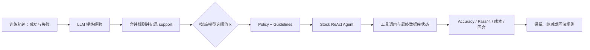

# ALTK-Evolve：把失败轨迹压成提示词记忆，能否让客服 Agent 更可靠？

> **原文**：IBM Research 在 Hugging Face 发布的 [ALTK-Evolve](https://huggingface.co/blog/ibm-research/altk-evolve-bc)（2026-10-20）  
> **类别**：大模型 Agent｜工程报告｜评测：τ²-bench retail / airline  
> **一句话问题**：不改模型权重，只把过去任务的成败提炼成规则并附到系统提示词，能否同时提高工具型客服 Agent 的平均成功率与“四次都成功”的可靠性？

## TL;DR

- 作者在 stock τ²-bench 的 ReAct 客服脚手架上，只增加一段从训练轨迹归纳出的 Markdown guidelines；策略文档、工具、任务以及 THINK → ACT 循环均保持不变。
- `gpt-4.1` 在 retail 的 40 个留出任务上，平均成功率从 **78.1%** 到 **82.5%**，`Pass^4` 从 **57.5%** 到 **67.5%**；后者表示同一任务四次独立执行均成功，因而比单次均值更接近可靠性要求。
- airline 的 20 个留出任务更敏感：全量规则把平均成功率从 **57.5%** 升至 **65.0%**，但只有 14 条高支持规则的 `sup3` 才达到最佳 `Pass^4=45.0%`。规则越多不是普适单调收益。
- 强基座并未让记忆失效：用 `gpt-5.5` 的 airline 实验，平均成功率 **72.5% → 82.5%**、`Pass^4` **55.0% → 70.0%**。这仍是作者自己的有限设置，不等于任何 Agent 或真实客服场景的普遍提升。
- 成本主要落在输入 token：retail 从每会话 **$0.084** 升至 **$0.139（+65%）**；在两种设置都解决的配对样本上，回合数反而约少 **0.3–0.4**。不能将此直接解读为线上延迟、客户满意度或安全性的实测改善。

## 这篇报告真正要反驳什么？

### 只靠更大模型，还是让 Agent 记住“怎样做对”？

工具 Agent 的错误往往不是不会生成一句自然语言，而是漏做身份核验、未取得确认便修改数据库、把多个不可逆操作挤在一个回合，或在一次检索失败后放弃。传统修正路径是重写提示、人工标注、微调，或换一个更强模型；三者都把知识更新绑定到人力或参数更新。

作者的主张更窄：**从训练任务的轨迹中自动提炼可复用行为准则，以外显记忆的方式注入下一轮任务**。这里的“学习”不是梯度下降；它更像把成功和失败压缩为可检索、可审阅、可替换的 playbook。报告以 policy-bound 客服为例，因为任务结果由最终数据库状态二元判定，既需要对话，又需要按规则调用工具。

| 待验证主张 | 机制 | 本文给出的证据 | 尚不能证明 |
| --- | --- | --- | --- |
| 不更新权重也能增强能力 | 轨迹 → 规则 → 系统提示 | 两个 τ²-bench 域的留出集对比 | 跨组织、跨语言、跨工具迁移 |
| 规则能提高可靠性 | 用 `Pass^4` 而非只看均值 | 每任务 4 次运行的全通过比例 | 真实用户下的长期稳定性 |
| 强模型也能受益 | 用强模型重新挖掘规则 | `gpt-5.5` airline 的单域实验 | 所有 frontier 模型的一般规律 |
| 代价可控 | 提示更长、回合未变长 | 每会话价格与配对回合统计 | 生产缓存、尾延迟、事故成本 |

## 机制：从轨迹蒸馏到可执行的提示词记忆

### 输入、状态与输出分别是什么？

训练阶段输入是若干 τ²-bench train task 的完整尝试：用户目标、政策文本、工具调用、环境反馈与最终成败。`gpt-4.1` 阅读这些轨迹，归纳如“操作订单前先认证用户”“对修改/取消/退货先明确复述并取得批准”“一次先做一个工具动作”等规则；相似规则被合并，并记录其来自多少个不同训练任务的 **support count**。

令训练轨迹集合为 \(\mathcal{T}\)，第 \(i\) 条轨迹的结果为 \(r_i\in\{0,1\}\)，归纳器为 \(E\)，规则合并器为 \(C\)：

\[
G=C\left(E(\mathcal{T},r)\right),\qquad
s(g)=\left|\{i:g\text{ 由第 }i\text{ 个任务支持}\}\right|
\]

部署时保留阈值不低于 \(k\) 的规则：\(G_k=\{g\in G:s(g)\ge k\}\)。系统提示由原政策 \(P\) 与规则块拼接而成：

\[
\text{Prompt}=P\oplus \text{Guidelines}(G_k)
\]

这里 \(k=\infty\) 可理解为 baseline（无规则）；`sup3` 用 \(k=3\)，`lossless` 保留合并后所有 support 至少为 1 的规则。这个阈值不是可信度校准：它只表示规则来自多少个不同训练任务，不能证明规则本身正确、因果有效或没有遗漏例外。

### 可复述的执行流程

```text
Input: train trajectories T, policy P, held-out tasks H, support threshold k
State: consolidated rule set G = ∅
for trajectory t in T:
    extract success/failure lessons with the chosen LLM
    merge semantically overlapping lessons into G
    increment support only once per source task
Gk = {rule in G | support(rule) ≥ k}
for task h in H, repeated four times:
    run stock ReAct( P + Markdown(Gk), tools, simulated user )
    mark success iff final database state equals expected state
Output: Mean Accuracy, Pass^4, cost, and matched-run turn statistics
Failure boundary: a plausible rule can be over-specific, conflict with policy,
                  or crowd context out of the prompt; threshold tuning is required.
```

值得注意的是，规则并不直接替代业务 policy。它们是“如何遵守/执行 policy”的程序性提醒；若二者冲突，实际系统还需要显式优先级、版本控制与回归测试。报告展示的是纯文本附加，而不是一个带冲突检测、检索过滤或在线回滚的记忆系统。

## 评测协议：为何 `Pass^4` 比均值更苛刻？

### 固定的部分与唯一变量

作者使用 τ²-bench 自带的基础 ReAct scaffold，Agent 以 `gpt-4.1` 运行，用户模拟器以 `gpt-5.5` 运行；每个任务重复 4 次。零售和航旅各包含政策、工具与模拟客户，任务仅在最终数据库状态符合预期时记为成功。文章称唯一改动是 policy 后追加的 guidelines block，因此该对比较好地隔离了提示记忆的作用；但模型与用户模拟器均为闭源服务，随机性控制、提示词精确版本和全部轨迹未在报告内完整给出。

对任务 \(j\) 的四次成功指示为 \(y_{j,1},\ldots,y_{j,4}\)，报告的两个读数是：

\[
\mathrm{Accuracy}=\frac{1}{4N}\sum_{j=1}^{N}\sum_{q=1}^{4}y_{j,q},\qquad
\mathrm{Pass}^{4}=\frac{1}{N}\sum_{j=1}^{N}\prod_{q=1}^{4}y_{j,q}
\]

前者问“某次尝试平均多常成功”，后者问“一个任务是否四次都没有失败”。它们不能互相替代：若单次成功率为 \(p\) 且各次独立，理论上 \(Pass^4\approx p^4\)；真实 Agent 的失败常相关，故四次重复既暴露不稳定性，也会放大样本较少带来的波动。

| 设置 | Retail 规则数 | Airline 规则数 | 设计意图 |
| --- | ---: | ---: | --- |
| baseline | 0 | 0 | 原始 policy + ReAct 对照 |
| `sup3` | 31 | 14 | 只保留至少三个训练任务支持的核心规则 |
| lossless | 292 | 101 | 保留全部合并规则，最大化行为覆盖 |

## 主要结果：能力与可靠性并非同一条曲线

### `gpt-4.1` 的留出集对比

| 域（留出任务数） | 配置 | Mean Accuracy | 相对 baseline | `Pass^4` | 相对 baseline |
| --- | --- | ---: | ---: | ---: | ---: |
| Retail（40） | baseline | 78.1% | — | 57.5% | — |
|  | `sup3` | 78.8% | +0.7 pt | 60.0% | +2.5 pt |
|  | lossless | **82.5%** | **+4.4 pt** | **67.5%** | **+10.0 pt** |
| Airline（20） | baseline | 57.5% | — | 35.0% | — |
|  | `sup3` | 60.0% | +2.5 pt | **45.0%** | **+10.0 pt** |
|  | lossless | **65.0%** | **+7.5 pt** | 40.0% | +5.0 pt |

零售域呈现直观的“更多规则更好”：292 条 `lossless` 规则同时增加均值和 `Pass^4`。航旅域则提供了最有信息量的反例：101 条规则把均值推得最高，却让四次全通过低于 14 条规则的 `sup3`。因此不能只根据平均 reward 把 memory bank 越堆越大；规则覆盖、冲突、注意力稀释和任务分布可能改变可靠性的排序。

### 图表/表格证据应如何读？

- **原文 Table 1** 不是性能表，而是干预剂量表：31/292 与 14/101 的巨大差异说明两个域的归纳产物本就不同，不能把同一个 support 阈值当成公平的 token 预算。
- **Figure 1 与 Table 2** 支撑“平均能力与重复可靠性均有改善”，但只覆盖 40+20 个留出任务；文章未报告置信区间、逐任务分布、显著性检验或错误类型迁移。
- **Figure 2 / Table 3** 给出模型与用户模拟器合计的会话成本，不是完整部署 TCO；缓存命中、工具成本、人类升级处理与重试策略均未计入。
- **Table 4** 只在“两种配置都成功”的交集上比较回合数。这是一个合理的 like-for-like 分析，但也是条件化选择：它不能说明对所有任务、尤其新增成功或新增失败的任务，轮数都会减少。

## 成本、回合与强模型对照

### 输入 token 的价格是真实取舍

| 域 | baseline | `sup3` | lossless | 最大增幅 |
| --- | ---: | ---: | ---: | ---: |
| Retail 每会话总成本 | $0.084 | $0.095（+12%） | $0.139（+65%） | +65% |
| Airline 每会话总成本 | $0.081 | $0.097（+19%） | $0.107（+32%） | +32% |

在同时解决的测试运行交集上，retail 从 10.59 降到 10.16 回合、airline 从 9.15 降到 8.82 回合（均为 baseline 对 lossless）。这支持“提升不是简单靠多轮追问”这一有限结论；它不抵消更长系统提示的费用，也没有测量端到端 P95 延迟。原文提到 prompt caching 可能收回部分开销，但没有给出缓存配置或实测后成本，故不能将其算入结果。

### 强模型实验回答了什么，遗漏了什么？

为回应“规则只是在补弱模型缺口”的质疑，作者把 airline 的 Agent 与规则提炼器都换成 `gpt-5.5`。由于没有规则获得 support ≥3，比较的是 103 条 `sup2`、146 条 lossless 与空规则：

| `gpt-5.5` airline（20 个留出任务） | Accuracy | `Pass^4` |
| --- | ---: | ---: |
| baseline | 72.5% | 55.0% |
| `sup2`（103 条） | 80.0%（+7.5） | 70.0%（+15.0） |
| lossless（146 条） | 82.5%（+10.0） | 70.0%（+15.0） |

这说明在**这一个域、这一对模型、这一套模拟器**中，外显规则仍有增益；它不构成对“frontier model 普遍需要或受益于记忆”的证明。特别是 `gpt-5.5` 的规则由其自身重挖，基座、归纳器与规则集同时变了，不能把增益分解为模型能力、规则质量和阈值选择各自的因果份额。

## 排行榜主张与可复现性边界

作者把 10 月 12 日的 leaderboard snapshot 与自己的 full base split 提交并列：retail 的 `gpt-4.1 + guidelines` 为 `Pass^4=67.5%`，高于所列 RAFT-30B-A3B 的 61.4%；airline 上 `gpt-5.5` 方案为 82.0%，文章称高于当时的 frontier 条目。此处必须与前面的 held-out 表分开阅读：排行榜用 train ∪ test 的 base split，分母不同，不能把 67.5% 的排行榜数与 retail 留出表中的 67.5% 当成同一统计估计。

可复现需要至少固定以下对象：τ²-bench 提交版本、policy 与任务 split、Agent/用户 simulator 的模型版本和温度、规则提取提示、合并去重准则、support 计数定义、seed、价格表及“成功”的数据库断言。报告链接 ALTK-Evolve 库与 leaderboard PR，提供了追踪入口；但本文本身没有公开完整轨迹、规则全集、随机种子或独立复跑，因而应将“tops leaderboard”读作作者在特定快照下的提交陈述，而非稳定的跨版本排名事实。

## 把报告的设计拆开看：每个选择在论证中承担什么角色？

### 为什么是轨迹，而不是直接让模型“总结 policy”？

客服政策通常描述允许什么，却未必枚举一个 ReAct Agent 在多轮互动中会怎样迷路。轨迹给出了 policy 与动作之间的缺口：模型在哪一步把昵称解析错、在哪一步忘了确认、调用工具失败后如何继续。用成败轨迹提炼规则，意图是把抽象约束变成带操作顺序的行为模板。

这也决定了它的风险。轨迹的成功不一定来自那条后来被提炼出的规则，失败也不一定由显眼动作造成；归纳器可能把结果相关性误当原因。因此规则库应保存 provenance：规则来自哪些 task、成功/失败案例分别是什么、是否被人工或自动 counterfactual 检验。原文只报告 support 的计数，而没有展示每一条规则的来源与冲突处理。

| 设计选择 | 它解决的具体问题 | 若省略会怎样 | 应追加的验证 |
| --- | --- | --- | --- |
| 从任务轨迹提炼 | 将 policy 连接到工具动作序列 | 规则容易停留在“遵守政策”的空话 | 对每条规则做来源与反事实追踪 |
| 合并相似规则 | 避免记忆无限重复膨胀 | 提示冗余、语义互相打架 | 报告合并前后条数和人工一致性 |
| support 阈值 | 用跨任务出现次数筛掉孤例 | 单次失败会变成刚性流程 | 留出域上调参并给置信区间 |
| 追加而非替换 policy | 保留基准条件、便于归因 | 无法知道收益来自哪里 | 冲突时强制 policy 优先 |
| 四次执行 | 将偶发成功与稳定成功分开 | 单次分数掩盖脆弱性 | 报告 seed、失败相关性与任务粒度结果 |

### `Pass^4` 也有一个容易忽略的含义

作者选择四次全通过而非“至少一次成功”，表达的确是客服系统不能靠用户反复重试。但该指标同时混合了模型采样、用户模拟器采样和工具环境随机性。若四次运行的随机源高度相关，低 `Pass^4` 可能来自一个系统性政策盲点；若随机源独立，低值则可能由长尾动作错误累积。两种情况的工程修复完全不同：前者应增加 hard constraint 或修订 policy，后者可能更适合重试、审查或工具保护。

此外，二元最终数据库状态对不可逆工具非常有价值，却不能区分“安全拒绝但用户不满意”“解释错误但数据库正确”“早期操作错误后被后续修复”等情形。要把这类结果用于安全敏感客服，评测至少还应加：认证绕过率、未经确认的写操作率、错误升级率、敏感字段曝光率，以及对 adversarial user instruction 的拒绝率。它们不能由 `Pass^4` 自动推出。

### 对照是否足以支持因果解释？

在报告内，baseline 与规则版本共用脚手架、任务、政策和工具；这比随意换整套 Agent 的案例比较强得多。可是在同一次实验中加入了一个很长的文本块，变化可能来自具体规则、额外 token 带来的思考预算、强调语气，或模型对格式的响应。严谨消融应至少包含三类额外对照：

1. **长度匹配但语义打乱的文本**：检验仅增加 prompt 长度是否已经影响表现。
2. **随机抽取同数规则**：检验 support 筛选是否优于任意“经验列表”。
3. **规则去除或逐类替换**：分别测身份认证、确认、工具调用顺序、解释义务等模块的边际贡献。

若某条规则只在训练轨迹上见过，真正的泛化测试还应刻意构造相近但不相同的用户表述、工具故障、冲突政策和恶意诱导。否则所谓“外显记忆”的收益可能是对 benchmark 工作流的局部适配，而不是对客服任务结构的学习。

## 一个可审计的上线评测框架

### 指标不能只保留一个总分

报告已经把能力与可靠性分开，是一个好起点。若将此思路推广到真实 Agent 迭代，可以把每次规则包 \(G^{(v)}\) 当作一个版本化工件，针对固定 holdout 与新鲜 challenge set 同时记录多轴向量：

\[
\mathbf{z}(G)=
\bigl(\mathrm{Accuracy},\ \mathrm{Pass}^{4},\ \mathrm{PolicyViolation},\ \mathrm{Cost},\ \mathrm{P95Latency},\ \mathrm{EscalationRate}\bigr)
\]

发布不是“总分上涨就上线”，而是一个约束优化：在不让硬约束指标退化的前提下，寻找可靠性增益与成本的折中。形式化地，可要求

\[
\Delta\mathrm{Pass}^{4}>0\quad\land\quad
\Delta\mathrm{PolicyViolation}\le 0\quad\land\quad
\Delta\mathrm{Cost}\le B
\]

其中 \(B\) 是团队明示的可接受预算，而非从论文表格推导出来的常数。对高风险写工具，甚至应把 `PolicyViolation=0` 设成 gate，而不是允许用更高平均成功率去补偿。

### 规则治理比“自动学习”更重要

从 AI 安全视角看，自动归纳出来的规则有两种身份：它既可能是提升能力的记忆，也可能是影响外部状态的控制逻辑。前者可以快速实验，后者必须可审计。一个最小治理流程应包括：

- 给每条规则分配稳定 ID、自然语言文本、来源任务、support、适用域和创建版本；
- 将 policy-derived hard requirement 与 trajectory-derived heuristic 分开存放，前者不可被后者覆盖；
- 针对规则冲突定义确定性优先级，不让模型临场自行仲裁“效率”和“认证”；
- 保留 shadow-mode 日志，比较旧/新规则对同一输入建议的动作差异；
- 将新增数据库写操作、权限升级或敏感数据访问作为强制人工审阅触发器；
- 当挑战集或线上监控显示回归时，能按规则版本回滚，而不是重新训练整个模型。

这套治理并不在 ALTK-Evolve 的实验中被验证；它是由该实验暴露的接口——“把经验放入 prompt”——所自然引出的后续要求。也正因为规则可外显、可 diff，它相对隐藏在权重中的行为变化更适合被安全团队检查；但可见不等于正确，仍需要测试和权限层保证。

## 与相邻路线的区别：不要把它误称为微调或检索

ALTK-Evolve 位于几条常被混在一起的路线之间。它不是 SFT/RL：模型权重不变，经验经由自然语言规则进入上下文；它也不是典型 RAG：检索对象不是外部事实文档，而是从自身历史轨迹压缩得到的行为准则；它更接近 agentic memory / prompt optimization，但用 support count 将“哪些经验重复出现”暴露给了配置层。

| 路线 | 知识写入位置 | 更新代价 | 主要风险 | 本文关系 |
| --- | --- | --- | --- | --- |
| SFT 或 RL 后训练 | 模型权重 | 训练数据与计算昂贵 | 行为变化难定位、回滚昂贵 | 本文刻意避开 |
| RAG | 外部文档或数据库 | 建索引与检索质量 | 检索错配、事实过期 | 规则不是事实检索 |
| 手写 system prompt | 固定提示 | 人工维护 | 覆盖不足、经验难累积 | 本文自动生成其一部分 |
| 轨迹规则记忆 | 可版本化 guidelines | 重新归纳与评测 | 过拟合、冲突、上下文膨胀 | 本文直接评测对象 |

这种定位提醒读者：它不应被包装成“无需后训练就获得通用能力飞跃”。它提供的是一个低摩擦接口，让特定工具环境中的经验可以先以文本形式被审查、试验、回滚；若规则变得稳定、跨域且成本可接受，之后仍可考虑把部分模式蒸馏到权重或结构化策略模块。反过来，若规则只能在很窄 benchmark 上增加分数，就应保留在实验分支，而不要让排行榜优势替代泛化证明。

因此，最可信的结论不是某个绝对排名，而是：外显、可检查的经验压缩值得作为 Agent 迭代中的一个可测组件继续研究。

## 失败模式、局限与研究者应继续追问的问题

### 已呈现的失败/反例

1. **航旅的规则过量反例**：lossless 提升平均成功率，却不如 `sup3` 的 `Pass^4`；这反驳了“更多记忆必然更可靠”。
2. **阈值随模型改变**：`gpt-5.5` 没有任何规则 support ≥3，必须改用 `sup2`。support 是经验旋钮，不是跨模型常数。
3. **成本并未消失**：retail 的 +65% 每会话价格就是明确代价；缓存只是作者提出的可能缓解，未被本实验验证。

### 关键证据边界

- 这是 IBM Research / Hugging Face 的作者报告，非独立盲测；只涉及 retail 与 airline 两个模拟客户服务域，测试任务分别为 40 与 20。
- 二元最终数据库状态严格，却不能覆盖隐私泄露、误导性解释、语气、用户信任、恶意输入与长时记忆污染。
- 四次重复比一次 reward 更强，但 20 个航旅任务下 5 或 10 个百分点对应的任务数变化有限；未给置信区间时，不应夸大细小配置差异。
- 从训练轨迹提炼规则可能编码训练任务的偶然模式；文章声称不用 test-set leakage，但读者仍需检查规则提取的输入边界和数据治理。
- 给 prompt 追加规则能改善行为，并不等价于安全保证。对不可逆工具，规则应与权限检查、结构化确认、策略引擎和可审计回滚共同构成防线。

### 领域延伸：把 memory 当作可测试的“行为补丁”

最值得带走的不是“写更长的 system prompt”，而是把 Agent 经验转成可版本化的行为补丁，并对其做可靠性回归。一个后续研究设计可以把规则按任务簇与风险级别检索，测量 \(\Delta\mathrm{Accuracy}\)、\(\Delta\mathrm{Pass}^4\)、输入 token、违规率和最坏分位延迟；当新规则造成任一高风险情形退化时自动停用。对 AI 安全而言，规则应从“改善能力”的记忆中分离出“不可违反”的 hard constraint，并以工具层 enforcement 验证，而非仅依赖模型遵从。



这张图也说明了下一步的实证要求：对每一次规则更新，都应保留规则 diff、支持轨迹、覆盖的失败类型和独立 holdout；同时报告新收益是否以某类政策违规或边缘任务失败为代价。只有这样，外显记忆才从一次性 leaderboard 技巧，变成可以审计的 Agent 后训练接口。
