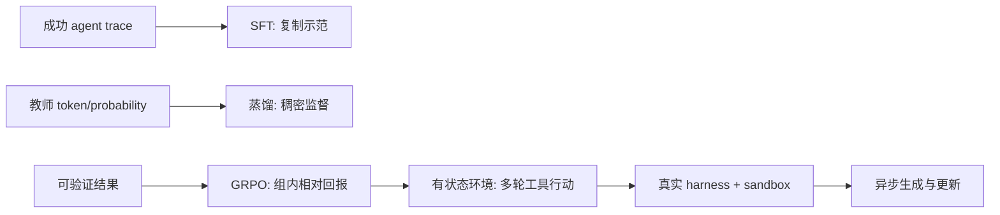

# A curriculum for post-training agents：把 Agent 后训练拆成五种监督信号

> **原文**：Hugging Face，[A curriculum for post-training agents](https://huggingface.co/blog/huggingface/train-agents)，2026-10-20 发布。  
> **类别**：大模型后训练（也覆盖 Agent 训练）。  
> **定位**：一篇课程式技术文章，不是新算法论文；它的贡献是把已有训练器、环境与 harness 组织成可执行的训练顺序。

## TL;DR

1. 文章把 Agent 的后训练排成五级：**SFT → 蒸馏 → 单轮 GRPO → 有状态环境 RL → 通过真实 harness 的异步 GRPO**。每一级改变的不是“模型是否会调用工具”这一表面能力，而是模型接收的监督信号、rollout 的状态性与系统吞吐瓶颈。
2. SFT 学的是更强模型留下的完整 agent trace，便宜且稳定，但只看成功轨迹；模型一旦走错，训练数据没有教它如何从自己的错误中恢复。
3. 蒸馏用教师的 token 或概率提供稠密信号，样本效率通常优于只给整题分数的 RL；代价是受教师能力上限约束，而且 on-policy 蒸馏每一步都要调用教师。
4. GRPO 对同一 prompt 采样多条回答，用组内平均回报作相对基线，提升高于组均值的轨迹概率。文章强调其奖励只有“每个回答一个分数”，因而比 token 级蒸馏稀疏，需要更多尝试。
5. 真正面向 Agent 的跃迁发生在环境与 harness：环境保存状态、执行工具并验证最终产物；harness 则让训练 rollout 走生产中同一套 agent 外壳。文章建议用 `AsyncGRPOTrainer` 让生成与训练分属不同 GPU，避免长 episode 令更新端空转。
6. 可核对的工程锚点包括 TRL 的 `SFTTrainer`、`DistillationTrainer`、`GRPOTrainer`、`AsyncGRPOTrainer`，以及 OpenEnv、远程 sandbox、vLLM。原文未报告统一 benchmark、模型规模、胜率或成本曲线，因此不能把这套课程理解为已被单一实验严格验证的“最优配方”。

## 这篇文章究竟在解决什么问题？

### 不是“给模型接工具”，而是选择模型从何处学习

预训练模型能续写文本，不等于能稳定完成一个多步任务。Agent 执行一次编程、浏览或操作环境的过程，通常包含：读状态、选择工具、观察工具返回、修正计划、提交最终结果。作者把后训练定义为预训练之后的 SFT、蒸馏与强化学习阶段；目标是让模型在这个闭环中遵循指令、用工具，并在失败后继续推进。

文章的核心视角很清楚：训练方案应按**监督信号的来源与粒度**递进，而不是按流行术语罗列。下面的表把原文“Steps at a glance”重新组织为一个决策表。

| 层级 | 模型直接学习什么 | 原文对应训练器 | 需要准备什么 | 最主要缺口 |
|---|---|---|---|---|
| 1. SFT | 强模型产生的 agent trace | `SFTTrainer` | 轨迹数据集 | 未见自身错误与恢复 |
| 2. 蒸馏 | 教师 token 或概率 | `DistillationTrainer` | prompts 与教师模型 | 受教师限制、推理成本高 |
| 3. 单轮 RL | 每个答案的结果分数 | `GRPOTrainer` | prompts 与 reward function | 信号稀疏、无多步状态 |
| 4. 环境 RL | 多轮行动后的环境结果 | `GRPOTrainer` | tasks 与 OpenEnv 环境 | rollout 很慢 |
| 5. Harness + scale | 真实 agent run 的整段回报 | `AsyncGRPOTrainer` | task、环境、harness | 系统一致性与隔离复杂 |

### 作者的论证路线：先复制，再比较，再让世界反馈



这不是声称后一级必然淘汰前一级。相反，文章把它们视为不同资源约束下的课程：当只有可靠 demonstration 时，SFT 是低风险起点；当能调用强教师时，蒸馏能补充更细的 token 信号；当能检验结果却难以写出步骤标注时，RL 才成为合适接口；当任务本质上依赖外部状态，奖励函数必须升格为环境。

## 第一层：SFT 为什么仍然是 Agent 训练的起点？

### Trace 的信息量比“问题—答案”大得多

原文将 agent trace 定义为一次解题的完整录制：每个工具调用以及工具结果都在其中。对 coding agent 而言，trace 不仅有最后提交的代码，还可含读取文件、运行测试、查看报错、再次修改等中间状态。因此 SFT 的监督对象不是一个静态答案，而是条件分布：

\[
\mathcal{L}_{\mathrm{SFT}}(\theta)=-\sum_{t=1}^{T}\log \pi_\theta(a_t\mid x, a_{<t}, o_{<t})
\]

其中 `x` 是任务，`a_t` 是第 `t` 个文本或工具动作，`o_{<t}` 是此前工具观察；训练让策略复现轨迹上的下一个动作。这个写法也说明它的边界：如果数据只保存成功轨迹，条件历史中几乎没有“走错后如何回退”的样本。

### 稳定性来自离线监督，也带来分布偏移

作者称 SFT “cheap and stable”，原因是训练不必在线采样、无需实时运行环境，也不要求 reward 函数。然而部署时模型会面对自己的动作产生的新状态；一处早期误判会将后续上下文推离演示轨迹。原文用“只看到 correct traces、没有学会 recover”点出这一点。

这条观察对 Agent 特别重要：普通问答的一个错误常止于一个答案；多工具任务的错误会改变文件、数据库或页面状态。SFT 因而适合作为行为格式、工具语法和基本策略的底座，却不足以单独证明鲁棒的长期执行能力。

## 第二层：蒸馏把教师知识放到学生自己的轨迹上

### 两种教师信号，以及它们为什么更稠密

原文列出两条蒸馏路径：教师写出训练数据，或教师在学生自己生成的 token 上给出概率。教师可以是更大的模型、多个专家蒸成一个学生（文中以 MOPD 为例），也可以是在额外上下文下的同一模型做 self-distillation。

若以教师分布 `q(\cdot\mid s_t)` 监督学生 `\pi_\theta`，典型目标可写为：

\[
\mathcal{L}_{\mathrm{distill}}=\sum_t \mathrm{KL}\!\left(q(\cdot\mid s_t)\;\|\;\pi_\theta(\cdot\mid s_t)\right)
\]

每个 token 都能给梯度，故称稠密；与只在 episode 末尾给一个 `r` 相比，同一批序列提供更多判别信息。文章据此判断蒸馏通常比 RL 需要更少样本——这是对监督粒度的解释，不是该文新测得的定量结论。

### On-policy 的收益与账单

“在学生自己的 token 上”是关键，因为它直面学生会实际走到的状态，部分缓解 SFT 的分布偏移。但代价也明确：每个训练步骤都要运行教师。教师服务的时延、价格、并发和输出漂移都会进入训练系统；并且学生仍很难超越教师所提供的知识与决策边界。

因此，文章没有把蒸馏描绘成 RL 的简单替代，而把它放在“教师可用且希望更稠密反馈”的位置。对读者而言，这意味着选择蒸馏前应先问：教师是否可靠覆盖目标任务？能否保存或复用概率/轨迹？在线调用成本是否比收集环境 rollout 更可控？

## 第三层：GRPO 用组内相对回报连接“会做”与“做对”

### 原文采用的机制

文章说，GRPO 会为每个 prompt 采样若干答案，对它们全部打分，再提高高于组平均分答案的概率；不另训练一个估值模型来估计哪个尝试更好。令同一输入 `x` 的第 `i` 条轨迹回报为 `r_i`，组均值为 `\bar r`，可用中心化优势直观表示为：

\[
\hat A_i=r_i-\bar r,\qquad \bar r=\frac{1}{G}\sum_{j=1}^{G}r_j
\]

再以 `\hat A_i` 加权策略梯度或 PPO 风格比率项。文章并未给出其完整实现超参数，因此上式是解释“组内比较”而非复刻其具体代码；真正训练仍要处理截断、KL 约束、长度与奖励尺度。

### 为什么这种奖励更弱、但更普适？

RL 所需的只是“检查答案的方法”：如代码是否通过测试、结构化输出是否匹配规范。它不需要教师持续在场，适合结果可验证而中间解法不唯一的任务。代价是每个回答通常只收到一个标量分数，而非每 token 一个教师概率；为分辨好坏，系统必须生成更多尝试。

| 比较维度 | 蒸馏 | 单轮 GRPO |
|---|---|---|
| 反馈粒度 | token/概率级 | answer/episode 级 |
| 外部依赖 | 在线或离线教师 | reward verifier |
| 主要资源 | 教师推理与存储 | 大量 rollout |
| 容易失真的位置 | 教师偏差、teacher ceiling | reward hacking、检查器漏洞 |
| 适合的前提 | 有高质量教师 | 能可靠验收结果 |

文章明确只讨论“plain reward function”下的一次回答、一次打分。复杂 Agent 很少满足这个简化：工具调用会改变状态，任务成败不能在第一轮文本结束时判断，这便引向下一层。

## 第四层：环境把奖励函数升级为状态机

### 环境承担三项不可省略的职责

原文对 RL environment 的定义包含：保持状态、暴露工具并回传结果、检查最终结果。以 coding task 为例，环境运行工具，记录文件或测试状态变化，最终执行测试。它不是一个“把 prompt 发给模型的 wrapper”，而是定义了可行动空间与验收语义。

可以将一个 episode 写为：

\[
s_{t+1}=f(s_t,a_t),\qquad o_{t+1}=g(s_{t+1}),\qquad R=V(s_T)
\]

- `s_t`：环境内部状态，如工作区、服务响应、浏览器会话；
- `a_t`：模型文本或工具动作；
- `o_{t+1}`：环境返回给模型的观察；
- `V`：最终验证器，例如测试是否通过。

这层设计的论证意义在于：把“模型写出看似合理动作”改成“模型在外部世界产生可检验后果”。同时也暴露安全边界——环境若可访问真实网络、凭据或共享文件，训练 rollout 可能造成实际副作用；原文的解决方向是后续的 remote sandbox，而不是假设工具调用天然无害。

### 长 episode 使生成而非反向传播成为瓶颈

原文指出每条 episode 比单一回答更长，生成 rollout 会成为训练最慢部分。这个结论符合 Agent 的实际成本结构：工具延迟、测试时间、容器启动与多轮上下文都会让采样端拉长。单纯提高 GPU 训练吞吐不能消除环境执行时间，反而可能令更新 GPU 等待数据。

## 第五层：harness 决定“训练中的 Agent”是否就是“上线的 Agent”

### Harness 不是模型，也不是环境

文章用 harness 指现有 agent harness：它把模型、工具协议、上下文管理、循环控制和 sandbox 的交互编排成一次完整运行。让训练 rollout 经过“实践中使用的同一 harness”，作者的主张是减少训练/部署接口不一致：模型不只在抽象的环境 API 中学会得分，也在实际 scaffold、工具格式与循环策略中积累行为。

```text
Input: task x, policy πθ, agent harness H, sandboxed environment E
State: transcript τ ← ∅, environment state s ← reset(E, x)
repeat until terminal or budget exhausted:
    a ← πθ(x, τ)
    (s, o, done) ← H.execute(a, E, s)
    τ ← append(τ, a, o)
R ← verifier(E, s, τ)
store(τ, R); update policy from grouped rollouts
Output: updated θ, diagnostics for failures/timeouts
```

伪代码刻意包含 `budget`、`timeout` 和 verifier：完整 agent run 不应只记录成功样本；超时、工具异常、循环调用和污染状态都应成为可观测失败边界。原文没有给出某个 harness 的失败率，因此这些是从其系统边界导出的实现检查点，而非作者已验证的实验数据。

### AsyncGRPO 的系统含义

原文最后一层让生成与训练分到不同 GPU：长 episode 在一侧生成，训练器在另一侧更新，随后将更新权重送回 vLLM。其目标是避免训练器因等待 rollout 而空闲。可将粗略有效吞吐写为：

\[
\mathrm{throughput}\approx\frac{N\times L}{\max(T_{\mathrm{rollout}},T_{\mathrm{update}})}
\]

这里 `N` 是并发 rollout 数、`L` 是每条 token 或动作量。异步并不自动提高质量：若权重同步滞后过大，采样轨迹来自旧策略；若 sandbox 不可复现，奖励会带噪。文章提供的是架构方向和 TRL/OpenEnv 入口，并没有公布最优并发、陈旧度阈值或端到端加速比。

## 证据清单：原文展示了什么，没有展示什么？

### 把五层课程转成可审计的训练设计

原文给的是学习路径，不是一份可直接比较的实验表；但它足以导出一张实验记录应当具备的最小清单。若团队声称自己已从 SFT 走到环境 RL，读者不应只看到“用了 GRPO”这一标签，而应能逐层回答以下问题。

| 训练层 | 应记录的输入与版本 | 应记录的过程指标 | 应记录的失败样本 |
|---|---|---|---|
| SFT | trace 来源、工具 schema、成功判定 | token 覆盖、格式合法率、held-out trace NLL | 非法调用、提前结束、恢复缺失 |
| 蒸馏 | 教师版本、上下文、温度、概率是否保存 | KL、教师调用量、学生偏好变化 | 教师幻觉被复制、版本漂移 |
| GRPO | reward 代码、组大小、采样参数 | 回报分布、组内方差、KL、长度 | 钻 verifier 漏洞、投机式输出 |
| 环境 RL | 镜像/数据快照、reset 逻辑、工具权限 | episode 长度、超时率、状态转移 | 污染状态、不可重放、工具异常 |
| Harness 异步训练 | harness commit、权重同步策略、sandbox 镜像 | 生成/更新利用率、策略陈旧度 | 版本不一致、死循环、资源泄漏 |

这张表并非原文声称已经完成的实验协议，而是对其“每层需要什么资产”的严格化。它尤其强调了一个常被遗漏的事实：环境、harness、verifier 和 sandbox 都是训练数据生成器的一部分。它们一旦改动，哪怕模型 checkpoint 相同，得到的策略分布也可能不同。

### 一个可操作的课程选择顺序

以下决策流程把文章的叙述翻译为研究者可复核的判断，而不是机械地把所有层都串起来。

1. **先检查接口**：如果模型连工具 JSON、观察消息和基本终止格式都不稳定，优先收集或合成高质量 trace 做 SFT；此时直接上长链 RL 往往会把格式错误误归为“探索不足”。
2. **再检查教师可得性**：若有更强模型且能为学生自己的状态给出 token 级判断，蒸馏能提供高密度纠错；若教师只会产生表面流畅却不可执行的轨迹，应先审计 trace，而非放大其权重。
3. **随后检查验收器**：只有在结果能以测试、约束或任务完成状态稳定验收时，GRPO 的标量奖励才有意义。奖励不可靠时，更多 rollout 只会更高效地学会利用漏洞。
4. **最后检查状态与部署一致性**：任务是否真的需要多轮状态、工具副作用和真实 harness？若答案是否定的，单轮 verifier 可能更简单也更易复现；若答案肯定，就必须把 sandbox 隔离、reset 与超时列为实验条件。

这个顺序也解释了为什么文章把“harnesses and scale”放在最后：它不是装饰层，而是在前面各类信号已经可用后，检验策略能否在真实执行外壳中持续工作的一道系统门槛。

### 评价时应同时看三条曲线

仅报告最终通过率会掩盖课程的真实代价。建议将结果至少拆成三条曲线：**能力**（任务验证通过率）、**效率**（每个有效成功消耗的 token、教师调用或环境时间）与**可靠性**（超时、工具失败、越权和不可重放比例）。例如，某个环境 RL 版本即使最终分数更高，若成功主要来自更长 rollout 或更宽松的 reset 条件，就不能与 SFT 基线作直接的“算法优越”比较。文章没有给出这些曲线，正好提醒后续复现者将它们作为补充证据。

### 已直接展示的证据

1. 页面明确标记为 **Community Article**，2026-10-20 发布，并由 Hugging Face 组织关联作者署名；它应被读作实践课程，而非同行评审论文。
2. 原文明确列出了五个步骤、每步的学习对象、TRL trainer 与所需资产。
3. 它给出可跟随的材料入口：SFT、蒸馏、GRPO、RL environments 的课程/文档，以及 Async GRPO、OpenEnv harness 的文档链接。
4. 页面关联的课程集合中，GRPO collection 标注为近期更新；这支持“配套教学资产存在”，但不构成某模型性能提升的实验结果。

### 不能从文章推出的结论

| 常见误读 | 为什么不能推出 |
|---|---|
| 五层课程必然优于只做 SFT | 没有同预算、同模型的消融表 |
| AsyncGRPO 已带来确定倍数的加速 | 原文未给 wall-clock、GPU 数或吞吐曲线 |
| 环境 RL 让 Agent 更安全 | 文中强调 sandbox，但没有安全攻击评测 |
| GRPO 自动避免 reward hacking | 组内相对比较不修复 verifier 漏洞 |
| 教师蒸馏总会比 RL 更省数据 | 这是基于反馈密度的机制判断，具体取决于任务与教师 |

### 风险不只在算法：五层各自引入攻击面

课程面向 Agent 时，训练效率与安全隔离不能拆开讨论。SFT 的风险是采集到含敏感工具输出或不安全示范的 trace；蒸馏的风险是把教师的偏好、提示泄漏或错误置信度系统性复制给学生；GRPO 的风险是 verifier 被投机；环境 RL 的风险是工具真正改动外部状态；harness 级训练则把密钥注入、网络出口、日志保存和容器逃逸都带入训练面。

因此“one sandbox per rollout”一类工程建议的价值不是仅为并发。隔离应让每次尝试的文件系统、凭据、网络策略与清理边界可声明、可审计、可重置。若 reward 只检查最终测试通过，却未检查数据外泄、越权访问或异常网络行为，训练会把这些未被惩罚的捷径视为可接受动作。原文没有展开安全评测，这正是将其应用于高权限 Agent 前必须补上的边界。

## 与相关工作的关系：它提供的是“接口层地图”

文章把 SFT、on-policy distillation、GRPO、环境 RL 和多 harness 训练并排，并非提出新的 `\mathcal{L}` 或 benchmark。它最有价值的地方是把训练算法与 Agent 系统接口对应起来：trace 对应记录，教师对应 token 监督，verifier 对应结果监督，环境对应状态，harness 对应部署运行时。

对后训练研究者，这张地图有助于避免把算法问题与基础设施问题混为一谈。例如，当 reward 很弱时，先改善 verifier 可能比换优化器更重要；当 rollout 慢时，增加数据并不解决 sandbox 与工具延迟；当离线分数很好、上线失败时，harness 差异可能比模型参数更值得排查。

## 结论与继续追问

这篇文章最值得带走的判断是：**训练 Agent 不是为同一模型不断追加“更强的 RL”，而是逐步让训练信号接近部署时会遇到的状态、工具和验收条件。** SFT、蒸馏与 GRPO 分别回答“模仿谁”“由谁逐 token 纠正”“如何按结果比较”；环境与 harness 则回答“结果在何处发生、训练是否复现真实运行时”。

仍有四个研究缺口值得继续追问：

1. 如何在相同模型、算力、任务与 harness 下量化五层课程的边际收益？
2. 怎样报告 environment verifier 的覆盖率、误判率和被 exploit 的失败案例，而不只报告 reward？
3. 异步采样的权重陈旧度、环境非确定性与分布式 sandbox 失败如何影响策略稳定性？
4. 当 Agent 工具触及代码执行、网络或私有数据时，训练 sandbox 的权限、审计与回滚应如何成为优化目标的一部分？

这些问题也划出本文的证据边界：它是一份强有力的训练路线图和工具索引，却尚不是关于“何种 Agent 后训练最有效”的实证定论。

## 参考

1. Hugging Face, [A curriculum for post-training agents](https://huggingface.co/blog/huggingface/train-agents), 2026-10-20.
2. 原文链接的 TRL trainers、OpenEnv 与相关课程集合（以发布页面为准）。
