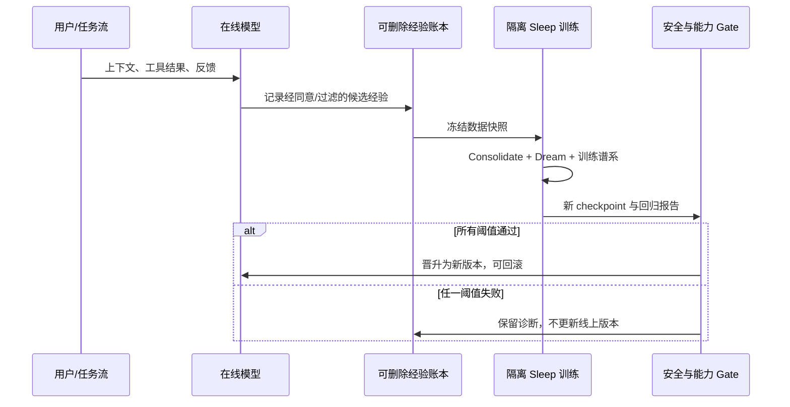

# Sleep 框架：把上下文里的短期经验写入参数，能否让语言模型持续学习？

> **原始发布**：Google Research，2026-10-27｜[官方解读](https://research.google/blog/the-sleep-framework-a-new-way-for-llms-to-retain-knowledge-in-continual-learning/)｜论文：[arXiv:2606.03979](https://arxiv.org/abs/2606.03979)
>
> **类别**：大模型后训练 / 持续学习｜**条目 ID**：`itm_81b4d1f2550db13b`

## TL;DR

- Google Research 用 ``Sleep`` 描述一种周期性后训练：模型在 **wake** 阶段用上下文接收新信息，在离线 **sleep** 阶段把其中可泛化的部分迁移到新扩展的低频参数，再用筛选过的合成 ``dream`` 做强化式复练。
- 关键不是把 10M token 塞进注意力窗口，而是把长上下文中的任务信息压缩为参数记忆；因此它要回答的是“如何以受控更新抵抗遗忘”，不是“如何把上下文窗口做大”。
- 方法将 Hope 的多频记忆结构与两件事结合：**Knowledge Seeding**（小网络到扩展网络的 on-policy 蒸馏 + 语义/编辑距离奖励）和 **Dreaming**（随机专家路由、梯度式样本筛选、RL 复练）。
- 作者报告：Qwen3-8B 上 AIME-24 / AIME-25 / HMMT-25 为 **79.2 / 69.0 / 46.1**（average@16）；SQuAD 新知写入中，四层 Sleep 在单 passage / 200-passage CPT 为 **48.9 / 46.2**，高于 SEAL 的 **46.7 / 43.2**；ARC 少样本任务成功率 **80%**，而 SEAL 为 72.5%。
- 但这些是作者的受控实验，骨干模型为 Llama-3B、Llama3-8B、Qwen3 与 Llama-3.2-1B 的不同设置；没有生产系统的持续在线用户数据、扩展成本、可删除性、安全回归或独立复现。尤其“模型自行改权重”会让评测对象从一个静态 checkpoint 变成版本序列，审计难度显著上升。

## 这篇工作真正试图解决什么？

部署后的语言模型通常只能在两个极端中选一边：

| 路径 | 得到什么 | 失去什么 | Sleep 的切入点 |
| --- | --- | --- | --- |
| 只用 ICL / RAG | 立即读到新资料，参数不动 | 会话结束后不保留；超长输入检索会退化 | 把临时表征转成可复用的长期表征 |
| 反复 SFT / 继续预训练 | 新知识进入权重 | 旧技能可能被覆写，更新昂贵 | 预留/扩展容量，避免直接覆盖已有权重 |
| 静态模型 | 版本稳定、易评估 | 知识截止日固定 | 将更新限定为离线周期和明确训练规则 |

作者借“睡眠”作比喻，但边界很明确：没有修改模型的基本架构，也不是无约束的自我设计；人仍决定架构、数据流程、奖励和何时触发周期。它的研究问题可以写为：

$$
\text{如何把短期轨迹 } H_{\mathrm{wake}} \text{ 压缩为长期参数 } \theta_{\mathrm{slow}}\text{，同时令旧任务损失不显著上升？}
$$

其中 $H_{\mathrm{wake}}$ 是当前会话中由上下文与快速记忆承载的经验，$\theta_{\mathrm{slow}}$ 是较低更新频率的长期模块。若只最小化新数据损失，常见结果是灾难性遗忘；若完全不改参数，知识又只停留在上下文里。

## 作者的论证路线：主张、机制、证据与没有证明的事

| Claim | 机制 | 论文/官方页给出的证据 | 仍不能证明什么 |
| --- | --- | --- | --- |
| 记忆可跨周期保留 | 向扩展网络的 Knowledge Seeding | 新语言连续学习中 Hope-3 接近单语言成绩，ICL 明显回落 | 未给出真实用户知识流上的长期遗忘曲线 |
| 长上下文可以被“写进”模型 | 多层低频记忆 + sleep-time 蒸馏 | BABILong 在约 1M 后仍稳定，图示延至 10M | 这不是对 10M 原始 token 的逐 token 注意力，也不等于通用长文理解 |
| consolidation 有助于推理 | on-policy 分布对齐与语义奖励 | Qwen3-8B 三个数学集优于 SFT、GRPO、OPSD | 训练预算、数据配方和每个 baseline 的最优调参是否对等，公开描述不足 |
| dreaming 不是可有可无 | 生成、筛选、复练的闭环 | SQuAD 200-passage：完整四层 46.2；移除 dreaming 36.2 | 合成数据的污染、隐私和 reward hacking 尚未在生产条件下检验 |

这个表格也解释了为什么不能把标题里的“self-improve”理解成性能必然单调上涨：实验确实展示若干测评上的提升，但每一次 sleep 都是一个新的模型版本；若没有冻结数据、回归集和可回滚版本，旧能力、隐私与安全属性都可能跟着变。

## 从 wake 到 sleep：两个阶段怎样连接？

### 1. Wake：快、短、会失效的上下文适应

- 输入 $x_t$ 先经高频模块与上下文状态处理；Hope 的 continuum memory 让不同层以不同频率更新。
- 这一步比“模型什么都不记得”强，但它仍受序列结束、检索频率与固定容量限制。
- 作者特意把 online consolidation 与本工作分开：已有 Hope/Nested Learning 能将快速记忆向慢模块传播，却没有额外容量和显式离线的有损抽象，因此只能**推迟**遗忘。

### 2. Consolidation：Knowledge Seeding 不是简单微调

Sleep 时首先扩展参数容量，例如解锁预分配的低秩 MoE 专家；旧的较小网络担任教师，扩展后的学生吸收其在自己采样轨迹上的行为。抽象写成：

$$
\mathcal{L}_{\mathrm{KS}} = \lambda_{\mathrm{OPD}}\,\mathcal{L}_{\mathrm{on\text{-}policy\ distill}}
+ \lambda_{\mathrm{sem}}\,\bigl(1-r_{\mathrm{sem}}\bigr)
+ \lambda_{\mathrm{abs}}\,\bigl(1-r_{\mathrm{abs}}\bigr).
$$

| 符号 | 含义 | 设计意图 |
| --- | --- | --- |
| $\mathcal{L}_{\mathrm{OPD}}$ | 在学生自己采样的前缀上对齐教师分布 | 减少只看教师轨迹造成的 train–inference 分布偏移 |
| $r_{\mathrm{sem}}$ | 语义相似度奖励 | 不把蒸馏缩成逐 token 的死记硬背 |
| $r_{\mathrm{abs}}$ | 由 Levenshtein 距离归一化的字面一致性奖励 | 保留需要精确复现的形式信息 |
| 扩展专家 | 新增、低秩的参数容量 | 让新知识有“写入处”，少直接扰动旧参数 |

完成后，作者会重置高频的临时部分以腾出下一轮 wake 的容量。这个 reset 是效率上的关键，也是风险上的关键：它意味着最终留下的是被蒸馏的压缩表示，而不是可逐条检查的原始会话日志。

### 3. Dreaming：用什么“梦”，谁来判定梦有价值？

Dreaming 阶段不再直接复放原始数据，而是让 MoE 路由随机激活非常规专家，生成合成经验；随后用梯度相关的选择器保留预计最有学习价值的样本，最后 SFT/RL 复练并检查下游改进。其逻辑链是：随机专家增加更新方向的多样性，筛选避免把全部自生成文本当训练集，奖励只为带来改善的 dream 赋值。

```text
Input: wake 轨迹 H、稳定参数 θ、可解锁专家 E、评测/奖励 R
State: θ_fast, θ_slow, replay buffer B
for each scheduled sleep cycle:
    θ_exp ← expand(θ_slow, E)                 # 给新知识新增容量
    T ← sample prefixes from H with θ_exp      # 使用学生自己的轨迹
    θ_exp ← optimize Knowledge-Seeding(T)      # OPD + 语义/字面奖励
    D ← generate dreams(random-route(θ_exp))
    B ← select_by_gradient_utility(D)          # 仅保留有信息量的样本
    θ_slow ← RL/SFT update(θ_exp, B, R)
    reset(θ_fast)
Output: versioned θ_slow
Failure boundary: 若 R 未覆盖旧任务、隐私或安全约束，更新可提升目标分数却损害未测属性
```

## 实验设置：每个实验在测不同的“记住”

| 实验簇 | 骨干与协议 | 对比 | 它检验的不是/是 |
| --- | --- | --- | --- |
| 类增量分类 | Llama-3B / Llama3-8B；CLINC、Banking、DBpedia | ICL、EWC、InCA、Hope | 是顺序加入类别后是否遗忘；不是开放世界知识更新 |
| 长上下文 | LongHealth、QASPER、MK-NIAH；BABILong | ICL、DuoAttention、Cartridges、RMT/ARMT/Titans、GPT-4/4o-mini | 是长输入内的信息保留/压缩；不是宣称任意 10M 文本均可准确理解 |
| 新语言 | MTOB + Manchu；再连续加入 Kalamang | ICL、SFT、Cartridges、Hope-1/2/3 | 是相继学习未知语言后的相互干扰 |
| 数学推理 | Qwen3-1.7B、Qwen3-8B；average@16 | Base、SFT、GRPO、OPSD | 是固定 benchmark 上的效果；不是一般智能增益 |
| 新知写入 | SQuAD；单 passage 与 $n=200$ CPT | Base、无 dream FT、SEAL、2/4 层 Sleep | 是无上下文问答中是否写入新事实 |
| 少样本抽象 | Llama-3.2-1B；11 train / 8 held-out ARC 任务 | ICL、TTT、SEAL | 是小范围受控结构泛化；样本很小 |

## 主结果：数值应该怎样读？

### 数学推理：完整组合有提升，但每个组件的作用不完全一致

| Qwen3-8B，average@16 | AIME-24 | AIME-25 | HMMT-25 |
| --- | ---: | ---: | ---: |
| Base (Instruct) | 73.8 | 68.1 | 42.4 |
| SFT | 75.5 | 66.4 | 43.7 |
| GRPO | 76.4 | 68.1 | 44.9 |
| OPSD | 76.6 | 67.4 | 45.1 |
| **Sleep** | **79.2** | **69.0** | **46.1** |

- 对 Base 的绝对提升分别为 **+5.4、+0.9、+3.7** 点；对 OPSD 为 **+2.6、+1.6、+1.0** 点。
- 这支持“在 on-policy 轨迹上蒸馏 + 扩容”在此协议优于几种后训练配方，但不能分离出数据量、采样温度、训练时长和实现细节各自贡献。
- 论文的组件表也很有用：移除 imitation 后为 76.8 / 67.9 / 45.0；移除 semantic reward 后为 78.9 / 69.2 / 44.5；去掉 expansion 后为 78.2 / 67.9 / 44.9。AIME-25 上 semantic-ablation 的 69.2 甚至略高于完整模型的 69.0，提醒读者不要把“所有组件在每个指标都严格单调有效”读进去。

### 新知写入与 dreaming 消融：这是最直接的机制证据

| SQuAD 无上下文准确率 | 单 passage $n=1$ | CPT $n=200$ |
| --- | ---: | ---: |
| Base | 31.9 | 31.9 |
| 无 dreaming 的微调 | 33.4 | 32.0 |
| SEAL | 46.7 | 43.2 |
| Sleep Transformer | 48.1 | 44.3 |
| **Sleep Transformer + 四层** | **48.9** | **46.2** |
| 去掉 gradient selection | 47.1 | 45.2 |
| 去掉 random expert | 48.0 | 44.7 |
| 去掉 dreaming | 35.7 | 36.2 |

在 200-passage 条件，作者对全部 974 个关联问题评测、每个 passage 采样 5 个 dreams。最显眼的是移除 dreaming 降到 36.2：这使“只是多层架构更强”不足以解释结果。不过它也把因果结论限定在该数据集、该 dream 生成和选择器上；尚未证明任何自生成训练都会安全地改善知识写入。

### 长上下文与连续翻译：Figure 的信息不是单一榜单

- **Figure 5（连续新语言翻译）**：坐标分别对应 Manchu→English 与 Kalamang→English 的 ChRF。单语言时 Hope 变体不弱于 ICL；连续加入两种语言后 ICL 接近预训练行为，更多 consolidation stage 的 Hope 更接近单语言点。SFT 与 Cartridges 至少在一个语言上发生严重遗忘，甚至弱于 ICL。
- **Figure 6（BABILong）**：大模型在约 128K–256K 后快速退化；RAG 较耐受却随长度增长下降；经过官方 BABILong protocol 微调的小模型在约 1M 前相近，但 Hope 在图中延至 10M 仍稳定，而 Titans/ARMT 明显下降。
- **Table 4（ARC）**：ICL 0%、TTT 10%、SEAL 72.5%、Sleep 80%。作者在每个任务抽 60 个 dreams、拒绝 45 个；测试时每个未见任务生成 5 个 dream 再预测。因此 80% 是特定过滤和采样预算下的成功率，不是无需搜索的单次解题准确率。

## 图表、公式与效率：哪些证据最值得保留？


- Figure 1 的核心是状态转换：wake 和 sleep 不是训练/推理一次性切分，而是生命周期中反复交替。
- Figure 5/6 共同服务“保留”的主张，却分别测顺序语言技能和超长输入压缩；两张图不可相互替代。
- Table 1 是 consolidation 本身的消融，Table 3 是完整 Sleep 加 dreaming 的消融；把二者混为“统一提升”会掩盖两阶段各自的假设。
- 附录的效率比较给出一个很窄的结论：同样 step 数，SFT 约快 4 倍；若要求达到 Sleep 在三项数学集上的相同性能，作者报告 SFT 需 4.3×、3.6×、4.8× wall-clock。该比较依赖目标分数与硬件/实现，不能推出 Sleep 在所有预算下更便宜。

## 把公式展开：为何“on-policy + 奖励”比普通蒸馏多一层约束？

普通知识蒸馏可被理解为在教师产生的序列 $y\sim p_T$ 上，让学生 $p_\theta$ 逼近教师分布；但部署时真正出现的是学生已写出前缀、再继续生成的序列。因此论文把训练轨迹改为学生自己的采样前缀：

$$
\mathcal{L}_{\mathrm{OPD}}
= \mathbb{E}_{\hat y_{<t}\sim p_\theta}
  \left[\operatorname{KL}\bigl(p_T(\cdot\mid \hat y_{<t})\,\Vert\,p_\theta(\cdot\mid \hat y_{<t})\bigr)\right].
$$

- $p_T$ 是扩展前/教师侧在同一前缀下的分布；$p_\theta$ 是正在写入长期容量的学生。
- ``on-policy`` 的好处是学生必须在自己容易偏离的轨迹上学习回正，而非只在教师永远正确的轨迹上背答案。
- 但 KL 对齐本身无法区分“词面相近却语义错误”和“换说法但任务完成”。所以作者再引入语义奖励与基于编辑距离的绝对奖励。
- 奖励项不是外部事实验证器。它衡量的是所定义的相似/改善信号；若 teacher、语义模型或下游判别器本身偏差，学生会忠实压缩那种偏差。

从持续学习角度，扩容可表示为把原参数嵌入更大参数空间：

$$
\theta_{\mathrm{exp}} = [\theta_{\mathrm{old}};\Delta\theta_E],
\qquad
\min_{\Delta\theta_E}\; \mathcal{L}_{\mathrm{KS}}
+ \beta\,\mathcal{L}_{\mathrm{retain}}(\theta_{\mathrm{old}}).
$$

这里 $\Delta\theta_E$ 是新专家/低秩容量，$\mathcal{L}_{\mathrm{retain}}$ 代表旧行为的保持压力。论文的工程直觉很合理：若新知识只能写入 $\theta_{\mathrm{old}}$，每次更新都在和旧知识争同一组自由度；若可以写入新块，就可把“哪里存新信息”变为显式设计选择。但 $Delta\theta_E$ 不会免费：需要决定专家的大小、路由、合并、失效与服务时加载策略。

## 逐项看消融：它们说明了什么，也没有说明什么？

### Knowledge Seeding 的三个部件

| 消融 | Qwen3-8B 观察 | 合理解释 | 不宜过度推断 |
| --- | --- | --- | --- |
| 去 imitation learning | 三集均低于完整模型 | 单纯分布蒸馏不够，序列完成的奖励补足任务行为 | 不能推出任意 imitation reward 都会改进推理 |
| 去 semantic reward | AIME-24/25 为 78.9/69.2，HMMT-25 为 44.5 | 语义约束对某些题集更重要 | AIME-25 的 69.2 高于完整 69.0，故没有统一单调优势 |
| 不扩容 | 78.2/67.9/44.9 | 新的可写容量帮助降低干扰 | 没有给出等参数量的替代架构比较 |

这三项的正确读法是“完整方案在平均上较好，并且各部件在至少部分评测中有贡献”，而非“每一个科学直觉都被独立、充分地因果证明”。尤其数学指标只有三列，差异在不同集上不一致；若要稳健结论，需多随机种子、置信区间和统一算力预算。

### Dreaming 的三个部件

| 消融 | SQuAD $n=1$ / CPT $n=200$ | 对机制的信号 |
| --- | ---: | --- |
| 完整四层 Sleep | 48.9 / 46.2 | 这是作者的最好配置 |
| 无 gradient selection | 47.1 / 45.2 | 不是所有合成 dream 等价，选择器可能在去噪 |
| 无 random expert | 48.0 / 44.7 | 多样路由可能对困难的连续场景更有帮助 |
| 无 dreaming | 35.7 / 36.2 | 单有 consolidation 不足以达到完整方案表现 |

作者将随机专家解释为扩大梯度方向，梯度选择解释为保留有效 rehearsal。这个解释与结果方向一致，但它没有把每个被保留 dream 的事实性、毒性、版权或私密信息风险逐条展示出来。对于真实交互学习，必须在“学习信号大”之外再加数据治理和安全过滤；否则高 utility 只代表对当前评分函数有用。

## 训练与评估协议的细节：为何不能只盯着最高分？

- **数学结果采用 average@16。** 这意味着每题有多次采样/聚合；它不同于单次 greedy accuracy。比较时应让所有 baseline 使用相同采样数、提示、温度和验证规则，论文摘要页没有逐项展开这些条件。
- **SQuAD 不是检索增强问答。** 表中的评测是 no-context：目标是考察 passage 中的新事实是否已进入参数。它因此很适合检验“写入”，却无法评估带引用的回答质量或检索系统的实时更新能力。
- **BABILong 的 10M 不是在线窗口主张。** 小模型遵循官方训练协议，Sleep 利用离线 consolidation 做紧凑表征；相比之下 GPT-4/4o-mini、Llama-8B+RAG 和其他小型长记忆模型的训练/推理条件并不相同。图展示趋势很有信息量，但不构成跨产品成本比较。
- **ARC 样本量很小。** 训练 11 个、保留 8 个任务；每训练任务 60 dream 中拒绝 45 个。这个严格的筛选恰好说明选择器很重要，也意味着数字会对任务抽样和评判器敏感。
- **连续翻译使用未见语言。** Manchu 与 Kalamang 的顺序干扰是漂亮的诊断任务，但现实知识流会同时包含矛盾事实、时间漂移、多个领域和隐私约束，难度不只在遗忘。

## 如果把它部署成 Agent 的记忆层，系统约束应该怎样改变？

Sleep 很容易被误解成“Agent 可以边工作边训练自己”。论文实际描绘的是一个应当隔离的离线更新循环。更合理的系统结构如下：

1. **在线层只收集候选经验。** 工具调用、用户上下文和任务反馈先进入可访问控制、可删除的事件存储；不可直接把原始对话当作 dream 训练集。
2. **离线层生成受限更新。** 用固定的模型版本、数据快照、允许的专家与明确奖励运行 consolidation；随机路由也应可复现地记录随机种子。
3. **评测层阻断不合格版本。** 目标任务、旧技能、红队、安全拒答、隐私攻击与偏差集构成 release gate；任一关键维度退化，更新不晋升。
4. **服务层维持可回滚性。** 每个 $\theta_{\mathrm{slow}}^{(k)}$ 有不可变版本号、训练谱系和生效范围；发生异常时回到 $k-1$，而非希望下一轮 dream 自动修复。



这套流程没有改变论文的核心，但补上了论文未展开的治理条件：模型能吸收经验不等于它应该吸收全部经验；参数记忆越难解释，就越要让输入和版本边界变得可解释。

## 相关工作中的位置：它与 RAG、长上下文、SEAL 有什么不同？

| 路线 | 主要记忆位置 | Sleep 的差异 | 尚未替代的能力 |
| --- | --- | --- | --- |
| RAG | 外部索引与检索结果 | Sleep 希望把抽象写入参数，减少每次读取负担 | 可引用、可删除、可逐条溯源仍是 RAG 的长处 |
| 长上下文/KV 压缩 | token / KV 表征 | Sleep 是离线参数 consolidation | 不能保证原文细节可精确恢复 |
| EWC 等正则化 CL | 权重更新受约束 | 增加容量且用 on-policy/奖励蒸馏 | 仍需验证更多任务序列 |
| SEAL/自适应 LM | 自生成更新 | 加入多层记忆、随机专家、梯度选择 | 合成数据质量与安全对齐问题依旧存在 |
| Titans、RMT、ARMT | 不同形式的长期/递归记忆 | 作者的实验强调 sleep-time parameter transfer | 跨架构、公平算力和训练数据比较仍不完整 |

## 证据边界、失败模式与可复现性

### 已被这组实验支持的判断

- 在作者给定的多个受控任务和骨干上，周期性 consolidation 与 dreaming 的组合通常优于所列 baseline。
- 多个 consolidation level 与较低频的稳定记忆，在文中长上下文和连续学习设置中相关于更好的保留。
- dreaming、梯度样本选择、随机专家都不是纯装饰；SQuAD 消融显示去除它们会损失一部分或大量分数。

### 仍是开放问题，且与 AI 安全直接相关

1. **更新后要评什么？** 传统静态模型只须评一个 checkpoint；Sleep 需要在每周期后保留能力、安全、偏差、隐私和拒答回归集，并能定位哪次 dream 造成变化。
2. **用户资料能否被“写入”又删除？** 从上下文压缩到参数可能使删除请求、成员推断与训练数据泄漏比外部存储更难治理；论文未给出此类测量。
3. **奖励遗漏会怎样？** 伪代码中的 failure boundary 并非细枝末节：若 $R$ 只奖励任务分数，模型可以在未覆盖的安全约束上退化；随机专家增加探索也可能扩大意外行为面。
4. **容量和成本如何随周期增长？** “扩展专家”避开覆写，却会带来路由、存储、服务延迟及何时回收专家的工程问题；10M 展示不能替代端到端成本曲线。
5. **可复现性如何判断？** 论文提供明确任务、若干骨干和 Table 5 配置，但官方博客是二次阐释、论文是 arXiv v2，尚无同行评议或独立复现；应把所有 headline 数字视为作者报告，而不是已定论。

## 研究者视角：下一步最值得做的不是再造一个“会做梦”的标签

更严格的后续研究应把 Sleep 视为一个**状态会迁移的训练系统**，而非单一模型技巧：

- 为每个 sleep cycle 记录数据来源、路由、dream、选择分数、参数差分与固定回归结果，形成可审计的更新谱系。
- 在同一算力、相同新知识量、相同外部检索预算下，对 RAG、长上下文、LoRA/MoE 扩容和 Sleep 比较“记住、遗忘、可删除、成本”四条曲线。
- 将安全评测嵌进奖励和 gating：只有目标任务、旧任务和安全集均不退化时才允许版本晋升；否则回滚而不是把失败当作下一轮训练材料。
- 将隐私与遗忘作为一等实验指标。若长期记忆来自交互数据，成功并不只是 SQuAD 分数更高，而是能否证明敏感片段没有被不当保留或复述。

Sleep 最有价值的贡献，是把“模型从会话中学到东西”拆成可研究的容量、蒸馏、样本选择与版本治理问题。它提供了一条有具体实验支撑的路线，但离安全、低成本、可删除且可长期运营的持续学习系统仍有很长距离。
